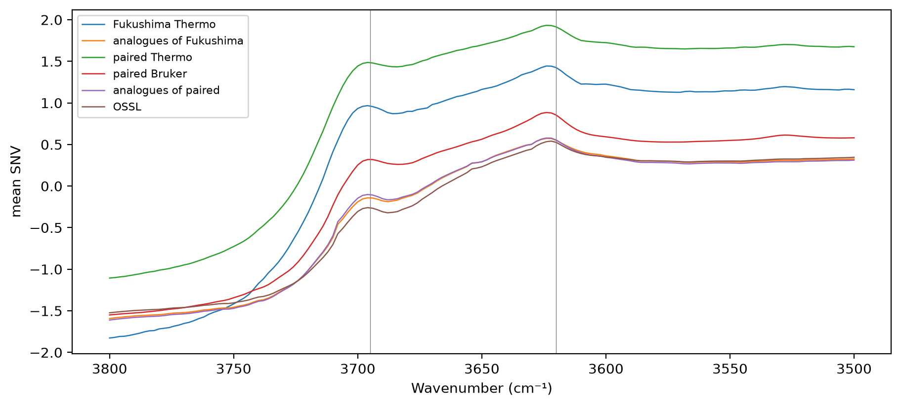

# Al–OH band


<!-- WARNING: THIS FILE WAS AUTOGENERATED! DO NOT EDIT! -->

``` python
import pandas as pd
import matplotlib.pyplot as plt
from scipy.stats import spearmanr
from sklearn.neighbors import NearestNeighbors
from sklearn.preprocessing import StandardScaler
from fastcore.test import *
from soilspecdata.all import load_ossl
from soilspectfm.preprocessing import SNV
from ossl_fuku_transfer.data import *
from ossl_fuku_transfer.moisture import band_height
```

`17_importance` found that the OSSL Kex model relies most densely on
3600–3700 cm⁻¹, with the Al–OH stretching band of illite, smectite and
kaolinite near 3620 cm⁻¹ the most important window. `16_moisture` found
the Thermo spectra much higher than their OSSL analogues between 3450
and 3700 cm⁻¹. A broad absorption there could hide the sharp band. This
notebook measures the band directly.

The module part uses small random arrays, so it runs without the data.
The sections from *Data* onwards read OSSL and the Fukushima data, and
are marked `#| fukudata`.

## Band depth

`band_depth` measures how sharp a band is: minus the minimum of the
Savitzky-Golay second derivative within `half` cm⁻¹ of `center`. A sharp
band gives a deep negative second derivative, and a broad absorption
underneath it adds almost nothing. A window of 11 points is 22 cm⁻¹ on
the 2 cm⁻¹ grid. `sharp_bands` holds the two bands measured here, with
the ranges and anchors that `band_height` uses for the second measure:

------------------------------------------------------------------------

### band_depth

``` python
def band_depth(
    X, # Spectra, one per row
    wns, # Wavenumbers of the columns of `X`, evenly spaced
    center, # Band centre, in cm⁻¹
    half:int=6, # Half-width of the search range, in cm⁻¹
    window:int=11, # Savitzky-Golay window, in points
)->numpy.ndarray: # One depth per spectrum, positive for a band
```

*Minus the minimum of the second derivative of `X` within `half` of
`center`*

``` python
wns_syn = np.arange(3400, 3800, 2.)
broad = np.exp(-0.5 * ((wns_syn - 3500) / 150)**2)
sharp = np.exp(-0.5 * ((wns_syn - 3620) / 8)**2)
d = band_depth(np.stack([broad, broad + 0.1 * sharp, 3 * broad + 0.1 * sharp]), wns_syn, 3620)
test_eq(d[0] < 0.02 * d[1], True)
test_close(d[1], d[2], eps=0.05 * d[1])
```

## Data

SNV spectra on 650–3996 cm⁻¹, the range the Bruker exports cover: the
Fukushima Thermo spectra of the current selection, the Thermo and Bruker
spectra of the paired soils, 10,000 random OSSL spectra, and each
Fukushima soil’s OSSL analogue, matched as in `12_wetchem`. Kex and clay
come from `fuku_shared_props` and `ossl_shared_props`:

``` python
pw = shared_wns[:-1]
snv = SNV()
om = load_ossl().mir(wmin=shared_wns[0], wmax=shared_wns[-1])
ossl = ossl_shared_props(om)
op = prop_features(ossl)
sc_p = StandardScaler().fit(op)
nn = NearestNeighbors(n_neighbors=1).fit(sc_p.transform(op))
opos = pd.Series(np.arange(len(om.sample_ids)), index=om.sample_ids)
def analogues(ids):
    fp = prop_features(fuku_shared_props(ids))
    return fp.index, op.index[nn.kneighbors(sc_p.transform(fp))[1][:, 0]]
f_ids, f_an = analogues(sample_ids())
p_ids = [i for i in sorted(bruker_files(), key=int) if i not in excluded and i in set(spa_files())]
p_ids, p_an = analogues(p_ids)
o_sub = np.random.default_rng(0).choice(len(om.sample_ids), 10000, replace=False)
spec = {'Fukushima Thermo': snv.fit_transform(load_fuku(pw, list(f_ids)).spectra),
        'analogues of Fukushima': snv.fit_transform(om.spectra[opos[f_an].to_numpy()][:, :-1]),
        'paired Thermo': snv.fit_transform(load_fuku(pw, list(p_ids)).spectra),
        'paired Bruker': snv.fit_transform(load_bruker(pw, list(p_ids)).spectra),
        'analogues of paired': snv.fit_transform(om.spectra[opos[p_an].to_numpy()][:, :-1]),
        'OSSL': snv.fit_transform(om.spectra[o_sub][:, :-1])}
fprops = fuku_shared_props(list(f_ids)); pprops = fuku_shared_props(list(p_ids))
props = {'Fukushima Thermo': fprops, 'analogues of Fukushima': ossl.loc[f_an], 'paired Thermo': pprops, 'paired Bruker': pprops,
         'analogues of paired': ossl.loc[p_an], 'OSSL': ossl.iloc[o_sub]}
{k: len(v) for k, v in spec.items()}
```

    {'Fukushima Thermo': 1385,
     'analogues of Fukushima': 1385,
     'paired Thermo': 375,
     'paired Bruker': 375,
     'analogues of paired': 375,
     'OSSL': 10000}

The mean SNV spectrum of each set between 3500 and 3800 cm⁻¹, with the
two bands marked:

``` python
m = (pw >= 3500) & (pw <= 3800)
fig, ax = plt.subplots(figsize=(9, 4), layout='constrained')
for k, S in spec.items(): ax.plot(pw[m], S[:, m].mean(0), lw=0.9, label=k)
for c, *_ in sharp_bands.values(): ax.axvline(c, lw=0.5, c='grey')
ax.invert_xaxis(); ax.set_xlabel('Wavenumber (cm⁻¹)'); ax.set_ylabel('mean SNV'); ax.legend(fontsize=8);
```



## Is the band flattened?

The median depth and height of each band in each set, and, for the
pairs, the share in which the Fukushima spectrum has the deeper band
than its analogue:

``` python
depth = {b: {k: band_depth(S, pw, c) for k, S in spec.items()} for b, (c, *_) in sharp_bands.items()}
height = {b: {k: band_height(S, pw, rng_, lo, hi) for k, S in spec.items()} for b, (_, rng_, lo, hi) in sharp_bands.items()}
tab = pd.DataFrame({(b, meas): {k: np.median(v) for k, v in d[b].items()} for b in sharp_bands for meas, d in (('depth', depth), ('height', height))})
display(tab.round(4))
pd.DataFrame({b: {'Fukushima Thermo deeper than analogue': (depth[b]['Fukushima Thermo'] > depth[b]['analogues of Fukushima']).mean(),
                  'paired Thermo deeper than analogue': (depth[b]['paired Thermo'] > depth[b]['analogues of paired']).mean(),
                  'paired Bruker deeper than analogue': (depth[b]['paired Bruker'] > depth[b]['analogues of paired']).mean(),
                  'paired Thermo deeper than Bruker': (depth[b]['paired Thermo'] > depth[b]['paired Bruker']).mean()} for b in sharp_bands}).round(3)
```

<div>
<style scoped>
    .dataframe tbody tr th:only-of-type {
        vertical-align: middle;
    }
&#10;    .dataframe tbody tr th {
        vertical-align: top;
    }
&#10;    .dataframe thead tr th {
        text-align: left;
    }
</style>

<table class="dataframe" data-quarto-postprocess="true" data-border="1">
<thead>
<tr>
<th data-quarto-table-cell-role="th"></th>
<th colspan="2" data-quarto-table-cell-role="th"
data-halign="left">Al–OH 3620</th>
<th colspan="2" data-quarto-table-cell-role="th"
data-halign="left">kaolinite 3695</th>
</tr>
<tr>
<th data-quarto-table-cell-role="th"></th>
<th data-quarto-table-cell-role="th">depth</th>
<th data-quarto-table-cell-role="th">height</th>
<th data-quarto-table-cell-role="th">depth</th>
<th data-quarto-table-cell-role="th">height</th>
</tr>
</thead>
<tbody>
<tr>
<td data-quarto-table-cell-role="th">Fukushima Thermo</td>
<td>0.0104</td>
<td>0.1754</td>
<td>0.0218</td>
<td>0.6172</td>
</tr>
<tr>
<td data-quarto-table-cell-role="th">analogues of Fukushima</td>
<td>0.0072</td>
<td>0.1567</td>
<td>0.0159</td>
<td>0.2841</td>
</tr>
<tr>
<td data-quarto-table-cell-role="th">paired Thermo</td>
<td>0.0087</td>
<td>0.1452</td>
<td>0.0190</td>
<td>0.5693</td>
</tr>
<tr>
<td data-quarto-table-cell-role="th">paired Bruker</td>
<td>0.0119</td>
<td>0.1978</td>
<td>0.0185</td>
<td>0.4566</td>
</tr>
<tr>
<td data-quarto-table-cell-role="th">analogues of paired</td>
<td>0.0079</td>
<td>0.1638</td>
<td>0.0167</td>
<td>0.3086</td>
</tr>
<tr>
<td data-quarto-table-cell-role="th">OSSL</td>
<td>0.0069</td>
<td>0.1551</td>
<td>0.0148</td>
<td>0.2232</td>
</tr>
</tbody>
</table>

</div>

<div>
<style scoped>
    .dataframe tbody tr th:only-of-type {
        vertical-align: middle;
    }
&#10;    .dataframe tbody tr th {
        vertical-align: top;
    }
&#10;    .dataframe thead th {
        text-align: right;
    }
</style>

<table class="dataframe" data-quarto-postprocess="true" data-border="1">
<thead>
<tr style="text-align: right;">
<th data-quarto-table-cell-role="th"></th>
<th data-quarto-table-cell-role="th">Al–OH 3620</th>
<th data-quarto-table-cell-role="th">kaolinite 3695</th>
</tr>
</thead>
<tbody>
<tr>
<td data-quarto-table-cell-role="th">Fukushima Thermo deeper than
analogue</td>
<td>0.679</td>
<td>0.733</td>
</tr>
<tr>
<td data-quarto-table-cell-role="th">paired Thermo deeper than
analogue</td>
<td>0.533</td>
<td>0.579</td>
</tr>
<tr>
<td data-quarto-table-cell-role="th">paired Bruker deeper than
analogue</td>
<td>0.709</td>
<td>0.557</td>
</tr>
<tr>
<td data-quarto-table-cell-role="th">paired Thermo deeper than
Bruker</td>
<td>0.117</td>
<td>0.643</td>
</tr>
</tbody>
</table>

</div>

## Does the band track Kex?

The Spearman correlation of each band’s depth with Kex, and with clay as
a check, in each set. Clay is missing for some samples, and each
correlation uses the samples that have the property:

``` python
def rho(x, y):
    ok = np.isfinite(y)
    return spearmanr(x[ok], y[ok])[0] if ok.sum() > 20 else np.nan
pd.DataFrame({(b, p): {k: rho(depth[b][k], props[k][p].to_numpy(dtype=float)) for k in spec} for b in sharp_bands for p in ('K', 'clay')}).round(3)
```

<div>
<style scoped>
    .dataframe tbody tr th:only-of-type {
        vertical-align: middle;
    }
&#10;    .dataframe tbody tr th {
        vertical-align: top;
    }
&#10;    .dataframe thead tr th {
        text-align: left;
    }
</style>

<table class="dataframe" data-quarto-postprocess="true" data-border="1">
<thead>
<tr>
<th data-quarto-table-cell-role="th"></th>
<th colspan="2" data-quarto-table-cell-role="th"
data-halign="left">Al–OH 3620</th>
<th colspan="2" data-quarto-table-cell-role="th"
data-halign="left">kaolinite 3695</th>
</tr>
<tr>
<th data-quarto-table-cell-role="th"></th>
<th data-quarto-table-cell-role="th">K</th>
<th data-quarto-table-cell-role="th">clay</th>
<th data-quarto-table-cell-role="th">K</th>
<th data-quarto-table-cell-role="th">clay</th>
</tr>
</thead>
<tbody>
<tr>
<td data-quarto-table-cell-role="th">Fukushima Thermo</td>
<td>-0.089</td>
<td>-0.186</td>
<td>-0.033</td>
<td>-0.242</td>
</tr>
<tr>
<td data-quarto-table-cell-role="th">analogues of Fukushima</td>
<td>0.034</td>
<td>0.381</td>
<td>0.138</td>
<td>0.453</td>
</tr>
<tr>
<td data-quarto-table-cell-role="th">paired Thermo</td>
<td>-0.168</td>
<td>-0.083</td>
<td>-0.141</td>
<td>-0.153</td>
</tr>
<tr>
<td data-quarto-table-cell-role="th">paired Bruker</td>
<td>-0.101</td>
<td>0.062</td>
<td>-0.070</td>
<td>0.177</td>
</tr>
<tr>
<td data-quarto-table-cell-role="th">analogues of paired</td>
<td>-0.044</td>
<td>0.474</td>
<td>0.056</td>
<td>0.512</td>
</tr>
<tr>
<td data-quarto-table-cell-role="th">OSSL</td>
<td>-0.131</td>
<td>0.300</td>
<td>0.015</td>
<td>0.460</td>
</tr>
</tbody>
</table>

</div>

For the paired soils, the Spearman correlation between the Thermo and
Bruker depths of each band, which shows whether the two instruments rank
the soils alike:

``` python
{b: round(float(spearmanr(depth[b]['paired Thermo'], depth[b]['paired Bruker'])[0]), 3) for b in sharp_bands}
```

    {'Al–OH 3620': 0.84, 'kaolinite 3695': 0.655}

## By soil type

The same depths and correlations by Fukushima soil type, for the current
selection and their analogues, and for OSSL split into Andisols and
other soils. Soil types with fewer than 30 samples with clay are left
out of the clay correlations:

``` python
soil = fprops['soil'].to_numpy()
rows = {}
for s in pd.Series(soil).dropna().value_counts().index:
    msk = soil == s
    for k, pk in (('Fukushima Thermo', fprops), ('analogues of Fukushima', ossl.loc[f_an])):
        r = {'n': int(msk.sum()), 'n with clay': int(np.isfinite(pk['clay'].to_numpy(dtype=float)[msk]).sum())}
        for b in sharp_bands:
            r[f'{b} depth'] = np.median(depth[b][k][msk])
            for p in ('clay', 'K'):
                y = pk[p].to_numpy(dtype=float)[msk]
                ok = np.isfinite(y)
                r[f'{b} vs {p}'] = spearmanr(depth[b][k][msk][ok], y[ok])[0] if ok.sum() >= 30 else np.nan
        rows[s, k] = r
oa = props['OSSL']['andisol'].to_numpy()
for s, msk in (('Andisols', oa), ('other soils', ~oa)):
    r = {'n': int(msk.sum()), 'n with clay': int(np.isfinite(props['OSSL']['clay'].to_numpy(dtype=float)[msk]).sum())}
    for b in sharp_bands:
        r[f'{b} depth'] = np.median(depth[b]['OSSL'][msk])
        for p in ('clay', 'K'):
            y = props['OSSL'][p].to_numpy(dtype=float)[msk]
            ok = np.isfinite(y)
            r[f'{b} vs {p}'] = spearmanr(depth[b]['OSSL'][msk][ok], y[ok])[0] if ok.sum() >= 30 else np.nan
    rows[s, 'OSSL'] = r
pd.DataFrame(rows).T.round(3)
```

<div>
<style scoped>
    .dataframe tbody tr th:only-of-type {
        vertical-align: middle;
    }
&#10;    .dataframe tbody tr th {
        vertical-align: top;
    }
&#10;    .dataframe thead th {
        text-align: right;
    }
</style>

<table class="dataframe" data-quarto-postprocess="true" data-border="1">
<thead>
<tr style="text-align: right;">
<th data-quarto-table-cell-role="th"></th>
<th data-quarto-table-cell-role="th"></th>
<th data-quarto-table-cell-role="th">n</th>
<th data-quarto-table-cell-role="th">n with clay</th>
<th data-quarto-table-cell-role="th">Al–OH 3620 depth</th>
<th data-quarto-table-cell-role="th">Al–OH 3620 vs clay</th>
<th data-quarto-table-cell-role="th">Al–OH 3620 vs K</th>
<th data-quarto-table-cell-role="th">kaolinite 3695 depth</th>
<th data-quarto-table-cell-role="th">kaolinite 3695 vs clay</th>
<th data-quarto-table-cell-role="th">kaolinite 3695 vs K</th>
</tr>
</thead>
<tbody>
<tr>
<td rowspan="2" data-quarto-table-cell-role="th"
data-valign="top">Lowland soil</td>
<td data-quarto-table-cell-role="th">Fukushima Thermo</td>
<td>904.0</td>
<td>631.0</td>
<td>0.011</td>
<td>-0.307</td>
<td>-0.125</td>
<td>0.022</td>
<td>-0.354</td>
<td>-0.065</td>
</tr>
<tr>
<td data-quarto-table-cell-role="th">analogues of Fukushima</td>
<td>904.0</td>
<td>895.0</td>
<td>0.007</td>
<td>0.284</td>
<td>0.061</td>
<td>0.016</td>
<td>0.388</td>
<td>0.183</td>
</tr>
<tr>
<td rowspan="2" data-quarto-table-cell-role="th"
data-valign="top">Andosols</td>
<td data-quarto-table-cell-role="th">Fukushima Thermo</td>
<td>213.0</td>
<td>146.0</td>
<td>0.009</td>
<td>0.137</td>
<td>0.095</td>
<td>0.019</td>
<td>0.055</td>
<td>0.139</td>
</tr>
<tr>
<td data-quarto-table-cell-role="th">analogues of Fukushima</td>
<td>213.0</td>
<td>212.0</td>
<td>0.007</td>
<td>0.532</td>
<td>0.085</td>
<td>0.014</td>
<td>0.542</td>
<td>0.117</td>
</tr>
<tr>
<td rowspan="2" data-quarto-table-cell-role="th"
data-valign="top">Forest soil</td>
<td data-quarto-table-cell-role="th">Fukushima Thermo</td>
<td>137.0</td>
<td>96.0</td>
<td>0.011</td>
<td>-0.108</td>
<td>-0.156</td>
<td>0.022</td>
<td>-0.201</td>
<td>-0.126</td>
</tr>
<tr>
<td data-quarto-table-cell-role="th">analogues of Fukushima</td>
<td>137.0</td>
<td>136.0</td>
<td>0.007</td>
<td>0.606</td>
<td>-0.053</td>
<td>0.016</td>
<td>0.589</td>
<td>0.056</td>
</tr>
<tr>
<td rowspan="2" data-quarto-table-cell-role="th" data-valign="top">Peat
soil</td>
<td data-quarto-table-cell-role="th">Fukushima Thermo</td>
<td>66.0</td>
<td>45.0</td>
<td>0.009</td>
<td>-0.111</td>
<td>-0.268</td>
<td>0.021</td>
<td>-0.199</td>
<td>-0.215</td>
</tr>
<tr>
<td data-quarto-table-cell-role="th">analogues of Fukushima</td>
<td>66.0</td>
<td>62.0</td>
<td>0.008</td>
<td>0.536</td>
<td>0.045</td>
<td>0.016</td>
<td>0.636</td>
<td>0.097</td>
</tr>
<tr>
<td rowspan="2" data-quarto-table-cell-role="th" data-valign="top">Red
yellow soil</td>
<td data-quarto-table-cell-role="th">Fukushima Thermo</td>
<td>46.0</td>
<td>38.0</td>
<td>0.012</td>
<td>0.321</td>
<td>-0.091</td>
<td>0.023</td>
<td>-0.057</td>
<td>-0.056</td>
</tr>
<tr>
<td data-quarto-table-cell-role="th">analogues of Fukushima</td>
<td>46.0</td>
<td>45.0</td>
<td>0.008</td>
<td>0.449</td>
<td>-0.108</td>
<td>0.017</td>
<td>0.455</td>
<td>0.013</td>
</tr>
<tr>
<td rowspan="2" data-quarto-table-cell-role="th" data-valign="top">Glay
soil</td>
<td data-quarto-table-cell-role="th">Fukushima Thermo</td>
<td>16.0</td>
<td>13.0</td>
<td>0.009</td>
<td>NaN</td>
<td>NaN</td>
<td>0.021</td>
<td>NaN</td>
<td>NaN</td>
</tr>
<tr>
<td data-quarto-table-cell-role="th">analogues of Fukushima</td>
<td>16.0</td>
<td>16.0</td>
<td>0.007</td>
<td>NaN</td>
<td>NaN</td>
<td>0.017</td>
<td>NaN</td>
<td>NaN</td>
</tr>
<tr>
<td data-quarto-table-cell-role="th">Andisols</td>
<td data-quarto-table-cell-role="th">OSSL</td>
<td>201.0</td>
<td>179.0</td>
<td>0.004</td>
<td>0.468</td>
<td>0.033</td>
<td>0.008</td>
<td>0.442</td>
<td>0.112</td>
</tr>
<tr>
<td data-quarto-table-cell-role="th">other soils</td>
<td data-quarto-table-cell-role="th">OSSL</td>
<td>9799.0</td>
<td>6517.0</td>
<td>0.007</td>
<td>0.284</td>
<td>-0.132</td>
<td>0.015</td>
<td>0.451</td>
<td>0.014</td>
</tr>
</tbody>
</table>

</div>

The soil types recorded for the paired soils:

``` python
pprops['soil'].value_counts(dropna=False).to_dict()
```

    {'Lowland soil': 189,
     'Andosols': 114,
     'Forest soil': 34,
     'Red yellow soil': 18,
     'Peat soil': 16,
     'Glay soil': 4}

## Findings

The Al–OH band near 3620 cm⁻¹ is not flattened in the Fukushima spectra.
Its median second-derivative depth is 0.0104 in the Fukushima Thermo
spectra, against 0.0072 in their OSSL analogues and 0.0069 in OSSL. It
is deeper than in the analogue for 68% of the soils. The kaolinite band
at 3695 cm⁻¹ is also deeper (0.0218 against 0.0159, in 73% of the
pairs). The height above a local baseline gives the same order. For the
paired soils, the Bruker spectra show the Al–OH band more deeply than
the Thermo spectra (0.0119 against 0.0087), but the two instruments rank
the soils alike: their depths correlate at 0.84 for the Al–OH band and
0.66 for the kaolinite band. A broad absorption hiding the band does not
explain the transfer failure.

On its own, the depth of the Al–OH band does not track Kex, in OSSL
either. Its Spearman correlation with Kex is -0.13 in OSSL, 0.03 in the
analogues and -0.09 in the Fukushima Thermo spectra. The OSSL model’s
reliance on the 3600 to 3700 cm⁻¹ region (`17_importance`) therefore
goes through combinations with other bands, not through this band’s
depth alone.

In OSSL, both bands track clay, and in Fukushima they do not. The depth
of the Al–OH band correlates with clay at 0.30 in OSSL and 0.38 in the
analogues of the Fukushima soils, and at -0.19 in the Fukushima Thermo
spectra. For the kaolinite band, the figures are 0.46, 0.45 and -0.24.
For the paired soils, the correlations with clay are near zero on both
instruments: -0.08 and 0.06 for the Al–OH band on the Thermo and Bruker
spectra, against 0.47 in their analogues. Because the Bruker spectra
show the same loss, the instrument does not explain it.

The relation between the clay-mineral bands and the soil properties
differs between Fukushima and OSSL soils with the same properties. Two
explanations fit: different clay mineralogy, such as more allophane and
imogolite in Andosols, which give no sharp band near 3620 cm⁻¹, or a
different clay measurement, since Andosols disperse poorly and their
clay content tends to be underestimated. Clay is available for 972 of
the 1,385 Fukushima soils.

The split by soil type points away from the Andosols. The decoupling is
strongest in the Lowland soils, the largest group, with 631 samples with
clay. There, the depth of the Al–OH band correlates with clay at -0.31,
and the kaolinite band at -0.35, against 0.28 and 0.39 in their
analogues. With that many samples, a Spearman correlation has a standard
error of about 0.04. The 146 Andosols with clay keep a weak positive
relation: 0.14 for the Al–OH band and 0.06 for the kaolinite band,
against 0.53 and 0.54 in their analogues. Forest and Peat soils have
smaller samples and correlations of -0.11 to -0.20. In every soil type,
the analogues show correlations of 0.28 to 0.64.

The Fukushima Andosols have slightly shallower bands than the Lowland
soils (median Al–OH depth 0.009 against 0.011). The OSSL Andisols have
much shallower bands than other OSSL soils (0.004 against 0.007), as
allophane and imogolite would give. But the Fukushima Andosols are not
where the relation with clay breaks most. Allophane in Andosols
therefore does not explain the decoupling. In the Lowland soils, which
are mostly paddy fields, more clay goes with shallower sharp
clay-mineral bands. What causes this, in mineralogy or in how clay was
measured, these data do not show.
