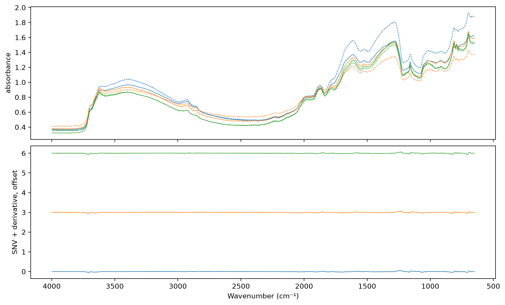

# Augmentation


<!-- WARNING: THIS FILE WAS AUTOGENERATED! DO NOT EDIT! -->

``` python
import matplotlib.pyplot as plt
from fastcore.test import *
from soilspecdata.all import load_ossl
from soilspecdl.all import predict
from ossl_fuku_transfer.data import *
from ossl_fuku_transfer.transfer import *
from ossl_fuku_transfer.inside import layer_features, probe
```

`12_wetchem` and `13_epo` found that the zero-shot failure lies in the
Fukushima spectra, and that linear corrections don’t fix it.
Augmentation takes the other route: it trains the CNN on OSSL spectra
perturbed in the ways that `05_paired` measured between instruments, so
that the features it learns change less under such differences.

The perturbations act on raw absorbance, before SNV and the derivative.
So in training, SNV and the derivative run on each batch, after the
perturbations. At prediction, the spectra are preprocessed offline as
before.

The module part uses small random arrays, so it runs without the data.
The sections from *Data* onwards read OSSL and the Fukushima data, and
are marked `#| fukudata`.

## Preprocessing on batches

`SNVDeriv` applies SNV, then the Savitzky-Golay filter, to each spectrum
of a batch, as `preprocessings()['snv_d1']` does offline. The filter is
linear, so it is a matrix: filtering the rows of an identity matrix with
SciPy gives it, edges included, and a matrix product applies it on the
GPU.

------------------------------------------------------------------------

### SNVDeriv

``` python
def SNVDeriv(
    n, # Number of wavenumbers
    window_length:int=15, # As in `SavitzkyGolay`
    polyorder:int=3, # As in `SavitzkyGolay`
    deriv:int=1, # As in `SavitzkyGolay`
):
```

*SNV, then the Savitzky-Golay filter, on each spectrum of a batch, as
`preprocessings()['snv_d1']`*

``` python
rng = np.random.default_rng(0)
X_syn = 1 + 0.3 * rng.random((6, len(shared_wns)))
xb = TensorSpectrum(torch.tensor(X_syn, dtype=torch.float32).unsqueeze(1), wns=shared_wns)
out = SNVDeriv(len(shared_wns))(xb)
test_eq(type(out), TensorSpectrum)
test_close(out.squeeze(1).numpy(), preprocessings()['snv_d1'].fit_transform(X_syn), eps=1e-4)
```

## Perturbations

`SpectralAug` perturbs raw absorbance spectra of training batches. Each
perturbation applies to each spectrum with probability `p`, with a
random size drawn from its range:

- Gaussian broadening with a standard deviation up to `sigma` points. On
  the 2 cm⁻¹ grid, 3 points is 6 cm⁻¹, the largest broadening tested in
  `05_paired`.
- A shift along the wavenumber axis of up to `shift` points, by linear
  interpolation. `05_paired` measured 1.6 cm⁻¹, or 0.8 points.
- A contrast change: absorbance, clipped at 10⁻³, raised to a power
  between `gamma[0]` and `gamma[1]`, drawn on a log scale. `05_paired`
  found about six times less contrast in the Thermo spectra, which SNV
  does not fully remove.
- A baseline: a constant, a slope and a curvature across the spectrum,
  each up to `baseline` times the spectrum’s standard deviation.
- Gaussian noise with a standard deviation of `noise` times the
  spectrum’s standard deviation.

Scaling a whole spectrum is left out, because SNV removes it. As a
fastai transform with `split_idx = 0`, it leaves validation batches
unchanged.

------------------------------------------------------------------------

### SpectralAug

``` python
def SpectralAug(
    p:float=0.5, # Probability of each perturbation, per spectrum
    sigma:float=3.0, # Largest Gaussian broadening, in points
    shift:float=1.0, # Largest shift, in points
    gamma:tuple=(0.5, 2.0), # Range of the contrast exponent
    baseline:float=0.2, # Largest baseline term, relative to the spectrum's standard deviation
    noise:float=0.005, # Noise standard deviation, relative to the spectrum's standard deviation
):
```

*Random broadening, shift, contrast, baseline and noise of raw
absorbance spectra, on training batches only*

``` python
aug = SpectralAug()
set_seed(0)
xa = aug(xb, split_idx=0)
test_eq((type(xa), xa.shape), (TensorSpectrum, xb.shape))
test_eq(torch.allclose(xa, xb), False)
test_eq(torch.equal(aug(xb, split_idx=1), xb), True)
test_close(SpectralAug(p=0)(xb, split_idx=0), xb, eps=1e-5)
```

`pretrain_aug` trains `SpectralCNN` on raw OSSL spectra as `pretrain`
does on preprocessed ones, with `aug`, `SNVDeriv` and `BatchSNV` on each
batch. The saved model takes spectra preprocessed offline, like the
other pretrained models, and loads with `load_pretrained`:

------------------------------------------------------------------------

### pretrain_aug

``` python
def pretrain_aug(
    X, # Raw OSSL absorbance spectra on `shared_wns`
    y, # Targets, such as `log1p` of a soil property
    fname, # File name for the weights, without extension
    aug:NoneType=None, # Augmentation transform, such as `SpectralAug()`; none if None
    seed:int=42, # Seed for the validation split and the training
    epochs:int=20, # Number of one-cycle epochs
    lr:float=0.001, # Maximum learning rate
):
```

*Train `SpectralCNN` on augmented spectra, or load the weights that an
earlier run saved under `fname`*

## Data

OSSL Kex and the Fukushima spectra, as in `03_kex`. The OSSL spectra
stay raw for pretraining:

``` python
om = load_ossl().mir(wmin=shared_wns[0], wmax=shared_wns[-1])
Xo, yo, _ = om.xy('k.ext_usda.a725_cmolc.kg')
yo = np.log1p(yo.ravel())
fuku = load_fuku()
fuku.source = fuku.source.assign(target=fuku.source['soil_ex_K2O'] / mg_k2o_per_cmolc)
Xf, yf, idf = fuku.xy('target')
yf = np.log1p(yf.ravel())
is_test = np.isin(idf, cs137_split()[1])
pipe = preprocessings()['snv_d1']
Xf_d = pipe.transform(Xf)
Xo.shape, Xf_d.shape
```

    ((57674, 1675), (1388, 1675))

Three OSSL spectra, raw and after augmentation, then both after SNV and
the derivative:

``` python
xs = TensorSpectrum(torch.tensor(Xo[:3], dtype=torch.float32).unsqueeze(1), wns=shared_wns)
set_seed(1)
xa = SpectralAug(p=1)(xs, split_idx=0)
sd = SNVDeriv(len(shared_wns))
fig, axs = plt.subplots(2, 1, figsize=(10, 6), sharex=True, layout='constrained')
for i in range(3):
    axs[0].plot(shared_wns, xs[i, 0], lw=0.7, c=f'C{i}'); axs[0].plot(shared_wns, xa[i, 0], lw=0.7, ls='--', c=f'C{i}')
    axs[1].plot(shared_wns, sd(xs)[i, 0] + 3 * i, lw=0.7, c=f'C{i}'); axs[1].plot(shared_wns, sd(xa)[i, 0] + 3 * i, lw=0.7, ls='--', c=f'C{i}')
axs[0].set_ylabel('absorbance'); axs[1].set_ylabel('SNV + derivative, offset'); axs[1].invert_xaxis(); axs[1].set_xlabel('Wavenumber (cm⁻¹)');
```



## Pretraining

The augmented model trains as the saved model `ossl_kex_snv_d1` did: the
same split, seed and schedule (20 epochs, learning rate 10⁻³). The last
epoch, with the OSSL validation R²:

``` python
models = {'no augmentation': load_pretrained('ossl_kex_snv_d1'), 'augmentation': pretrain_aug(Xo, yo, 'ossl_kex_aug', SpectralAug())}
pretrain_history('ossl_kex_aug').iloc[-1].round(3).to_dict()
```

    {'train_loss': 0.028, 'valid_loss': 0.032, 'r2_score': 0.782}

## Fukushima

Zero-shot scores of both models on the Fukushima training and test
samples:

``` python
pd.DataFrame({(m, s): scores(yf[msk], predict(model, Xf_d[msk], shared_wns)) for m, model in models.items()
              for s, msk in (('train', ~is_test), ('test', is_test))}).T.round(3)
```

<div>
<style scoped>
    .dataframe tbody tr th:only-of-type {
        vertical-align: middle;
    }
&#10;    .dataframe tbody tr th {
        vertical-align: top;
    }
&#10;    .dataframe thead th {
        text-align: right;
    }
</style>

<table class="dataframe" data-quarto-postprocess="true" data-border="1">
<thead>
<tr style="text-align: right;">
<th data-quarto-table-cell-role="th"></th>
<th data-quarto-table-cell-role="th"></th>
<th data-quarto-table-cell-role="th">R²</th>
<th data-quarto-table-cell-role="th">r</th>
<th data-quarto-table-cell-role="th">RMSE</th>
<th data-quarto-table-cell-role="th">bias</th>
</tr>
</thead>
<tbody>
<tr>
<td rowspan="2" data-quarto-table-cell-role="th" data-valign="top">no
augmentation</td>
<td data-quarto-table-cell-role="th">train</td>
<td>-0.748</td>
<td>0.162</td>
<td>0.597</td>
<td>0.305</td>
</tr>
<tr>
<td data-quarto-table-cell-role="th">test</td>
<td>-0.820</td>
<td>0.126</td>
<td>0.537</td>
<td>0.285</td>
</tr>
<tr>
<td rowspan="2" data-quarto-table-cell-role="th"
data-valign="top">augmentation</td>
<td data-quarto-table-cell-role="th">train</td>
<td>-0.556</td>
<td>-0.027</td>
<td>0.584</td>
<td>0.133</td>
</tr>
<tr>
<td data-quarto-table-cell-role="th">test</td>
<td>-0.707</td>
<td>-0.096</td>
<td>0.539</td>
<td>0.140</td>
</tr>
</tbody>
</table>

</div>

Ridge `probe`s on each frozen layer of both models, trained on the
Fukushima training samples and scored on the test samples:

``` python
pr = {}
for m, model in models.items():
    Fm = layer_features(model, Xf_d)
    for k, Fk in Fm.items(): pr[m, k] = probe(Fk[~is_test], yf[~is_test], Fk[is_test], yf[is_test])
pd.DataFrame(pr).T[['R²', 'r']].unstack(0).round(3)
```

<div>
<style scoped>
    .dataframe tbody tr th:only-of-type {
        vertical-align: middle;
    }
&#10;    .dataframe tbody tr th {
        vertical-align: top;
    }
&#10;    .dataframe thead tr th {
        text-align: left;
    }
</style>

<table class="dataframe" data-quarto-postprocess="true" data-border="1">
<thead>
<tr>
<th data-quarto-table-cell-role="th"></th>
<th colspan="2" data-quarto-table-cell-role="th"
data-halign="left">R²</th>
<th colspan="2" data-quarto-table-cell-role="th"
data-halign="left">r</th>
</tr>
<tr>
<th data-quarto-table-cell-role="th"></th>
<th data-quarto-table-cell-role="th">augmentation</th>
<th data-quarto-table-cell-role="th">no augmentation</th>
<th data-quarto-table-cell-role="th">augmentation</th>
<th data-quarto-table-cell-role="th">no augmentation</th>
</tr>
</thead>
<tbody>
<tr>
<td data-quarto-table-cell-role="th">block 1</td>
<td>0.381</td>
<td>0.378</td>
<td>0.619</td>
<td>0.618</td>
</tr>
<tr>
<td data-quarto-table-cell-role="th">block 2</td>
<td>0.409</td>
<td>0.403</td>
<td>0.640</td>
<td>0.635</td>
</tr>
<tr>
<td data-quarto-table-cell-role="th">block 3</td>
<td>0.420</td>
<td>0.396</td>
<td>0.649</td>
<td>0.629</td>
</tr>
<tr>
<td data-quarto-table-cell-role="th">block 4</td>
<td>0.432</td>
<td>0.429</td>
<td>0.660</td>
<td>0.657</td>
</tr>
<tr>
<td data-quarto-table-cell-role="th">block 5</td>
<td>0.387</td>
<td>0.371</td>
<td>0.626</td>
<td>0.614</td>
</tr>
<tr>
<td data-quarto-table-cell-role="th">input</td>
<td>0.332</td>
<td>0.332</td>
<td>0.582</td>
<td>0.582</td>
</tr>
<tr>
<td data-quarto-table-cell-role="th">pooled</td>
<td>0.313</td>
<td>0.253</td>
<td>0.563</td>
<td>0.504</td>
</tr>
</tbody>
</table>

</div>

## Findings

Augmentation during OSSL pretraining doesn’t make the CNN transfer to
Fukushima. The augmented model reaches an OSSL validation R² of 0.78,
against 0.79 without augmentation. Its zero-shot correlation for
Fukushima Kex is -0.10 on the test samples, against 0.13 without
augmentation. Its bias is smaller (0.14 against 0.29 in `log1p` units),
and R² is -0.71 against -0.82.

Ridge probes on its frozen layers give the same Kex scores as without
augmentation, within the sampling noise of about 0.04. Block 4 gives R²
0.43 for both models. The largest differences are in block 3 (0.42
against 0.40) and the pooled features (0.31 against 0.25).

The perturbations cover the differences that `05_paired` measured
between the Bruker and Thermo spectra: broadening, shift, contrast and
baseline. A model trained to ignore them still fails on the Fukushima
spectra. So these measured differences are not what separates the
Fukushima spectra from OSSL for Kex, or the ranges used here are too
small. This run tried one setting, with each perturbation applied with
probability 0.5.
