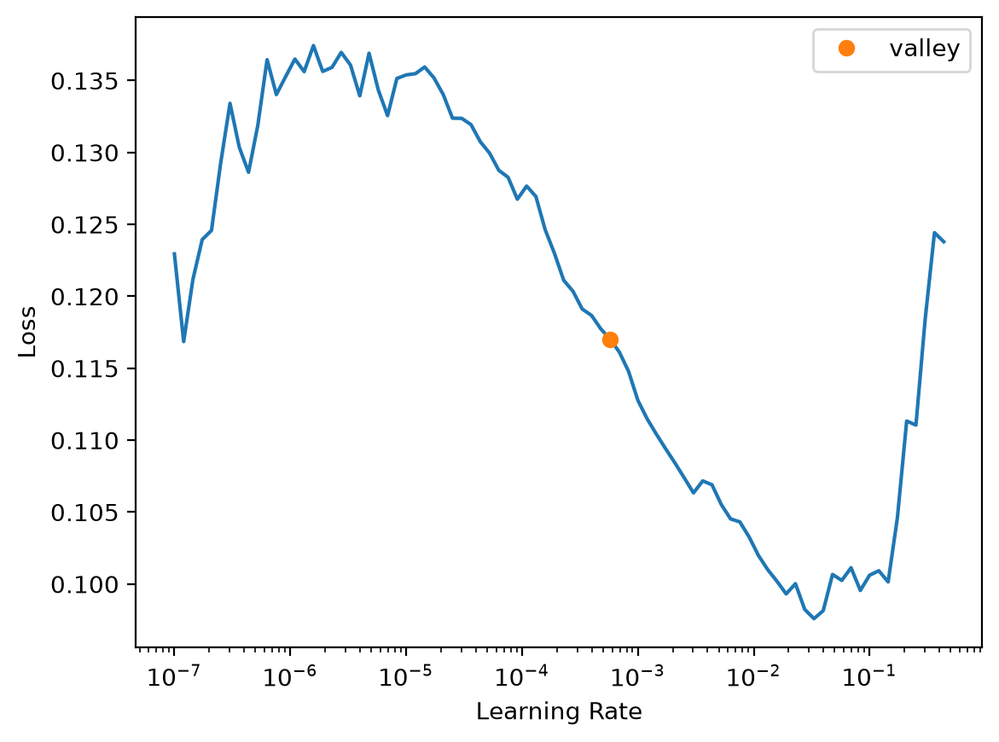
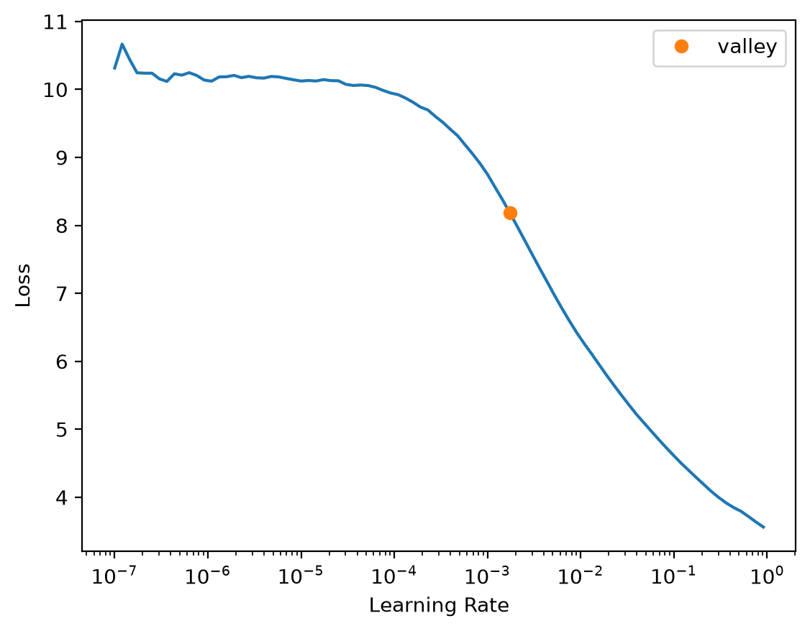
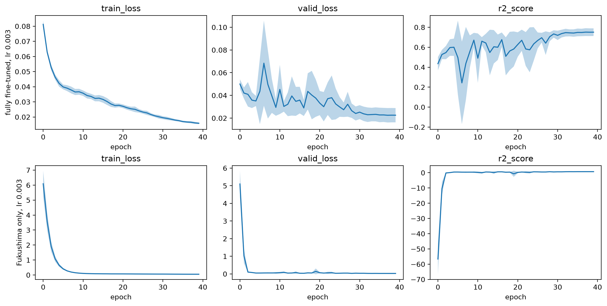
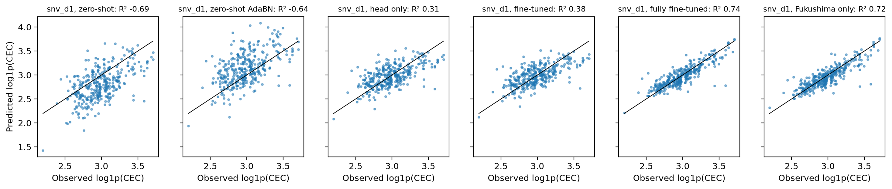

# CEC


<!-- WARNING: THIS FILE WAS AUTOGENERATED! DO NOT EDIT! -->

``` python
import numpy as np, pandas as pd
import matplotlib.pyplot as plt
from fastcore.test import *
from soilspecdata.all import load_ossl
from soilspecdl.all import plot_cv
from ossl_fuku_transfer.data import *
from ossl_fuku_transfer.transfer import *
```

    /Users/franckalbinet/pro/dev/soilspec/ossl-fuku-transfer/.venv/lib/python3.13/site-packages/torch/jit/_script.py:1491: FutureWarning: `torch.jit.script` is deprecated. Please switch to `torch.compile` or `torch.export`.
      warnings.warn(

Every code cell reads OSSL or the Fukushima data, and is marked
`#| fukudata`. The outputs come from a local run on an Apple silicon GPU
(MPS). `02_transfer` defines the functions used here.

## Data

OSSL MIR spectra on the shared grid, with CEC in cmolc/kg. The models
predict `log1p(CEC)`:

``` python
om = load_ossl().mir(wmin=shared_wns[0], wmax=shared_wns[-1])
Xo, yo, _ = om.xy('cec_usda.a723_cmolc.kg')
yo = np.log1p(yo.ravel())
Xo.shape
```

    (57062, 1675)

The Fukushima spectra, with CEC in meq/100 g, which equals cmolc/kg. The
test set is the Cs137 study’s test set:

``` python
fuku = load_fuku()
fuku.source = fuku.source.assign(target=fuku.source['soil_CEC'])
Xf, yf, idf = fuku.xy('target')
yf = np.log1p(yf.ravel())
_, test_ids = cs137_split()
is_test = np.isin(idf, test_ids)
yt = yf[is_test]
Xf.shape, int(is_test.sum())
```

    ((1386, 1675), 340)

## Pretraining

The preprocessing is SNV followed by a Savitzky-Golay first derivative,
fitted on OSSL and applied to Fukushima. `pretrain` trains on OSSL, or
loads the weights of an earlier run. The table shows the last epoch of
pretraining, with the R² of the OSSL validation set:

``` python
pipe = preprocessings()['snv_d1']
Xo_d, Xf_d = pipe.fit_transform(Xo), pipe.transform(Xf)
pretrained = pretrain(Xo_d, yo, 'ossl_cec_snv_d1')
pretrain_history('ossl_cec_snv_d1').iloc[-1].round(3).to_dict()
```

    {'train_loss': 0.037, 'valid_loss': 0.028, 'r2_score': 0.966}

## Schedule

The fully fine-tuned and Fukushima-only models each get their own
learning rate and number of epochs, chosen on the Fukushima training
samples by 5-fold cross-validation. The test set plays no part. `start`
gives each model’s starting weights: the pretrained model, or `None` for
random weights. The learning rate finder, from each starting point:

``` python
start = {'fully fine-tuned': pretrained, 'Fukushima only': None}
mslug = {'fully fine-tuned': 'ft', 'Fukushima only': 'scratch'}
{m: float(fuku_lr_find(s, Xf_d, yf, is_test).valley) for m, s in start.items()}
```





    {'fully fine-tuned': 0.0005754399462603033,
     'Fukushima only': 0.001737800776027143}

Four learning rates, each with 40 one-cycle epochs. The table gives the
validation loss (mean squared error of `log1p`) and R² at the last
epoch, as mean and standard deviation over the folds:

``` python
lrs = [1e-4, 3e-4, 1e-3, 3e-3]
cv = lambda m, lr, ep: cv_curves(start[m], Xf_d, yf, is_test, lr, ep, fname=f'cv_cec_{mslug[m]}_lr{lr:g}_ep{ep}')
lr_res = {(m, lr): cv_final(cv(m, lr, 40)) for m in start for lr in lrs}
best_lr = {m: min(lrs, key=lambda lr: lr_res[m, lr]['valid_loss']) for m in start}
pd.DataFrame(lr_res).T.round(4)
```

<div>
<style scoped>
    .dataframe tbody tr th:only-of-type {
        vertical-align: middle;
    }
&#10;    .dataframe tbody tr th {
        vertical-align: top;
    }
&#10;    .dataframe thead th {
        text-align: right;
    }
</style>

<table class="dataframe" data-quarto-postprocess="true" data-border="1">
<thead>
<tr style="text-align: right;">
<th data-quarto-table-cell-role="th"></th>
<th data-quarto-table-cell-role="th"></th>
<th data-quarto-table-cell-role="th">valid_loss</th>
<th data-quarto-table-cell-role="th">valid_loss sd</th>
<th data-quarto-table-cell-role="th">R²</th>
<th data-quarto-table-cell-role="th">R² sd</th>
</tr>
</thead>
<tbody>
<tr>
<td rowspan="4" data-quarto-table-cell-role="th" data-valign="top">fully
fine-tuned</td>
<td data-quarto-table-cell-role="th">0.0001</td>
<td>0.0271</td>
<td>0.0042</td>
<td>0.6978</td>
<td>0.0115</td>
</tr>
<tr>
<td data-quarto-table-cell-role="th">0.0003</td>
<td>0.0242</td>
<td>0.0049</td>
<td>0.7307</td>
<td>0.0213</td>
</tr>
<tr>
<td data-quarto-table-cell-role="th">0.0010</td>
<td>0.0232</td>
<td>0.0058</td>
<td>0.7436</td>
<td>0.0322</td>
</tr>
<tr>
<td data-quarto-table-cell-role="th">0.0030</td>
<td>0.0226</td>
<td>0.0063</td>
<td>0.7508</td>
<td>0.0383</td>
</tr>
<tr>
<td rowspan="4" data-quarto-table-cell-role="th"
data-valign="top">Fukushima only</td>
<td data-quarto-table-cell-role="th">0.0001</td>
<td>0.0381</td>
<td>0.0071</td>
<td>0.5754</td>
<td>0.0413</td>
</tr>
<tr>
<td data-quarto-table-cell-role="th">0.0003</td>
<td>0.0325</td>
<td>0.0066</td>
<td>0.6383</td>
<td>0.0398</td>
</tr>
<tr>
<td data-quarto-table-cell-role="th">0.0010</td>
<td>0.0285</td>
<td>0.0064</td>
<td>0.6835</td>
<td>0.0388</td>
</tr>
<tr>
<td data-quarto-table-cell-role="th">0.0030</td>
<td>0.0266</td>
<td>0.0049</td>
<td>0.7044</td>
<td>0.0194</td>
</tr>
</tbody>
</table>

</div>

The learning curves at each model’s best learning rate, as mean over
folds with a band of ±1 standard deviation:

``` python
fig, axs = plt.subplots(2, 3, figsize=(12, 6), layout='constrained')
for row, m in zip(axs, start):
    plot_cv(cv(m, best_lr[m], 40), axs=row)
    row[0].set_ylabel(f'{m}, lr {best_lr[m]:g}')
```



Three numbers of epochs, at each model’s best learning rate. A one-cycle
schedule changes shape with its length, so each count is trained
separately:

``` python
eps = [20, 40, 80]
ep_res = {(m, ep): cv_final(cv(m, best_lr[m], ep)) for m in start for ep in eps}
schedules = {m: (min(eps, key=lambda ep: ep_res[m, ep]['valid_loss']), best_lr[m]) for m in start}
pd.DataFrame(ep_res).T.round(4), schedules
```

    (                     valid_loss  valid_loss sd      R²   R² sd
     fully fine-tuned 20      0.0232         0.0059  0.7434  0.0335
                      40      0.0226         0.0063  0.7508  0.0383
                      80      0.0234         0.0063  0.7407  0.0386
     Fukushima only   20      0.0332         0.0066  0.6304  0.0378
                      40      0.0266         0.0049  0.7044  0.0194
                      80      0.0228         0.0052  0.7472  0.0268,
     {'fully fine-tuned': (40, 0.003), 'Fukushima only': (80, 0.003)})

## Comparison

Each Fukushima model trains with five seeds, the fully fine-tuned and
Fukushima-only models with the schedules chosen above. The other models
keep their defaults. The table gives the mean and standard deviation
over the seeds of R² and correlation `r` of `log1p(CEC)`, and of the
RMSE and bias of CEC in cmolc/kg, on the test samples:

``` python
res, preds = compare({'snv_d1': pretrained}, {'snv_d1': Xf_d}, yf, is_test, schedules=schedules)
summarise(res).round(3)
```

<div>
<style scoped>
    .dataframe tbody tr th:only-of-type {
        vertical-align: middle;
    }
&#10;    .dataframe tbody tr th {
        vertical-align: top;
    }
&#10;    .dataframe thead tr th {
        text-align: left;
    }
&#10;    .dataframe thead tr:last-of-type th {
        text-align: right;
    }
</style>

<table class="dataframe" data-quarto-postprocess="true" data-border="1">
<thead>
<tr>
<th data-quarto-table-cell-role="th"></th>
<th data-quarto-table-cell-role="th"></th>
<th colspan="2" data-quarto-table-cell-role="th"
data-halign="left">R²</th>
<th colspan="2" data-quarto-table-cell-role="th"
data-halign="left">r</th>
<th colspan="2" data-quarto-table-cell-role="th"
data-halign="left">RMSE</th>
<th colspan="2" data-quarto-table-cell-role="th"
data-halign="left">bias</th>
</tr>
<tr>
<th data-quarto-table-cell-role="th"></th>
<th data-quarto-table-cell-role="th"></th>
<th data-quarto-table-cell-role="th">mean</th>
<th data-quarto-table-cell-role="th">std</th>
<th data-quarto-table-cell-role="th">mean</th>
<th data-quarto-table-cell-role="th">std</th>
<th data-quarto-table-cell-role="th">mean</th>
<th data-quarto-table-cell-role="th">std</th>
<th data-quarto-table-cell-role="th">mean</th>
<th data-quarto-table-cell-role="th">std</th>
</tr>
<tr>
<th data-quarto-table-cell-role="th">preprocessing</th>
<th data-quarto-table-cell-role="th">model</th>
<th data-quarto-table-cell-role="th"></th>
<th data-quarto-table-cell-role="th"></th>
<th data-quarto-table-cell-role="th"></th>
<th data-quarto-table-cell-role="th"></th>
<th data-quarto-table-cell-role="th"></th>
<th data-quarto-table-cell-role="th"></th>
<th data-quarto-table-cell-role="th"></th>
<th data-quarto-table-cell-role="th"></th>
</tr>
</thead>
<tbody>
<tr>
<td rowspan="6" data-quarto-table-cell-role="th"
data-valign="top">snv_d1</td>
<td data-quarto-table-cell-role="th">zero-shot</td>
<td>-0.695</td>
<td>0.000</td>
<td>0.572</td>
<td>0.000</td>
<td>6.165</td>
<td>0.000</td>
<td>-2.994</td>
<td>0.000</td>
</tr>
<tr>
<td data-quarto-table-cell-role="th">zero-shot AdaBN</td>
<td>-0.646</td>
<td>0.008</td>
<td>0.550</td>
<td>0.000</td>
<td>8.403</td>
<td>0.030</td>
<td>4.060</td>
<td>0.037</td>
</tr>
<tr>
<td data-quarto-table-cell-role="th">head only</td>
<td>0.313</td>
<td>0.004</td>
<td>0.611</td>
<td>0.002</td>
<td>4.585</td>
<td>0.015</td>
<td>-0.294</td>
<td>0.076</td>
</tr>
<tr>
<td data-quarto-table-cell-role="th">fine-tuned</td>
<td>0.387</td>
<td>0.003</td>
<td>0.646</td>
<td>0.002</td>
<td>4.345</td>
<td>0.010</td>
<td>-0.224</td>
<td>0.091</td>
</tr>
<tr>
<td data-quarto-table-cell-role="th">fully fine-tuned</td>
<td>0.735</td>
<td>0.004</td>
<td>0.859</td>
<td>0.002</td>
<td>2.796</td>
<td>0.017</td>
<td>-0.274</td>
<td>0.085</td>
</tr>
<tr>
<td data-quarto-table-cell-role="th">Fukushima only</td>
<td>0.709</td>
<td>0.012</td>
<td>0.848</td>
<td>0.007</td>
<td>2.949</td>
<td>0.065</td>
<td>-0.520</td>
<td>0.141</td>
</tr>
</tbody>
</table>

</div>

For scale, the standard deviation of the test CEC values, in cmolc/kg:

``` python
round(float(np.expm1(yt).std()), 3)
```

    5.612

Predictions of the first seed against the observed values:

``` python
plot_preds(preds, yt, label='log1p(CEC)');
```



## Checks

The OSSL validation R² covers OSSL’s whole CEC range. The pretrained
model is scored again on its OSSL validation samples, first all of them,
then those within the 5th to 95th percentile of Fukushima CEC:

``` python
lo, hi = np.quantile(yf, [0.05, 0.95])
np.expm1([lo, hi]).round(2), {k: round(v, 3) for k, v in range_check(Xo_d, yo, pretrained, lo, hi).items()}
```

    (array([11.2 , 30.77]),
     {'n all': 5706,
      'R² all': 0.966,
      'r all': np.float64(0.983),
      'n in range': 2677,
      'R² in range': 0.66,
      'r in range': np.float64(0.857)})

## Error analysis

Mean absolute error of `log1p(CEC)` by soil type, year and measurement
batch. Each model’s predictions are averaged over the seeds first:

``` python
props = fuku.source.loc[idf[is_test]]
error_table(preds, yt, props['Soil_type_describe'], 'snv_d1').round(3)
```

<div>
<style scoped>
    .dataframe tbody tr th:only-of-type {
        vertical-align: middle;
    }
&#10;    .dataframe tbody tr th {
        vertical-align: top;
    }
&#10;    .dataframe thead th {
        text-align: right;
    }
</style>

<table class="dataframe" data-quarto-postprocess="true" data-border="1">
<thead>
<tr style="text-align: right;">
<th data-quarto-table-cell-role="th"></th>
<th data-quarto-table-cell-role="th">head only</th>
<th data-quarto-table-cell-role="th">fine-tuned</th>
<th data-quarto-table-cell-role="th">fully fine-tuned</th>
<th data-quarto-table-cell-role="th">Fukushima only</th>
<th data-quarto-table-cell-role="th">n</th>
</tr>
</thead>
<tbody>
<tr>
<td data-quarto-table-cell-role="th">Andosols</td>
<td>0.161</td>
<td>0.153</td>
<td>0.112</td>
<td>0.131</td>
<td>44</td>
</tr>
<tr>
<td data-quarto-table-cell-role="th">Forest soil</td>
<td>0.204</td>
<td>0.195</td>
<td>0.074</td>
<td>0.083</td>
<td>27</td>
</tr>
<tr>
<td data-quarto-table-cell-role="th">Glay soil</td>
<td>0.171</td>
<td>0.160</td>
<td>0.105</td>
<td>0.094</td>
<td>6</td>
</tr>
<tr>
<td data-quarto-table-cell-role="th">Lowland soil</td>
<td>0.169</td>
<td>0.158</td>
<td>0.094</td>
<td>0.093</td>
<td>243</td>
</tr>
<tr>
<td data-quarto-table-cell-role="th">Peat soil</td>
<td>0.150</td>
<td>0.132</td>
<td>0.078</td>
<td>0.084</td>
<td>14</td>
</tr>
<tr>
<td data-quarto-table-cell-role="th">Red yellow soil</td>
<td>0.129</td>
<td>0.117</td>
<td>0.081</td>
<td>0.071</td>
<td>6</td>
</tr>
</tbody>
</table>

</div>

``` python
error_table(preds, yt, props['year'].astype(int), 'snv_d1').round(3)
```

<div>
<style scoped>
    .dataframe tbody tr th:only-of-type {
        vertical-align: middle;
    }
&#10;    .dataframe tbody tr th {
        vertical-align: top;
    }
&#10;    .dataframe thead th {
        text-align: right;
    }
</style>

<table class="dataframe" data-quarto-postprocess="true" data-border="1">
<thead>
<tr style="text-align: right;">
<th data-quarto-table-cell-role="th"></th>
<th data-quarto-table-cell-role="th">head only</th>
<th data-quarto-table-cell-role="th">fine-tuned</th>
<th data-quarto-table-cell-role="th">fully fine-tuned</th>
<th data-quarto-table-cell-role="th">Fukushima only</th>
<th data-quarto-table-cell-role="th">n</th>
</tr>
</thead>
<tbody>
<tr>
<td data-quarto-table-cell-role="th">2013</td>
<td>0.205</td>
<td>0.195</td>
<td>0.134</td>
<td>0.138</td>
<td>34</td>
</tr>
<tr>
<td data-quarto-table-cell-role="th">2014</td>
<td>0.162</td>
<td>0.138</td>
<td>0.081</td>
<td>0.085</td>
<td>53</td>
</tr>
<tr>
<td data-quarto-table-cell-role="th">2015</td>
<td>0.143</td>
<td>0.137</td>
<td>0.084</td>
<td>0.084</td>
<td>48</td>
</tr>
<tr>
<td data-quarto-table-cell-role="th">2016</td>
<td>0.154</td>
<td>0.147</td>
<td>0.074</td>
<td>0.073</td>
<td>58</td>
</tr>
<tr>
<td data-quarto-table-cell-role="th">2017</td>
<td>0.181</td>
<td>0.167</td>
<td>0.086</td>
<td>0.101</td>
<td>37</td>
</tr>
<tr>
<td data-quarto-table-cell-role="th">2018</td>
<td>0.217</td>
<td>0.205</td>
<td>0.114</td>
<td>0.115</td>
<td>46</td>
</tr>
<tr>
<td data-quarto-table-cell-role="th">2019</td>
<td>0.137</td>
<td>0.133</td>
<td>0.093</td>
<td>0.092</td>
<td>48</td>
</tr>
<tr>
<td data-quarto-table-cell-role="th">2020</td>
<td>0.184</td>
<td>0.174</td>
<td>0.115</td>
<td>0.117</td>
<td>16</td>
</tr>
</tbody>
</table>

</div>

``` python
error_table(preds, yt, sample_batches(idf[is_test]), 'snv_d1').round(3)
```

<div>
<style scoped>
    .dataframe tbody tr th:only-of-type {
        vertical-align: middle;
    }
&#10;    .dataframe tbody tr th {
        vertical-align: top;
    }
&#10;    .dataframe thead th {
        text-align: right;
    }
</style>

<table class="dataframe" data-quarto-postprocess="true" data-border="1">
<thead>
<tr style="text-align: right;">
<th data-quarto-table-cell-role="th"></th>
<th data-quarto-table-cell-role="th">head only</th>
<th data-quarto-table-cell-role="th">fine-tuned</th>
<th data-quarto-table-cell-role="th">fully fine-tuned</th>
<th data-quarto-table-cell-role="th">Fukushima only</th>
<th data-quarto-table-cell-role="th">n</th>
</tr>
</thead>
<tbody>
<tr>
<td data-quarto-table-cell-role="th">batch 1</td>
<td>0.193</td>
<td>0.176</td>
<td>0.103</td>
<td>0.112</td>
<td>110</td>
</tr>
<tr>
<td data-quarto-table-cell-role="th">batch 2</td>
<td>0.158</td>
<td>0.149</td>
<td>0.090</td>
<td>0.089</td>
<td>230</td>
</tr>
</tbody>
</table>

</div>

## Findings

The pretrained model comes from one pretraining run. The Fukushima-side
training was repeated with five seeds. Training on MPS is not fully
deterministic, and the variation between pretraining runs is not
measured. All results use SNV followed by the first derivative.

Cross-validation on the training samples chose a maximum learning rate
of 3e-3 for both the fully fine-tuned and the Fukushima-only model, the
highest rate tried. It chose 40 epochs for the fully fine-tuned model
and 80 for the Fukushima-only model, the longest run tried. Both choices
for the Fukushima-only model are at the edge of the grid, so it may
improve further. In cross-validation, the two models reached about the
same validation R²: 0.75 for both, with standard deviations over the
folds of 0.03 to 0.04.

With these schedules, the fully fine-tuned model is slightly better on
the test set: an R² of `log1p(CEC)` of 0.74, a correlation of 0.86 and
an RMSE of 2.8 cmolc/kg, against 0.71, 0.85 and 2.9 cmolc/kg for the
Fukushima-only model. The standard deviations over the seeds are 0.004
and 0.014 in R². The standard deviation of the test CEC values is 5.6
cmolc/kg. Before tuning, with 21 epochs at 1e-3 for both models, the gap
was much larger (0.72 against 0.59). Most of that gap came from
undertraining the Fukushima-only model. The pretrained model needs half
the epochs.

On OSSL validation samples within Fukushima’s CEC range (11.2 to 30.8
cmolc/kg), the pretrained model reaches an R² of 0.66 and a correlation
of 0.86. Both tuned Fukushima models do about as well on the Fukushima
test set.

The OSSL backbone does not work unchanged. Without training, it partly
ranks the Fukushima samples (correlation 0.57) but predicts too low,
with a bias of -3.0 cmolc/kg. A linear head on the frozen backbone gives
an R² of 0.31, and fastai’s `fine_tune`, whose backbone trains at a
maximum learning rate of 5e-6, gives 0.39. These models keep their
default schedules.

Recomputing the BatchNorm statistics on the non-test Fukushima spectra
(AdaBN) does not help. The zero-shot bias changes from -3.0 to +4.1
cmolc/kg, the R² stays near -0.65, and the correlation stays at 0.55.
The failure to transfer lies in the features, not in the BatchNorm
statistics.

The fully fine-tuned and Fukushima-only models have similar errors in
each soil type, year and batch.
