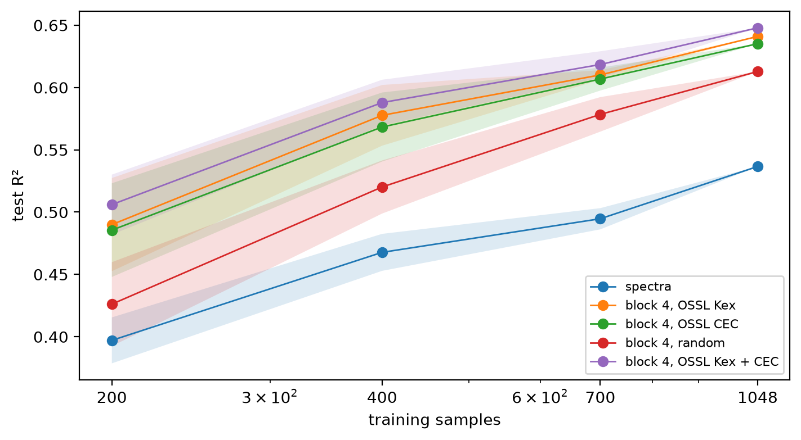

# Cs-137 ratio


<!-- WARNING: THIS FILE WAS AUTOGENERATED! DO NOT EDIT! -->

``` python
import numpy as np, pandas as pd
import matplotlib.pyplot as plt
from sklearn.cross_decomposition import PLSRegression
from sklearn.model_selection import GridSearchCV, KFold
from sklearn.metrics import r2_score
from fastai.torch_core import set_seed
from soilspecdl.all import SpectralCNN, regression_scores
from ossl_fuku_transfer.data import *
from ossl_fuku_transfer.transfer import *
from ossl_fuku_transfer.inside import layer_features, probe
from kennard_stone import train_test_split as ks_split
```

    /Users/franckalbinet/pro/dev/soilspec/ossl-fuku-transfer/.venv/lib/python3.13/site-packages/torch/jit/_script.py:1491: FutureWarning: `torch.jit.script` is deprecated. Please switch to `torch.compile` or `torch.export`.
      warnings.warn(

Every code cell reads the Fukushima data or the saved OSSL models, and
is marked `#| fukudata`.

## Target and scores

The target is the Cs137 study’s `exCs137_totalCs137`: log10 of
exchangeable over total Cs-137. `ratio_scores`, which is
`regression_scores`, gives R², correlation `r`, and the RMSE and bias,
all on that log10 scale:

``` python
ref = fuku_path()/'reference'
csv = {s: pd.read_csv(ref/f'cs137_ratio_{s}.csv') for s in ('train', 'test')}
ratio = pd.concat(csv.values()).assign(ID=lambda d: d.ID.astype(str)).set_index('ID')['exCs137_totalCs137']
ratio_scores = regression_scores
ratio.describe().round(3).to_dict()
```

    {'count': 1592.0,
     'mean': -1.322,
     'std': 0.359,
     'min': -2.921,
     '25%': -1.563,
     '50%': -1.27,
     '75%': -1.044,
     'max': -0.606}

## The study’s spectra

The Cs137 study’s own spectra: 657 points from 685 to 3965 cm⁻¹, as
exported for that study, with 1,194 training and 398 test samples. The
current selection has `.spa` files for 1,388 of these samples: 1,047
training and 341 test samples. PLSR, with the number of components
chosen by 5-fold cross-validation on the training samples, and a ridge
regression, on the full split and on the samples of the current
selection. This shows how much the smaller selection alone changes the
scores:

``` python
def plsr(Xtr, ytr, Xte, yte, max_comp=60):
    "Test scores of PLSR with the number of components chosen by 5-fold cross-validation"
    gs = GridSearchCV(PLSRegression(scale=False), {'n_components': range(1, max_comp + 1)},
                      cv=KFold(5, shuffle=True, random_state=0), scoring='neg_mean_squared_error').fit(Xtr, ytr)
    return {**ratio_scores(yte, gs.predict(Xte).ravel()), 'components': gs.best_params_['n_components']}

sel = set(sample_ids())
study = {}
for name, keep in (('full split', lambda d: d), ('current selection', lambda d: d[d.ID.astype(str).isin(sel)])):
    tr, te = keep(csv['train']), keep(csv['test'])
    Xtr, Xte = tr.filter(regex='^X').to_numpy(), te.filter(regex='^X').to_numpy()
    ytr, yte = tr.exCs137_totalCs137.to_numpy(), te.exCs137_totalCs137.to_numpy()
    study[name, 'PLSR'] = {'n train': len(tr), 'n test': len(te), **plsr(Xtr, ytr, Xte, yte)}
    study[name, 'ridge'] = {'n train': len(tr), 'n test': len(te), **probe(Xtr, ytr, Xte, yte, score_fn=ratio_scores)}
pd.DataFrame(study).T.round(3)
```

<div>
<style scoped>
    .dataframe tbody tr th:only-of-type {
        vertical-align: middle;
    }
&#10;    .dataframe tbody tr th {
        vertical-align: top;
    }
&#10;    .dataframe thead th {
        text-align: right;
    }
</style>

<table class="dataframe" data-quarto-postprocess="true" data-border="1">
<thead>
<tr style="text-align: right;">
<th data-quarto-table-cell-role="th"></th>
<th data-quarto-table-cell-role="th"></th>
<th data-quarto-table-cell-role="th">n train</th>
<th data-quarto-table-cell-role="th">n test</th>
<th data-quarto-table-cell-role="th">R²</th>
<th data-quarto-table-cell-role="th">r</th>
<th data-quarto-table-cell-role="th">RMSE</th>
<th data-quarto-table-cell-role="th">bias</th>
<th data-quarto-table-cell-role="th">components</th>
<th data-quarto-table-cell-role="th">alpha</th>
</tr>
</thead>
<tbody>
<tr>
<td rowspan="2" data-quarto-table-cell-role="th" data-valign="top">full
split</td>
<td data-quarto-table-cell-role="th">PLSR</td>
<td>1194.0</td>
<td>398.0</td>
<td>0.543</td>
<td>0.744</td>
<td>0.245</td>
<td>0.037</td>
<td>33.0</td>
<td>NaN</td>
</tr>
<tr>
<td data-quarto-table-cell-role="th">ridge</td>
<td>1194.0</td>
<td>398.0</td>
<td>0.544</td>
<td>0.751</td>
<td>0.245</td>
<td>0.044</td>
<td>NaN</td>
<td>31.623</td>
</tr>
<tr>
<td rowspan="2" data-quarto-table-cell-role="th"
data-valign="top">current selection</td>
<td data-quarto-table-cell-role="th">PLSR</td>
<td>1048.0</td>
<td>341.0</td>
<td>0.558</td>
<td>0.755</td>
<td>0.229</td>
<td>0.037</td>
<td>30.0</td>
<td>NaN</td>
</tr>
<tr>
<td data-quarto-table-cell-role="th">ridge</td>
<td>1048.0</td>
<td>341.0</td>
<td>0.555</td>
<td>0.754</td>
<td>0.230</td>
<td>0.038</td>
<td>NaN</td>
<td>10.000</td>
</tr>
</tbody>
</table>

</div>

## Spectra of the current selection

The `.spa` spectra on the shared 2 cm⁻¹ grid, with SNV and a
Savitzky-Golay first derivative as in `03_kex`. Both steps work on each
spectrum alone, so fitting them on Fukushima gives the same result as
fitting them on OSSL. The same training and test samples as the current
selection above:

``` python
fuku = load_fuku()
fuku.source = fuku.source.assign(target=ratio)
Xf, yf, idf = fuku.xy('target')
yf = yf.ravel()
is_test = np.isin(idf, cs137_split()[1])
Xf_d = preprocessings()['snv_d1'].fit_transform(Xf)
tr_, te_ = ~is_test, is_test
own = {'PLSR': plsr(Xf_d[tr_], yf[tr_], Xf_d[te_], yf[te_]), 'ridge': probe(Xf_d[tr_], yf[tr_], Xf_d[te_], yf[te_], score_fn=ratio_scores)}
int(tr_.sum()), int(te_.sum()), pd.DataFrame(own).T.round(3)
```

    (1048,
     341,
               R²      r   RMSE   bias  components  alpha
     PLSR   0.560  0.757  0.229  0.038        23.0    NaN
     ridge  0.537  0.742  0.235  0.041         NaN  100.0)

## Frozen layers

Ridge regressions on each layer of three models, as in
`07_inside_transfer`: the saved OSSL Kex and CEC models, and a model
with random weights as a control. Neither OSSL model ever saw the Cs-137
ratio. The test R²:

``` python
set_seed(0)
models = {'OSSL Kex': load_pretrained('ossl_kex_snv_d1'), 'OSSL CEC': load_pretrained('ossl_cec_snv_d1'), 'random': SpectralCNN()}
F = {m: layer_features(model, Xf_d) for m, model in models.items()}
F['OSSL Kex + CEC'] = {k: np.hstack([F['OSSL Kex'][k], F['OSSL CEC'][k]]) for k in F['OSSL Kex'] if k != 'input'}
lay = pd.DataFrame({(m, k): probe(Fm[k][tr_], yf[tr_], Fm[k][te_], yf[te_], score_fn=ratio_scores) for m, Fm in F.items() for k in Fm}).T
lay['R²'].unstack(0).reindex(list(F['OSSL Kex'])).round(3)
```

<div>
<style scoped>
    .dataframe tbody tr th:only-of-type {
        vertical-align: middle;
    }
&#10;    .dataframe tbody tr th {
        vertical-align: top;
    }
&#10;    .dataframe thead th {
        text-align: right;
    }
</style>

<table class="dataframe" data-quarto-postprocess="true" data-border="1">
<thead>
<tr style="text-align: right;">
<th data-quarto-table-cell-role="th"></th>
<th data-quarto-table-cell-role="th">OSSL CEC</th>
<th data-quarto-table-cell-role="th">OSSL Kex</th>
<th data-quarto-table-cell-role="th">OSSL Kex + CEC</th>
<th data-quarto-table-cell-role="th">random</th>
</tr>
</thead>
<tbody>
<tr>
<td data-quarto-table-cell-role="th">input</td>
<td>0.537</td>
<td>0.537</td>
<td>NaN</td>
<td>0.537</td>
</tr>
<tr>
<td data-quarto-table-cell-role="th">block 1</td>
<td>0.589</td>
<td>0.594</td>
<td>0.586</td>
<td>0.566</td>
</tr>
<tr>
<td data-quarto-table-cell-role="th">block 2</td>
<td>0.607</td>
<td>0.613</td>
<td>0.618</td>
<td>0.597</td>
</tr>
<tr>
<td data-quarto-table-cell-role="th">block 3</td>
<td>0.614</td>
<td>0.613</td>
<td>0.626</td>
<td>0.590</td>
</tr>
<tr>
<td data-quarto-table-cell-role="th">block 4</td>
<td>0.635</td>
<td>0.641</td>
<td>0.648</td>
<td>0.613</td>
</tr>
<tr>
<td data-quarto-table-cell-role="th">block 5</td>
<td>0.623</td>
<td>0.625</td>
<td>0.658</td>
<td>0.584</td>
</tr>
<tr>
<td data-quarto-table-cell-role="th">pooled</td>
<td>0.544</td>
<td>0.479</td>
<td>0.564</td>
<td>0.482</td>
</tr>
</tbody>
</table>

</div>

The correlation `r` of the same regressions:

``` python
lay['r'].unstack(0).reindex(list(F['OSSL Kex'])).round(3)
```

<div>
<style scoped>
    .dataframe tbody tr th:only-of-type {
        vertical-align: middle;
    }
&#10;    .dataframe tbody tr th {
        vertical-align: top;
    }
&#10;    .dataframe thead th {
        text-align: right;
    }
</style>

<table class="dataframe" data-quarto-postprocess="true" data-border="1">
<thead>
<tr style="text-align: right;">
<th data-quarto-table-cell-role="th"></th>
<th data-quarto-table-cell-role="th">OSSL CEC</th>
<th data-quarto-table-cell-role="th">OSSL Kex</th>
<th data-quarto-table-cell-role="th">OSSL Kex + CEC</th>
<th data-quarto-table-cell-role="th">random</th>
</tr>
</thead>
<tbody>
<tr>
<td data-quarto-table-cell-role="th">input</td>
<td>0.742</td>
<td>0.742</td>
<td>NaN</td>
<td>0.742</td>
</tr>
<tr>
<td data-quarto-table-cell-role="th">block 1</td>
<td>0.776</td>
<td>0.779</td>
<td>0.776</td>
<td>0.761</td>
</tr>
<tr>
<td data-quarto-table-cell-role="th">block 2</td>
<td>0.788</td>
<td>0.792</td>
<td>0.792</td>
<td>0.778</td>
</tr>
<tr>
<td data-quarto-table-cell-role="th">block 3</td>
<td>0.794</td>
<td>0.791</td>
<td>0.797</td>
<td>0.778</td>
</tr>
<tr>
<td data-quarto-table-cell-role="th">block 4</td>
<td>0.801</td>
<td>0.805</td>
<td>0.811</td>
<td>0.789</td>
</tr>
<tr>
<td data-quarto-table-cell-role="th">block 5</td>
<td>0.795</td>
<td>0.796</td>
<td>0.814</td>
<td>0.773</td>
</tr>
<tr>
<td data-quarto-table-cell-role="th">pooled</td>
<td>0.745</td>
<td>0.706</td>
<td>0.760</td>
<td>0.702</td>
</tr>
</tbody>
</table>

</div>

## Learning curve

Ridge regressions on the spectra and on block 4 of each model, trained
on random subsets of the training samples, five per size, and on all of
them, and scored on the same test set:

``` python
feats = {'spectra': Xf_d, **{f'block 4, {m}': F[m]['block 4'] for m in F}}
sizes, rows = [200, 400, 700, int(tr_.sum())], []
for n in sizes:
    for s in range(5):
        sub = np.random.RandomState(s).choice(np.flatnonzero(tr_), n, replace=False)
        for k, Fx in feats.items(): rows.append({'features': k, 'n': n, 'seed': s, **probe(Fx[sub], yf[sub], Fx[te_], yf[te_], score_fn=ratio_scores)})
lc = pd.DataFrame(rows).groupby(['features', 'n'], sort=False)['R²'].agg(['mean', 'std'])
fig, ax = plt.subplots(figsize=(7, 3.8), layout='constrained')
for k in feats:
    s = lc.loc[k]
    ax.plot(s.index, s['mean'], marker='o', lw=1, label=k)
    ax.fill_between(s.index, s['mean'] - s['std'], s['mean'] + s['std'], alpha=0.15)
ax.set_xscale('log'); ax.set_xticks(sizes, sizes); ax.set_xlabel('training samples'); ax.set_ylabel('test R²'); ax.legend(fontsize=8)
lc['mean'].unstack(0).round(3)
```



<div>
<style scoped>
    .dataframe tbody tr th:only-of-type {
        vertical-align: middle;
    }
&#10;    .dataframe tbody tr th {
        vertical-align: top;
    }
&#10;    .dataframe thead th {
        text-align: right;
    }
</style>

<table class="dataframe" data-quarto-postprocess="true" data-border="1">
<thead>
<tr style="text-align: right;">
<th data-quarto-table-cell-role="th">features</th>
<th data-quarto-table-cell-role="th">spectra</th>
<th data-quarto-table-cell-role="th">block 4, OSSL Kex</th>
<th data-quarto-table-cell-role="th">block 4, OSSL CEC</th>
<th data-quarto-table-cell-role="th">block 4, random</th>
<th data-quarto-table-cell-role="th">block 4, OSSL Kex + CEC</th>
</tr>
<tr>
<th data-quarto-table-cell-role="th">n</th>
<th data-quarto-table-cell-role="th"></th>
<th data-quarto-table-cell-role="th"></th>
<th data-quarto-table-cell-role="th"></th>
<th data-quarto-table-cell-role="th"></th>
<th data-quarto-table-cell-role="th"></th>
</tr>
</thead>
<tbody>
<tr>
<td data-quarto-table-cell-role="th">200</td>
<td>0.397</td>
<td>0.490</td>
<td>0.486</td>
<td>0.426</td>
<td>0.506</td>
</tr>
<tr>
<td data-quarto-table-cell-role="th">400</td>
<td>0.468</td>
<td>0.578</td>
<td>0.568</td>
<td>0.520</td>
<td>0.588</td>
</tr>
<tr>
<td data-quarto-table-cell-role="th">700</td>
<td>0.495</td>
<td>0.610</td>
<td>0.607</td>
<td>0.578</td>
<td>0.618</td>
</tr>
<tr>
<td data-quarto-table-cell-role="th">1048</td>
<td>0.537</td>
<td>0.641</td>
<td>0.635</td>
<td>0.613</td>
<td>0.648</td>
</tr>
</tbody>
</table>

</div>

## Kennard-Stone splits

The earlier study’s R² of 0.68 came from a Kennard-Stone split.
Kennard-Stone puts the samples that span the spectral space into the
training set, so the test samples sit among them, and test scores tend
to be higher than on a random split. Which input the study ran
Kennard-Stone on is not known: the spectra as exported, or their SNV or
SNV and Savitzky-Golay first-derivative transforms. Each gives a
different split.

Three Kennard-Stone splits of all 1,592 samples of the study, with 25%
for testing as in the study’s files, one per input. The Savitzky-Golay
settings are those of `preprocessings`, which were chosen for the 2 cm⁻¹
grid, and here apply to the study’s 5 cm⁻¹ grid. The number of test
samples each split shares with the test set of the study’s files hints
at which input the study used:

``` python
allcsv = pd.concat([csv['train'], csv['test']], ignore_index=True)
ids_all, y_all = allcsv.ID.astype(str).to_numpy(), allcsv.exCs137_totalCs137.to_numpy()
Xc = allcsv.filter(regex='^X').to_numpy()
pp = preprocessings()
Xc_d = pp['snv_d1'].fit_transform(Xc)
ks_inputs = {'spectra': Xc, 'SNV': pp['snv'].fit_transform(Xc), 'SNV + d1': Xc_d}
ks_test = {k: np.isin(ids_all, ks_split(X, ids_all, test_size=0.25)[3]) for k, X in ks_inputs.items()}
files_test = set(csv['test'].ID.astype(str))
pd.DataFrame({k: {'test samples': int(t.sum()), 'shared with the files': len(set(ids_all[t]) & files_test),
                  'in current selection': int(np.isin(ids_all[t], idf).sum())} for k, t in ks_test.items()}).T
```

<div>
<style scoped>
    .dataframe tbody tr th:only-of-type {
        vertical-align: middle;
    }
&#10;    .dataframe tbody tr th {
        vertical-align: top;
    }
&#10;    .dataframe thead th {
        text-align: right;
    }
</style>

<table class="dataframe" data-quarto-postprocess="true" data-border="1">
<thead>
<tr style="text-align: right;">
<th data-quarto-table-cell-role="th"></th>
<th data-quarto-table-cell-role="th">test samples</th>
<th data-quarto-table-cell-role="th">shared with the files</th>
<th data-quarto-table-cell-role="th">in current selection</th>
</tr>
</thead>
<tbody>
<tr>
<td data-quarto-table-cell-role="th">spectra</td>
<td>398</td>
<td>179</td>
<td>333</td>
</tr>
<tr>
<td data-quarto-table-cell-role="th">SNV</td>
<td>398</td>
<td>189</td>
<td>329</td>
</tr>
<tr>
<td data-quarto-table-cell-role="th">SNV + d1</td>
<td>398</td>
<td>166</td>
<td>335</td>
</tr>
</tbody>
</table>

</div>

For each split, PLSR on the study’s spectra as exported and after SNV
and first derivative, with all 1,592 samples. Then, on the samples of
the split in the current selection, the methods of the sections above:
PLSR and ridge on the `.spa` spectra, and ridge on frozen layers. The
test R² and correlation:

``` python
pos = pd.Series(np.arange(len(idf)), index=idf)
methods = {'ridge, block 4, OSSL Kex': F['OSSL Kex']['block 4'], 'ridge, block 4, OSSL Kex + CEC': F['OSSL Kex + CEC']['block 4'],
           'ridge, block 5, OSSL Kex + CEC': F['OSSL Kex + CEC']['block 5'], 'ridge, block 4, random': F['random']['block 4']}
ks_res = {}
for k, t in ks_test.items():
    for name, Xs in (('PLSR, study spectra', Xc), ('PLSR, study spectra, SNV + d1', Xc_d)):
        ks_res[k, name] = plsr(Xs[~t], y_all[~t], Xs[t], y_all[t])
    in_sel = np.isin(ids_all, idf)
    te_ids, tr_ids = ids_all[t & in_sel], ids_all[~t & in_sel]
    a, b = pos[tr_ids].to_numpy(), pos[te_ids].to_numpy()
    ks_res[k, 'PLSR, .spa spectra'] = plsr(Xf_d[a], yf[a], Xf_d[b], yf[b])
    ks_res[k, 'ridge, .spa spectra'] = probe(Xf_d[a], yf[a], Xf_d[b], yf[b], score_fn=ratio_scores)
    for name, Fx in methods.items(): ks_res[k, name] = probe(Fx[a], yf[a], Fx[b], yf[b], score_fn=ratio_scores)
ks_tab = pd.DataFrame(ks_res).T
ks_tab[['R²', 'r']].unstack(0).round(3)
```

<div>
<style scoped>
    .dataframe tbody tr th:only-of-type {
        vertical-align: middle;
    }
&#10;    .dataframe tbody tr th {
        vertical-align: top;
    }
&#10;    .dataframe thead tr th {
        text-align: left;
    }
</style>

<table class="dataframe" data-quarto-postprocess="true" data-border="1">
<thead>
<tr>
<th data-quarto-table-cell-role="th"></th>
<th colspan="3" data-quarto-table-cell-role="th"
data-halign="left">R²</th>
<th colspan="3" data-quarto-table-cell-role="th"
data-halign="left">r</th>
</tr>
<tr>
<th data-quarto-table-cell-role="th"></th>
<th data-quarto-table-cell-role="th">SNV</th>
<th data-quarto-table-cell-role="th">SNV + d1</th>
<th data-quarto-table-cell-role="th">spectra</th>
<th data-quarto-table-cell-role="th">SNV</th>
<th data-quarto-table-cell-role="th">SNV + d1</th>
<th data-quarto-table-cell-role="th">spectra</th>
</tr>
</thead>
<tbody>
<tr>
<td data-quarto-table-cell-role="th">PLSR, .spa spectra</td>
<td>0.597</td>
<td>0.642</td>
<td>0.573</td>
<td>0.773</td>
<td>0.804</td>
<td>0.760</td>
</tr>
<tr>
<td data-quarto-table-cell-role="th">PLSR, study spectra</td>
<td>0.558</td>
<td>0.620</td>
<td>0.580</td>
<td>0.748</td>
<td>0.789</td>
<td>0.764</td>
</tr>
<tr>
<td data-quarto-table-cell-role="th">PLSR, study spectra, SNV + d1</td>
<td>0.519</td>
<td>0.607</td>
<td>0.533</td>
<td>0.721</td>
<td>0.782</td>
<td>0.733</td>
</tr>
<tr>
<td data-quarto-table-cell-role="th">ridge, .spa spectra</td>
<td>0.599</td>
<td>0.605</td>
<td>0.559</td>
<td>0.775</td>
<td>0.789</td>
<td>0.753</td>
</tr>
<tr>
<td data-quarto-table-cell-role="th">ridge, block 4, OSSL Kex</td>
<td>0.690</td>
<td>0.708</td>
<td>0.678</td>
<td>0.831</td>
<td>0.844</td>
<td>0.826</td>
</tr>
<tr>
<td data-quarto-table-cell-role="th">ridge, block 4, OSSL Kex + CEC</td>
<td>0.699</td>
<td>0.707</td>
<td>0.695</td>
<td>0.839</td>
<td>0.847</td>
<td>0.839</td>
</tr>
<tr>
<td data-quarto-table-cell-role="th">ridge, block 4, random</td>
<td>0.674</td>
<td>0.675</td>
<td>0.666</td>
<td>0.823</td>
<td>0.828</td>
<td>0.821</td>
</tr>
<tr>
<td data-quarto-table-cell-role="th">ridge, block 5, OSSL Kex + CEC</td>
<td>0.707</td>
<td>0.690</td>
<td>0.685</td>
<td>0.842</td>
<td>0.834</td>
<td>0.837</td>
</tr>
</tbody>
</table>

</div>

## Findings

Frozen layers of the OSSL models predict the Cs-137 ratio clearly better
than the spectra. On the 341 test samples of the current selection, a
ridge regression on block 4 of the OSSL Kex model gives a test R² of
0.64 (r 0.80), and on block 4 of the Kex and CEC models together 0.65 (r
0.81). The best layer is block 5 of the two models together, at 0.66 (r
0.81). On the same samples, PLSR on the `.spa` spectra gives 0.56 (r
0.76) and a ridge regression on them 0.54. Neither OSSL model was
trained on the Cs-137 ratio.

Part of the gain comes from the architecture, not from OSSL. Block 4 of
the model with random weights gives 0.61, against 0.64 for the OSSL Kex
model. The OSSL features add most when the training samples are few:
with 200 samples, block 4 gives 0.49 for the OSSL Kex model, 0.43 for
the random model and 0.40 for the spectra. With all 1,048, they give
0.64, 0.61 and 0.54.

With 400 training samples, a ridge regression on block 4 of the OSSL
models (0.57 to 0.59) beats a ridge regression on the spectra with all
1,048 (0.54). Like Kex in `08_learning_curve`, every set of features is
still gaining at 1,048 samples, by 0.03 to 0.04 R² from 700 samples.

As for Kex, the pooled features transfer worst: 0.48 for the OSSL Kex
model and 0.54 for the OSSL CEC model, no better than the spectra.

PLSR on the Cs137 study’s own spectra gives 0.54 on its full split
(1,194 training and 398 test samples) and 0.56 on the samples of the
current selection. So the smaller selection doesn’t lower the scores.
These PLSR scores are below the R² of about 0.68 that the earlier study
reported for PLSR and Cubist on a Kennard-Stone split.

None of the three Kennard-Stone splits reproduces the test set of the
study’s files. They share 166 to 189 of its 398 test samples, against
about 100 expected by chance. So the split behind the study’s files is
closer to Kennard-Stone than to random, but was made with other inputs
or settings.

On the Kennard-Stone splits, PLSR on the study’s spectra gives 0.56 to
0.62, the best on the split made on SNV and first-derivative spectra.
That is higher than the 0.54 on the files’ split, but still below 0.68.
The split explains part of the earlier study’s score. Its preprocessing
or Cubist may explain the rest.

On the same splits, the ridge regressions on frozen layers give 0.68 to
0.71. Block 4 of the OSSL Kex and CEC models together gives 0.70 to 0.71
(r 0.84 to 0.85), and PLSR on the `.spa` spectra gives 0.57 to 0.64. So
the frozen OSSL features reach or exceed the earlier study’s 0.68 on a
comparable kind of split. Block 4 of the random model gives 0.67 to
0.68, so most of the gain over PLSR comes from the convolutional
features with a ridge regression, and OSSL adds 0.01 to 0.04. These
regressions are scored on the 329 to 335 test samples of each split in
the current selection. PLSR on the study’s spectra is scored on all 398.
