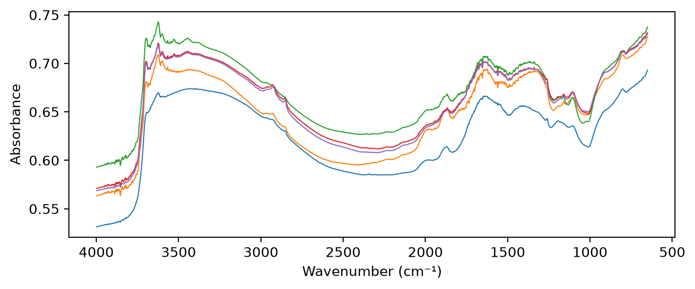

# Fukushima data


<!-- WARNING: THIS FILE WAS AUTOGENERATED! DO NOT EDIT! -->

``` python
from fastcore.test import *
import matplotlib.pyplot as plt
```

The Fukushima data is not public. The cells that read it are marked
`#| fukudata`, and `nbdev-test` skips them unless you run
`nbdev-test --flags fukudata`. The outputs on this page come from a
local run.

## Data location

------------------------------------------------------------------------

### fuku_path

``` python
def fuku_path()->pathlib.Path: # Folder holding the Fukushima data
```

*The `fukushima` folder of `data_path()`*

------------------------------------------------------------------------

### data_path

``` python
def data_path()->pathlib.Path: # Folder holding the data shared by the soilspec projects
```

*The `SOILSPEC_DATA` folder if that variable is set, else `data/` in the
soilspec workspace*

The soilspec workspace keeps the data in `data/`, beside the project
folders. Set `SOILSPEC_DATA` to use a folder elsewhere. The Fukushima
data is in its `fukushima` folder:

``` python
assert fuku_path().is_dir()
sorted(o.name for o in fuku_path().iterdir())
```

    ['MIRS_rawData', 'reference']

## Soil properties

------------------------------------------------------------------------

### load_props

``` python
def load_props()->pandas.DataFrame: # One row per sample, indexed by sample ID
```

*Soil properties of the Fukushima samples*

`load_props` reads the laboratory measurements in
`WetData_2013_2023.csv`. Sample IDs are strings, as in
`Spectra.sample_ids`. Soil property columns start with `soil_`, for
example exchangeable potassium (`soil_ex_K2O`), CEC (`soil_CEC`) and
carbon (`soil_C`):

``` python
props = load_props()
props.shape, [c for c in props.columns if c.startswith('soil_')]
```

    ((2003, 37),
     ['soil_harvest_date',
      'soil_water_soluble_K2O',
      'soil_available_K2O',
      'soil_ex_K2O',
      'soil_pH(H2O)',
      'soil_C',
      'soil_N',
      'soil_CN_ratio',
      'soil_CEC',
      'soil_MgO',
      'soil_CaO',
      'soil_P_absorption_coefficient'])

Exchangeable potassium, `soil_ex_K2O`, is in mg K₂O per 100 g of dry
soil. OSSL gives Kex in cmolc/kg. 1 cmolc/kg of K is 391 mg K per kg, or
39.1 mg K per 100 g. As K₂O (94.2 g/mol, two K per molecule), that is
47.1 mg K₂O per 100 g:

``` python
kex = props['soil_ex_K2O'] / mg_k2o_per_cmolc
kex.describe().round(2).to_dict()
```

    {'count': 1998.0,
     'mean': 0.74,
     'std': 0.48,
     'min': 0.06,
     '25%': 0.41,
     '50%': 0.63,
     '75%': 0.93,
     'max': 4.99}

## Sample selection

The selection is provisional. It can change after review with the
Fukushima colleagues.

It starts from the 1,592 samples of the earlier Cs137 ratio study,
listed in `reference/cs137_ratio_metadata.csv`. Results stay comparable
with that study. 1,401 of them have Thermo OMNIC `.spa` files. The
samples in `excluded` are left out while any of their scans is in doubt:

------------------------------------------------------------------------

### sample_ids

``` python
def sample_ids()->numpy.ndarray: # Sample IDs, in increasing order
```

*IDs of the samples in the current selection*

------------------------------------------------------------------------

### spa_files

``` python
def spa_files()->dict: # Sample ID: `.spa` files of its replicates
```

*The `.spa` files of the Fukushima soil samples, by sample ID*

`sample_ids` applies the selection. Most samples have four replicates,
`a` to `d`:

``` python
ids = sample_ids()
files = spa_files()
test_eq(len(ids), 1401 - len(excluded))
len(ids), pd.Series([len(files[i]) for i in ids]).value_counts().to_dict()
```

    (1389, {4: 1382, 3: 5, 1: 1, 2: 1})

The earlier Cs137 ratio study split its samples into training and test
sets. Its test set is the fixed Fukushima test set of this project.
`cs137_split` keeps the samples of each set that are in the current
selection:

------------------------------------------------------------------------

### cs137_split

``` python
def cs137_split()->tuple: # (training IDs, test IDs), each in increasing order
```

*Training and test sample IDs of the Cs137 ratio study, within the
current selection*

``` python
train_ids, test_ids = cs137_split()
test_eq(len(train_ids) + len(test_ids), len(ids))
len(train_ids), len(test_ids)
```

    (1048, 341)

Each folder of `.spa` files is one measurement batch. `sample_batches`
numbers the batches in the sorted order of their folders:

------------------------------------------------------------------------

### sample_batches

``` python
def sample_batches(
    ids, # Sample IDs
)->numpy.ndarray: # Batch label of each sample, such as 'batch 1'
```

*The measurement batch of each sample*

``` python
pd.Series(sample_batches(ids)).value_counts().to_dict()
```

    {'batch 2': 854, 'batch 1': 535}

## Bruker spectra

377 of the samples were also scanned on a Bruker spectrometer: the 316
Kazu samples (IDs 2600 and up) and 61 others. The Bruker spectra are CSV
exports of wavenumber and absorbance, one file per replicate, named such
as `2600a.csv` or `1624_1.csv`. `bruker_files` lists them by sample ID:

------------------------------------------------------------------------

### load_bruker

``` python
def load_bruker(
    wns, # Wavenumbers to interpolate onto, in cm⁻¹, in increasing order
    ids:NoneType=None, # Sample IDs to load; defaults to every sample in `bruker_files()`
)->soilspecdata.types.Spectra: # One spectrum per sample, with the soil properties in `source`
```

*Load the Bruker spectra, averaging the replicates of each sample*

------------------------------------------------------------------------

### bruker_files

``` python
def bruker_files()->dict: # Sample ID: CSV files of its replicates
```

*The CSV exports of the Bruker spectra of the Fukushima soil samples, by
sample ID*

The Bruker files cover 498 to 3997.5 cm⁻¹, every 2.05 cm⁻¹. They end
just below the 3998 cm⁻¹ of `shared_wns`, so comparisons with Bruker
spectra stop at 3996 cm⁻¹. All 377 samples also have Thermo `.spa`
files:

``` python
bfiles = bruker_files()
paired = sorted(set(bfiles) & set(spa_files()), key=int)
br = load_bruker(np.arange(650, 3997, 2), paired[:3])
len(bfiles), len(paired), sum(int(i) >= 2600 for i in paired), br.spectra.shape
```

    (377, 377, 316, (3, 1674))

## Loading

    /opt/hostedtoolcache/Python/3.12.15/x64/lib/python3.12/site-packages/fastcore/docments.py:478: UserWarning: docments unavailable for load_fuku: ValueError: The truth value of an array with more than one element is ambiguous. Use a.any() or a.all()
      warnings.warn(f'docments unavailable for {self.nm}: {type(e).__name__}: {e}')

------------------------------------------------------------------------

### load_fuku

``` python
load_fuku(wns=array([ 650,  652,  654, ..., 3994, 3996, 3998], shape=(1675,)), ids=None) -> soilspecdata.types.Spectra
```

*Load the Fukushima spectra, averaging the replicates of each sample*

`load_fuku` interpolates each `.spa` file onto `shared_wns`, 2 cm⁻¹ from
650 to 3998 cm⁻¹, then averages the replicates of each sample. The rows
follow `sample_ids()`:

``` python
fuku = load_fuku()
test_eq(fuku.spectra.shape, (len(ids), len(shared_wns)))
test_eq(fuku.sample_ids, ids)
fuku.spectra.shape, fuku.measurement_type
```

    ((1389, 1675), 'abs')

The CO₂ band, around 2300–2400 cm⁻¹, is still in the spectra:

``` python
fig, ax = plt.subplots(figsize=(8, 3))
ax.plot(fuku.wavenumbers, fuku.spectra[:5].T, lw=0.8)
ax.invert_xaxis()
ax.set_xlabel('Wavenumber (cm⁻¹)'); ax.set_ylabel('Absorbance');
```



`Spectra.xy` returns the spectra and targets of the samples that have
both:

``` python
X, y, xy_ids = fuku.xy('soil_ex_K2O')
X.shape, y.shape
```

    ((1388, 1675), (1388, 1))
