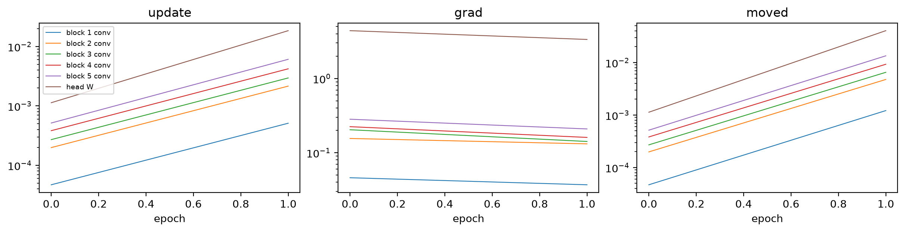
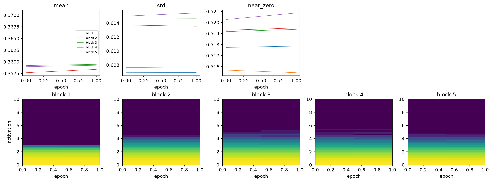
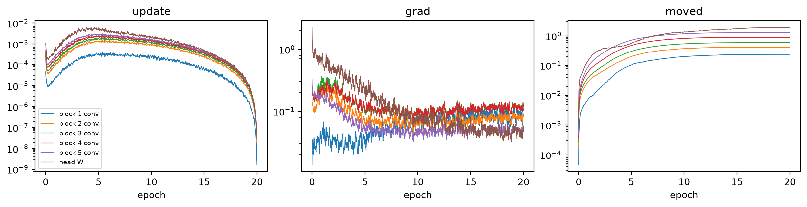
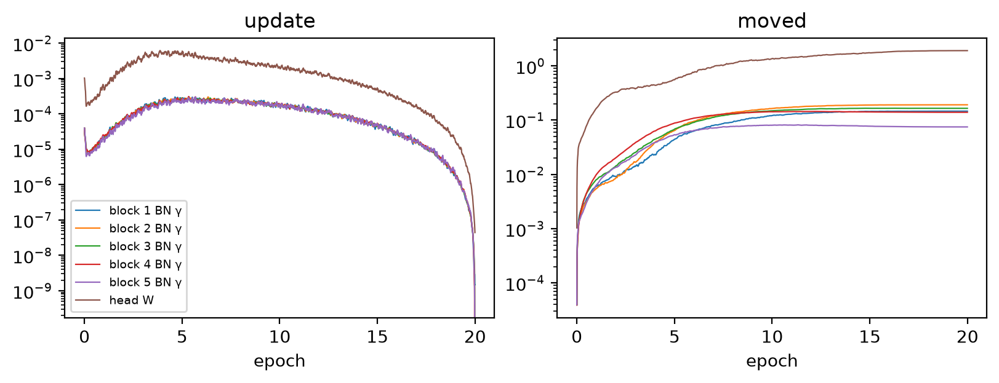
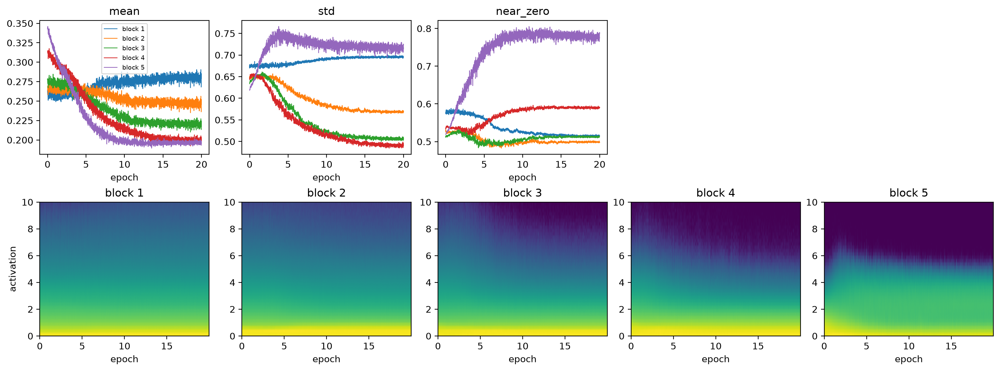
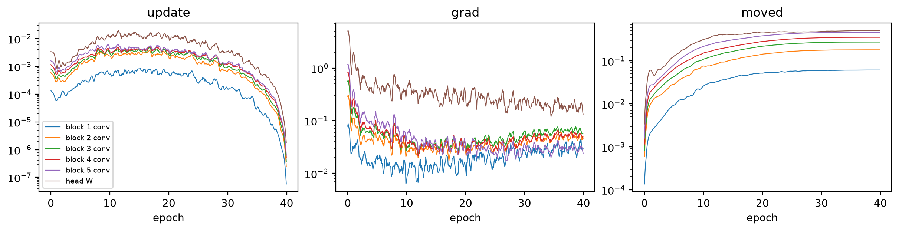
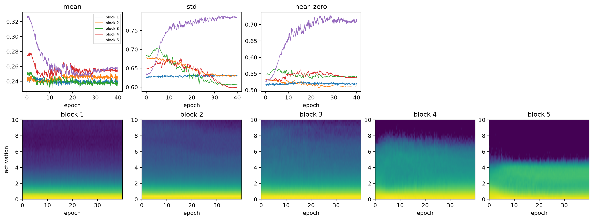
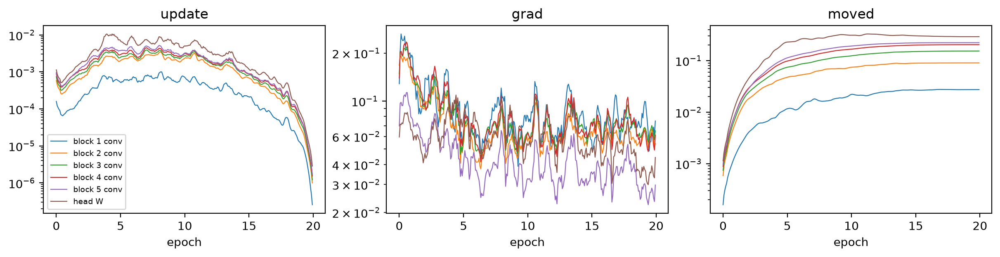
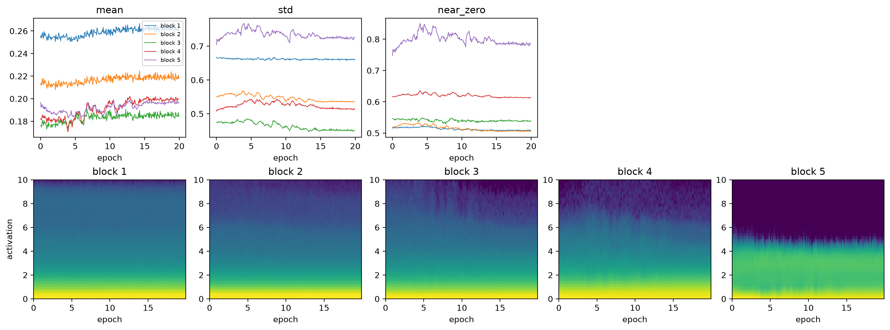

# Training dynamics


<!-- WARNING: THIS FILE WAS AUTOGENERATED! DO NOT EDIT! -->

``` python
import copy
from fastcore.test import *
from fastai.torch_core import set_seed
from soilspecdata.all import load_ossl
from soilspecdl.all import get_spectral_dls, get_splitter, BatchSNV, SpectralCNN, predict
from ossl_fuku_transfer.data import *
from ossl_fuku_transfer.transfer import *
```

The module part uses small random arrays, so it runs without the data.
The sections from *OSSL pretraining* onwards read OSSL and the Fukushima
data, and are marked `#| fukudata`.

## Recording

`param_label` turns a parameter name of `SpectralCNN` into a short
label. Each block has a convolution, then batch norm with scale γ and
shift β:

------------------------------------------------------------------------

### param_label

``` python
def param_label(
    name:str
)->str: # Such as 'block 1 conv', 'block 1 BN γ' or 'head W'
```

*Short label for the parameter `name` of a `SpectralCNN`*

``` python
labels = [param_label(n) for n, _ in SpectralCNN().named_parameters()]
test_eq(labels[:4], ['block 1 conv', 'block 1 BN γ', 'block 1 BN β', 'block 2 conv'])
test_eq(labels[-2:], ['head W', 'head b'])
len(labels)
```

    17

`ParamStats` records, every `every` training steps and for each
parameter tensor:

- `weight`: the norm ‖W‖;
- `grad`: the norm of the gradient;
- `update`: the size of this step relative to the weights, ‖ΔW‖/‖W‖;
- `moved`: how far the weights are from where the fit started, ‖W −
  W₀‖/‖W₀‖.

A relative update near 10⁻³ is a common rule of thumb for a layer that
learns at a sensible rate. Much smaller means the layer barely learns,
and much larger means it is unstable.

Adam scales each element’s step by the history of its own gradients, so
the step per element is similar across layers. The default
initialisation sets a layer’s weights to a scale of about 1/√(fan-in),
the number of inputs to each unit. So with the same learning rate,
‖ΔW‖/‖W‖ grows with √(fan-in). In `SpectralCNN`, the fan-in of the 5
convolutions is 3, 48, 96, 192 and 384. A smaller relative update in
block 1 is therefore expected, and doesn’t by itself mean that block 1
learns less.

------------------------------------------------------------------------

### ParamStats

``` python
def ParamStats(
    every:int=10
):
```

*Record the norm, gradient norm, relative update and relative distance
from the start of each parameter, every `every` steps*

`tracked_fit` trains `learn` with a one-cycle schedule while recording
`ParamStats` and fastai’s `ActivationStats`. The activations are those
of each block’s convolution, batch norm and LeakyReLU, before pooling.
`ActivationStats` gives their mean, standard deviation and `near_zero`,
the share of values ≤ 0.05. After LeakyReLU, those are the units that
are switched off. The histograms span 0 to 10 in 40 bins.

With `fname`, the record is saved in `model_dir()` and loaded on later
calls instead of training again.

------------------------------------------------------------------------

### tracked_fit

``` python
def tracked_fit(
    learn, # Learner from `spectral_learner`, with a `SpectralCNN`
    epochs, # Number of one-cycle epochs
    lr, # Maximum learning rate
    every:int=10, # Record every `every` training steps
    fname:NoneType=None, # File name for the record, without extension; no file if None
)->dict: # Keys 'params', 'acts', 'history', 'steps_per_epoch' and 'state'
```

*Fit `learn` and record its parameter and activation statistics, or load
the record saved under `fname`*

``` python
rng = np.random.default_rng(0)
X_syn, y_syn = rng.random((100, len(shared_wns))), rng.random(100)
dls_syn = fuku_dls(X_syn, y_syn, np.arange(100) >= 80)
set_seed(0)
rec_syn = tracked_fit(spectral_learner(dls_syn, SpectralCNN()), 2, 1e-3, every=2)
p, steps = rec_syn['params'], list(range(0, 2 * rec_syn['steps_per_epoch'], 2))
test_eq(p.param.nunique(), 17)
test_eq(sorted(p.step.unique()), steps)
test_eq(rec_syn['acts']['hist'].shape, (len(steps), 5, 40))
p.head()
```

<div>
<style scoped>
    .dataframe tbody tr th:only-of-type {
        vertical-align: middle;
    }
&#10;    .dataframe tbody tr th {
        vertical-align: top;
    }
&#10;    .dataframe thead th {
        text-align: right;
    }
</style>

<table class="dataframe" data-quarto-postprocess="true" data-border="1">
<thead>
<tr style="text-align: right;">
<th data-quarto-table-cell-role="th"></th>
<th data-quarto-table-cell-role="th">step</th>
<th data-quarto-table-cell-role="th">lr</th>
<th data-quarto-table-cell-role="th">param</th>
<th data-quarto-table-cell-role="th">weight</th>
<th data-quarto-table-cell-role="th">grad</th>
<th data-quarto-table-cell-role="th">update</th>
<th data-quarto-table-cell-role="th">moved</th>
</tr>
</thead>
<tbody>
<tr>
<td data-quarto-table-cell-role="th">0</td>
<td>0</td>
<td>0.00004</td>
<td>block 1 conv</td>
<td>5.867114</td>
<td>0.046041</td>
<td>0.000047</td>
<td>0.000047</td>
</tr>
<tr>
<td data-quarto-table-cell-role="th">1</td>
<td>0</td>
<td>0.00004</td>
<td>block 1 BN γ</td>
<td>3.999980</td>
<td>0.033374</td>
<td>0.000040</td>
<td>0.000040</td>
</tr>
<tr>
<td data-quarto-table-cell-role="th">2</td>
<td>0</td>
<td>0.00004</td>
<td>block 1 BN β</td>
<td>0.003983</td>
<td>0.031638</td>
<td>0.040067</td>
<td>0.039900</td>
</tr>
<tr>
<td data-quarto-table-cell-role="th">3</td>
<td>0</td>
<td>0.00004</td>
<td>block 2 conv</td>
<td>7.797356</td>
<td>0.155505</td>
<td>0.000199</td>
<td>0.000199</td>
</tr>
<tr>
<td data-quarto-table-cell-role="th">4</td>
<td>0</td>
<td>0.00004</td>
<td>block 2 BN γ</td>
<td>5.656854</td>
<td>0.035060</td>
<td>0.000040</td>
<td>0.000040</td>
</tr>
</tbody>
</table>

</div>

## Plotting

`plot_params` plots statistics of `ParamStats` against the epoch, one
line per parameter whose label contains `kind`, plus the head weights.
Each line is a rolling mean over `smooth` records, on a log scale:

------------------------------------------------------------------------

### plot_params

``` python
def plot_params(
    rec, # Record from `tracked_fit`
    stats:tuple=('update', 'grad', 'moved'), # Columns of `rec['params']` to plot, one panel each
    kind:str='conv', # Part of the parameter label to select, such as 'conv' or 'BN γ'
    smooth:int=10, # Window of the rolling mean, in records
):
```

*Plot `stats` of each selected parameter over training*

``` python
plot_params(rec_syn, smooth=1);
```



`plot_acts` plots the activation statistics of each block over training.
The second row shows each block’s histogram over training, as fastai’s
`color_dim` does: the colour is the log of the count, and the vertical
axis spans activations from 0 to 10:

------------------------------------------------------------------------

### plot_acts

``` python
def plot_acts(
    rec, # Record from `tracked_fit`
):
```

*Plot the mean, standard deviation, share ≤ 0.05 and histogram of each
block’s activations over training*

``` python
plot_acts(rec_syn);
```



## Channel activity

`block_acts` runs spectra through a model block by block, and yields
each block’s activations before pooling. `channel_activity` gives, for
each block of a trained model, the share of spectra and positions at
which each channel’s activation is above 0.05. A channel that is almost
never above it is dead: it passes almost nothing to the next block. A
channel that is almost always above it works as a linear unit, since
LeakyReLU then never bends its output.

------------------------------------------------------------------------

### activity_table

``` python
def activity_table(
    acts:dict, # Model name, or tuple of names: result of `channel_activity`
    lo:float=0.01, # A channel is dead below this share
    hi:float=0.99, # A channel is linear above this share
)->pandas.DataFrame:
```

*Number of channels per block that are dead, linear, and in total, for
each model*

------------------------------------------------------------------------

### channel_activity

``` python
def channel_activity(
    model, # Trained `SpectralCNN`
    X, # Preprocessed spectra, one per row
    bs:int=256, # Batch size
)->list: # One array per block, with one share per channel
```

*Share of activations above 0.05 for each channel of each block of
`model`, over the spectra in `X` and all positions*

------------------------------------------------------------------------

### block_acts

``` python
def block_acts(
    model, # Trained `SpectralCNN`
    X, # Preprocessed spectra, one per row
    bs:int=256, # Batch size
):
```

*Yield, for each batch of `X`, the activations of each block of `model`
before pooling, applying `BatchSNV` first as in training*

``` python
m_syn = SpectralCNN()
m_syn.load_state_dict(rec_syn['state'])
act_syn = channel_activity(m_syn, X_syn)
test_eq([len(c) for c in act_syn], [16, 32, 64, 128, 256])
test_eq(all(((c >= 0) & (c <= 1)).all() for c in act_syn), True)
activity_table({'random data': act_syn})
```

<div>
<style scoped>
    .dataframe tbody tr th:only-of-type {
        vertical-align: middle;
    }
&#10;    .dataframe tbody tr th {
        vertical-align: top;
    }
&#10;    .dataframe thead th {
        text-align: right;
    }
</style>

<table class="dataframe" data-quarto-postprocess="true" data-border="1">
<thead>
<tr style="text-align: right;">
<th data-quarto-table-cell-role="th"></th>
<th data-quarto-table-cell-role="th"></th>
<th data-quarto-table-cell-role="th">dead</th>
<th data-quarto-table-cell-role="th">linear</th>
<th data-quarto-table-cell-role="th">channels</th>
</tr>
</thead>
<tbody>
<tr>
<td rowspan="5" data-quarto-table-cell-role="th"
data-valign="top">random data</td>
<td data-quarto-table-cell-role="th">1</td>
<td>0</td>
<td>0</td>
<td>16</td>
</tr>
<tr>
<td data-quarto-table-cell-role="th">2</td>
<td>0</td>
<td>0</td>
<td>32</td>
</tr>
<tr>
<td data-quarto-table-cell-role="th">3</td>
<td>1</td>
<td>2</td>
<td>64</td>
</tr>
<tr>
<td data-quarto-table-cell-role="th">4</td>
<td>17</td>
<td>12</td>
<td>128</td>
</tr>
<tr>
<td data-quarto-table-cell-role="th">5</td>
<td>47</td>
<td>33</td>
<td>256</td>
</tr>
</tbody>
</table>

</div>

## OSSL pretraining

The data and preprocessing are those of `03_kex`: OSSL MIR spectra with
`log1p(Kex)`, SNV and a Savitzky-Golay first derivative fitted on OSSL.
The Fukushima spectra get the same preprocessing and the Cs137 test
split:

``` python
om = load_ossl().mir(wmin=shared_wns[0], wmax=shared_wns[-1])
Xo, yo, _ = om.xy('k.ext_usda.a725_cmolc.kg')
yo = np.log1p(yo.ravel())
fuku = load_fuku()
fuku.source = fuku.source.assign(target=fuku.source['soil_ex_K2O'] / mg_k2o_per_cmolc)
Xf, yf, idf = fuku.xy('target')
yf = np.log1p(yf.ravel())
is_test = np.isin(idf, cs137_split()[1])
pipe = preprocessings()['snv_d1']
Xo_d, Xf_d = pipe.fit_transform(Xo), pipe.transform(Xf)
Xo_d.shape, Xf_d.shape
```

    ((57674, 1675), (1388, 1675))

This run repeats `pretrain('ossl_kex_snv_d1')` with the same split, seed
and schedule (20 epochs, learning rate 10⁻³), recording every 10 steps.
Training on MPS is not fully deterministic, so its weights differ
slightly from the saved pretrained model. The last epoch:

``` python
dls_o = get_spectral_dls(Xo_d, yo, shared_wns, splitter=get_splitter(0.9, 0.1, seed=42), batch_tfms=[BatchSNV()])[0]
set_seed(42)
runs = {'OSSL': tracked_fit(spectral_learner(dls_o, SpectralCNN()), 20, 1e-3, fname='dyn_ossl_kex')}
runs['OSSL']['history'].iloc[-1].round(3).to_dict()
```

    {'train_loss': 0.027, 'valid_loss': 0.03, 'r2_score': 0.792}

``` python
plot_params(runs['OSSL']);
```



``` python
plot_params(runs['OSSL'], kind='BN γ', stats=('update', 'moved'));
```



``` python
plot_acts(runs['OSSL']);
```



## Fukushima

Two runs on the Fukushima training samples, with the schedules that
cross-validation chose in `03_kex`: from random weights (40 epochs,
learning rate 3·10⁻³), and fully fine-tuned from the saved pretrained
model (20 epochs, 3·10⁻³). Both record every 2 steps. The test scores
check that these runs match the comparison in `03_kex`:

``` python
dls_f = fuku_dls(Xf_d, yf, is_test, seed=0)
set_seed(0)
runs['Fukushima only'] = tracked_fit(spectral_learner(dls_f, SpectralCNN()), 40, 3e-3, every=2, fname='dyn_fuku_kex_scratch')
set_seed(0)
pretrained = load_pretrained('ossl_kex_snv_d1')
runs['fully fine-tuned'] = tracked_fit(spectral_learner(dls_f, copy.deepcopy(pretrained)), 20, 3e-3, every=2, fname='dyn_fuku_kex_ft')
models = {}
for k, r in runs.items():
    models[k] = SpectralCNN()
    models[k].load_state_dict(r['state'])
pd.DataFrame({k: scores(yf[is_test], predict(models[k], Xf_d[is_test], shared_wns)) for k in ('Fukushima only', 'fully fine-tuned')}).round(3)
```

<div>
<style scoped>
    .dataframe tbody tr th:only-of-type {
        vertical-align: middle;
    }
&#10;    .dataframe tbody tr th {
        vertical-align: top;
    }
&#10;    .dataframe thead th {
        text-align: right;
    }
</style>

<table class="dataframe" data-quarto-postprocess="true" data-border="1">
<thead>
<tr style="text-align: right;">
<th data-quarto-table-cell-role="th"></th>
<th data-quarto-table-cell-role="th">Fukushima only</th>
<th data-quarto-table-cell-role="th">fully fine-tuned</th>
</tr>
</thead>
<tbody>
<tr>
<td data-quarto-table-cell-role="th">R²</td>
<td>0.377</td>
<td>0.426</td>
</tr>
<tr>
<td data-quarto-table-cell-role="th">r</td>
<td>0.616</td>
<td>0.655</td>
</tr>
<tr>
<td data-quarto-table-cell-role="th">RMSE</td>
<td>0.316</td>
<td>0.303</td>
</tr>
<tr>
<td data-quarto-table-cell-role="th">bias</td>
<td>-0.037</td>
<td>-0.035</td>
</tr>
</tbody>
</table>

</div>

``` python
plot_params(runs['Fukushima only'], smooth=5);
```



``` python
plot_acts(runs['Fukushima only']);
```



``` python
plot_params(runs['fully fine-tuned'], smooth=5);
```



``` python
plot_acts(runs['fully fine-tuned']);
```



## Comparison

How far each parameter moved from its starting weights by the end of
each run, ‖W − W₀‖/‖W₀‖. For the fully fine-tuned model, the start is
the pretrained model. The BN shifts β and the head bias start at or near
zero, so their relative distance means little, and the table leaves them
out:

``` python
moved = pd.DataFrame({k: r['params'].groupby('param', sort=False)['moved'].last() for k, r in runs.items()})
moved[~moved.index.str.contains('β|head b')].round(3)
```

<div>
<style scoped>
    .dataframe tbody tr th:only-of-type {
        vertical-align: middle;
    }
&#10;    .dataframe tbody tr th {
        vertical-align: top;
    }
&#10;    .dataframe thead th {
        text-align: right;
    }
</style>

<table class="dataframe" data-quarto-postprocess="true" data-border="1">
<thead>
<tr style="text-align: right;">
<th data-quarto-table-cell-role="th"></th>
<th data-quarto-table-cell-role="th">OSSL</th>
<th data-quarto-table-cell-role="th">Fukushima only</th>
<th data-quarto-table-cell-role="th">fully fine-tuned</th>
</tr>
<tr>
<th data-quarto-table-cell-role="th">param</th>
<th data-quarto-table-cell-role="th"></th>
<th data-quarto-table-cell-role="th"></th>
<th data-quarto-table-cell-role="th"></th>
</tr>
</thead>
<tbody>
<tr>
<td data-quarto-table-cell-role="th">block 1 conv</td>
<td>0.236</td>
<td>0.061</td>
<td>0.027</td>
</tr>
<tr>
<td data-quarto-table-cell-role="th">block 1 BN γ</td>
<td>0.147</td>
<td>0.036</td>
<td>0.016</td>
</tr>
<tr>
<td data-quarto-table-cell-role="th">block 2 conv</td>
<td>0.413</td>
<td>0.181</td>
<td>0.090</td>
</tr>
<tr>
<td data-quarto-table-cell-role="th">block 2 BN γ</td>
<td>0.192</td>
<td>0.069</td>
<td>0.023</td>
</tr>
<tr>
<td data-quarto-table-cell-role="th">block 3 conv</td>
<td>0.590</td>
<td>0.274</td>
<td>0.154</td>
</tr>
<tr>
<td data-quarto-table-cell-role="th">block 3 BN γ</td>
<td>0.165</td>
<td>0.052</td>
<td>0.033</td>
</tr>
<tr>
<td data-quarto-table-cell-role="th">block 4 conv</td>
<td>0.894</td>
<td>0.353</td>
<td>0.204</td>
</tr>
<tr>
<td data-quarto-table-cell-role="th">block 4 BN γ</td>
<td>0.140</td>
<td>0.053</td>
<td>0.025</td>
</tr>
<tr>
<td data-quarto-table-cell-role="th">block 5 conv</td>
<td>1.283</td>
<td>0.462</td>
<td>0.223</td>
</tr>
<tr>
<td data-quarto-table-cell-role="th">block 5 BN γ</td>
<td>0.075</td>
<td>0.026</td>
<td>0.024</td>
</tr>
<tr>
<td data-quarto-table-cell-role="th">head W</td>
<td>1.912</td>
<td>0.507</td>
<td>0.291</td>
</tr>
</tbody>
</table>

</div>

The median relative update per parameter over each run:

``` python
pd.DataFrame({k: r['params'].groupby('param', sort=False)['update'].median() for k, r in runs.items()}).loc[lambda d: d.index.str.contains('conv|head W')].map('{:.1e}'.format)
```

<div>
<style scoped>
    .dataframe tbody tr th:only-of-type {
        vertical-align: middle;
    }
&#10;    .dataframe tbody tr th {
        vertical-align: top;
    }
&#10;    .dataframe thead th {
        text-align: right;
    }
</style>

<table class="dataframe" data-quarto-postprocess="true" data-border="1">
<thead>
<tr style="text-align: right;">
<th data-quarto-table-cell-role="th"></th>
<th data-quarto-table-cell-role="th">OSSL</th>
<th data-quarto-table-cell-role="th">Fukushima only</th>
<th data-quarto-table-cell-role="th">fully fine-tuned</th>
</tr>
<tr>
<th data-quarto-table-cell-role="th">param</th>
<th data-quarto-table-cell-role="th"></th>
<th data-quarto-table-cell-role="th"></th>
<th data-quarto-table-cell-role="th"></th>
</tr>
</thead>
<tbody>
<tr>
<td data-quarto-table-cell-role="th">block 1 conv</td>
<td>1.3e-04</td>
<td>3.1e-04</td>
<td>3.4e-04</td>
</tr>
<tr>
<td data-quarto-table-cell-role="th">block 2 conv</td>
<td>5.3e-04</td>
<td>1.4e-03</td>
<td>1.3e-03</td>
</tr>
<tr>
<td data-quarto-table-cell-role="th">block 3 conv</td>
<td>6.8e-04</td>
<td>1.9e-03</td>
<td>1.6e-03</td>
</tr>
<tr>
<td data-quarto-table-cell-role="th">block 4 conv</td>
<td>8.5e-04</td>
<td>2.3e-03</td>
<td>1.8e-03</td>
</tr>
<tr>
<td data-quarto-table-cell-role="th">block 5 conv</td>
<td>1.0e-03</td>
<td>2.7e-03</td>
<td>2.0e-03</td>
</tr>
<tr>
<td data-quarto-table-cell-role="th">head W</td>
<td>1.4e-03</td>
<td>5.7e-03</td>
<td>3.1e-03</td>
</tr>
</tbody>
</table>

</div>

Dead and linear channels of each model, per block, on 5,000 OSSL spectra
and on all Fukushima spectra. The blocks have 16, 32, 64, 128 and 256
channels:

``` python
sub = np.random.default_rng(0).choice(len(Xo_d), 5000, replace=False)
acts = {(k, d): channel_activity(m, X) for k, m in models.items() for d, X in (('OSSL', Xo_d[sub]), ('Fukushima', Xf_d))}
activity_table(acts).drop(columns='channels').unstack(level=2)
```

<div>
<style scoped>
    .dataframe tbody tr th:only-of-type {
        vertical-align: middle;
    }
&#10;    .dataframe tbody tr th {
        vertical-align: top;
    }
&#10;    .dataframe thead tr th {
        text-align: left;
    }
</style>

<table class="dataframe" data-quarto-postprocess="true" data-border="1">
<thead>
<tr>
<th data-quarto-table-cell-role="th"></th>
<th data-quarto-table-cell-role="th"></th>
<th colspan="5" data-quarto-table-cell-role="th"
data-halign="left">dead</th>
<th colspan="5" data-quarto-table-cell-role="th"
data-halign="left">linear</th>
</tr>
<tr>
<th data-quarto-table-cell-role="th"></th>
<th data-quarto-table-cell-role="th"></th>
<th data-quarto-table-cell-role="th">1</th>
<th data-quarto-table-cell-role="th">2</th>
<th data-quarto-table-cell-role="th">3</th>
<th data-quarto-table-cell-role="th">4</th>
<th data-quarto-table-cell-role="th">5</th>
<th data-quarto-table-cell-role="th">1</th>
<th data-quarto-table-cell-role="th">2</th>
<th data-quarto-table-cell-role="th">3</th>
<th data-quarto-table-cell-role="th">4</th>
<th data-quarto-table-cell-role="th">5</th>
</tr>
</thead>
<tbody>
<tr>
<td rowspan="2" data-quarto-table-cell-role="th"
data-valign="top">Fukushima only</td>
<td data-quarto-table-cell-role="th">Fukushima</td>
<td>0</td>
<td>0</td>
<td>0</td>
<td>0</td>
<td>0</td>
<td>0</td>
<td>0</td>
<td>0</td>
<td>0</td>
<td>0</td>
</tr>
<tr>
<td data-quarto-table-cell-role="th">OSSL</td>
<td>0</td>
<td>0</td>
<td>0</td>
<td>0</td>
<td>0</td>
<td>0</td>
<td>0</td>
<td>0</td>
<td>0</td>
<td>0</td>
</tr>
<tr>
<td rowspan="2" data-quarto-table-cell-role="th"
data-valign="top">OSSL</td>
<td data-quarto-table-cell-role="th">Fukushima</td>
<td>0</td>
<td>0</td>
<td>0</td>
<td>0</td>
<td>0</td>
<td>0</td>
<td>0</td>
<td>0</td>
<td>0</td>
<td>0</td>
</tr>
<tr>
<td data-quarto-table-cell-role="th">OSSL</td>
<td>0</td>
<td>0</td>
<td>0</td>
<td>0</td>
<td>0</td>
<td>0</td>
<td>0</td>
<td>0</td>
<td>0</td>
<td>0</td>
</tr>
<tr>
<td rowspan="2" data-quarto-table-cell-role="th" data-valign="top">fully
fine-tuned</td>
<td data-quarto-table-cell-role="th">Fukushima</td>
<td>0</td>
<td>0</td>
<td>0</td>
<td>0</td>
<td>0</td>
<td>0</td>
<td>0</td>
<td>0</td>
<td>0</td>
<td>0</td>
</tr>
<tr>
<td data-quarto-table-cell-role="th">OSSL</td>
<td>0</td>
<td>0</td>
<td>0</td>
<td>0</td>
<td>0</td>
<td>0</td>
<td>0</td>
<td>0</td>
<td>0</td>
<td>0</td>
</tr>
</tbody>
</table>

</div>

## Findings

The CNN trains without the usual optimisation problems in all three
runs. Gradients reach block 1. Activations neither collapse nor
saturate. No channel of any block is dead (above 0.05 for less than 1%
of spectra and positions) or linear (above 0.05 for more than 99%), on
OSSL or on Fukushima spectra. At their peak, the relative updates of the
convolutions in blocks 2 to 5 are 1–3·10⁻³ on OSSL (learning rate 10⁻³)
and 2–4·10⁻³ on Fukushima (learning rate 3·10⁻³). Block 1’s are several
times smaller, for the reason in the next paragraph. In all three runs
the updates fall to a few 10⁻⁶ at the end of the one-cycle schedule.

The differences between blocks in update size follow the initialisation,
not the learning. In the first OSSL epoch, the relative updates of
blocks 1 to 5 are in the ratio 1 : 4.2 : 5.7 : 8.1 : 11.3. The square
roots of their fan-ins are in the ratio 1 : 4 : 5.7 : 8 : 11.3. How far
each layer moves by the end of OSSL pretraining also rises from block 1
to block 5, but less steeply: 1 : 1.75 : 2.5 : 3.8 : 5.4. The
initialisation explains part of why block 1 moves least, so that alone
doesn’t show that block 1 learns less.

Block 5 becomes sparse during training. Its share of activations ≤ 0.05
rises from 0.52 to 0.79 during OSSL pretraining, and from 0.53 to 0.72
when training on Fukushima from random weights. At the end, 15–17% of
its activations are above 2.5, against at most 3.4% in blocks 1 to 4.
Each of its channels responds strongly at a few positions and is off
elsewhere. The global average pool then averages those positions.

Fine-tuning keeps the weights close to the pretrained ones. The
convolutions and head move 0.03 to 0.29 of their norm, against 0.24 to
1.91 during pretraining from random weights. Compared with training from
random weights, which runs twice as many epochs, fine-tuning moves each
layer 0.44 to 0.58 as far. No layer takes a clearly larger share of the
change.

In the first epoch of fine-tuning, the median gradient norm of block 1
is 0.21. At the end of OSSL pretraining it was 0.080, 2.6 times smaller.
For the other layers the ratio is 1.6 to 2.2. This hints that the
mismatch between OSSL and Fukushima is largest near the input, but the
evidence is weak: the two gradients are measured at different points of
different schedules.

On Fukushima, the training loss keeps falling after the validation loss
levels off. When fine-tuning, the training loss halves from epoch 10 to
epoch 19 (0.035 to 0.017) while the validation loss stays at
0.039–0.040. On OSSL, the validation R² still rises from 0.67 at epoch
10 to 0.79 at epoch 19. The test scores of the two Fukushima runs (R²
0.38 and 0.43) are close to the means in `03_kex` (0.37 and 0.42).

These diagnostics find no fault in how the network trains. They can’t
show whether it learns the right features for Fukushima. The CKA
comparison and linear probes of `07`, and the wavenumber importance of
`08`, address that.
