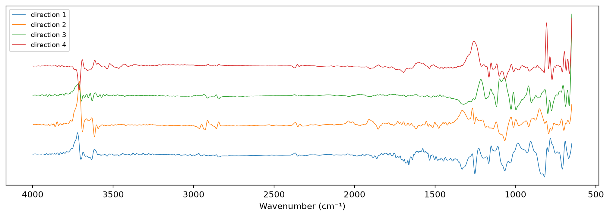

# EPO


<!-- WARNING: THIS FILE WAS AUTOGENERATED! DO NOT EDIT! -->

``` python
import pandas as pd
import matplotlib.pyplot as plt
from fastcore.test import *
from sklearn.linear_model import RidgeCV
from sklearn.pipeline import make_pipeline
from sklearn.preprocessing import StandardScaler
from soilspecdata.all import load_ossl
from soilspecdl.all import get_splitter
from ossl_fuku_transfer.data import *
from ossl_fuku_transfer.transfer import *
from ossl_fuku_transfer.inside import layer_features, probe
from sklearn.neighbors import NearestNeighbors
```

`12_wetchem` found that the OSSL models predict OSSL soils with
properties like the Fukushima soils well, and the Fukushima spectra
poorly. The failure lies in the spectra. External parameter
orthogonalisation (EPO; Roger et al. 2003) removes from every spectrum
the directions in which spectra of the same samples differ between two
measurement conditions. Here the two conditions are the Bruker and
Thermo instruments of `05_paired`, with whatever sample preparation each
used.

The module part uses small random arrays, so it runs without the data.
The sections from *Paired spectra* onwards read OSSL and the Fukushima
data, and are marked `#| fukudata`.

## Projection

`epo_basis` takes the spectra of the same samples under two conditions,
and returns the first `k` right singular vectors of their differences,
one column per direction. The differences are not centred, so the mean
difference between the conditions is part of what the directions
capture. `epo_project` removes those directions from spectra:

------------------------------------------------------------------------

### epo_project

``` python
def epo_project(
    X, # Spectra, one row per sample
    V, # Directions from `epo_basis`
)->numpy.ndarray:
```

*`X` with the directions `V` removed*

------------------------------------------------------------------------

### epo_basis

``` python
def epo_basis(
    Xa, # Spectra under one condition, one row per sample
    Xb, # Spectra of the same samples under the other condition
    k, # Number of directions
)->numpy.ndarray: # One unit column per direction, shape (wavenumbers, k)
```

*The first `k` right singular vectors of `Xa - Xb`*

``` python
rng = np.random.default_rng(0)
Xa = rng.normal(size=(50, 30))
Xb = Xa + np.outer(rng.normal(size=50), np.r_[1., np.zeros(29)])
V = epo_basis(Xa, Xb, 1)
test_close(np.abs(V[:, 0]), np.r_[1., np.zeros(29)], eps=1e-8)
test_close(epo_project(Xa, V) @ V, 0, eps=1e-8)
test_close(epo_project(epo_project(Xa, V), V), epo_project(Xa, V), eps=1e-8)
test_close(epo_project(Xa, V), epo_project(Xb, V), eps=1e-8)
```

## Paired spectra

The paired soils of `05_paired`, without those in the Fukushima test
set, so no test spectrum enters the correction. Both instruments’
spectra get SNV and the Savitzky-Golay first derivative. The Bruker
exports end at 3996 cm⁻¹, one point short of the shared grid, so the
directions are estimated on 650–3996 cm⁻¹ and the projection leaves the
last point, 3998 cm⁻¹, unchanged:

``` python
pw = shared_wns[:-1]
_, test_ids = cs137_split()
ids = [i for i in sorted(set(bruker_files()) & set(spa_files()), key=int) if i not in excluded and i not in set(test_ids)]
br, th = load_bruker(pw, ids), load_fuku(pw, ids)
pipe = preprocessings()['snv_d1']
Xb_p, Xt_p = pipe.fit_transform(br.spectra), pipe.fit_transform(th.spectra)
s = np.linalg.svd(Xt_p - Xb_p, compute_uv=False)
share = s**2 / (s**2).sum()
basis = lambda k: np.vstack([epo_basis(Xt_p, Xb_p, k), np.zeros((1, k))])
len(ids), pd.Series(share.cumsum()[[0, 1, 3, 7, 15, 31]], index=[1, 2, 4, 8, 16, 32], name='cumulative share').round(3).to_dict()
```

    (365, {1: 0.795, 2: 0.838, 4: 0.887, 8: 0.935, 16: 0.964, 32: 0.984})

The first four directions, against wavenumber:

``` python
fig, ax = plt.subplots(figsize=(10, 3.5), layout='constrained')
for j, v in enumerate(basis(4).T): ax.plot(shared_wns, v + 0.15 * j, lw=0.7, label=f'direction {j + 1}')
ax.invert_xaxis(); ax.set_xlabel('Wavenumber (cm⁻¹)'); ax.set_yticks([]); ax.legend(fontsize=8);
```



## Linear check

Before training a CNN, a ridge regression shows whether EPO helps at
all. It trains on 20,000 random OSSL spectra with the target, after
removing the first `k` directions, and predicts zero-shot the Fukushima
spectra with the same directions removed, and 5,000 other OSSL spectra
as a check that EPO keeps what OSSL needs. `k = 0` is no correction. The
Fukushima scores are on the training samples, which choose `k`, and on
the test samples:

``` python
om = load_ossl().mir(wmin=shared_wns[0], wmax=shared_wns[-1])
fuku = load_fuku()
fuku.source = fuku.source.assign(Kex=fuku.source['soil_ex_K2O'] / mg_k2o_per_cmolc, CEC=fuku.source['soil_CEC'])
r = np.random.default_rng(0)
data = {}
for t, col in (('Kex', 'k.ext_usda.a725_cmolc.kg'), ('CEC', 'cec_usda.a723_cmolc.kg')):
    Xo, yo, ido = om.xy(col)
    Xf, yf, idf = fuku.xy(t)
    perm = r.permutation(len(Xo))
    data[t] = dict(Xo=pipe.fit_transform(Xo), yo=np.log1p(yo.ravel()), ido=ido, Xf=pipe.transform(Xf), yf=np.log1p(yf.ravel()),
                   is_test=np.isin(idf, test_ids), tr=perm[:20000], va=perm[20000:25000])

def zero_shot(t, V=None):
    "Scores of a ridge regression trained on OSSL for target `t`, with the directions `V` removed, or none if None"
    d = data[t]
    P = (lambda X: X) if V is None else (lambda X: epo_project(X, V))
    m = make_pipeline(StandardScaler(), RidgeCV(alphas=np.logspace(-1, 6, 15))).fit(P(d['Xo'][d['tr']]), d['yo'][d['tr']])
    pf = m.predict(P(d['Xf']))
    res = {'OSSL R²': scores(d['yo'][d['va']], m.predict(P(d['Xo'][d['va']])))['R²']}
    for s, msk in (('train', ~d['is_test']), ('test', d['is_test'])):
        sc = scores(d['yf'][msk], pf[msk])
        res |= {f'Fukushima {s} R²': sc['R²'], f'Fukushima {s} r': sc['r']}
    return res

ks = [0, 1, 2, 4, 8, 16, 32]
lin = pd.DataFrame([{'target': t, 'k': k, **zero_shot(t, None if k == 0 else basis(k))} for t in data for k in ks]).set_index(['target', 'k'])
lin.round(3)
```

<div>
<style scoped>
    .dataframe tbody tr th:only-of-type {
        vertical-align: middle;
    }
&#10;    .dataframe tbody tr th {
        vertical-align: top;
    }
&#10;    .dataframe thead th {
        text-align: right;
    }
</style>

<table class="dataframe" data-quarto-postprocess="true" data-border="1">
<thead>
<tr style="text-align: right;">
<th data-quarto-table-cell-role="th"></th>
<th data-quarto-table-cell-role="th"></th>
<th data-quarto-table-cell-role="th">OSSL R²</th>
<th data-quarto-table-cell-role="th">Fukushima train R²</th>
<th data-quarto-table-cell-role="th">Fukushima train r</th>
<th data-quarto-table-cell-role="th">Fukushima test R²</th>
<th data-quarto-table-cell-role="th">Fukushima test r</th>
</tr>
<tr>
<th data-quarto-table-cell-role="th">target</th>
<th data-quarto-table-cell-role="th">k</th>
<th data-quarto-table-cell-role="th"></th>
<th data-quarto-table-cell-role="th"></th>
<th data-quarto-table-cell-role="th"></th>
<th data-quarto-table-cell-role="th"></th>
<th data-quarto-table-cell-role="th"></th>
</tr>
</thead>
<tbody>
<tr>
<td rowspan="7" data-quarto-table-cell-role="th"
data-valign="top">Kex</td>
<td data-quarto-table-cell-role="th">0</td>
<td>0.652</td>
<td>-21.759</td>
<td>-0.055</td>
<td>-19.623</td>
<td>0.040</td>
</tr>
<tr>
<td data-quarto-table-cell-role="th">1</td>
<td>0.651</td>
<td>-27.379</td>
<td>-0.051</td>
<td>-23.172</td>
<td>0.039</td>
</tr>
<tr>
<td data-quarto-table-cell-role="th">2</td>
<td>0.652</td>
<td>-31.947</td>
<td>-0.049</td>
<td>-27.459</td>
<td>0.040</td>
</tr>
<tr>
<td data-quarto-table-cell-role="th">4</td>
<td>0.652</td>
<td>-8.075</td>
<td>-0.045</td>
<td>-7.396</td>
<td>-0.029</td>
</tr>
<tr>
<td data-quarto-table-cell-role="th">8</td>
<td>0.655</td>
<td>-13.554</td>
<td>-0.043</td>
<td>-12.384</td>
<td>-0.045</td>
</tr>
<tr>
<td data-quarto-table-cell-role="th">16</td>
<td>0.655</td>
<td>-6.882</td>
<td>-0.035</td>
<td>-6.908</td>
<td>-0.078</td>
</tr>
<tr>
<td data-quarto-table-cell-role="th">32</td>
<td>0.649</td>
<td>-2.500</td>
<td>-0.021</td>
<td>-2.850</td>
<td>-0.089</td>
</tr>
<tr>
<td rowspan="7" data-quarto-table-cell-role="th"
data-valign="top">CEC</td>
<td data-quarto-table-cell-role="th">0</td>
<td>0.956</td>
<td>-1.337</td>
<td>0.503</td>
<td>-1.340</td>
<td>0.474</td>
</tr>
<tr>
<td data-quarto-table-cell-role="th">1</td>
<td>0.957</td>
<td>-5.743</td>
<td>0.365</td>
<td>-5.828</td>
<td>0.354</td>
</tr>
<tr>
<td data-quarto-table-cell-role="th">2</td>
<td>0.957</td>
<td>-1.928</td>
<td>0.464</td>
<td>-1.882</td>
<td>0.431</td>
</tr>
<tr>
<td data-quarto-table-cell-role="th">4</td>
<td>0.957</td>
<td>-1.029</td>
<td>0.539</td>
<td>-0.808</td>
<td>0.487</td>
</tr>
<tr>
<td data-quarto-table-cell-role="th">8</td>
<td>0.957</td>
<td>-3.167</td>
<td>0.437</td>
<td>-3.376</td>
<td>0.400</td>
</tr>
<tr>
<td data-quarto-table-cell-role="th">16</td>
<td>0.957</td>
<td>-2.209</td>
<td>0.459</td>
<td>-2.357</td>
<td>0.400</td>
</tr>
<tr>
<td data-quarto-table-cell-role="th">32</td>
<td>0.957</td>
<td>-0.797</td>
<td>0.551</td>
<td>-1.055</td>
<td>0.428</td>
</tr>
</tbody>
</table>

</div>

## Analogue EPO

The paired Bruker spectra fail with the OSSL models too, so correcting
towards them cannot work. The soil analogues of `12_wetchem` give pairs
with OSSL itself: each Fukushima soil and the OSSL sample with the
closest properties. The two soils of a pair are not the same, so their
spectral differences mix soil variation with the difference in
measurement. Over many pairs, the measurement difference is systematic
and should dominate the first directions.

For each target, the pairs use only the Fukushima training samples, and
OSSL samples outside that target’s 5,000 check samples. The matching is
that of `12_wetchem`: nearest neighbour in the seven standardised
properties of `prop_features`. Then the same ridge regressions as above,
with the analogue directions removed:

``` python
op, fp = prop_features(ossl_shared_props(om)), prop_features(fuku_shared_props(fuku.sample_ids))
sc_p = StandardScaler().fit(op)
opos = pd.Series(np.arange(len(om.sample_ids)), index=om.sample_ids)
fpos = pd.Series(np.arange(len(fuku.sample_ids)), index=fuku.sample_ids)
f_train = fp.index[~np.isin(fp.index, test_ids)]
Xf_all = pipe.transform(fuku.spectra)
pairs, abasis = {}, {}
for t, d in data.items():
    pool = op.index.difference(d['ido'][d['va']])
    nn = NearestNeighbors(n_neighbors=1).fit(sc_p.transform(op.loc[pool]))
    an = pool[nn.kneighbors(sc_p.transform(fp.loc[f_train]))[1][:, 0]]
    Xa_f, Xa_o = Xf_all[fpos[f_train].to_numpy()], pipe.transform(om.spectra[opos[an].to_numpy()])
    sv = np.linalg.svd(Xa_f - Xa_o, compute_uv=False)
    pairs[t] = {'pairs': len(f_train), 'distinct analogues': len(np.unique(an)), 'share of direction 1': (sv[0]**2 / (sv**2).sum()), 'share of 8': (sv[:8]**2).sum() / (sv**2).sum()}
    abasis[t] = lambda k, Xa_f=Xa_f, Xa_o=Xa_o: epo_basis(Xa_f, Xa_o, k)
pd.DataFrame(pairs).round(3)
```

<div>
<style scoped>
    .dataframe tbody tr th:only-of-type {
        vertical-align: middle;
    }
&#10;    .dataframe tbody tr th {
        vertical-align: top;
    }
&#10;    .dataframe thead th {
        text-align: right;
    }
</style>

<table class="dataframe" data-quarto-postprocess="true" data-border="1">
<thead>
<tr style="text-align: right;">
<th data-quarto-table-cell-role="th"></th>
<th data-quarto-table-cell-role="th">Kex</th>
<th data-quarto-table-cell-role="th">CEC</th>
</tr>
</thead>
<tbody>
<tr>
<td data-quarto-table-cell-role="th">pairs</td>
<td>1045.000</td>
<td>1045.000</td>
</tr>
<tr>
<td data-quarto-table-cell-role="th">distinct analogues</td>
<td>685.000</td>
<td>694.000</td>
</tr>
<tr>
<td data-quarto-table-cell-role="th">share of direction 1</td>
<td>0.684</td>
<td>0.679</td>
</tr>
<tr>
<td data-quarto-table-cell-role="th">share of 8</td>
<td>0.914</td>
<td>0.915</td>
</tr>
</tbody>
</table>

</div>

``` python
alin = pd.DataFrame([{'target': t, 'k': k, **zero_shot(t, None if k == 0 else abasis[t](k))} for t in data for k in ks]).set_index(['target', 'k'])
alin.round(3)
```

<div>
<style scoped>
    .dataframe tbody tr th:only-of-type {
        vertical-align: middle;
    }
&#10;    .dataframe tbody tr th {
        vertical-align: top;
    }
&#10;    .dataframe thead th {
        text-align: right;
    }
</style>

<table class="dataframe" data-quarto-postprocess="true" data-border="1">
<thead>
<tr style="text-align: right;">
<th data-quarto-table-cell-role="th"></th>
<th data-quarto-table-cell-role="th"></th>
<th data-quarto-table-cell-role="th">OSSL R²</th>
<th data-quarto-table-cell-role="th">Fukushima train R²</th>
<th data-quarto-table-cell-role="th">Fukushima train r</th>
<th data-quarto-table-cell-role="th">Fukushima test R²</th>
<th data-quarto-table-cell-role="th">Fukushima test r</th>
</tr>
<tr>
<th data-quarto-table-cell-role="th">target</th>
<th data-quarto-table-cell-role="th">k</th>
<th data-quarto-table-cell-role="th"></th>
<th data-quarto-table-cell-role="th"></th>
<th data-quarto-table-cell-role="th"></th>
<th data-quarto-table-cell-role="th"></th>
<th data-quarto-table-cell-role="th"></th>
</tr>
</thead>
<tbody>
<tr>
<td rowspan="7" data-quarto-table-cell-role="th"
data-valign="top">Kex</td>
<td data-quarto-table-cell-role="th">0</td>
<td>0.652</td>
<td>-21.759</td>
<td>-0.055</td>
<td>-19.623</td>
<td>0.040</td>
</tr>
<tr>
<td data-quarto-table-cell-role="th">1</td>
<td>0.652</td>
<td>-19.193</td>
<td>-0.058</td>
<td>-16.989</td>
<td>0.033</td>
</tr>
<tr>
<td data-quarto-table-cell-role="th">2</td>
<td>0.653</td>
<td>-7.340</td>
<td>-0.060</td>
<td>-6.845</td>
<td>0.003</td>
</tr>
<tr>
<td data-quarto-table-cell-role="th">4</td>
<td>0.654</td>
<td>-2.079</td>
<td>-0.049</td>
<td>-2.354</td>
<td>-0.055</td>
</tr>
<tr>
<td data-quarto-table-cell-role="th">8</td>
<td>0.652</td>
<td>-2.328</td>
<td>0.107</td>
<td>-2.966</td>
<td>0.097</td>
</tr>
<tr>
<td data-quarto-table-cell-role="th">16</td>
<td>0.656</td>
<td>-2.390</td>
<td>0.106</td>
<td>-2.648</td>
<td>0.061</td>
</tr>
<tr>
<td data-quarto-table-cell-role="th">32</td>
<td>0.655</td>
<td>-2.850</td>
<td>0.162</td>
<td>-3.190</td>
<td>0.068</td>
</tr>
<tr>
<td rowspan="7" data-quarto-table-cell-role="th"
data-valign="top">CEC</td>
<td data-quarto-table-cell-role="th">0</td>
<td>0.956</td>
<td>-1.337</td>
<td>0.503</td>
<td>-1.340</td>
<td>0.474</td>
</tr>
<tr>
<td data-quarto-table-cell-role="th">1</td>
<td>0.957</td>
<td>-1.483</td>
<td>0.481</td>
<td>-1.444</td>
<td>0.446</td>
</tr>
<tr>
<td data-quarto-table-cell-role="th">2</td>
<td>0.957</td>
<td>-0.963</td>
<td>0.528</td>
<td>-0.915</td>
<td>0.487</td>
</tr>
<tr>
<td data-quarto-table-cell-role="th">4</td>
<td>0.957</td>
<td>-0.750</td>
<td>0.551</td>
<td>-0.641</td>
<td>0.507</td>
</tr>
<tr>
<td data-quarto-table-cell-role="th">8</td>
<td>0.957</td>
<td>-0.983</td>
<td>0.541</td>
<td>-0.932</td>
<td>0.497</td>
</tr>
<tr>
<td data-quarto-table-cell-role="th">16</td>
<td>0.956</td>
<td>-1.853</td>
<td>0.420</td>
<td>-2.283</td>
<td>0.325</td>
</tr>
<tr>
<td data-quarto-table-cell-role="th">32</td>
<td>0.956</td>
<td>-2.059</td>
<td>0.397</td>
<td>-3.111</td>
<td>0.305</td>
</tr>
</tbody>
</table>

</div>

## Findings

EPO with the paired Bruker and Thermo spectra doesn’t make OSSL models
transfer to Fukushima. With a ridge regression trained on OSSL, the
zero-shot correlation for Fukushima Kex stays between −0.09 and 0.04 for
every number of removed directions from 0 to 32, on the training and the
test samples. For CEC it varies between 0.35 and 0.55 without a
consistent gain over no correction (0.50 on the training samples, 0.47
on the test samples). The OSSL validation R² stays at 0.65 for Kex and
0.96 for CEC, so the projection keeps what OSSL needs, but it doesn’t
fix Fukushima. All Fukushima R² values are negative, from large biases.

The 365 paired soils give a clear structure: the first direction holds
80% of the squared differences, and 8 directions hold 94%.

A likely reason is in `05_paired`. The OSSL Kex model fails on the
Bruker spectra of these soils too (correlation 0.19). EPO removes how
the Thermo spectra differ from these Bruker spectra. Even a perfect
correction would only bring the Thermo spectra to the Bruker spectra,
which are themselves not like OSSL’s for Kex. The Bruker instrument and
preparation behind these exports are not known, and may differ from
those of the KSSL spectra in OSSL.

EPO from the soil analogues doesn’t fix the transfer either. Its 1,045
pairs per target use about 690 distinct OSSL analogues. The first
direction holds 68% of the squared differences, and 8 directions hold
91%. Removing them reduces the Kex bias: the Fukushima R² rises from −20
to −22 without correction to between −2 and −3 for 4 directions or more.
The correlation stays low: at most 0.16 on the training samples and 0.10
on the test samples. For CEC, 4 directions give the best correlation,
0.55 on the training samples and 0.51 on the test samples, against 0.50
and 0.47 without correction. More directions lower it.

Neither linear correction, towards the Bruker spectra or towards OSSL
analogues, gives the ridge regression a usable zero-shot correlation for
Kex. Pretraining the CNN on EPO-projected OSSL spectra was not run,
because the linear checks give no reason to expect a gain.
