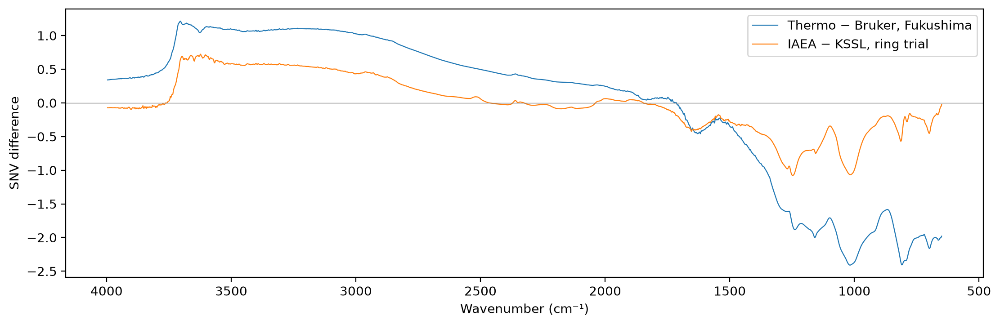
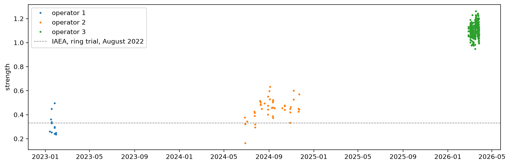

# The IAEA artefact


<!-- WARNING: THIS FILE WAS AUTOGENERATED! DO NOT EDIT! -->

``` python
import numpy as np, pandas as pd
import matplotlib.pyplot as plt
from scipy.stats import spearmanr
from sklearn.linear_model import Ridge
from sklearn.pipeline import make_pipeline
from sklearn.preprocessing import StandardScaler
from fastcore.test import *
from soilspecdata.all import load_ossl
from soilspecdata.datasets.ringtrial import load_ringtrial
from soilspecdl.all import get_splitter, group_folds, predict, regression_scores
from ossl_fuku_transfer.data import *
from ossl_fuku_transfer.transfer import preprocessings, load_pretrained
from ossl_fuku_transfer.grouped import oof_preds
from ossl_fuku_transfer.epo import epo_project
from ossl_fuku_transfer.inside import layer_features
```

    /Users/franckalbinet/aai-ws/.venv/lib/python3.13/site-packages/torch/jit/_script.py:1491: FutureWarning: `torch.jit.script` is deprecated. Please switch to `torch.compile` or `torch.export`.
      warnings.warn(

The cells that read the Fukushima data are marked `#| fukudata` and
`#| rtdata`, because they read the Fukushima data and the ring trial.
The outputs on this page come from a local run.

After SNV, the Thermo spectra of the Fukushima soils are higher than
their OSSL analogues at 2800–3700 cm⁻¹ and lower below 2000 cm⁻¹
(`16_moisture`). `ossl-rt-transfer/10_where_it_fails` found the same
shift in the ring-trial scans of the IAEA Nicolet, on soils that
Woodwell prepared centrally, and on almost every soil. This notebook
measures the shift on the Fukushima soils that both instruments scanned,
finds what its strength depends on, and tests whether it harms the
predictions and whether removing it helps.

The OSSL models also fail on the Bruker spectra of the same soils
(`05_paired`). A correction of the Thermo spectra can therefore at most
bring the predictions to the Bruker level. The tests report that
ceiling.

## The artefact

All spectra on the 2 cm⁻¹ grid from 650 to 3996 cm⁻¹, the range of the
Bruker exports, with SNV. The artefact profile is the mean difference
between the Thermo and Bruker spectra of the same soils, and the
ring-trial profile the mean difference between the IAEA and KSSL spectra
of the 70 ring-trial soils:

``` python
pw = shared_wns[:-1]
snv = lambda A: (A - A.mean(1, keepdims=True)) / A.std(1, keepdims=True)
pids = [i for i in sorted(set(bruker_files()) & set(spa_files()), key=int) if i not in excluded]
br, th = load_bruker(pw, pids), load_fuku(pw, pids)
D_tb = snv(th.spectra) - snv(br.spectra)
rt = load_ringtrial(data_path()/'ringtrial')
rt_ids = sorted(set(rt['IAEA_aug2022'].sample_ids) & set(rt['KSSL'].sample_ids))
def on(sp, ids): return sp.spectra[pd.Index(sp.sample_ids).get_indexer(ids)][:, np.isin(sp.wavenumbers, pw)]
Ria, Rks = on(rt['IAEA_aug2022'], rt_ids), on(rt['KSSL'], rt_ids)
D_rt = snv(Ria) - snv(Rks)
p_tb, p_rt = D_tb.mean(0), D_rt.mean(0)
len(pids), len(rt_ids), np.corrcoef(p_tb, p_rt)[0, 1].round(3)
```

    (376, 70, np.float64(0.872))

``` python
regions = {'650–1300': (650, 1300), '1300–1610': (1300, 1610), 'H–O–H bend 1610–1650': (1610, 1650), '1650–2000': (1650, 2000),
           '2000–2800': (2000, 2800), '2800–3200': (2800, 3200), 'O–H stretch 3200–3450': (3200, 3450), '3450–3700': (3450, 3700), '3700–3996': (3700, 3996)}
def by_region(D, f): return pd.Series({k: f(D[:, (pw >= lo) & (pw <= hi)]) for k, (lo, hi) in regions.items()})
pd.DataFrame({'Thermo − Bruker, mean': by_region(D_tb, np.mean), 'share higher': by_region(D_tb, lambda d: (d > 0).mean()),
              'IAEA − KSSL, mean': by_region(D_rt, np.mean), 'share higher ': by_region(D_rt, lambda d: (d > 0).mean())}).round(3)
```

<div>
<style scoped>
    .dataframe tbody tr th:only-of-type {
        vertical-align: middle;
    }
&#10;    .dataframe tbody tr th {
        vertical-align: top;
    }
&#10;    .dataframe thead th {
        text-align: right;
    }
</style>

<table class="dataframe" data-quarto-postprocess="true" data-border="1">
<thead>
<tr style="text-align: right;">
<th data-quarto-table-cell-role="th"></th>
<th data-quarto-table-cell-role="th">Thermo − Bruker, mean</th>
<th data-quarto-table-cell-role="th">share higher</th>
<th data-quarto-table-cell-role="th">IAEA − KSSL, mean</th>
<th data-quarto-table-cell-role="th">share higher</th>
</tr>
</thead>
<tbody>
<tr>
<td data-quarto-table-cell-role="th">650–1300</td>
<td>-1.958</td>
<td>0.002</td>
<td>-0.534</td>
<td>0.104</td>
</tr>
<tr>
<td data-quarto-table-cell-role="th">1300–1610</td>
<td>-0.644</td>
<td>0.001</td>
<td>-0.373</td>
<td>0.105</td>
</tr>
<tr>
<td data-quarto-table-cell-role="th">H–O–H bend 1610–1650</td>
<td>-0.430</td>
<td>0.001</td>
<td>-0.389</td>
<td>0.018</td>
</tr>
<tr>
<td data-quarto-table-cell-role="th">1650–2000</td>
<td>0.058</td>
<td>0.729</td>
<td>-0.065</td>
<td>0.412</td>
</tr>
<tr>
<td data-quarto-table-cell-role="th">2000–2800</td>
<td>0.463</td>
<td>0.952</td>
<td>0.030</td>
<td>0.471</td>
</tr>
<tr>
<td data-quarto-table-cell-role="th">2800–3200</td>
<td>1.013</td>
<td>1.000</td>
<td>0.442</td>
<td>0.996</td>
</tr>
<tr>
<td data-quarto-table-cell-role="th">O–H stretch 3200–3450</td>
<td>1.084</td>
<td>1.000</td>
<td>0.567</td>
<td>1.000</td>
</tr>
<tr>
<td data-quarto-table-cell-role="th">3450–3700</td>
<td>1.111</td>
<td>1.000</td>
<td>0.633</td>
<td>0.994</td>
</tr>
<tr>
<td data-quarto-table-cell-role="th">3700–3996</td>
<td>0.495</td>
<td>0.860</td>
<td>0.002</td>
<td>0.359</td>
</tr>
</tbody>
</table>

</div>

``` python
fig, ax = plt.subplots(figsize=(11, 3.5), layout='constrained')
ax.plot(pw, p_tb, lw=0.8, label='Thermo − Bruker, Fukushima'); ax.plot(pw, p_rt, lw=0.8, label='IAEA − KSSL, ring trial')
ax.axhline(0, c='grey', lw=0.5); ax.invert_xaxis(); ax.set_xlabel('Wavenumber (cm⁻¹)'); ax.set_ylabel('SNV difference'); ax.legend();
```



## Strength by operator

The strength of the artefact in a scan is the least-squares coefficient
of its difference from the Bruker spectrum of the same soil on the
profile `p_tb`, so the mean strength over the paired soils is 1. The
strength of each replicate, against the mean Bruker spectrum of its
soil, splits the variation into a part within samples, from loading the
cup, and a part between samples:

``` python
strength = lambda D: D @ p_tb / (p_tb @ p_tb)
s = strength(D_tb)
reps = load_replicates(pw, pids)
s_rep = pd.Series(strength(snv(reps.spectra) - snv(br.spectra)[pd.Index(br.sample_ids).get_indexer(reps.sample_ids)]), index=reps.sample_ids)
test_close(s.mean(), 1, eps=1e-9)
pd.Series({'within samples': s_rep.groupby(level=0).var().mean(), 'between samples': s_rep.groupby(level=0).mean().var()}, name='variance').round(4)
```

    within samples     0.0029
    between samples    0.0667
    Name: variance, dtype: float64

`sample_batches` numbers the folders of the Thermo files, one per
operator: batch 1 is operator 1’s, batch 2 operator 2’s and batch 3
operator 3’s. The strength by batch, by year of sampling and by soil
type, and its Spearman correlation with soil properties. The ring-trial
strength uses the same profile:

``` python
ops = {'batch 1': 'operator 1', 'batch 2': 'operator 2', 'batch 3': 'operator 3'}
meta = pd.DataFrame({'strength': s, 'operator': pd.Series(sample_batches(pids)).map(ops).values}, index=pids).join(th.source.reindex(pids)[['year', 'Soil_type_describe', 'soil_C', 'soil_CEC', 'clay']])
display(pd.concat({g: meta.groupby(g).strength.agg(['count', 'mean', 'std']) for g in ['operator', 'year']}).round(3))
s_ring = D_rt @ p_tb / (p_tb @ p_tb)
pd.Series({**{f'ρ with {c}': spearmanr(meta.strength, pd.to_numeric(meta[c], errors='coerce'), nan_policy='omit')[0] for c in ['soil_C', 'soil_CEC', 'clay']},
           'ring trial, IAEA, mean strength': s_ring.mean()}).round(3)
```

<div>
<style scoped>
    .dataframe tbody tr th:only-of-type {
        vertical-align: middle;
    }
&#10;    .dataframe tbody tr th {
        vertical-align: top;
    }
&#10;    .dataframe thead th {
        text-align: right;
    }
</style>

<table class="dataframe" data-quarto-postprocess="true" data-border="1">
<thead>
<tr style="text-align: right;">
<th data-quarto-table-cell-role="th"></th>
<th data-quarto-table-cell-role="th"></th>
<th data-quarto-table-cell-role="th">count</th>
<th data-quarto-table-cell-role="th">mean</th>
<th data-quarto-table-cell-role="th">std</th>
</tr>
</thead>
<tbody>
<tr>
<td rowspan="3" data-quarto-table-cell-role="th"
data-valign="top">operator</td>
<td data-quarto-table-cell-role="th">operator 1</td>
<td>12</td>
<td>0.317</td>
<td>0.084</td>
</tr>
<tr>
<td data-quarto-table-cell-role="th">operator 2</td>
<td>48</td>
<td>0.450</td>
<td>0.087</td>
</tr>
<tr>
<td data-quarto-table-cell-role="th">operator 3</td>
<td>316</td>
<td>1.109</td>
<td>0.057</td>
</tr>
<tr>
<td rowspan="7" data-quarto-table-cell-role="th"
data-valign="top">year</td>
<td data-quarto-table-cell-role="th">2016.0</td>
<td>14</td>
<td>0.469</td>
<td>0.060</td>
</tr>
<tr>
<td data-quarto-table-cell-role="th">2017.0</td>
<td>12</td>
<td>0.480</td>
<td>0.075</td>
</tr>
<tr>
<td data-quarto-table-cell-role="th">2018.0</td>
<td>12</td>
<td>0.317</td>
<td>0.084</td>
</tr>
<tr>
<td data-quarto-table-cell-role="th">2019.0</td>
<td>11</td>
<td>0.490</td>
<td>0.053</td>
</tr>
<tr>
<td data-quarto-table-cell-role="th">2020.0</td>
<td>11</td>
<td>0.353</td>
<td>0.089</td>
</tr>
<tr>
<td data-quarto-table-cell-role="th">2022.0</td>
<td>161</td>
<td>1.092</td>
<td>0.051</td>
</tr>
<tr>
<td data-quarto-table-cell-role="th">2023.0</td>
<td>155</td>
<td>1.128</td>
<td>0.056</td>
</tr>
</tbody>
</table>

</div>

    ρ with soil_C                     -0.143
    ρ with soil_CEC                    0.010
    ρ with clay                        0.084
    ring trial, IAEA, mean strength    0.332
    dtype: float64

The projection of the Thermo and Bruker spectra on the profile, by
operator, shows on which side the difference between operators lies:

``` python
proj = lambda S: S @ p_tb / (p_tb @ p_tb)
pd.DataFrame({'Thermo': proj(snv(th.spectra)), 'Bruker': proj(snv(br.spectra)), 'operator': meta.operator.values}).groupby('operator').agg(['mean', 'std']).round(3)
```

<div>
<style scoped>
    .dataframe tbody tr th:only-of-type {
        vertical-align: middle;
    }
&#10;    .dataframe tbody tr th {
        vertical-align: top;
    }
&#10;    .dataframe thead tr th {
        text-align: left;
    }
&#10;    .dataframe thead tr:last-of-type th {
        text-align: right;
    }
</style>

<table class="dataframe" data-quarto-postprocess="true" data-border="1">
<thead>
<tr>
<th data-quarto-table-cell-role="th"></th>
<th colspan="2" data-quarto-table-cell-role="th"
data-halign="left">Thermo</th>
<th colspan="2" data-quarto-table-cell-role="th"
data-halign="left">Bruker</th>
</tr>
<tr>
<th data-quarto-table-cell-role="th"></th>
<th data-quarto-table-cell-role="th">mean</th>
<th data-quarto-table-cell-role="th">std</th>
<th data-quarto-table-cell-role="th">mean</th>
<th data-quarto-table-cell-role="th">std</th>
</tr>
<tr>
<th data-quarto-table-cell-role="th">operator</th>
<th data-quarto-table-cell-role="th"></th>
<th data-quarto-table-cell-role="th"></th>
<th data-quarto-table-cell-role="th"></th>
<th data-quarto-table-cell-role="th"></th>
</tr>
</thead>
<tbody>
<tr>
<td data-quarto-table-cell-role="th">operator 1</td>
<td>-0.197</td>
<td>0.080</td>
<td>-0.514</td>
<td>0.041</td>
</tr>
<tr>
<td data-quarto-table-cell-role="th">operator 2</td>
<td>-0.123</td>
<td>0.098</td>
<td>-0.573</td>
<td>0.043</td>
</tr>
<tr>
<td data-quarto-table-cell-role="th">operator 3</td>
<td>0.572</td>
<td>0.070</td>
<td>-0.537</td>
<td>0.039</td>
</tr>
</tbody>
</table>

</div>

## Strength by scan date

A colleague who measured cassava plants on a similar set-up found that
opening the sample chamber from above moved the mirrors, so that the
alignment changed between batches. If this happened here, the strength
should change between measurement sessions and stay stable within one.

`spa_time` reads the acquisition time from a Thermo `.spa` file, stored
at byte 296 as seconds since 31 December 1899, the layout that common
`.spa` readers use. The file modification times only record when the
files were copied, in October 2026:

``` python
import struct, datetime
def spa_time(fn):
    "Acquisition time of the Thermo `.spa` file `fn`"
    with open(fn, 'rb') as f:
        f.seek(296)
        return datetime.datetime(1899, 12, 31) + datetime.timedelta(seconds=struct.unpack('<I', f.read(4))[0])
```

The mean strength of the paired soils by scan day, with the standard
deviation within each day:

``` python
meta['day'] = [spa_time(spa_files()[i][0]).date() for i in meta.index]
display(meta.groupby('operator').day.agg(['min', 'max']))
days = meta.groupby(['operator', 'day']).strength.agg(['count', 'mean', 'std'])
days.round(3)
```

<div>
<style scoped>
    .dataframe tbody tr th:only-of-type {
        vertical-align: middle;
    }
&#10;    .dataframe tbody tr th {
        vertical-align: top;
    }
&#10;    .dataframe thead th {
        text-align: right;
    }
</style>

<table class="dataframe" data-quarto-postprocess="true" data-border="1">
<thead>
<tr style="text-align: right;">
<th data-quarto-table-cell-role="th"></th>
<th data-quarto-table-cell-role="th">min</th>
<th data-quarto-table-cell-role="th">max</th>
</tr>
<tr>
<th data-quarto-table-cell-role="th">operator</th>
<th data-quarto-table-cell-role="th"></th>
<th data-quarto-table-cell-role="th"></th>
</tr>
</thead>
<tbody>
<tr>
<td data-quarto-table-cell-role="th">operator 1</td>
<td>2023-01-13</td>
<td>2023-01-30</td>
</tr>
<tr>
<td data-quarto-table-cell-role="th">operator 2</td>
<td>2024-06-27</td>
<td>2024-11-22</td>
</tr>
<tr>
<td data-quarto-table-cell-role="th">operator 3</td>
<td>2026-02-26</td>
<td>2026-03-27</td>
</tr>
</tbody>
</table>

</div>

<div>
<style scoped>
    .dataframe tbody tr th:only-of-type {
        vertical-align: middle;
    }
&#10;    .dataframe tbody tr th {
        vertical-align: top;
    }
&#10;    .dataframe thead th {
        text-align: right;
    }
</style>

<table class="dataframe" data-quarto-postprocess="true" data-border="1">
<thead>
<tr style="text-align: right;">
<th data-quarto-table-cell-role="th"></th>
<th data-quarto-table-cell-role="th"></th>
<th data-quarto-table-cell-role="th">count</th>
<th data-quarto-table-cell-role="th">mean</th>
<th data-quarto-table-cell-role="th">std</th>
</tr>
<tr>
<th data-quarto-table-cell-role="th">operator</th>
<th data-quarto-table-cell-role="th">day</th>
<th data-quarto-table-cell-role="th"></th>
<th data-quarto-table-cell-role="th"></th>
<th data-quarto-table-cell-role="th"></th>
</tr>
</thead>
<tbody>
<tr>
<td rowspan="5" data-quarto-table-cell-role="th"
data-valign="top">operator 1</td>
<td data-quarto-table-cell-role="th">2023-01-13</td>
<td>1</td>
<td>0.260</td>
<td>NaN</td>
</tr>
<tr>
<td data-quarto-table-cell-role="th">2023-01-16</td>
<td>1</td>
<td>0.362</td>
<td>NaN</td>
</tr>
<tr>
<td data-quarto-table-cell-role="th">2023-01-18</td>
<td>4</td>
<td>0.343</td>
<td>0.080</td>
</tr>
<tr>
<td data-quarto-table-cell-role="th">2023-01-26</td>
<td>4</td>
<td>0.332</td>
<td>0.112</td>
</tr>
<tr>
<td data-quarto-table-cell-role="th">2023-01-30</td>
<td>2</td>
<td>0.242</td>
<td>0.010</td>
</tr>
<tr>
<td rowspan="26" data-quarto-table-cell-role="th"
data-valign="top">operator 2</td>
<td data-quarto-table-cell-role="th">2024-06-27</td>
<td>1</td>
<td>0.376</td>
<td>NaN</td>
</tr>
<tr>
<td data-quarto-table-cell-role="th">2024-06-28</td>
<td>3</td>
<td>0.269</td>
<td>0.091</td>
</tr>
<tr>
<td data-quarto-table-cell-role="th">2024-07-03</td>
<td>1</td>
<td>0.344</td>
<td>NaN</td>
</tr>
<tr>
<td data-quarto-table-cell-role="th">2024-07-23</td>
<td>1</td>
<td>0.426</td>
<td>NaN</td>
</tr>
<tr>
<td data-quarto-table-cell-role="th">2024-07-24</td>
<td>2</td>
<td>0.402</td>
<td>0.017</td>
</tr>
<tr>
<td data-quarto-table-cell-role="th">2024-07-25</td>
<td>2</td>
<td>0.307</td>
<td>0.018</td>
</tr>
<tr>
<td data-quarto-table-cell-role="th">2024-08-07</td>
<td>1</td>
<td>0.515</td>
<td>NaN</td>
</tr>
<tr>
<td data-quarto-table-cell-role="th">2024-08-08</td>
<td>1</td>
<td>0.512</td>
<td>NaN</td>
</tr>
<tr>
<td data-quarto-table-cell-role="th">2024-08-09</td>
<td>3</td>
<td>0.490</td>
<td>0.011</td>
</tr>
<tr>
<td data-quarto-table-cell-role="th">2024-08-12</td>
<td>1</td>
<td>0.449</td>
<td>NaN</td>
</tr>
<tr>
<td data-quarto-table-cell-role="th">2024-08-20</td>
<td>1</td>
<td>0.495</td>
<td>NaN</td>
</tr>
<tr>
<td data-quarto-table-cell-role="th">2024-08-29</td>
<td>4</td>
<td>0.467</td>
<td>0.064</td>
</tr>
<tr>
<td data-quarto-table-cell-role="th">2024-09-02</td>
<td>1</td>
<td>0.597</td>
<td>NaN</td>
</tr>
<tr>
<td data-quarto-table-cell-role="th">2024-09-03</td>
<td>1</td>
<td>0.529</td>
<td>NaN</td>
</tr>
<tr>
<td data-quarto-table-cell-role="th">2024-09-04</td>
<td>1</td>
<td>0.632</td>
<td>NaN</td>
</tr>
<tr>
<td data-quarto-table-cell-role="th">2024-09-09</td>
<td>2</td>
<td>0.457</td>
<td>0.002</td>
</tr>
<tr>
<td data-quarto-table-cell-role="th">2024-09-11</td>
<td>3</td>
<td>0.467</td>
<td>0.068</td>
</tr>
<tr>
<td data-quarto-table-cell-role="th">2024-09-12</td>
<td>4</td>
<td>0.468</td>
<td>0.069</td>
</tr>
<tr>
<td data-quarto-table-cell-role="th">2024-09-16</td>
<td>1</td>
<td>0.455</td>
<td>NaN</td>
</tr>
<tr>
<td data-quarto-table-cell-role="th">2024-10-07</td>
<td>1</td>
<td>0.455</td>
<td>NaN</td>
</tr>
<tr>
<td data-quarto-table-cell-role="th">2024-10-14</td>
<td>3</td>
<td>0.464</td>
<td>0.019</td>
</tr>
<tr>
<td data-quarto-table-cell-role="th">2024-10-29</td>
<td>3</td>
<td>0.400</td>
<td>0.060</td>
</tr>
<tr>
<td data-quarto-table-cell-role="th">2024-10-30</td>
<td>1</td>
<td>0.464</td>
<td>NaN</td>
</tr>
<tr>
<td data-quarto-table-cell-role="th">2024-11-07</td>
<td>2</td>
<td>0.563</td>
<td>0.052</td>
</tr>
<tr>
<td data-quarto-table-cell-role="th">2024-11-20</td>
<td>2</td>
<td>0.439</td>
<td>0.017</td>
</tr>
<tr>
<td data-quarto-table-cell-role="th">2024-11-22</td>
<td>2</td>
<td>0.507</td>
<td>0.089</td>
</tr>
<tr>
<td rowspan="18" data-quarto-table-cell-role="th"
data-valign="top">operator 3</td>
<td data-quarto-table-cell-role="th">2026-02-26</td>
<td>6</td>
<td>1.092</td>
<td>0.030</td>
</tr>
<tr>
<td data-quarto-table-cell-role="th">2026-03-03</td>
<td>21</td>
<td>1.103</td>
<td>0.046</td>
</tr>
<tr>
<td data-quarto-table-cell-role="th">2026-03-04</td>
<td>11</td>
<td>1.091</td>
<td>0.050</td>
</tr>
<tr>
<td data-quarto-table-cell-role="th">2026-03-05</td>
<td>10</td>
<td>1.122</td>
<td>0.031</td>
</tr>
<tr>
<td data-quarto-table-cell-role="th">2026-03-06</td>
<td>17</td>
<td>1.096</td>
<td>0.051</td>
</tr>
<tr>
<td data-quarto-table-cell-role="th">2026-03-09</td>
<td>18</td>
<td>1.092</td>
<td>0.054</td>
</tr>
<tr>
<td data-quarto-table-cell-role="th">2026-03-10</td>
<td>11</td>
<td>1.070</td>
<td>0.045</td>
</tr>
<tr>
<td data-quarto-table-cell-role="th">2026-03-11</td>
<td>23</td>
<td>1.076</td>
<td>0.048</td>
</tr>
<tr>
<td data-quarto-table-cell-role="th">2026-03-12</td>
<td>8</td>
<td>1.045</td>
<td>0.054</td>
</tr>
<tr>
<td data-quarto-table-cell-role="th">2026-03-16</td>
<td>33</td>
<td>1.100</td>
<td>0.056</td>
</tr>
<tr>
<td data-quarto-table-cell-role="th">2026-03-17</td>
<td>23</td>
<td>1.112</td>
<td>0.045</td>
</tr>
<tr>
<td data-quarto-table-cell-role="th">2026-03-18</td>
<td>20</td>
<td>1.172</td>
<td>0.042</td>
</tr>
<tr>
<td data-quarto-table-cell-role="th">2026-03-19</td>
<td>20</td>
<td>1.164</td>
<td>0.039</td>
</tr>
<tr>
<td data-quarto-table-cell-role="th">2026-03-23</td>
<td>29</td>
<td>1.114</td>
<td>0.041</td>
</tr>
<tr>
<td data-quarto-table-cell-role="th">2026-03-24</td>
<td>23</td>
<td>1.154</td>
<td>0.046</td>
</tr>
<tr>
<td data-quarto-table-cell-role="th">2026-03-25</td>
<td>19</td>
<td>1.113</td>
<td>0.058</td>
</tr>
<tr>
<td data-quarto-table-cell-role="th">2026-03-26</td>
<td>15</td>
<td>1.085</td>
<td>0.071</td>
</tr>
<tr>
<td data-quarto-table-cell-role="th">2026-03-27</td>
<td>9</td>
<td>1.072</td>
<td>0.041</td>
</tr>
</tbody>
</table>

</div>

``` python
fig, ax = plt.subplots(figsize=(11, 3.5), layout='constrained')
for o, d in meta.groupby('operator'): ax.plot(pd.to_datetime(d.day), d.strength, '.', ms=4, label=o)
ax.axhline(s_ring.mean(), c='grey', ls='--', lw=0.8, label='IAEA, ring trial, August 2022')
ax.set_ylabel('strength'); ax.legend();
```



The 1,389 samples used for modelling come from operator 1’s and operator
2’s folders only:

``` python
fuku = load_fuku()
ids = fuku.sample_ids
op_f = pd.Series(sample_batches(ids)).map(ops).values
pd.Series(op_f).value_counts()
```

    operator 2    854
    operator 1    535
    Name: count, dtype: int64

The 1,389 modelling samples have no Bruker spectra. Their projection on
the profile mixes the artefact with differences between soils, but its
mean over a month of scans follows the artefact:

``` python
month = pd.Series([spa_time(spa_files()[i][0]).strftime('%Y-%m') for i in ids])
pd.DataFrame({'operator': op_f, 'month': month, 'projection': proj(snv(fuku.spectra[:, np.isin(shared_wns, pw)]))}).groupby(['operator', 'month']).projection.agg(['count', 'mean', 'std']).round(3)
```

<div>
<style scoped>
    .dataframe tbody tr th:only-of-type {
        vertical-align: middle;
    }
&#10;    .dataframe tbody tr th {
        vertical-align: top;
    }
&#10;    .dataframe thead th {
        text-align: right;
    }
</style>

<table class="dataframe" data-quarto-postprocess="true" data-border="1">
<thead>
<tr style="text-align: right;">
<th data-quarto-table-cell-role="th"></th>
<th data-quarto-table-cell-role="th"></th>
<th data-quarto-table-cell-role="th">count</th>
<th data-quarto-table-cell-role="th">mean</th>
<th data-quarto-table-cell-role="th">std</th>
</tr>
<tr>
<th data-quarto-table-cell-role="th">operator</th>
<th data-quarto-table-cell-role="th">month</th>
<th data-quarto-table-cell-role="th"></th>
<th data-quarto-table-cell-role="th"></th>
<th data-quarto-table-cell-role="th"></th>
</tr>
</thead>
<tbody>
<tr>
<td rowspan="4" data-quarto-table-cell-role="th"
data-valign="top">operator 1</td>
<td data-quarto-table-cell-role="th">2022-12</td>
<td>143</td>
<td>-0.238</td>
<td>0.128</td>
</tr>
<tr>
<td data-quarto-table-cell-role="th">2023-01</td>
<td>211</td>
<td>-0.245</td>
<td>0.101</td>
</tr>
<tr>
<td data-quarto-table-cell-role="th">2023-02</td>
<td>165</td>
<td>-0.303</td>
<td>0.089</td>
</tr>
<tr>
<td data-quarto-table-cell-role="th">2023-03</td>
<td>16</td>
<td>-0.313</td>
<td>0.075</td>
</tr>
<tr>
<td rowspan="8" data-quarto-table-cell-role="th"
data-valign="top">operator 2</td>
<td data-quarto-table-cell-role="th">2024-06</td>
<td>27</td>
<td>-0.340</td>
<td>0.170</td>
</tr>
<tr>
<td data-quarto-table-cell-role="th">2024-07</td>
<td>57</td>
<td>-0.284</td>
<td>0.114</td>
</tr>
<tr>
<td data-quarto-table-cell-role="th">2024-08</td>
<td>202</td>
<td>-0.132</td>
<td>0.105</td>
</tr>
<tr>
<td data-quarto-table-cell-role="th">2024-09</td>
<td>189</td>
<td>-0.152</td>
<td>0.087</td>
</tr>
<tr>
<td data-quarto-table-cell-role="th">2024-10</td>
<td>64</td>
<td>-0.151</td>
<td>0.079</td>
</tr>
<tr>
<td data-quarto-table-cell-role="th">2024-11</td>
<td>129</td>
<td>-0.147</td>
<td>0.095</td>
</tr>
<tr>
<td data-quarto-table-cell-role="th">2024-12</td>
<td>113</td>
<td>-0.180</td>
<td>0.092</td>
</tr>
<tr>
<td data-quarto-table-cell-role="th">2025-01</td>
<td>73</td>
<td>-0.192</td>
<td>0.083</td>
</tr>
</tbody>
</table>

</div>

## Harm to transfer from OSSL

The artefact added to 2,000 OSSL validation spectra, after SNV and
before the derivative, at the mean strength of each operator. The models
are the OSSL Kex and CEC models of `03_kex` and `04_cec`, on `log1p` of
the property:

``` python
pipe = preprocessings()['snv_d1']
deriv = pipe.named_steps['deriv']
pad = lambda A: np.c_[A, A[:, -1:]]
p_full = pad(p_tb[None])[0]
om = load_ossl().mir(wmin=shared_wns[0], wmax=shared_wns[-1])
models = {'Kex': load_pretrained('ossl_kex_snv_d1'), 'CEC': load_pretrained('ossl_cec_snv_d1')}
cols = {'Kex': 'k.ext_usda.a725_cmolc.kg', 'CEC': 'cec_usda.a723_cmolc.kg'}
s_op = meta.groupby('operator').strength.mean()
def pred(m, S): return predict(models[m], deriv.transform(S), shared_wns).ravel()
rows = {}
for m, c in cols.items():
    Xo, yo, _ = om.xy(c)
    yo = np.log1p(yo.ravel())
    vs = np.random.default_rng(0).choice(get_splitter(0.9, 0.1, seed=42)(Xo, yo)[1], 2000, replace=False)
    So, yv = snv(Xo[vs]), yo[vs]
    p0 = pred(m, So)
    for k, a in {'none': 0, **s_op}.items():
        p = pred(m, So + a * p_full)
        rows[m, k] = {'strength': a, **regression_scores(yv, p), 'RMS change': np.sqrt(((p - p0)**2).mean())}
pd.DataFrame(rows).T[['strength', 'R²', 'r', 'RMS change']].astype(float).round(3)
```

<div>
<style scoped>
    .dataframe tbody tr th:only-of-type {
        vertical-align: middle;
    }
&#10;    .dataframe tbody tr th {
        vertical-align: top;
    }
&#10;    .dataframe thead th {
        text-align: right;
    }
</style>

<table class="dataframe" data-quarto-postprocess="true" data-border="1">
<thead>
<tr style="text-align: right;">
<th data-quarto-table-cell-role="th"></th>
<th data-quarto-table-cell-role="th"></th>
<th data-quarto-table-cell-role="th">strength</th>
<th data-quarto-table-cell-role="th">R²</th>
<th data-quarto-table-cell-role="th">r</th>
<th data-quarto-table-cell-role="th">RMS change</th>
</tr>
</thead>
<tbody>
<tr>
<td rowspan="4" data-quarto-table-cell-role="th"
data-valign="top">Kex</td>
<td data-quarto-table-cell-role="th">none</td>
<td>0.000</td>
<td>0.797</td>
<td>0.893</td>
<td>0.000</td>
</tr>
<tr>
<td data-quarto-table-cell-role="th">operator 1</td>
<td>0.317</td>
<td>0.691</td>
<td>0.840</td>
<td>0.126</td>
</tr>
<tr>
<td data-quarto-table-cell-role="th">operator 2</td>
<td>0.450</td>
<td>0.605</td>
<td>0.791</td>
<td>0.168</td>
</tr>
<tr>
<td data-quarto-table-cell-role="th">operator 3</td>
<td>1.109</td>
<td>0.290</td>
<td>0.581</td>
<td>0.269</td>
</tr>
<tr>
<td rowspan="4" data-quarto-table-cell-role="th"
data-valign="top">CEC</td>
<td data-quarto-table-cell-role="th">none</td>
<td>0.000</td>
<td>0.962</td>
<td>0.981</td>
<td>0.000</td>
</tr>
<tr>
<td data-quarto-table-cell-role="th">operator 1</td>
<td>0.317</td>
<td>0.940</td>
<td>0.973</td>
<td>0.139</td>
</tr>
<tr>
<td data-quarto-table-cell-role="th">operator 2</td>
<td>0.450</td>
<td>0.924</td>
<td>0.966</td>
<td>0.181</td>
</tr>
<tr>
<td data-quarto-table-cell-role="th">operator 3</td>
<td>1.109</td>
<td>0.819</td>
<td>0.906</td>
<td>0.336</td>
</tr>
</tbody>
</table>

</div>

## Removing the artefact

First on the ring trial, where the soils are the same on both
instruments: the IAEA profile is estimated on half of the soils and
removed from the IAEA spectra of the other half. The zero-shot K
predictions are compared with the KSSL predictions and with the measured
K:

``` python
half = np.random.default_rng(0).permutation(len(rt_ids))
fit_h, test_h = half[:35], half[35:]
yK = np.log1p(rt['IAEA_aug2022'].source.reindex(rt_ids)['potassium_cmolkg'].to_numpy(dtype=float))
cases = {'KSSL': snv(Rks), 'IAEA': snv(Ria), 'IAEA, artefact removed': snv(Ria) - D_rt[fit_h].mean(0)}
pk = {k: pred('Kex', pad(S))[test_h] for k, S in cases.items()}
ok = np.isfinite(yK[test_h])
pd.DataFrame({k: {'r with K': np.corrcoef(p[ok], yK[test_h][ok])[0, 1], 'bias': (p[ok] - yK[test_h][ok]).mean(),
                  'RMS from KSSL': np.sqrt(((p - pk['KSSL'])**2).mean())} for k, p in pk.items()}).T.round(3)
```

<div>
<style scoped>
    .dataframe tbody tr th:only-of-type {
        vertical-align: middle;
    }
&#10;    .dataframe tbody tr th {
        vertical-align: top;
    }
&#10;    .dataframe thead th {
        text-align: right;
    }
</style>

<table class="dataframe" data-quarto-postprocess="true" data-border="1">
<thead>
<tr style="text-align: right;">
<th data-quarto-table-cell-role="th"></th>
<th data-quarto-table-cell-role="th">r with K</th>
<th data-quarto-table-cell-role="th">bias</th>
<th data-quarto-table-cell-role="th">RMS from KSSL</th>
</tr>
</thead>
<tbody>
<tr>
<td data-quarto-table-cell-role="th">KSSL</td>
<td>0.763</td>
<td>0.084</td>
<td>0.000</td>
</tr>
<tr>
<td data-quarto-table-cell-role="th">IAEA</td>
<td>0.620</td>
<td>0.380</td>
<td>0.374</td>
</tr>
<tr>
<td data-quarto-table-cell-role="th">IAEA, artefact removed</td>
<td>0.657</td>
<td>0.135</td>
<td>0.262</td>
</tr>
</tbody>
</table>

</div>

Then on the Fukushima spectra. On the paired soils, each Thermo spectrum
loses its own strength times the profile, which uses the Bruker spectrum
of the same soil, so it is the best case. On the 1,389 modelling
samples, each spectrum loses the mean strength of its operator:

``` python
srcP = th.source.reindex(pids)
yP = {'Kex': np.log1p(srcP['soil_ex_K2O'].to_numpy(dtype=float) / mg_k2o_per_cmolc), 'CEC': np.log1p(srcP['soil_CEC'].to_numpy(dtype=float))}
src = fuku.source.reindex(ids)
yF = {'Kex': np.log1p(src['soil_ex_K2O'].to_numpy(dtype=float) / mg_k2o_per_cmolc), 'CEC': np.log1p(src['soil_CEC'].to_numpy(dtype=float))}
SF = snv(fuku.spectra)
def zs(m, S, y):
    p, ok = pred(m, S), np.isfinite(y)
    sc = regression_scores(y[ok], p[ok])
    return {'R²': sc['R²'], 'r': sc['r'], 'bias': (p[ok] - y[ok]).mean()}
St, Sb = pad(snv(th.spectra)), pad(snv(br.spectra))
paired = {'Thermo': St, 'Thermo, artefact removed': St - s[:, None] * p_full, 'Bruker, the ceiling': Sb}
modelling = {'Thermo': SF, 'Thermo, artefact removed': SF - s_op.reindex(op_f).to_numpy()[:, None] * p_full}
pd.concat({'paired soils': pd.DataFrame({(m, k): zs(m, S, yP[m]) for m in models for k, S in paired.items()}).T,
           'modelling samples': pd.DataFrame({(m, k): zs(m, S, yF[m]) for m in models for k, S in modelling.items()}).T}).round(3)
```

<div>
<style scoped>
    .dataframe tbody tr th:only-of-type {
        vertical-align: middle;
    }
&#10;    .dataframe tbody tr th {
        vertical-align: top;
    }
&#10;    .dataframe thead th {
        text-align: right;
    }
</style>

<table class="dataframe" data-quarto-postprocess="true" data-border="1">
<thead>
<tr style="text-align: right;">
<th data-quarto-table-cell-role="th"></th>
<th data-quarto-table-cell-role="th"></th>
<th data-quarto-table-cell-role="th"></th>
<th data-quarto-table-cell-role="th">R²</th>
<th data-quarto-table-cell-role="th">r</th>
<th data-quarto-table-cell-role="th">bias</th>
</tr>
</thead>
<tbody>
<tr>
<td rowspan="6" data-quarto-table-cell-role="th"
data-valign="top">paired soils</td>
<td rowspan="3" data-quarto-table-cell-role="th"
data-valign="top">Kex</td>
<td data-quarto-table-cell-role="th">Thermo</td>
<td>-0.920</td>
<td>0.152</td>
<td>0.220</td>
</tr>
<tr>
<td data-quarto-table-cell-role="th">Thermo, artefact removed</td>
<td>-0.130</td>
<td>0.240</td>
<td>0.053</td>
</tr>
<tr>
<td data-quarto-table-cell-role="th">Bruker, the ceiling</td>
<td>-0.729</td>
<td>0.193</td>
<td>0.122</td>
</tr>
<tr>
<td rowspan="3" data-quarto-table-cell-role="th"
data-valign="top">CEC</td>
<td data-quarto-table-cell-role="th">Thermo</td>
<td>-0.508</td>
<td>0.527</td>
<td>0.213</td>
</tr>
<tr>
<td data-quarto-table-cell-role="th">Thermo, artefact removed</td>
<td>0.020</td>
<td>0.497</td>
<td>0.035</td>
</tr>
<tr>
<td data-quarto-table-cell-role="th">Bruker, the ceiling</td>
<td>0.242</td>
<td>0.656</td>
<td>0.093</td>
</tr>
<tr>
<td rowspan="4" data-quarto-table-cell-role="th"
data-valign="top">modelling samples</td>
<td rowspan="2" data-quarto-table-cell-role="th"
data-valign="top">Kex</td>
<td data-quarto-table-cell-role="th">Thermo</td>
<td>-0.763</td>
<td>0.154</td>
<td>0.179</td>
</tr>
<tr>
<td data-quarto-table-cell-role="th">Thermo, artefact removed</td>
<td>-0.604</td>
<td>0.096</td>
<td>0.115</td>
</tr>
<tr>
<td rowspan="2" data-quarto-table-cell-role="th"
data-valign="top">CEC</td>
<td data-quarto-table-cell-role="th">Thermo</td>
<td>-0.673</td>
<td>0.625</td>
<td>-0.207</td>
</tr>
<tr>
<td data-quarto-table-cell-role="th">Thermo, artefact removed</td>
<td>-0.887</td>
<td>0.632</td>
<td>-0.265</td>
</tr>
</tbody>
</table>

</div>

## Harm to models trained on Fukushima

A shift shared by all scans cannot harm a model trained on those scans.
Only its variation between scans can. Ridge regression on the spectra
after SNV and the first derivative, and on block 4 of the OSSL Kex and
CEC models as in `20_grouped_cv`, with folds grouped by field. The
spectra are used as measured, with the artefact direction projected out,
and with each operator’s mean spectrum removed:

``` python
ratio = pd.concat([pd.read_csv(fuku_path()/'reference'/f'cs137_ratio_{s}.csv', usecols=['ID', 'exCs137_totalCs137']) for s in ('train', 'test')])
ratio = ratio.assign(ID=ratio.ID.astype(str)).set_index('ID')['exCs137_totalCs137']
targets = {'Kex': yF['Kex'], 'Cs-137 ratio': ratio.reindex(ids).to_numpy()}
fields = src['field_no'].astype(str).to_numpy()
Xd = deriv.transform(SF)
v = deriv.transform(p_full[None])[0]
Xs = {'as measured': Xd, 'artefact direction removed': epo_project(Xd, (v / np.linalg.norm(v))[:, None]),
      'operator mean removed': Xd - pd.DataFrame(Xd).groupby(op_f).transform('mean').to_numpy() + Xd.mean(0)}
def b4(X): return np.hstack([layer_features(load_pretrained(n), X)['block 4'] for n in ('ossl_kex_snv_d1', 'ossl_cec_snv_d1')])
feats = {('spectra', k): X for k, X in Xs.items()} | {('block 4', 'as measured'): b4(Xd), ('block 4', 'artefact removed'): b4(deriv.transform(modelling['Thermo, artefact removed']))}
ridge = (make_pipeline(StandardScaler(), Ridge()), {'ridge__alpha': np.logspace(-1, 6, 15)})
import warnings
from scipy.linalg import LinAlgWarning
warnings.simplefilter('ignore', LinAlgWarning)
oof, res = {}, {}
for t, y in targets.items():
    ok = np.isfinite(y)
    for k, X in feats.items():
        p = np.full(len(y), np.nan)
        p[ok], _ = oof_preds(*ridge, X[ok], y[ok], group_folds(fields[ok]), fields[ok])
        oof[(t, *k)], res[(t, *k)] = p, regression_scores(y[ok], p[ok])
pd.DataFrame(res).T[['R²', 'r', 'RMSE']].round(3)
```

<div>
<style scoped>
    .dataframe tbody tr th:only-of-type {
        vertical-align: middle;
    }
&#10;    .dataframe tbody tr th {
        vertical-align: top;
    }
&#10;    .dataframe thead th {
        text-align: right;
    }
</style>

<table class="dataframe" data-quarto-postprocess="true" data-border="1">
<thead>
<tr style="text-align: right;">
<th data-quarto-table-cell-role="th"></th>
<th data-quarto-table-cell-role="th"></th>
<th data-quarto-table-cell-role="th"></th>
<th data-quarto-table-cell-role="th">R²</th>
<th data-quarto-table-cell-role="th">r</th>
<th data-quarto-table-cell-role="th">RMSE</th>
</tr>
</thead>
<tbody>
<tr>
<td rowspan="5" data-quarto-table-cell-role="th"
data-valign="top">Kex</td>
<td rowspan="3" data-quarto-table-cell-role="th"
data-valign="top">spectra</td>
<td data-quarto-table-cell-role="th">as measured</td>
<td>0.279</td>
<td>0.535</td>
<td>0.198</td>
</tr>
<tr>
<td data-quarto-table-cell-role="th">artefact direction removed</td>
<td>0.272</td>
<td>0.529</td>
<td>0.199</td>
</tr>
<tr>
<td data-quarto-table-cell-role="th">operator mean removed</td>
<td>0.265</td>
<td>0.521</td>
<td>0.200</td>
</tr>
<tr>
<td rowspan="2" data-quarto-table-cell-role="th" data-valign="top">block
4</td>
<td data-quarto-table-cell-role="th">as measured</td>
<td>0.264</td>
<td>0.518</td>
<td>0.200</td>
</tr>
<tr>
<td data-quarto-table-cell-role="th">artefact removed</td>
<td>0.266</td>
<td>0.521</td>
<td>0.200</td>
</tr>
<tr>
<td rowspan="5" data-quarto-table-cell-role="th"
data-valign="top">Cs-137 ratio</td>
<td rowspan="3" data-quarto-table-cell-role="th"
data-valign="top">spectra</td>
<td data-quarto-table-cell-role="th">as measured</td>
<td>0.524</td>
<td>0.724</td>
<td>0.241</td>
</tr>
<tr>
<td data-quarto-table-cell-role="th">artefact direction removed</td>
<td>0.511</td>
<td>0.715</td>
<td>0.245</td>
</tr>
<tr>
<td data-quarto-table-cell-role="th">operator mean removed</td>
<td>0.513</td>
<td>0.717</td>
<td>0.244</td>
</tr>
<tr>
<td rowspan="2" data-quarto-table-cell-role="th" data-valign="top">block
4</td>
<td data-quarto-table-cell-role="th">as measured</td>
<td>0.571</td>
<td>0.756</td>
<td>0.229</td>
</tr>
<tr>
<td data-quarto-table-cell-role="th">artefact removed</td>
<td>0.564</td>
<td>0.752</td>
<td>0.231</td>
</tr>
</tbody>
</table>

</div>

The mean out-of-fold residual of ridge on the spectra, by operator:

``` python
pd.DataFrame({t: pd.Series(targets[t] - oof[t, 'spectra', 'as measured']).groupby(op_f).mean() for t in targets}).round(3)
```

<div>
<style scoped>
    .dataframe tbody tr th:only-of-type {
        vertical-align: middle;
    }
&#10;    .dataframe tbody tr th {
        vertical-align: top;
    }
&#10;    .dataframe thead th {
        text-align: right;
    }
</style>

<table class="dataframe" data-quarto-postprocess="true" data-border="1">
<thead>
<tr style="text-align: right;">
<th data-quarto-table-cell-role="th"></th>
<th data-quarto-table-cell-role="th">Kex</th>
<th data-quarto-table-cell-role="th">Cs-137 ratio</th>
</tr>
</thead>
<tbody>
<tr>
<td data-quarto-table-cell-role="th">operator 1</td>
<td>-0.001</td>
<td>0.003</td>
</tr>
<tr>
<td data-quarto-table-cell-role="th">operator 2</td>
<td>-0.002</td>
<td>0.001</td>
</tr>
</tbody>
</table>

</div>

## Findings

The artefact has one shape in both datasets. After SNV, the Thermo
spectra of the 376 paired soils are higher than their Bruker spectra at
2800–3700 cm⁻¹ and lower below 1650 cm⁻¹, including the H–O–H bending
band. Its profile correlates at 0.87 with the IAEA − KSSL profile of the
ring-trial soils, which Woodwell prepared centrally. The Fukushima
profile is about twice as large at 2800–3700 cm⁻¹ and four times as
large at 650–1300 cm⁻¹.

Its strength depends on the operator, not on the soil. With the mean
over the paired soils set to 1, operator 1’s scans have a strength of
0.32 and operator 2’s 0.45, close to IAEA’s ring-trial scans of August
2022 (0.33). Operator 3’s scans of the 2022 and 2023 samples have 1.11,
about three times as much. Within each operator the standard deviation
is 0.06 to 0.09. The replicates of one sample barely differ (variance
0.003, against 0.067 between samples), so the cause is not how each
replicate was loaded. Soil carbon, CEC and clay barely relate to the
strength (Spearman −0.14 to 0.08). The Bruker spectra project on the
profile alike for all three operators (−0.51 to −0.57), so the change
between operators lies in the Thermo scans. Something in the measurement
changed between the earlier sessions and operator 3’s: the procedure,
the drying or storage of the samples, or the state of the instrument.

The strength follows the scan date, by session. Operator 1 scanned in
December 2022 to March 2023, operator 2 in June 2024 to January 2025,
and operator 3 in February and March 2026, after IAEA’s ring-trial scans
of August 2022. On the paired soils, the daily mean strength is 0.24 to
0.36 in January 2023, and 0.27 to 0.43 for operator 2 in June and July
2024. From 7 August 2024 it is 0.40 to 0.63. Operator 3’s daily means
are 1.04 to 1.17, with a standard deviation of 0.03 to 0.07 within each
day. The modelling spectra show the same step: their mean projection on
the profile is −0.24 to −0.31 for operator 1’s months, −0.34 and −0.28
for June and July 2024, and −0.13 to −0.19 from August 2024 to January
2025. So the measurement changed at least twice: between July and August
2024, and between January 2025 and February 2026. Small steps between
operator 3’s days fit a set-up that changes from session to session,
such as mirrors that move when the chamber is opened, as a colleague
found on another instrument. The data cannot tell that cause from
others, such as drift of the source or detector, a change of accessory,
or a change in how the samples were dried or stored before scanning.

Operator 3’s samples are not among the 1,389 used for modelling, which
are operator 1’s (535) and operator 2’s (854). They make up 316 of the
376 paired soils, so the paired comparisons of `05_paired` and
`16_moisture` describe mostly the strongest artefact.

The artefact harms transfer from OSSL, but does not explain the failure.
Added to OSSL validation spectra at operator 1’s and operator 2’s
strengths, it lowers the R² of the OSSL Kex model from 0.80 to 0.69 and
0.61, and its correlation from 0.89 to 0.84 and 0.79. CEC loses less: R²
from 0.96 to 0.94 and 0.92. The zero-shot Kex correlation on the
Fukushima spectra is 0.15, far below what the artefact alone leaves.

Removing the artefact corrects the bias, not the ranking. On the ring
trial, removing IAEA’s mean profile, estimated on other soils, cuts the
bias of the K predictions from 0.38 to 0.14, and their distance from the
KSSL predictions from 0.37 to 0.26. Their correlation with K rises from
0.62 to 0.66, against 0.76 on KSSL. On the paired Fukushima soils, the
best case, the bias falls for both properties, but the CEC correlation
stays at 0.50, below the Bruker ceiling of 0.66. On the modelling
samples, the zero-shot correlation does not improve: 0.15 to 0.10 for
Kex, 0.63 for CEC.

The artefact does not harm models trained on Fukushima. On folds grouped
by field, removing the artefact direction or each operator’s mean
spectrum changes R² by at most 0.014, for Kex and the Cs-137 ratio, on
the spectra and on block 4 of the OSSL models. The residuals average
−0.002 to 0.003 for both operators.

External parameter orthogonalisation with the ring-trial IAEA–KSSL
pairs, followed by ridge trained on OSSL, was tried in the kernel, not
in this notebook. As in `13_epo`, ridge trained on OSSL derivative
spectra does not transfer zero-shot (R² down to −27), so its results say
nothing about the correction.
