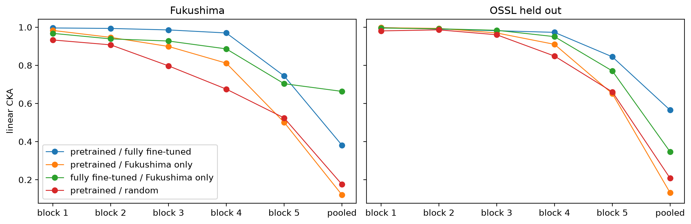
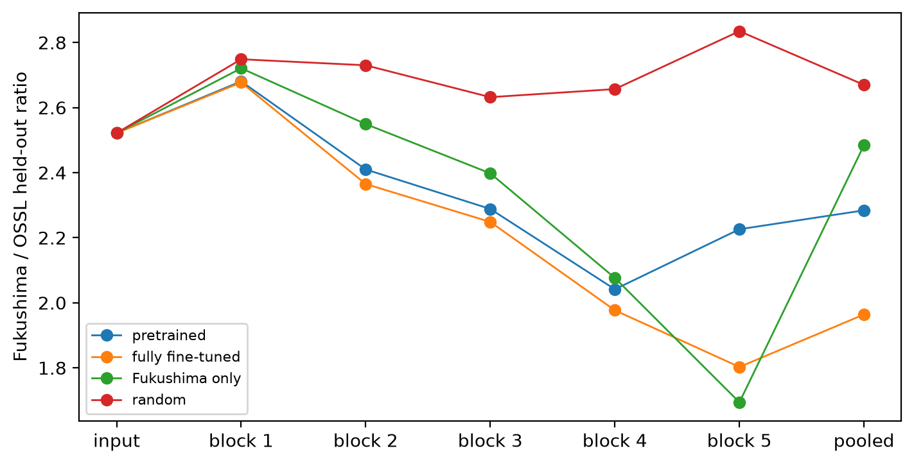
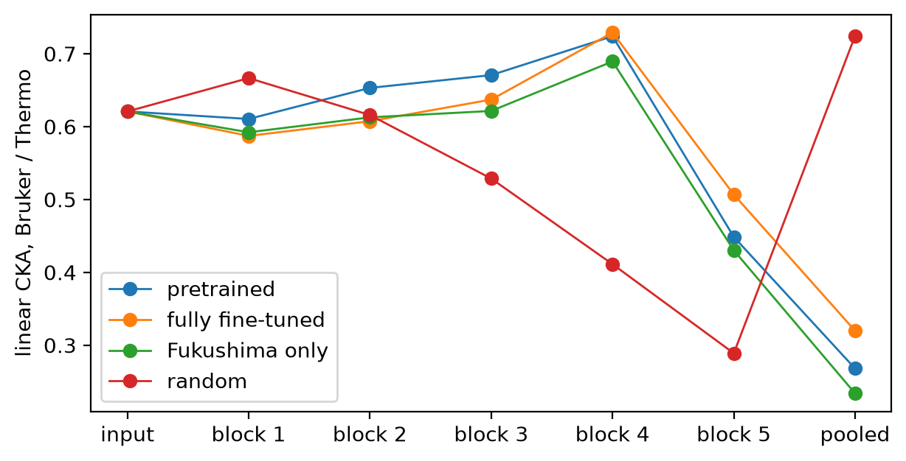
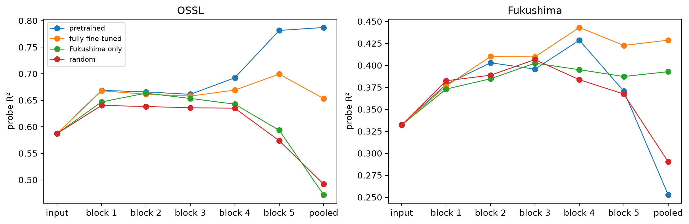

# Inside transfer


<!-- WARNING: THIS FILE WAS AUTOGENERATED! DO NOT EDIT! -->

``` python
import matplotlib.pyplot as plt
from fastcore.test import *
from soilspecdata.all import load_ossl
from fastai.torch_core import set_seed
from soilspecdl.all import get_splitter, BatchSNV, TensorSpectrum, SpectralCNN, predict
from ossl_fuku_transfer.data import *
from ossl_fuku_transfer.transfer import *
```

The module part uses small random arrays, so it runs without the data.
The sections from *Data and models* onwards read OSSL and the Fukushima
data, and are marked `#| fukudata`.

## Layer features

`layer_features` gives the representation of spectra at each layer of a
model, one row per spectrum:

- `input`: the preprocessed spectrum;
- `block 1` to `block 5`: each block’s output after pooling, with
  channels and positions flattened, so band position is kept;
- `pooled`: the global average over positions of block 5, the 256
  features the head sees.

------------------------------------------------------------------------

### layer_features

``` python
def layer_features(
    model, # Trained `SpectralCNN`
    X, # Preprocessed spectra, one per row
    bs:int=256, # Batch size
)->dict: # Layer name: array with one row per spectrum
```

*Representation of each spectrum in `X` at the input, after each block
of `model`, and after global pooling*

``` python
rng = np.random.default_rng(0)
X_syn = rng.random((60, len(shared_wns)))
m_syn = SpectralCNN()
F_syn = layer_features(m_syn, X_syn)
test_eq(list(F_syn), ['input'] + [f'block {i}' for i in range(1, 6)] + ['pooled'])
{k: v.shape for k, v in F_syn.items()}
```

    {'input': (60, 1675),
     'block 1': (60, 8928),
     'block 2': (60, 5952),
     'block 3': (60, 3968),
     'block 4': (60, 2560),
     'block 5': (60, 1536),
     'pooled': (60, 256)}

`pooled` matches the backbone’s own output:

``` python
xb = TensorSpectrum(torch.tensor(X_syn, dtype=torch.float32).unsqueeze(1), wns=shared_wns)
with torch.no_grad(): ref = m_syn.eval().backbone(BatchSNV()(xb)).numpy()
test_close(F_syn['pooled'], ref, eps=1e-4)
```

## Similarity

`linear_cka` is linear centred kernel alignment (Kornblith et al. 2019).
It compares two representations of the same samples, which may have
different numbers of features. It is 1 when one representation is a
rotation and rescaling of the other, and near 0 when they are unrelated.
It is computed from the n × n Gram matrices, so it works for layers with
thousands of features.

------------------------------------------------------------------------

### linear_cka

``` python
def linear_cka(
    A, # Representation of n samples, one row per sample
    B, # Another representation of the same n samples
)->float:
```

*Linear centred kernel alignment between `A` and `B`*

``` python
A = rng.normal(size=(200, 30))
Q, _ = np.linalg.qr(rng.normal(size=(30, 30)))
test_close(linear_cka(A, A), 1)
test_close(linear_cka(A, 3 * A @ Q), 1)
test_eq(linear_cka(A, rng.normal(size=(200, 50))) < 0.3, True)
```

`cka_layers` applies `linear_cka` layer by layer to two dicts from
`layer_features`:

------------------------------------------------------------------------

### cka_layers

``` python
def cka_layers(
    Fa:dict, # Layer name: representation, from `layer_features`
    Fb:dict, # The same layers for the same samples, from another model or input
)->pandas.Series: # One value per layer
```

*`linear_cka` between `Fa` and `Fb` at each layer*

``` python
test_eq(cka_layers(F_syn, F_syn).round(6).tolist(), [1.0] * 7)
```

## Distance from a reference set

`nn_ratio` measures how far new samples sit from a reference set, such
as Fukushima spectra from OSSL. It standardises the features on the
reference set and projects them on the reference’s first `n_pca`
principal components. It then divides the median distance from each new
sample to its nearest reference sample by the median distance from each
reference sample to its nearest other reference sample. A ratio near 1
means the new samples sit among the reference samples. A large ratio
means they sit outside.

The ratio depends on the size of the reference set. Comparing it with
the ratio for held-out samples from the reference population, which
should be near 1, is a fair control.

------------------------------------------------------------------------

### nn_ratio

``` python
def nn_ratio(
    F_ref, # Reference representation, one row per sample
    F_new, # Representation of new samples, with the same features
    n_pca:int=50, # Number of principal components
)->float:
```

*Median nearest-neighbour distance from `F_new` to `F_ref`, over the
median within `F_ref`*

``` python
ref, same, shifted = rng.normal(size=(500, 20)), rng.normal(size=(200, 20)), rng.normal(3, 1, size=(200, 20))
test_eq(0.8 < nn_ratio(ref, same) < 1.3, True)
test_eq(nn_ratio(ref, shifted) > 2, True)
```

## Probes

`probe` fits a ridge regression from a layer’s features to a target on
the training samples, and scores it on the test samples with `score_fn`,
by default `scores`. The features are standardised, and the ridge
penalty is chosen by efficient leave-one-out cross-validation on the
training samples. A probe shows how much of the target a layer holds in
a linearly readable form, whatever the model’s own head does with it.

    /opt/hostedtoolcache/Python/3.12.15/x64/lib/python3.12/site-packages/fastcore/docments.py:478: UserWarning: docments unavailable for probe: ValueError: The truth value of an array with more than one element is ambiguous. Use a.any() or a.all()
      warnings.warn(f'docments unavailable for {self.nm}: {type(e).__name__}: {e}')

------------------------------------------------------------------------

### probe

``` python
probe(F_train, y_train, F_test, y_test, alphas=array([1.00000000e-01, 3.16227766e-01, 1.00000000e+00, 3.16227766e+00,
       1.00000000e+01, 3.16227766e+01, 1.00000000e+02, 3.16227766e+02,
       1.00000000e+03, 3.16227766e+03, 1.00000000e+04, 3.16227766e+04,
       1.00000000e+05, 3.16227766e+05, 1.00000000e+06]), score_fn=<function scores at 0x7e6d71791080>) -> dict
```

*Test scores of a ridge regression from `F_train` to `y_train`*

``` python
w = rng.normal(size=20)
Xp = rng.normal(size=(300, 20))
yp = np.log1p(np.exp(0.1 * Xp @ w + 0.05 * rng.normal(size=300)))
res = probe(Xp[:200], yp[:200], Xp[200:], yp[200:])
test_eq(res['R²'] > 0.9, True)
res
```

    {'R²': 0.9554505703800562,
     'r': np.float64(0.9798306979006248),
     'RMSE': np.float64(0.22677363602703624),
     'bias': np.float64(-0.025616102029198496),
     'alpha': 0.31622776601683794}

`tracked_model` loads the final weights of a run that `06_dynamics`
saved with `tracked_fit`:

------------------------------------------------------------------------

### tracked_model

``` python
def tracked_model(
    fname
):
```

*`SpectralCNN` with the final weights of the `tracked_fit` record saved
under `fname`*

## Data and models

The data and preprocessing are those of `03_kex` and `06_dynamics`. From
OSSL, 2,500 spectra of the pretraining’s training set form the reference
set, and 1,388 spectra of its validation set, as many as there are
Fukushima spectra, are held out:

``` python
om = load_ossl().mir(wmin=shared_wns[0], wmax=shared_wns[-1])
Xo, yo, _ = om.xy('k.ext_usda.a725_cmolc.kg')
yo = np.log1p(yo.ravel())
fuku = load_fuku()
fuku.source = fuku.source.assign(target=fuku.source['soil_ex_K2O'] / mg_k2o_per_cmolc)
Xf, yf, idf = fuku.xy('target')
yf = np.log1p(yf.ravel())
is_test = np.isin(idf, cs137_split()[1])
pipe = preprocessings()['snv_d1']
Xo_d, Xf_d = pipe.fit_transform(Xo), pipe.transform(Xf)
tr, va, _ = get_splitter(0.9, 0.1, seed=42)(Xo_d, yo)
r = np.random.default_rng(0)
o_ref, o_new = r.choice(tr, 2500, replace=False), r.choice(va, len(Xf_d), replace=False)
len(o_ref), len(o_new), len(Xf_d), int(is_test.sum())
```

    (2500, 1388, 1388, 341)

Four models: the saved OSSL model (`pretrained`), the fully fine-tuned
and Fukushima-only models trained in `06_dynamics`, and a model with
random weights as a control. The control shows what the architecture
alone does to the representations. The test scores of each model’s own
head:

``` python
set_seed(0)
models = {'pretrained': load_pretrained('ossl_kex_snv_d1'), 'fully fine-tuned': tracked_model('dyn_fuku_kex_ft'),
          'Fukushima only': tracked_model('dyn_fuku_kex_scratch'), 'random': SpectralCNN()}
data = {'OSSL ref': Xo_d[o_ref], 'OSSL held out': Xo_d[o_new], 'Fukushima': Xf_d}
F = {(m, d): layer_features(model, X) for m, model in models.items() for d, X in data.items()}
layers = list(F['random', 'Fukushima'])
pd.DataFrame({m: scores(yf[is_test], predict(model, Xf_d[is_test], shared_wns)) for m, model in models.items()}).round(3)
```

<div>
<style scoped>
    .dataframe tbody tr th:only-of-type {
        vertical-align: middle;
    }
&#10;    .dataframe tbody tr th {
        vertical-align: top;
    }
&#10;    .dataframe thead th {
        text-align: right;
    }
</style>

<table class="dataframe" data-quarto-postprocess="true" data-border="1">
<thead>
<tr style="text-align: right;">
<th data-quarto-table-cell-role="th"></th>
<th data-quarto-table-cell-role="th">pretrained</th>
<th data-quarto-table-cell-role="th">fully fine-tuned</th>
<th data-quarto-table-cell-role="th">Fukushima only</th>
<th data-quarto-table-cell-role="th">random</th>
</tr>
</thead>
<tbody>
<tr>
<td data-quarto-table-cell-role="th">R²</td>
<td>-0.820</td>
<td>0.426</td>
<td>0.377</td>
<td>-1.213</td>
</tr>
<tr>
<td data-quarto-table-cell-role="th">r</td>
<td>0.126</td>
<td>0.655</td>
<td>0.616</td>
<td>-0.152</td>
</tr>
<tr>
<td data-quarto-table-cell-role="th">RMSE</td>
<td>0.537</td>
<td>0.303</td>
<td>0.316</td>
<td>0.570</td>
</tr>
<tr>
<td data-quarto-table-cell-role="th">bias</td>
<td>0.285</td>
<td>-0.035</td>
<td>-0.037</td>
<td>-0.396</td>
</tr>
</tbody>
</table>

</div>

## How alike the models are

CKA between pairs of models at each layer, on the Fukushima spectra and
on the held-out OSSL spectra. The input is the same for all models, so
it is left out:

``` python
pairs = [('pretrained', 'fully fine-tuned'), ('pretrained', 'Fukushima only'), ('fully fine-tuned', 'Fukushima only'), ('pretrained', 'random')]
cka_m = pd.DataFrame({(d, f'{a} / {b}'): cka_layers(F[a, d], F[b, d]) for d in ('Fukushima', 'OSSL held out') for a, b in pairs}).drop('input')
fig, axs = plt.subplots(1, 2, figsize=(11, 3.5), sharey=True, layout='constrained')
for ax, d in zip(axs, ('Fukushima', 'OSSL held out')):
    cka_m[d].plot(ax=ax, marker='o', lw=1, title=d)
    ax.set_ylabel('linear CKA')
axs[1].get_legend().remove()
cka_m.round(3)
```



<div>
<style scoped>
    .dataframe tbody tr th:only-of-type {
        vertical-align: middle;
    }
&#10;    .dataframe tbody tr th {
        vertical-align: top;
    }
&#10;    .dataframe thead tr th {
        text-align: left;
    }
</style>

<table class="dataframe" data-quarto-postprocess="true" data-border="1">
<thead>
<tr>
<th data-quarto-table-cell-role="th"></th>
<th colspan="4" data-quarto-table-cell-role="th"
data-halign="left">Fukushima</th>
<th colspan="4" data-quarto-table-cell-role="th" data-halign="left">OSSL
held out</th>
</tr>
<tr>
<th data-quarto-table-cell-role="th"></th>
<th data-quarto-table-cell-role="th">pretrained / fully fine-tuned</th>
<th data-quarto-table-cell-role="th">pretrained / Fukushima only</th>
<th data-quarto-table-cell-role="th">fully fine-tuned / Fukushima
only</th>
<th data-quarto-table-cell-role="th">pretrained / random</th>
<th data-quarto-table-cell-role="th">pretrained / fully fine-tuned</th>
<th data-quarto-table-cell-role="th">pretrained / Fukushima only</th>
<th data-quarto-table-cell-role="th">fully fine-tuned / Fukushima
only</th>
<th data-quarto-table-cell-role="th">pretrained / random</th>
</tr>
</thead>
<tbody>
<tr>
<td data-quarto-table-cell-role="th">block 1</td>
<td>0.996</td>
<td>0.983</td>
<td>0.968</td>
<td>0.933</td>
<td>0.999</td>
<td>0.997</td>
<td>0.996</td>
<td>0.981</td>
</tr>
<tr>
<td data-quarto-table-cell-role="th">block 2</td>
<td>0.993</td>
<td>0.947</td>
<td>0.939</td>
<td>0.907</td>
<td>0.990</td>
<td>0.994</td>
<td>0.992</td>
<td>0.986</td>
</tr>
<tr>
<td data-quarto-table-cell-role="th">block 3</td>
<td>0.986</td>
<td>0.899</td>
<td>0.927</td>
<td>0.797</td>
<td>0.982</td>
<td>0.970</td>
<td>0.984</td>
<td>0.960</td>
</tr>
<tr>
<td data-quarto-table-cell-role="th">block 4</td>
<td>0.970</td>
<td>0.811</td>
<td>0.886</td>
<td>0.675</td>
<td>0.973</td>
<td>0.910</td>
<td>0.950</td>
<td>0.849</td>
</tr>
<tr>
<td data-quarto-table-cell-role="th">block 5</td>
<td>0.744</td>
<td>0.501</td>
<td>0.704</td>
<td>0.524</td>
<td>0.845</td>
<td>0.651</td>
<td>0.771</td>
<td>0.661</td>
</tr>
<tr>
<td data-quarto-table-cell-role="th">pooled</td>
<td>0.381</td>
<td>0.121</td>
<td>0.663</td>
<td>0.176</td>
<td>0.565</td>
<td>0.132</td>
<td>0.346</td>
<td>0.208</td>
</tr>
</tbody>
</table>

</div>

## Distance from OSSL

`nn_ratio` at each layer of each model, with the 2,500 OSSL reference
spectra as the reference set. The held-out OSSL spectra are the control:
they come from the same population as the reference set:

``` python
dist = pd.DataFrame({(m, d): {k: nn_ratio(F[m, 'OSSL ref'][k], F[m, d][k]) for k in layers}
                     for m in models for d in ('OSSL held out', 'Fukushima')})
fig, ax = plt.subplots(figsize=(7, 3.5), layout='constrained')
for m in models: ax.plot(layers, dist[m, 'Fukushima'] / dist[m, 'OSSL held out'], marker='o', lw=1, label=m)
ax.set_ylabel('Fukushima / OSSL held-out ratio'); ax.legend(fontsize=8)
dist.round(2)
```



<div>
<style scoped>
    .dataframe tbody tr th:only-of-type {
        vertical-align: middle;
    }
&#10;    .dataframe tbody tr th {
        vertical-align: top;
    }
&#10;    .dataframe thead tr th {
        text-align: left;
    }
</style>

<table class="dataframe" data-quarto-postprocess="true" data-border="1">
<thead>
<tr>
<th data-quarto-table-cell-role="th"></th>
<th colspan="2" data-quarto-table-cell-role="th"
data-halign="left">pretrained</th>
<th colspan="2" data-quarto-table-cell-role="th"
data-halign="left">fully fine-tuned</th>
<th colspan="2" data-quarto-table-cell-role="th"
data-halign="left">Fukushima only</th>
<th colspan="2" data-quarto-table-cell-role="th"
data-halign="left">random</th>
</tr>
<tr>
<th data-quarto-table-cell-role="th"></th>
<th data-quarto-table-cell-role="th">OSSL held out</th>
<th data-quarto-table-cell-role="th">Fukushima</th>
<th data-quarto-table-cell-role="th">OSSL held out</th>
<th data-quarto-table-cell-role="th">Fukushima</th>
<th data-quarto-table-cell-role="th">OSSL held out</th>
<th data-quarto-table-cell-role="th">Fukushima</th>
<th data-quarto-table-cell-role="th">OSSL held out</th>
<th data-quarto-table-cell-role="th">Fukushima</th>
</tr>
</thead>
<tbody>
<tr>
<td data-quarto-table-cell-role="th">input</td>
<td>1.00</td>
<td>2.52</td>
<td>1.00</td>
<td>2.52</td>
<td>1.00</td>
<td>2.52</td>
<td>1.00</td>
<td>2.52</td>
</tr>
<tr>
<td data-quarto-table-cell-role="th">block 1</td>
<td>1.00</td>
<td>2.67</td>
<td>0.99</td>
<td>2.66</td>
<td>1.00</td>
<td>2.72</td>
<td>1.00</td>
<td>2.75</td>
</tr>
<tr>
<td data-quarto-table-cell-role="th">block 2</td>
<td>0.99</td>
<td>2.40</td>
<td>0.99</td>
<td>2.35</td>
<td>1.01</td>
<td>2.56</td>
<td>1.01</td>
<td>2.77</td>
</tr>
<tr>
<td data-quarto-table-cell-role="th">block 3</td>
<td>0.99</td>
<td>2.27</td>
<td>0.98</td>
<td>2.21</td>
<td>0.99</td>
<td>2.37</td>
<td>1.01</td>
<td>2.67</td>
</tr>
<tr>
<td data-quarto-table-cell-role="th">block 4</td>
<td>1.01</td>
<td>2.06</td>
<td>0.99</td>
<td>1.96</td>
<td>0.99</td>
<td>2.05</td>
<td>1.01</td>
<td>2.68</td>
</tr>
<tr>
<td data-quarto-table-cell-role="th">block 5</td>
<td>0.99</td>
<td>2.20</td>
<td>1.01</td>
<td>1.83</td>
<td>1.00</td>
<td>1.70</td>
<td>1.00</td>
<td>2.84</td>
</tr>
<tr>
<td data-quarto-table-cell-role="th">pooled</td>
<td>1.00</td>
<td>2.29</td>
<td>0.99</td>
<td>1.94</td>
<td>1.00</td>
<td>2.48</td>
<td>1.00</td>
<td>2.66</td>
</tr>
</tbody>
</table>

</div>

## Bruker and Thermo spectra of the same soils

The 376 soils of `05_paired` with both Bruker and Thermo spectra, on the
grid both instruments cover (650–3996 cm⁻¹), with the same
preprocessing. CKA between the two instruments’ representations of the
same soils, at each layer of each model:

``` python
pw = np.arange(650, 3997, 2)
ids = [i for i in sorted(set(bruker_files()) & set(spa_files()), key=int) if i not in excluded]
br, th = load_bruker(pw, ids), load_fuku(pw, ids)
pre = preprocessings()['snv_d1']
Xb, Xt = pre.fit_transform(br.spectra), pre.fit_transform(th.spectra)
paired = pd.DataFrame({m: cka_layers(layer_features(model, Xb), layer_features(model, Xt)) for m, model in models.items()})
ax = paired.plot(marker='o', lw=1, figsize=(7, 3.5), ylabel='linear CKA, Bruker / Thermo')
paired.round(3)
```



<div>
<style scoped>
    .dataframe tbody tr th:only-of-type {
        vertical-align: middle;
    }
&#10;    .dataframe tbody tr th {
        vertical-align: top;
    }
&#10;    .dataframe thead th {
        text-align: right;
    }
</style>

<table class="dataframe" data-quarto-postprocess="true" data-border="1">
<thead>
<tr style="text-align: right;">
<th data-quarto-table-cell-role="th"></th>
<th data-quarto-table-cell-role="th">pretrained</th>
<th data-quarto-table-cell-role="th">fully fine-tuned</th>
<th data-quarto-table-cell-role="th">Fukushima only</th>
<th data-quarto-table-cell-role="th">random</th>
</tr>
</thead>
<tbody>
<tr>
<td data-quarto-table-cell-role="th">input</td>
<td>0.621</td>
<td>0.621</td>
<td>0.621</td>
<td>0.621</td>
</tr>
<tr>
<td data-quarto-table-cell-role="th">block 1</td>
<td>0.610</td>
<td>0.587</td>
<td>0.592</td>
<td>0.667</td>
</tr>
<tr>
<td data-quarto-table-cell-role="th">block 2</td>
<td>0.653</td>
<td>0.607</td>
<td>0.613</td>
<td>0.616</td>
</tr>
<tr>
<td data-quarto-table-cell-role="th">block 3</td>
<td>0.671</td>
<td>0.637</td>
<td>0.621</td>
<td>0.529</td>
</tr>
<tr>
<td data-quarto-table-cell-role="th">block 4</td>
<td>0.724</td>
<td>0.729</td>
<td>0.689</td>
<td>0.411</td>
</tr>
<tr>
<td data-quarto-table-cell-role="th">block 5</td>
<td>0.449</td>
<td>0.507</td>
<td>0.430</td>
<td>0.289</td>
</tr>
<tr>
<td data-quarto-table-cell-role="th">pooled</td>
<td>0.268</td>
<td>0.320</td>
<td>0.234</td>
<td>0.725</td>
</tr>
</tbody>
</table>

</div>

## Kex in each layer

A `probe` at each layer of each model. For Fukushima, the probes train
on the Fukushima training samples and are scored on the test set. For
OSSL, they train on the 2,500 reference spectra and are scored on the
1,388 held-out spectra. The R² of `log1p(Kex)`:

``` python
rows = []
for m in models:
    for k in layers:
        Ff = F[m, 'Fukushima'][k]
        rows.append({'data': 'Fukushima', 'model': m, 'layer': k, **probe(Ff[~is_test], yf[~is_test], Ff[is_test], yf[is_test])})
        rows.append({'data': 'OSSL', 'model': m, 'layer': k, **probe(F[m, 'OSSL ref'][k], yo[o_ref], F[m, 'OSSL held out'][k], yo[o_new])})
pr = pd.DataFrame(rows)
fig, axs = plt.subplots(1, 2, figsize=(11, 3.5), layout='constrained')
for ax, d in zip(axs, ('OSSL', 'Fukushima')):
    for m in models:
        s = pr[(pr.data == d) & (pr.model == m)]
        ax.plot(s.layer, s['R²'], marker='o', lw=1, label=m)
    ax.set_title(d); ax.set_ylabel('probe R²')
axs[0].legend(fontsize=8)
pr.pivot_table(index='layer', columns=['data', 'model'], values='R²', sort=False).round(3)
```



<div>
<style scoped>
    .dataframe tbody tr th:only-of-type {
        vertical-align: middle;
    }
&#10;    .dataframe tbody tr th {
        vertical-align: top;
    }
&#10;    .dataframe thead tr th {
        text-align: left;
    }
&#10;    .dataframe thead tr:last-of-type th {
        text-align: right;
    }
</style>

<table class="dataframe" data-quarto-postprocess="true" data-border="1">
<thead>
<tr>
<th data-quarto-table-cell-role="th">data</th>
<th data-quarto-table-cell-role="th">Fukushima</th>
<th data-quarto-table-cell-role="th">OSSL</th>
<th data-quarto-table-cell-role="th">Fukushima</th>
<th data-quarto-table-cell-role="th">OSSL</th>
<th data-quarto-table-cell-role="th">Fukushima</th>
<th data-quarto-table-cell-role="th">OSSL</th>
<th data-quarto-table-cell-role="th">Fukushima</th>
<th data-quarto-table-cell-role="th">OSSL</th>
</tr>
<tr>
<th data-quarto-table-cell-role="th">model</th>
<th data-quarto-table-cell-role="th">pretrained</th>
<th data-quarto-table-cell-role="th">pretrained</th>
<th data-quarto-table-cell-role="th">fully fine-tuned</th>
<th data-quarto-table-cell-role="th">fully fine-tuned</th>
<th data-quarto-table-cell-role="th">Fukushima only</th>
<th data-quarto-table-cell-role="th">Fukushima only</th>
<th data-quarto-table-cell-role="th">random</th>
<th data-quarto-table-cell-role="th">random</th>
</tr>
<tr>
<th data-quarto-table-cell-role="th">layer</th>
<th data-quarto-table-cell-role="th"></th>
<th data-quarto-table-cell-role="th"></th>
<th data-quarto-table-cell-role="th"></th>
<th data-quarto-table-cell-role="th"></th>
<th data-quarto-table-cell-role="th"></th>
<th data-quarto-table-cell-role="th"></th>
<th data-quarto-table-cell-role="th"></th>
<th data-quarto-table-cell-role="th"></th>
</tr>
</thead>
<tbody>
<tr>
<td data-quarto-table-cell-role="th">input</td>
<td>0.332</td>
<td>0.587</td>
<td>0.332</td>
<td>0.587</td>
<td>0.332</td>
<td>0.587</td>
<td>0.332</td>
<td>0.587</td>
</tr>
<tr>
<td data-quarto-table-cell-role="th">block 1</td>
<td>0.378</td>
<td>0.669</td>
<td>0.376</td>
<td>0.668</td>
<td>0.373</td>
<td>0.647</td>
<td>0.383</td>
<td>0.640</td>
</tr>
<tr>
<td data-quarto-table-cell-role="th">block 2</td>
<td>0.403</td>
<td>0.666</td>
<td>0.410</td>
<td>0.661</td>
<td>0.385</td>
<td>0.663</td>
<td>0.389</td>
<td>0.638</td>
</tr>
<tr>
<td data-quarto-table-cell-role="th">block 3</td>
<td>0.396</td>
<td>0.661</td>
<td>0.410</td>
<td>0.658</td>
<td>0.403</td>
<td>0.653</td>
<td>0.407</td>
<td>0.636</td>
</tr>
<tr>
<td data-quarto-table-cell-role="th">block 4</td>
<td>0.429</td>
<td>0.692</td>
<td>0.443</td>
<td>0.669</td>
<td>0.395</td>
<td>0.643</td>
<td>0.384</td>
<td>0.635</td>
</tr>
<tr>
<td data-quarto-table-cell-role="th">block 5</td>
<td>0.371</td>
<td>0.782</td>
<td>0.423</td>
<td>0.699</td>
<td>0.387</td>
<td>0.593</td>
<td>0.367</td>
<td>0.574</td>
</tr>
<tr>
<td data-quarto-table-cell-role="th">pooled</td>
<td>0.253</td>
<td>0.787</td>
<td>0.429</td>
<td>0.653</td>
<td>0.393</td>
<td>0.472</td>
<td>0.290</td>
<td>0.492</td>
</tr>
</tbody>
</table>

</div>

The correlation `r` of the same probes:

``` python
pr.pivot_table(index='layer', columns=['data', 'model'], values='r', sort=False).round(3)
```

<div>
<style scoped>
    .dataframe tbody tr th:only-of-type {
        vertical-align: middle;
    }
&#10;    .dataframe tbody tr th {
        vertical-align: top;
    }
&#10;    .dataframe thead tr th {
        text-align: left;
    }
&#10;    .dataframe thead tr:last-of-type th {
        text-align: right;
    }
</style>

<table class="dataframe" data-quarto-postprocess="true" data-border="1">
<thead>
<tr>
<th data-quarto-table-cell-role="th">data</th>
<th data-quarto-table-cell-role="th">Fukushima</th>
<th data-quarto-table-cell-role="th">OSSL</th>
<th data-quarto-table-cell-role="th">Fukushima</th>
<th data-quarto-table-cell-role="th">OSSL</th>
<th data-quarto-table-cell-role="th">Fukushima</th>
<th data-quarto-table-cell-role="th">OSSL</th>
<th data-quarto-table-cell-role="th">Fukushima</th>
<th data-quarto-table-cell-role="th">OSSL</th>
</tr>
<tr>
<th data-quarto-table-cell-role="th">model</th>
<th data-quarto-table-cell-role="th">pretrained</th>
<th data-quarto-table-cell-role="th">pretrained</th>
<th data-quarto-table-cell-role="th">fully fine-tuned</th>
<th data-quarto-table-cell-role="th">fully fine-tuned</th>
<th data-quarto-table-cell-role="th">Fukushima only</th>
<th data-quarto-table-cell-role="th">Fukushima only</th>
<th data-quarto-table-cell-role="th">random</th>
<th data-quarto-table-cell-role="th">random</th>
</tr>
<tr>
<th data-quarto-table-cell-role="th">layer</th>
<th data-quarto-table-cell-role="th"></th>
<th data-quarto-table-cell-role="th"></th>
<th data-quarto-table-cell-role="th"></th>
<th data-quarto-table-cell-role="th"></th>
<th data-quarto-table-cell-role="th"></th>
<th data-quarto-table-cell-role="th"></th>
<th data-quarto-table-cell-role="th"></th>
<th data-quarto-table-cell-role="th"></th>
</tr>
</thead>
<tbody>
<tr>
<td data-quarto-table-cell-role="th">input</td>
<td>0.582</td>
<td>0.776</td>
<td>0.582</td>
<td>0.776</td>
<td>0.582</td>
<td>0.776</td>
<td>0.582</td>
<td>0.776</td>
</tr>
<tr>
<td data-quarto-table-cell-role="th">block 1</td>
<td>0.618</td>
<td>0.819</td>
<td>0.617</td>
<td>0.819</td>
<td>0.614</td>
<td>0.811</td>
<td>0.619</td>
<td>0.802</td>
</tr>
<tr>
<td data-quarto-table-cell-role="th">block 2</td>
<td>0.635</td>
<td>0.822</td>
<td>0.640</td>
<td>0.820</td>
<td>0.620</td>
<td>0.819</td>
<td>0.624</td>
<td>0.804</td>
</tr>
<tr>
<td data-quarto-table-cell-role="th">block 3</td>
<td>0.629</td>
<td>0.818</td>
<td>0.640</td>
<td>0.816</td>
<td>0.635</td>
<td>0.811</td>
<td>0.638</td>
<td>0.805</td>
</tr>
<tr>
<td data-quarto-table-cell-role="th">block 4</td>
<td>0.657</td>
<td>0.836</td>
<td>0.666</td>
<td>0.822</td>
<td>0.632</td>
<td>0.804</td>
<td>0.621</td>
<td>0.799</td>
</tr>
<tr>
<td data-quarto-table-cell-role="th">block 5</td>
<td>0.614</td>
<td>0.886</td>
<td>0.651</td>
<td>0.838</td>
<td>0.626</td>
<td>0.773</td>
<td>0.607</td>
<td>0.765</td>
</tr>
<tr>
<td data-quarto-table-cell-role="th">pooled</td>
<td>0.504</td>
<td>0.888</td>
<td>0.657</td>
<td>0.810</td>
<td>0.630</td>
<td>0.691</td>
<td>0.542</td>
<td>0.707</td>
</tr>
</tbody>
</table>

</div>

## Findings

On Fukushima, every layer of every model holds about the same amount of
linearly readable Kex information, even the model with random weights. A
ridge probe on the preprocessed spectra gives a test R² of 0.33 (r
0.58). Probes on blocks 1 to 5 of all four models give 0.37 to 0.44 (r
0.61 to 0.67). The random model’s best block gives 0.41. The best probe
is block 4 of the fully fine-tuned model, at 0.44. A probe on block 4 of
the frozen pretrained model gives 0.43 (r 0.66), the same as the fully
fine-tuned model’s own head (0.43, r 0.66). With 341 test samples, one
R² has a sampling standard deviation of about 0.04, so most of these
differences are within noise. In these layers, neither pretraining on
OSSL nor training on Fukushima produces features that hold clearly more
Kex information than random convolutions do.

On OSSL, learning makes a large difference. The pretrained model’s
probes rise from 0.59 at the input to 0.79 at the pooled features, while
the random model’s stay between 0.49 and 0.64. That gain does not carry
over to Fukushima. There, the pretrained model’s pooled features give
0.25, less than the spectra themselves. Block 5 and the global pool are
where the pretrained model turns general features into OSSL-specific
ones.

The CKA comparisons point to the same split. Fine-tuning leaves blocks 1
to 4 almost unchanged (CKA with the pretrained model 0.97 or more on
Fukushima spectra) and changes block 5 (0.74) and the pooled features
(0.38). The Fukushima-only model is close to the pretrained model in
block 1 (0.98) and moves away with depth: 0.81 in block 4, 0.50 in block
5 and 0.12 in the pooled features. The random model is also close to the
pretrained model in the early blocks (0.93 in block 1), so a high CKA
there mostly reflects the architecture. In block 4, the Fukushima-only
model is closer to the pretrained model (0.81) than the random model is
(0.68). Training on either dataset finds partly the same mid-level
features.

Fukushima spectra sit outside OSSL in every layer of every model. At the
input, the median distance from a Fukushima spectrum to its nearest OSSL
spectrum is 2.5 times that of a held-out OSSL spectrum, whose ratio is
1.0. The random model keeps the ratio at 2.7 to 2.8 through all blocks.
The trained models bring it down with depth, to about 2.0 in block 4 and
1.7 to 2.2 in block 5. None brings Fukushima among the OSSL spectra. The
pretrained model’s pooled features push it back out, to 2.3.

For the 376 soils with both Bruker and Thermo spectra, the CKA between
the two instruments’ representations is 0.62 at the input. In the three
trained models it dips slightly in block 1 (0.59 to 0.61), rises to 0.69
to 0.73 in block 4, then falls to 0.43 to 0.51 in block 5 and 0.23 to
0.32 in the pooled features. Blocks 2 to 4 make the two instruments’
spectra of a soil more alike, and block 5 and the pool make them less
alike. In the random model the CKA falls from block 1 to 0.29 in block
5, but its pooled features give 0.73. With random weights, the global
average probably keeps mostly an overall intensity that both instruments
share. This was not checked.

The Fukushima Kex ceiling of about 0.43 is reached by linear probes on
random features, by frozen OSSL features and by the end-to-end models
alike. So the limit lies in the Fukushima data rather than in the
features the CNN learns. `08_learning_curve` shows which part of the
data: every model still gains R² with more training samples at 1,047, so
the number of samples limits the scores. In the pretrained model, block
4 is the best candidate layer to transfer from. Its probe is the best of
that model on Fukushima, although within noise of the others. It brings
Fukushima closest to OSSL, and it makes the two instruments most alike.
