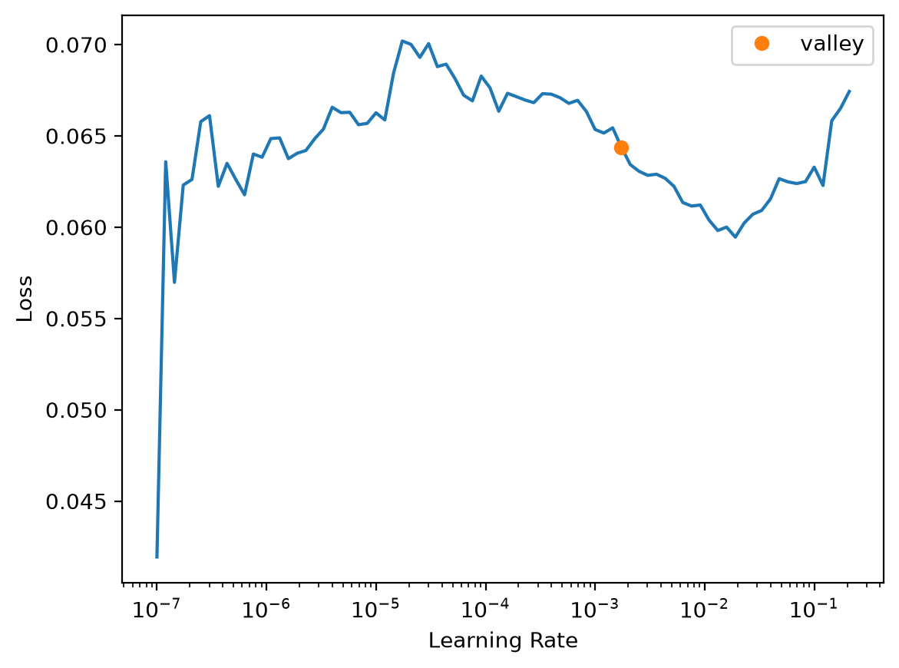
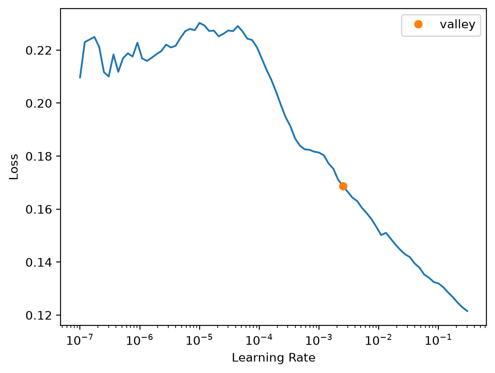
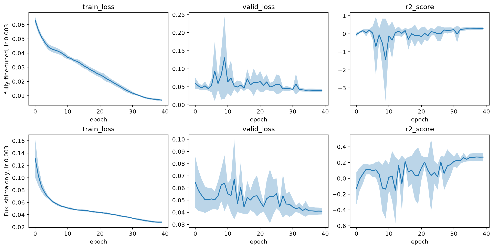
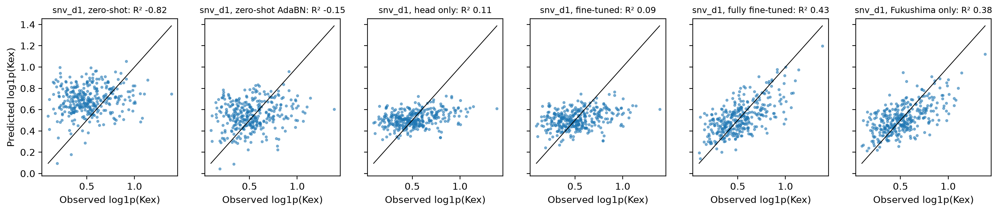

# Kex


<!-- WARNING: THIS FILE WAS AUTOGENERATED! DO NOT EDIT! -->

``` python
import numpy as np, pandas as pd
import matplotlib.pyplot as plt
from fastcore.test import *
from soilspecdata.all import load_ossl
from soilspecdl.all import plot_cv
from ossl_fuku_transfer.data import *
from ossl_fuku_transfer.transfer import *
```

    /Users/franckalbinet/pro/dev/soilspec/ossl-fuku-transfer/.venv/lib/python3.13/site-packages/torch/jit/_script.py:1491: FutureWarning: `torch.jit.script` is deprecated. Please switch to `torch.compile` or `torch.export`.
      warnings.warn(

Every code cell reads OSSL or the Fukushima data, and is marked
`#| fukudata`. The outputs come from a local run on an Apple silicon GPU
(MPS). `02_transfer` defines the functions used here.

## Data

OSSL MIR spectra on the shared grid, with Kex in cmolc/kg. The models
predict `log1p(Kex)`:

``` python
om = load_ossl().mir(wmin=shared_wns[0], wmax=shared_wns[-1])
Xo, yo, _ = om.xy('k.ext_usda.a725_cmolc.kg')
yo = np.log1p(yo.ravel())
Xo.shape
```

    (57674, 1675)

The Fukushima spectra, with Kex converted from mg K₂O per 100 g to
cmolc/kg. The test set is the Cs137 study’s test set:

``` python
fuku = load_fuku()
fuku.source = fuku.source.assign(target=fuku.source['soil_ex_K2O'] / mg_k2o_per_cmolc)
Xf, yf, idf = fuku.xy('target')
yf = np.log1p(yf.ravel())
_, test_ids = cs137_split()
is_test = np.isin(idf, test_ids)
yt = yf[is_test]
Xf.shape, int(is_test.sum())
```

    ((1388, 1675), 341)

## Pretraining

The preprocessing is SNV followed by a Savitzky-Golay first derivative,
fitted on OSSL and applied to Fukushima. `pretrain` trains on OSSL, or
loads the weights of an earlier run. The table shows the last epoch of
pretraining, with the R² of the OSSL validation set:

``` python
pipe = preprocessings()['snv_d1']
Xo_d, Xf_d = pipe.fit_transform(Xo), pipe.transform(Xf)
pretrained = pretrain(Xo_d, yo, 'ossl_kex_snv_d1')
pretrain_history('ossl_kex_snv_d1').iloc[-1].round(3).to_dict()
```

    {'train_loss': 0.023, 'valid_loss': 0.03, 'r2_score': 0.794}

## Schedule

The fully fine-tuned and Fukushima-only models each get their own
learning rate and number of epochs, chosen on the Fukushima training
samples by 5-fold cross-validation. The test set plays no part. `start`
gives each model’s starting weights: the pretrained model, or `None` for
random weights. The learning rate finder, from each starting point:

``` python
start = {'fully fine-tuned': pretrained, 'Fukushima only': None}
mslug = {'fully fine-tuned': 'ft', 'Fukushima only': 'scratch'}
{m: float(fuku_lr_find(s, Xf_d, yf, is_test).valley) for m, s in start.items()}
```





    {'fully fine-tuned': 0.001737800776027143,
     'Fukushima only': 0.002511886414140463}

Four learning rates, each with 40 one-cycle epochs. The table gives the
validation loss (mean squared error of `log1p`) and R² at the last
epoch, as mean and standard deviation over the folds:

``` python
lrs = [1e-4, 3e-4, 1e-3, 3e-3]
cv = lambda m, lr, ep: cv_curves(start[m], Xf_d, yf, is_test, lr, ep, fname=f'cv_kex_{mslug[m]}_lr{lr:g}_ep{ep}')
lr_res = {(m, lr): cv_final(cv(m, lr, 40)) for m in start for lr in lrs}
best_lr = {m: min(lrs, key=lambda lr: lr_res[m, lr]['valid_loss']) for m in start}
pd.DataFrame(lr_res).T.round(4)
```

<div>
<style scoped>
    .dataframe tbody tr th:only-of-type {
        vertical-align: middle;
    }
&#10;    .dataframe tbody tr th {
        vertical-align: top;
    }
&#10;    .dataframe thead th {
        text-align: right;
    }
</style>

<table class="dataframe" data-quarto-postprocess="true" data-border="1">
<thead>
<tr style="text-align: right;">
<th data-quarto-table-cell-role="th"></th>
<th data-quarto-table-cell-role="th"></th>
<th data-quarto-table-cell-role="th">valid_loss</th>
<th data-quarto-table-cell-role="th">valid_loss sd</th>
<th data-quarto-table-cell-role="th">R²</th>
<th data-quarto-table-cell-role="th">R² sd</th>
</tr>
</thead>
<tbody>
<tr>
<td rowspan="4" data-quarto-table-cell-role="th" data-valign="top">fully
fine-tuned</td>
<td data-quarto-table-cell-role="th">0.0001</td>
<td>0.0435</td>
<td>0.0058</td>
<td>0.2281</td>
<td>0.0457</td>
</tr>
<tr>
<td data-quarto-table-cell-role="th">0.0003</td>
<td>0.0420</td>
<td>0.0046</td>
<td>0.2537</td>
<td>0.0434</td>
</tr>
<tr>
<td data-quarto-table-cell-role="th">0.0010</td>
<td>0.0409</td>
<td>0.0038</td>
<td>0.2709</td>
<td>0.0619</td>
</tr>
<tr>
<td data-quarto-table-cell-role="th">0.0030</td>
<td>0.0405</td>
<td>0.0039</td>
<td>0.2771</td>
<td>0.0741</td>
</tr>
<tr>
<td rowspan="4" data-quarto-table-cell-role="th"
data-valign="top">Fukushima only</td>
<td data-quarto-table-cell-role="th">0.0001</td>
<td>0.0448</td>
<td>0.0069</td>
<td>0.2067</td>
<td>0.0406</td>
</tr>
<tr>
<td data-quarto-table-cell-role="th">0.0003</td>
<td>0.0426</td>
<td>0.0047</td>
<td>0.2426</td>
<td>0.0500</td>
</tr>
<tr>
<td data-quarto-table-cell-role="th">0.0010</td>
<td>0.0412</td>
<td>0.0046</td>
<td>0.2678</td>
<td>0.0314</td>
</tr>
<tr>
<td data-quarto-table-cell-role="th">0.0030</td>
<td>0.0410</td>
<td>0.0027</td>
<td>0.2691</td>
<td>0.0536</td>
</tr>
</tbody>
</table>

</div>

The learning curves at each model’s best learning rate, as mean over
folds with a band of ±1 standard deviation:

``` python
fig, axs = plt.subplots(2, 3, figsize=(12, 6), layout='constrained')
for row, m in zip(axs, start):
    plot_cv(cv(m, best_lr[m], 40), axs=row)
    row[0].set_ylabel(f'{m}, lr {best_lr[m]:g}')
```



Three numbers of epochs, at each model’s best learning rate. A one-cycle
schedule changes shape with its length, so each count is trained
separately:

``` python
eps = [20, 40, 80]
ep_res = {(m, ep): cv_final(cv(m, best_lr[m], ep)) for m in start for ep in eps}
schedules = {m: (min(eps, key=lambda ep: ep_res[m, ep]['valid_loss']), best_lr[m]) for m in start}
pd.DataFrame(ep_res).T.round(4), schedules
```

    (                     valid_loss  valid_loss sd      R²   R² sd
     fully fine-tuned 20      0.0395         0.0035  0.2954  0.0645
                      40      0.0405         0.0039  0.2771  0.0741
                      80      0.0414         0.0027  0.2598  0.0711
     Fukushima only   20      0.0417         0.0038  0.2577  0.0409
                      40      0.0410         0.0027  0.2691  0.0536
                      80      0.0443         0.0017  0.2068  0.0891,
     {'fully fine-tuned': (20, 0.003), 'Fukushima only': (40, 0.003)})

## Comparison

Each Fukushima model trains with five seeds, the fully fine-tuned and
Fukushima-only models with the schedules chosen above. The other models
keep their defaults. The table gives the mean and standard deviation
over the seeds of R² and correlation `r` of `log1p(Kex)`, and of the
RMSE and bias of Kex in cmolc/kg, on the test samples:

``` python
res, preds = compare({'snv_d1': pretrained}, {'snv_d1': Xf_d}, yf, is_test, schedules=schedules)
summarise(res).round(3)
```

<div>
<style scoped>
    .dataframe tbody tr th:only-of-type {
        vertical-align: middle;
    }
&#10;    .dataframe tbody tr th {
        vertical-align: top;
    }
&#10;    .dataframe thead tr th {
        text-align: left;
    }
&#10;    .dataframe thead tr:last-of-type th {
        text-align: right;
    }
</style>

<table class="dataframe" data-quarto-postprocess="true" data-border="1">
<thead>
<tr>
<th data-quarto-table-cell-role="th"></th>
<th data-quarto-table-cell-role="th"></th>
<th colspan="2" data-quarto-table-cell-role="th"
data-halign="left">R²</th>
<th colspan="2" data-quarto-table-cell-role="th"
data-halign="left">r</th>
<th colspan="2" data-quarto-table-cell-role="th"
data-halign="left">RMSE</th>
<th colspan="2" data-quarto-table-cell-role="th"
data-halign="left">bias</th>
</tr>
<tr>
<th data-quarto-table-cell-role="th"></th>
<th data-quarto-table-cell-role="th"></th>
<th data-quarto-table-cell-role="th">mean</th>
<th data-quarto-table-cell-role="th">std</th>
<th data-quarto-table-cell-role="th">mean</th>
<th data-quarto-table-cell-role="th">std</th>
<th data-quarto-table-cell-role="th">mean</th>
<th data-quarto-table-cell-role="th">std</th>
<th data-quarto-table-cell-role="th">mean</th>
<th data-quarto-table-cell-role="th">std</th>
</tr>
<tr>
<th data-quarto-table-cell-role="th">preprocessing</th>
<th data-quarto-table-cell-role="th">model</th>
<th data-quarto-table-cell-role="th"></th>
<th data-quarto-table-cell-role="th"></th>
<th data-quarto-table-cell-role="th"></th>
<th data-quarto-table-cell-role="th"></th>
<th data-quarto-table-cell-role="th"></th>
<th data-quarto-table-cell-role="th"></th>
<th data-quarto-table-cell-role="th"></th>
<th data-quarto-table-cell-role="th"></th>
</tr>
</thead>
<tbody>
<tr>
<td rowspan="6" data-quarto-table-cell-role="th"
data-valign="top">snv_d1</td>
<td data-quarto-table-cell-role="th">zero-shot</td>
<td>-0.820</td>
<td>0.000</td>
<td>0.126</td>
<td>0.000</td>
<td>0.537</td>
<td>0.000</td>
<td>0.285</td>
<td>0.000</td>
</tr>
<tr>
<td data-quarto-table-cell-role="th">zero-shot AdaBN</td>
<td>-0.154</td>
<td>0.001</td>
<td>0.190</td>
<td>0.000</td>
<td>0.427</td>
<td>0.000</td>
<td>0.019</td>
<td>0.001</td>
</tr>
<tr>
<td data-quarto-table-cell-role="th">head only</td>
<td>0.107</td>
<td>0.005</td>
<td>0.333</td>
<td>0.004</td>
<td>0.387</td>
<td>0.002</td>
<td>-0.059</td>
<td>0.007</td>
</tr>
<tr>
<td data-quarto-table-cell-role="th">fine-tuned</td>
<td>0.088</td>
<td>0.004</td>
<td>0.314</td>
<td>0.004</td>
<td>0.389</td>
<td>0.001</td>
<td>-0.058</td>
<td>0.007</td>
</tr>
<tr>
<td data-quarto-table-cell-role="th">fully fine-tuned</td>
<td>0.415</td>
<td>0.014</td>
<td>0.646</td>
<td>0.009</td>
<td>0.305</td>
<td>0.004</td>
<td>-0.024</td>
<td>0.012</td>
</tr>
<tr>
<td data-quarto-table-cell-role="th">Fukushima only</td>
<td>0.371</td>
<td>0.024</td>
<td>0.612</td>
<td>0.018</td>
<td>0.318</td>
<td>0.007</td>
<td>-0.037</td>
<td>0.009</td>
</tr>
</tbody>
</table>

</div>

For scale, the standard deviation of the test Kex values, in cmolc/kg:

``` python
round(float(np.expm1(yt).std()), 3)
```

    0.406

Predictions of the first seed against the observed values:

``` python
plot_preds(preds, yt, label='log1p(Kex)');
```



## Joint training

One model trains from random weights on all OSSL spectra and the
Fukushima training samples together, with the Fukushima samples repeated
to make up 25% or 50% of the training set (see `joint_dls`). It uses the
pretraining schedule, 20 one-cycle epochs at 1e-3, which was not tuned
for joint training. Three seeds per share, scored on the same test set
as above:

``` python
jrows = []
for share in [0.25, 0.5]:
    for s in range(3):
        p = fit_joint(Xo_d, yo, Xf_d, yf, is_test, share, s, fname=f'joint_kex_share{share}_seed{s}')
        jrows.append({'share': share, 'seed': s, **scores(yt, p)})
pd.DataFrame(jrows).groupby('share')[['R²', 'r', 'RMSE', 'bias']].agg(['mean', 'std']).round(3)
```

<div>
<style scoped>
    .dataframe tbody tr th:only-of-type {
        vertical-align: middle;
    }
&#10;    .dataframe tbody tr th {
        vertical-align: top;
    }
&#10;    .dataframe thead tr th {
        text-align: left;
    }
&#10;    .dataframe thead tr:last-of-type th {
        text-align: right;
    }
</style>

<table class="dataframe" data-quarto-postprocess="true" data-border="1">
<thead>
<tr>
<th data-quarto-table-cell-role="th"></th>
<th colspan="2" data-quarto-table-cell-role="th"
data-halign="left">R²</th>
<th colspan="2" data-quarto-table-cell-role="th"
data-halign="left">r</th>
<th colspan="2" data-quarto-table-cell-role="th"
data-halign="left">RMSE</th>
<th colspan="2" data-quarto-table-cell-role="th"
data-halign="left">bias</th>
</tr>
<tr>
<th data-quarto-table-cell-role="th"></th>
<th data-quarto-table-cell-role="th">mean</th>
<th data-quarto-table-cell-role="th">std</th>
<th data-quarto-table-cell-role="th">mean</th>
<th data-quarto-table-cell-role="th">std</th>
<th data-quarto-table-cell-role="th">mean</th>
<th data-quarto-table-cell-role="th">std</th>
<th data-quarto-table-cell-role="th">mean</th>
<th data-quarto-table-cell-role="th">std</th>
</tr>
<tr>
<th data-quarto-table-cell-role="th">share</th>
<th data-quarto-table-cell-role="th"></th>
<th data-quarto-table-cell-role="th"></th>
<th data-quarto-table-cell-role="th"></th>
<th data-quarto-table-cell-role="th"></th>
<th data-quarto-table-cell-role="th"></th>
<th data-quarto-table-cell-role="th"></th>
<th data-quarto-table-cell-role="th"></th>
<th data-quarto-table-cell-role="th"></th>
</tr>
</thead>
<tbody>
<tr>
<td data-quarto-table-cell-role="th">0.25</td>
<td>0.357</td>
<td>0.005</td>
<td>0.614</td>
<td>0.004</td>
<td>0.321</td>
<td>0.001</td>
<td>-0.018</td>
<td>0.012</td>
</tr>
<tr>
<td data-quarto-table-cell-role="th">0.50</td>
<td>0.343</td>
<td>0.009</td>
<td>0.607</td>
<td>0.004</td>
<td>0.326</td>
<td>0.004</td>
<td>-0.017</td>
<td>0.011</td>
</tr>
</tbody>
</table>

</div>

## Checks

The OSSL validation R² covers OSSL’s whole Kex range. The pretrained
model is scored again on its OSSL validation samples, first all of them,
then those within the 5th to 95th percentile of Fukushima Kex:

``` python
lo, hi = np.quantile(yf, [0.05, 0.95])
np.expm1([lo, hi]).round(2), {k: round(v, 3) for k, v in range_check(Xo_d, yo, pretrained, lo, hi).items()}
```

    (array([0.22, 1.63]),
     {'n all': 5767,
      'R² all': 0.794,
      'r all': np.float64(0.892),
      'n in range': 3227,
      'R² in range': 0.378,
      'r in range': np.float64(0.725)})

A spectral model predicts Kex partly through the soil properties that
Kex varies with. Spearman correlations of Kex with CEC and with total
carbon, in OSSL, in OSSL samples within Fukushima’s Kex range, in OSSL
Andisols, and in Fukushima:

``` python
ocols = {'k.ext_usda.a725_cmolc.kg': 'Kex', 'cec_usda.a723_cmolc.kg': 'CEC', 'c.tot_usda.a622_w.pct': 'C'}
op_ = om.source[list(ocols)].rename(columns=ocols).reindex(om.sample_ids)
fp = fuku.source.loc[fuku.sample_ids, ['target', 'soil_CEC', 'soil_C']].set_axis(['Kex', 'CEC', 'C'], axis=1)
in_rng = op_.Kex.between(*np.expm1([lo, hi]))
andisol = om.source['pedon.taxa_usda_txt'].reindex(om.sample_ids).astype('string').str.contains(r'[a-z]ands?\b|andepts?\b', na=False).to_numpy()
def corrs(df): return {'Kex–CEC': df.Kex.corr(df.CEC, method='spearman'), 'Kex–C': df.Kex.corr(df.C, method='spearman'), 'CEC–C': df.CEC.corr(df.C, method='spearman'), 'n': len(df.dropna())}
pd.DataFrame({'OSSL': corrs(op_), 'OSSL in Fukushima range': corrs(op_[in_rng]), 'OSSL Andisols': corrs(op_[andisol]), 'Fukushima': corrs(fp)}).T.round(2)
```

<div>
<style scoped>
    .dataframe tbody tr th:only-of-type {
        vertical-align: middle;
    }
&#10;    .dataframe tbody tr th {
        vertical-align: top;
    }
&#10;    .dataframe thead th {
        text-align: right;
    }
</style>

<table class="dataframe" data-quarto-postprocess="true" data-border="1">
<thead>
<tr style="text-align: right;">
<th data-quarto-table-cell-role="th"></th>
<th data-quarto-table-cell-role="th">Kex–CEC</th>
<th data-quarto-table-cell-role="th">Kex–C</th>
<th data-quarto-table-cell-role="th">CEC–C</th>
<th data-quarto-table-cell-role="th">n</th>
</tr>
</thead>
<tbody>
<tr>
<td data-quarto-table-cell-role="th">OSSL</td>
<td>0.60</td>
<td>0.36</td>
<td>0.56</td>
<td>53360.0</td>
</tr>
<tr>
<td data-quarto-table-cell-role="th">OSSL in Fukushima range</td>
<td>0.33</td>
<td>0.18</td>
<td>0.39</td>
<td>30494.0</td>
</tr>
<tr>
<td data-quarto-table-cell-role="th">OSSL Andisols</td>
<td>0.47</td>
<td>0.36</td>
<td>0.67</td>
<td>1444.0</td>
</tr>
<tr>
<td data-quarto-table-cell-role="th">Fukushima</td>
<td>0.29</td>
<td>0.03</td>
<td>0.41</td>
<td>1385.0</td>
</tr>
</tbody>
</table>

</div>

## Error analysis

Mean absolute error of `log1p(Kex)` by soil type, year and measurement
batch. Each model’s predictions are averaged over the seeds first:

``` python
props = fuku.source.loc[idf[is_test]]
error_table(preds, yt, props['Soil_type_describe'], 'snv_d1').round(3)
```

<div>
<style scoped>
    .dataframe tbody tr th:only-of-type {
        vertical-align: middle;
    }
&#10;    .dataframe tbody tr th {
        vertical-align: top;
    }
&#10;    .dataframe thead th {
        text-align: right;
    }
</style>

<table class="dataframe" data-quarto-postprocess="true" data-border="1">
<thead>
<tr style="text-align: right;">
<th data-quarto-table-cell-role="th"></th>
<th data-quarto-table-cell-role="th">head only</th>
<th data-quarto-table-cell-role="th">fine-tuned</th>
<th data-quarto-table-cell-role="th">fully fine-tuned</th>
<th data-quarto-table-cell-role="th">Fukushima only</th>
<th data-quarto-table-cell-role="th">n</th>
</tr>
</thead>
<tbody>
<tr>
<td data-quarto-table-cell-role="th">Andosols</td>
<td>0.174</td>
<td>0.173</td>
<td>0.138</td>
<td>0.152</td>
<td>44</td>
</tr>
<tr>
<td data-quarto-table-cell-role="th">Forest soil</td>
<td>0.171</td>
<td>0.170</td>
<td>0.147</td>
<td>0.137</td>
<td>27</td>
</tr>
<tr>
<td data-quarto-table-cell-role="th">Glay soil</td>
<td>0.190</td>
<td>0.198</td>
<td>0.122</td>
<td>0.127</td>
<td>6</td>
</tr>
<tr>
<td data-quarto-table-cell-role="th">Lowland soil</td>
<td>0.150</td>
<td>0.153</td>
<td>0.122</td>
<td>0.127</td>
<td>244</td>
</tr>
<tr>
<td data-quarto-table-cell-role="th">Peat soil</td>
<td>0.236</td>
<td>0.230</td>
<td>0.170</td>
<td>0.172</td>
<td>14</td>
</tr>
<tr>
<td data-quarto-table-cell-role="th">Red yellow soil</td>
<td>0.194</td>
<td>0.200</td>
<td>0.212</td>
<td>0.173</td>
<td>6</td>
</tr>
</tbody>
</table>

</div>

``` python
error_table(preds, yt, props['year'].astype(int), 'snv_d1').round(3)
```

<div>
<style scoped>
    .dataframe tbody tr th:only-of-type {
        vertical-align: middle;
    }
&#10;    .dataframe tbody tr th {
        vertical-align: top;
    }
&#10;    .dataframe thead th {
        text-align: right;
    }
</style>

<table class="dataframe" data-quarto-postprocess="true" data-border="1">
<thead>
<tr style="text-align: right;">
<th data-quarto-table-cell-role="th"></th>
<th data-quarto-table-cell-role="th">head only</th>
<th data-quarto-table-cell-role="th">fine-tuned</th>
<th data-quarto-table-cell-role="th">fully fine-tuned</th>
<th data-quarto-table-cell-role="th">Fukushima only</th>
<th data-quarto-table-cell-role="th">n</th>
</tr>
</thead>
<tbody>
<tr>
<td data-quarto-table-cell-role="th">2013</td>
<td>0.198</td>
<td>0.198</td>
<td>0.138</td>
<td>0.147</td>
<td>34</td>
</tr>
<tr>
<td data-quarto-table-cell-role="th">2014</td>
<td>0.179</td>
<td>0.176</td>
<td>0.147</td>
<td>0.154</td>
<td>53</td>
</tr>
<tr>
<td data-quarto-table-cell-role="th">2015</td>
<td>0.125</td>
<td>0.130</td>
<td>0.116</td>
<td>0.114</td>
<td>48</td>
</tr>
<tr>
<td data-quarto-table-cell-role="th">2016</td>
<td>0.135</td>
<td>0.136</td>
<td>0.109</td>
<td>0.116</td>
<td>58</td>
</tr>
<tr>
<td data-quarto-table-cell-role="th">2017</td>
<td>0.151</td>
<td>0.149</td>
<td>0.125</td>
<td>0.135</td>
<td>37</td>
</tr>
<tr>
<td data-quarto-table-cell-role="th">2018</td>
<td>0.174</td>
<td>0.182</td>
<td>0.151</td>
<td>0.149</td>
<td>46</td>
</tr>
<tr>
<td data-quarto-table-cell-role="th">2019</td>
<td>0.157</td>
<td>0.163</td>
<td>0.120</td>
<td>0.120</td>
<td>49</td>
</tr>
<tr>
<td data-quarto-table-cell-role="th">2020</td>
<td>0.187</td>
<td>0.196</td>
<td>0.143</td>
<td>0.155</td>
<td>16</td>
</tr>
</tbody>
</table>

</div>

``` python
error_table(preds, yt, sample_batches(idf[is_test]), 'snv_d1').round(3)
```

<div>
<style scoped>
    .dataframe tbody tr th:only-of-type {
        vertical-align: middle;
    }
&#10;    .dataframe tbody tr th {
        vertical-align: top;
    }
&#10;    .dataframe thead th {
        text-align: right;
    }
</style>

<table class="dataframe" data-quarto-postprocess="true" data-border="1">
<thead>
<tr style="text-align: right;">
<th data-quarto-table-cell-role="th"></th>
<th data-quarto-table-cell-role="th">head only</th>
<th data-quarto-table-cell-role="th">fine-tuned</th>
<th data-quarto-table-cell-role="th">fully fine-tuned</th>
<th data-quarto-table-cell-role="th">Fukushima only</th>
<th data-quarto-table-cell-role="th">n</th>
</tr>
</thead>
<tbody>
<tr>
<td data-quarto-table-cell-role="th">batch 1</td>
<td>0.170</td>
<td>0.171</td>
<td>0.142</td>
<td>0.149</td>
<td>110</td>
</tr>
<tr>
<td data-quarto-table-cell-role="th">batch 2</td>
<td>0.154</td>
<td>0.158</td>
<td>0.123</td>
<td>0.126</td>
<td>231</td>
</tr>
</tbody>
</table>

</div>
