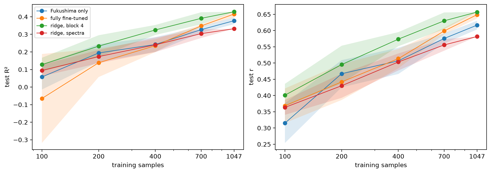

# Learning curve


<!-- WARNING: THIS FILE WAS AUTOGENERATED! DO NOT EDIT! -->

``` python
import numpy as np, pandas as pd
import matplotlib.pyplot as plt
from soilspecdata.all import load_ossl
from ossl_fuku_transfer.data import *
from ossl_fuku_transfer.transfer import *
from ossl_fuku_transfer.inside import layer_features, probe
```

    /Users/franckalbinet/pro/dev/soilspec/ossl-fuku-transfer/.venv/lib/python3.13/site-packages/torch/jit/_script.py:1491: FutureWarning: `torch.jit.script` is deprecated. Please switch to `torch.compile` or `torch.export`.
      warnings.warn(

Every code cell reads OSSL or the Fukushima data, and is marked
`#| fukudata`. The outputs come from a local run on an Apple silicon GPU
(MPS).

## Data and models

The data and preprocessing are those of `03_kex`. Of the 1,388 Fukushima
spectra, 341 form the fixed test set and 1,047 are available for
training:

``` python
om = load_ossl().mir(wmin=shared_wns[0], wmax=shared_wns[-1])
Xo, yo, _ = om.xy('k.ext_usda.a725_cmolc.kg')
yo = np.log1p(yo.ravel())
fuku = load_fuku()
fuku.source = fuku.source.assign(target=fuku.source['soil_ex_K2O'] / mg_k2o_per_cmolc)
Xf, yf, idf = fuku.xy('target')
yf = np.log1p(yf.ravel())
is_test = np.isin(idf, cs137_split()[1])
yt = yf[is_test]
pipe = preprocessings()['snv_d1']
Xo_d, Xf_d = pipe.fit_transform(Xo), pipe.transform(Xf)
int((~is_test).sum()), int(is_test.sum())
```

    (1047, 341)

Four models:

- `Fukushima only`: the CNN from random weights, 40 epochs at a learning
  rate of 3·10⁻³;
- `fully fine-tuned`: the CNN from the saved OSSL model, 20 epochs at
  3·10⁻³;
- `ridge, block 4`: a ridge regression on block 4 of the frozen OSSL
  model, the best layer in `07_inside_transfer`;
- `ridge, spectra`: a ridge regression on the preprocessed spectra.

The CNN schedules are those that cross-validation chose in `03_kex` on
all 1,047 training samples, and stay fixed for every size. With fewer
samples, a fixed number of epochs means fewer training steps. The CNNs
keep a tenth of each subset for validation, as `fuku_dls` does, and the
ridge regressions use the whole subset.

``` python
pretrained = load_pretrained('ossl_kex_snv_d1')
start = {'Fukushima only': None, 'fully fine-tuned': pretrained}
schedules = {'Fukushima only': (40, 3e-3), 'fully fine-tuned': (20, 3e-3)}
ridge_X = {'ridge, block 4': layer_features(pretrained, Xf_d)['block 4'], 'ridge, spectra': Xf_d}
{k: v.shape for k, v in ridge_X.items()}
```

    {'ridge, block 4': (1388, 2560), 'ridge, spectra': (1388, 1675)}

## Curve

Five training sizes, each drawn five times with a different seed. All
models of a seed use the same subset, the one `subset_preds` draws. At
1,047 the subset is the whole training set, so the seeds only change the
validation split and the CNNs’ initialisation, and the ridge regressions
give the same result for every seed. The results are saved in
`model_dir()` and loaded on later runs:

``` python
sizes, seeds = [100, 200, 400, 700, 1047], range(5)
fn = model_dir()/'curve_kex.csv'
if fn.exists(): curve = pd.read_csv(fn)
else:
    rows = []
    for n in sizes:
        for s in seeds:
            sub = np.random.RandomState(s).choice(np.flatnonzero(~is_test), n, replace=False)
            for m, (ep, lr) in schedules.items():
                rows.append({'model': m, 'n': n, 'seed': s, **scores(yt, subset_preds(start[m], Xf_d, yf, is_test, n, s, ep, lr))})
            for m, F in ridge_X.items():
                res = probe(F[sub], yf[sub], F[is_test], yt)
                rows.append({'model': m, 'n': n, 'seed': s, **{k: v for k, v in res.items() if k != 'alpha'}})
    curve = pd.DataFrame(rows)
    curve.to_csv(fn, index=False)
summ = curve.groupby(['model', 'n'], sort=False)[['R²', 'r']].agg(['mean', 'std'])
summ.round(3)
```

<div>
<style scoped>
    .dataframe tbody tr th:only-of-type {
        vertical-align: middle;
    }
&#10;    .dataframe tbody tr th {
        vertical-align: top;
    }
&#10;    .dataframe thead tr th {
        text-align: left;
    }
&#10;    .dataframe thead tr:last-of-type th {
        text-align: right;
    }
</style>

<table class="dataframe" data-quarto-postprocess="true" data-border="1">
<thead>
<tr>
<th data-quarto-table-cell-role="th"></th>
<th data-quarto-table-cell-role="th"></th>
<th colspan="2" data-quarto-table-cell-role="th"
data-halign="left">R²</th>
<th colspan="2" data-quarto-table-cell-role="th"
data-halign="left">r</th>
</tr>
<tr>
<th data-quarto-table-cell-role="th"></th>
<th data-quarto-table-cell-role="th"></th>
<th data-quarto-table-cell-role="th">mean</th>
<th data-quarto-table-cell-role="th">std</th>
<th data-quarto-table-cell-role="th">mean</th>
<th data-quarto-table-cell-role="th">std</th>
</tr>
<tr>
<th data-quarto-table-cell-role="th">model</th>
<th data-quarto-table-cell-role="th">n</th>
<th data-quarto-table-cell-role="th"></th>
<th data-quarto-table-cell-role="th"></th>
<th data-quarto-table-cell-role="th"></th>
<th data-quarto-table-cell-role="th"></th>
</tr>
</thead>
<tbody>
<tr>
<td data-quarto-table-cell-role="th">Fukushima only</td>
<td data-quarto-table-cell-role="th">100</td>
<td>0.057</td>
<td>0.071</td>
<td>0.315</td>
<td>0.061</td>
</tr>
<tr>
<td data-quarto-table-cell-role="th">fully fine-tuned</td>
<td data-quarto-table-cell-role="th">100</td>
<td>-0.065</td>
<td>0.253</td>
<td>0.369</td>
<td>0.053</td>
</tr>
<tr>
<td data-quarto-table-cell-role="th">ridge, block 4</td>
<td data-quarto-table-cell-role="th">100</td>
<td>0.128</td>
<td>0.039</td>
<td>0.401</td>
<td>0.035</td>
</tr>
<tr>
<td data-quarto-table-cell-role="th">ridge, spectra</td>
<td data-quarto-table-cell-role="th">100</td>
<td>0.094</td>
<td>0.033</td>
<td>0.363</td>
<td>0.023</td>
</tr>
<tr>
<td data-quarto-table-cell-role="th">Fukushima only</td>
<td data-quarto-table-cell-role="th">200</td>
<td>0.194</td>
<td>0.051</td>
<td>0.467</td>
<td>0.042</td>
</tr>
<tr>
<td data-quarto-table-cell-role="th">fully fine-tuned</td>
<td data-quarto-table-cell-role="th">200</td>
<td>0.138</td>
<td>0.081</td>
<td>0.442</td>
<td>0.056</td>
</tr>
<tr>
<td data-quarto-table-cell-role="th">ridge, block 4</td>
<td data-quarto-table-cell-role="th">200</td>
<td>0.233</td>
<td>0.062</td>
<td>0.495</td>
<td>0.058</td>
</tr>
<tr>
<td data-quarto-table-cell-role="th">ridge, spectra</td>
<td data-quarto-table-cell-role="th">200</td>
<td>0.174</td>
<td>0.038</td>
<td>0.430</td>
<td>0.037</td>
</tr>
<tr>
<td data-quarto-table-cell-role="th">Fukushima only</td>
<td data-quarto-table-cell-role="th">400</td>
<td>0.242</td>
<td>0.042</td>
<td>0.507</td>
<td>0.040</td>
</tr>
<tr>
<td data-quarto-table-cell-role="th">fully fine-tuned</td>
<td data-quarto-table-cell-role="th">400</td>
<td>0.236</td>
<td>0.037</td>
<td>0.514</td>
<td>0.030</td>
</tr>
<tr>
<td data-quarto-table-cell-role="th">ridge, block 4</td>
<td data-quarto-table-cell-role="th">400</td>
<td>0.325</td>
<td>0.028</td>
<td>0.574</td>
<td>0.022</td>
</tr>
<tr>
<td data-quarto-table-cell-role="th">ridge, spectra</td>
<td data-quarto-table-cell-role="th">400</td>
<td>0.241</td>
<td>0.042</td>
<td>0.503</td>
<td>0.026</td>
</tr>
<tr>
<td data-quarto-table-cell-role="th">Fukushima only</td>
<td data-quarto-table-cell-role="th">700</td>
<td>0.327</td>
<td>0.018</td>
<td>0.576</td>
<td>0.015</td>
</tr>
<tr>
<td data-quarto-table-cell-role="th">fully fine-tuned</td>
<td data-quarto-table-cell-role="th">700</td>
<td>0.348</td>
<td>0.007</td>
<td>0.599</td>
<td>0.010</td>
</tr>
<tr>
<td data-quarto-table-cell-role="th">ridge, block 4</td>
<td data-quarto-table-cell-role="th">700</td>
<td>0.391</td>
<td>0.035</td>
<td>0.630</td>
<td>0.026</td>
</tr>
<tr>
<td data-quarto-table-cell-role="th">ridge, spectra</td>
<td data-quarto-table-cell-role="th">700</td>
<td>0.304</td>
<td>0.025</td>
<td>0.556</td>
<td>0.018</td>
</tr>
<tr>
<td data-quarto-table-cell-role="th">Fukushima only</td>
<td data-quarto-table-cell-role="th">1047</td>
<td>0.378</td>
<td>0.020</td>
<td>0.617</td>
<td>0.013</td>
</tr>
<tr>
<td data-quarto-table-cell-role="th">fully fine-tuned</td>
<td data-quarto-table-cell-role="th">1047</td>
<td>0.416</td>
<td>0.018</td>
<td>0.649</td>
<td>0.012</td>
</tr>
<tr>
<td data-quarto-table-cell-role="th">ridge, block 4</td>
<td data-quarto-table-cell-role="th">1047</td>
<td>0.429</td>
<td>0.000</td>
<td>0.657</td>
<td>0.000</td>
</tr>
<tr>
<td data-quarto-table-cell-role="th">ridge, spectra</td>
<td data-quarto-table-cell-role="th">1047</td>
<td>0.332</td>
<td>0.000</td>
<td>0.582</td>
<td>0.000</td>
</tr>
</tbody>
</table>

</div>

Mean R² and correlation over the seeds, with a band of ±1 standard
deviation, on a log scale of training size:

``` python
fig, axs = plt.subplots(1, 2, figsize=(11, 3.8), layout='constrained')
for ax, st in zip(axs, ('R²', 'r')):
    for m in summ.index.get_level_values(0).unique():
        s = summ.loc[m, st]
        ax.plot(s.index, s['mean'], marker='o', lw=1, label=m)
        ax.fill_between(s.index, s['mean'] - s['std'], s['mean'] + s['std'], alpha=0.15)
    ax.set_xscale('log'); ax.set_xticks(sizes, sizes); ax.set_xlabel('training samples'); ax.set_ylabel(f'test {st}')
axs[0].legend(fontsize=8);
```



The gain in mean R² per doubling of the training set, between
consecutive sizes:

``` python
r2 = summ.xs('mean', axis=1, level=1)['R²'].unstack(0)
(r2.diff().div(np.log2(r2.index.to_series()).diff(), axis=0)).dropna().round(3)
```

<div>
<style scoped>
    .dataframe tbody tr th:only-of-type {
        vertical-align: middle;
    }
&#10;    .dataframe tbody tr th {
        vertical-align: top;
    }
&#10;    .dataframe thead th {
        text-align: right;
    }
</style>

<table class="dataframe" data-quarto-postprocess="true" data-border="1">
<thead>
<tr style="text-align: right;">
<th data-quarto-table-cell-role="th">model</th>
<th data-quarto-table-cell-role="th">Fukushima only</th>
<th data-quarto-table-cell-role="th">fully fine-tuned</th>
<th data-quarto-table-cell-role="th">ridge, block 4</th>
<th data-quarto-table-cell-role="th">ridge, spectra</th>
</tr>
<tr>
<th data-quarto-table-cell-role="th">n</th>
<th data-quarto-table-cell-role="th"></th>
<th data-quarto-table-cell-role="th"></th>
<th data-quarto-table-cell-role="th"></th>
<th data-quarto-table-cell-role="th"></th>
</tr>
</thead>
<tbody>
<tr>
<td data-quarto-table-cell-role="th">200</td>
<td>0.137</td>
<td>0.203</td>
<td>0.105</td>
<td>0.079</td>
</tr>
<tr>
<td data-quarto-table-cell-role="th">400</td>
<td>0.048</td>
<td>0.097</td>
<td>0.092</td>
<td>0.067</td>
</tr>
<tr>
<td data-quarto-table-cell-role="th">700</td>
<td>0.105</td>
<td>0.139</td>
<td>0.082</td>
<td>0.079</td>
</tr>
<tr>
<td data-quarto-table-cell-role="th">1047</td>
<td>0.088</td>
<td>0.116</td>
<td>0.065</td>
<td>0.048</td>
</tr>
</tbody>
</table>

</div>

## Findings

No model reaches a plateau. Between 700 and 1,047 training samples, the
mean test R² still rises by 0.05 to 0.12 per doubling of the training
set: 0.116 for the fully fine-tuned CNN, 0.088 for the Fukushima-only
CNN, 0.065 for the ridge regression on block 4 and 0.048 for the ridge
regression on the spectra. With 1,047 samples, the Kex scores on
Fukushima are limited by the number of samples. The curve doesn’t show
how far they would rise with more.

The frozen OSSL features help most when samples are few. The ridge
regression on block 4 is the best model, or level with the best, at
every size. At 400 samples it reaches an R² of 0.33 (r 0.57), against
0.24 for the Fukushima-only CNN, the fully fine-tuned CNN and the ridge
regression on the spectra. At 1,047 samples the gap has closed: 0.43 for
the ridge regression on block 4 and 0.42 for the fully fine-tuned CNN.

The fully fine-tuned CNN gains fastest from 400 samples upwards. It
overtakes the Fukushima-only CNN from 700 samples (0.35 against 0.33)
and leads it at 1,047 (0.42 against 0.38). At 100 samples it is unstable
(R² −0.07, standard deviation 0.25 over the seeds), but its correlation
(0.37) is higher than the Fukushima-only CNN’s (0.32). The schedules
were chosen for 1,047 samples and not retuned for smaller sizes, so the
CNNs may be underrated at small sizes.

The ridge regression on the spectra, close to a PLSR baseline, gains
least: 0.33 at 1,047 samples, rising by 0.05 per doubling.
