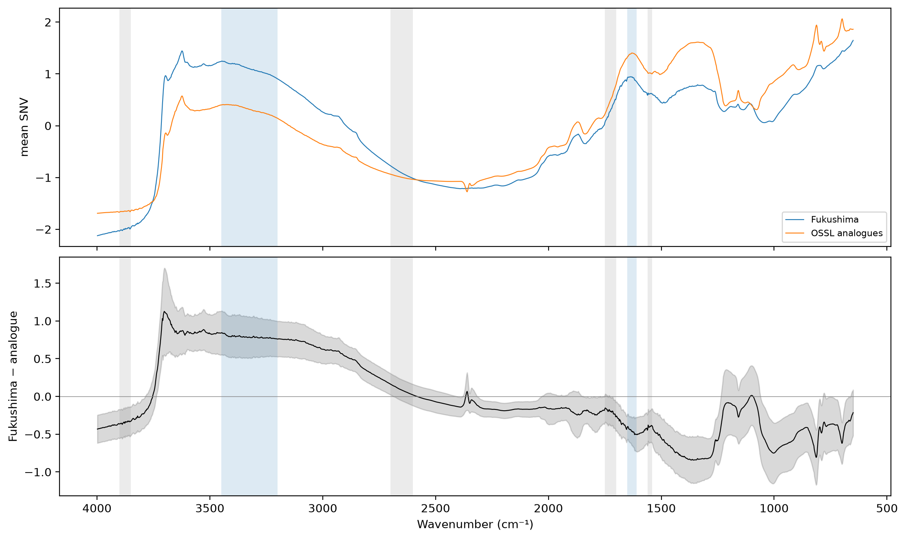
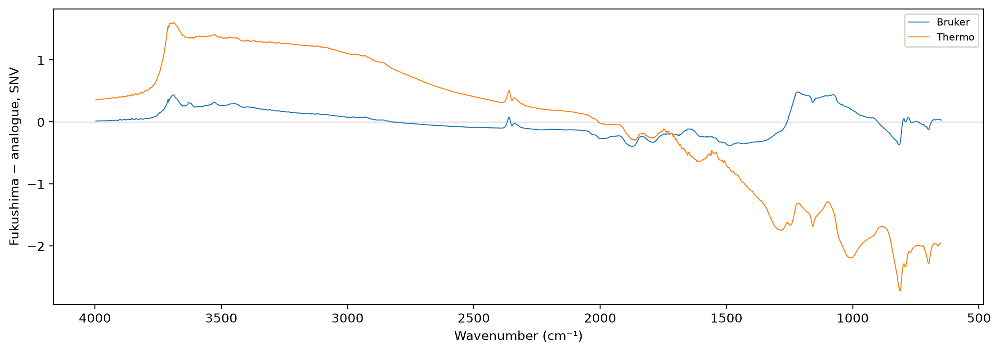

# Sample moisture


<!-- WARNING: THIS FILE WAS AUTOGENERATED! DO NOT EDIT! -->

``` python
import pandas as pd
import matplotlib.pyplot as plt
from scipy.stats import spearmanr
from sklearn.neighbors import NearestNeighbors
from sklearn.preprocessing import StandardScaler
from fastcore.test import *
from soilspecdata.all import load_ossl
from soilspectfm.preprocessing import SNV
from soilspecdl.all import predict
from ossl_fuku_transfer.data import *
from ossl_fuku_transfer.transfer import *
from ossl_fuku_transfer.inside import tracked_model
```

Water held by a soil sample absorbs in two broad bands: O–H stretching,
centred near 3400 cm⁻¹, and H–O–H bending near 1630 cm⁻¹. Unlike water
vapour (`15_vapour`), these bands are tens to hundreds of cm⁻¹ wide.
`01_pca` found a broad absorption at 3500–3950 cm⁻¹ in the Fukushima
residuals. A sample that was not fully dry, or that took up water before
measurement, would show stronger water bands than an OSSL soil with the
same properties.

The module part uses small random arrays, so it runs without the data.
The sections from *Data* onwards read OSSL and the Fukushima data, and
are marked `#| fukudata`.

## Band height

`band_height` is the mean height of a band above a straight baseline.
The baseline joins the mean values of two anchor ranges on either side
of the band, at their mean wavenumbers. `water_bands` holds the band and
anchor ranges used here. The anchors avoid the narrow structural O–H
bands of kaolinite near 3620–3700 cm⁻¹ and the organic C–H bands near
2850–2950 cm⁻¹:

------------------------------------------------------------------------

### band_height

``` python
def band_height(
    X, # Spectra, one per row
    wns, # Wavenumbers of the columns of `X`
    band, # (low, high) range of the band, in cm⁻¹
    lo, # (low, high) range of the anchor below the band
    hi, # (low, high) range of the anchor above the band
)->numpy.ndarray: # One height per spectrum
```

*Mean height of `band` above the straight line through the means of the
anchor ranges `lo` and `hi`*

``` python
wns_syn = np.arange(650, 3999, 2.)
slope = 0.001 * wns_syn
bump = np.exp(-0.5 * ((wns_syn - 3325) / 60)**2)
X_syn = np.stack([slope, slope + 0.5 * bump])
h = band_height(X_syn, wns_syn, *water_bands['O–H stretch'])
test_close(h[0], 0, eps=1e-9)
test_close(h[1], 0.5 * bump[(wns_syn >= 3200) & (wns_syn <= 3450)].mean(), eps=1e-3)
```

## Data

The Fukushima spectra and all OSSL spectra on the shared grid, with SNV,
so that the heights compare spectra of different overall absorbance.
Each Fukushima soil gets its OSSL soil analogue, as in `12_wetchem`: the
nearest OSSL sample in the seven standardised properties of
`prop_features`:

``` python
fuku = load_fuku()
om = load_ossl().mir(wmin=shared_wns[0], wmax=shared_wns[-1])
snv = SNV()
Sf = snv.fit_transform(fuku.spectra)
op, fp = prop_features(ossl_shared_props(om)), prop_features(fuku_shared_props(fuku.sample_ids))
sc_p = StandardScaler().fit(op)
an = op.index[NearestNeighbors(n_neighbors=1).fit(sc_p.transform(op)).kneighbors(sc_p.transform(fp))[1][:, 0]]
opos = pd.Series(np.arange(len(om.sample_ids)), index=om.sample_ids)
fpos = pd.Series(np.arange(len(fuku.sample_ids)), index=fuku.sample_ids)
Sa = snv.fit_transform(om.spectra[opos[an].to_numpy()])
Sf_p = Sf[fpos[fp.index].to_numpy()]
sub = np.random.default_rng(0).choice(len(om.spectra), 10000, replace=False)
So = snv.fit_transform(om.spectra[sub])
len(fp), len(np.unique(an))
```

    (1385, 831)

## Mean difference from the analogues

The mean SNV spectrum of the Fukushima soils and of their analogues, and
their mean difference with a band of ±1 standard deviation over the
pairs. The water bands and anchors are shaded:

``` python
diff = Sf_p - Sa
fig, axs = plt.subplots(2, 1, figsize=(11, 6.5), sharex=True, layout='constrained')
axs[0].plot(shared_wns, Sf_p.mean(0), lw=0.8, label='Fukushima')
axs[0].plot(shared_wns, Sa.mean(0), lw=0.8, label='OSSL analogues')
axs[1].plot(shared_wns, diff.mean(0), lw=0.8, c='k')
axs[1].fill_between(shared_wns, diff.mean(0) - diff.std(0), diff.mean(0) + diff.std(0), color='k', alpha=0.15)
axs[1].axhline(0, lw=0.5, c='grey')
for ax in axs:
    for band, lo, hi in water_bands.values():
        ax.axvspan(*band, color='tab:blue', alpha=0.15, lw=0)
        for a in (lo, hi): ax.axvspan(*a, color='tab:grey', alpha=0.15, lw=0)
axs[0].set_ylabel('mean SNV'); axs[0].legend(fontsize=8); axs[1].set_ylabel('Fukushima − analogue'); axs[1].invert_xaxis(); axs[1].set_xlabel('Wavenumber (cm⁻¹)');
```



The mean absolute difference per region, and how consistent its sign is:
the share of pairs in which Fukushima is higher, averaged over the
region:

``` python
regions = {'650–1300': (650, 1300), '1300–1610': (1300, 1610), 'H–O–H bend 1610–1650': (1610, 1650), '1650–2000': (1650, 2000), '2000–2800': (2000, 2800),
           '2800–3200': (2800, 3200), 'O–H stretch 3200–3450': (3200, 3450), '3450–3700': (3450, 3700), '3700–3998': (3700, 3998)}
pd.DataFrame({k: {'mean difference': diff[:, (shared_wns >= lo) & (shared_wns <= hi)].mean(), 'mean |difference|': np.abs(diff[:, (shared_wns >= lo) & (shared_wns <= hi)]).mean(),
                  'share Fukushima higher': (diff[:, (shared_wns >= lo) & (shared_wns <= hi)] > 0).mean()} for k, (lo, hi) in regions.items()}).T.round(3)
```

<div>
<style scoped>
    .dataframe tbody tr th:only-of-type {
        vertical-align: middle;
    }
&#10;    .dataframe tbody tr th {
        vertical-align: top;
    }
&#10;    .dataframe thead th {
        text-align: right;
    }
</style>

<table class="dataframe" data-quarto-postprocess="true" data-border="1">
<thead>
<tr style="text-align: right;">
<th data-quarto-table-cell-role="th"></th>
<th data-quarto-table-cell-role="th">mean difference</th>
<th data-quarto-table-cell-role="th">mean |difference|</th>
<th data-quarto-table-cell-role="th">share Fukushima higher</th>
</tr>
</thead>
<tbody>
<tr>
<td data-quarto-table-cell-role="th">650–1300</td>
<td>-0.430</td>
<td>0.505</td>
<td>0.158</td>
</tr>
<tr>
<td data-quarto-table-cell-role="th">1300–1610</td>
<td>-0.654</td>
<td>0.658</td>
<td>0.017</td>
</tr>
<tr>
<td data-quarto-table-cell-role="th">H–O–H bend 1610–1650</td>
<td>-0.459</td>
<td>0.461</td>
<td>0.014</td>
</tr>
<tr>
<td data-quarto-table-cell-role="th">1650–2000</td>
<td>-0.216</td>
<td>0.253</td>
<td>0.147</td>
</tr>
<tr>
<td data-quarto-table-cell-role="th">2000–2800</td>
<td>-0.048</td>
<td>0.168</td>
<td>0.345</td>
</tr>
<tr>
<td data-quarto-table-cell-role="th">2800–3200</td>
<td>0.619</td>
<td>0.619</td>
<td>0.998</td>
</tr>
<tr>
<td data-quarto-table-cell-role="th">O–H stretch 3200–3450</td>
<td>0.789</td>
<td>0.789</td>
<td>0.999</td>
</tr>
<tr>
<td data-quarto-table-cell-role="th">3450–3700</td>
<td>0.874</td>
<td>0.876</td>
<td>0.994</td>
</tr>
<tr>
<td data-quarto-table-cell-role="th">3700–3998</td>
<td>-0.158</td>
<td>0.382</td>
<td>0.212</td>
</tr>
</tbody>
</table>

</div>

## Moisture scores

The height of each water band in the Fukushima spectra, their analogues
and 10,000 random OSSL spectra. The quantiles, and the share of pairs in
which the Fukushima soil has the higher band:

``` python
hgt = {name: {'Fukushima': band_height(Sf_p, shared_wns, *b), 'analogues': band_height(Sa, shared_wns, *b), 'OSSL': band_height(So, shared_wns, *b)}
       for name, b in water_bands.items()}
qs = [0.05, 0.25, 0.5, 0.75, 0.95]
tab = pd.concat({name: pd.DataFrame({k: np.quantile(v, qs) for k, v in d.items()}, index=qs) for name, d in hgt.items()}, axis=1)
display(tab.round(3))
{name: round(float((d['Fukushima'] > d['analogues']).mean()), 3) for name, d in hgt.items()}
```

<div>
<style scoped>
    .dataframe tbody tr th:only-of-type {
        vertical-align: middle;
    }
&#10;    .dataframe tbody tr th {
        vertical-align: top;
    }
&#10;    .dataframe thead tr th {
        text-align: left;
    }
</style>

<table class="dataframe" data-quarto-postprocess="true" data-border="1">
<thead>
<tr>
<th data-quarto-table-cell-role="th"></th>
<th colspan="3" data-quarto-table-cell-role="th" data-halign="left">O–H
stretch</th>
<th colspan="3" data-quarto-table-cell-role="th"
data-halign="left">H–O–H bend</th>
</tr>
<tr>
<th data-quarto-table-cell-role="th"></th>
<th data-quarto-table-cell-role="th">Fukushima</th>
<th data-quarto-table-cell-role="th">analogues</th>
<th data-quarto-table-cell-role="th">OSSL</th>
<th data-quarto-table-cell-role="th">Fukushima</th>
<th data-quarto-table-cell-role="th">analogues</th>
<th data-quarto-table-cell-role="th">OSSL</th>
</tr>
</thead>
<tbody>
<tr>
<td data-quarto-table-cell-role="th">0.05</td>
<td>2.308</td>
<td>1.136</td>
<td>0.848</td>
<td>0.330</td>
<td>0.465</td>
<td>0.359</td>
</tr>
<tr>
<td data-quarto-table-cell-role="th">0.25</td>
<td>2.499</td>
<td>1.538</td>
<td>1.407</td>
<td>0.397</td>
<td>0.545</td>
<td>0.513</td>
</tr>
<tr>
<td data-quarto-table-cell-role="th">0.50</td>
<td>2.635</td>
<td>1.717</td>
<td>1.727</td>
<td>0.451</td>
<td>0.594</td>
<td>0.637</td>
</tr>
<tr>
<td data-quarto-table-cell-role="th">0.75</td>
<td>2.728</td>
<td>1.834</td>
<td>1.962</td>
<td>0.501</td>
<td>0.662</td>
<td>0.776</td>
</tr>
<tr>
<td data-quarto-table-cell-role="th">0.95</td>
<td>2.848</td>
<td>2.029</td>
<td>2.198</td>
<td>0.572</td>
<td>0.760</td>
<td>1.009</td>
</tr>
</tbody>
</table>

</div>

    {'O–H stretch': 0.999, 'H–O–H bend': 0.047}

## Moisture and the transfer failure

The Spearman correlation of the Kex errors with each band height, and
with its excess over the analogue’s: the zero-shot error of the
pretrained OSSL model on all samples, and the residuals of the fully
fine-tuned and Fukushima-only models of `06_dynamics` on the test
samples:

``` python
fuku.source = fuku.source.assign(target=fuku.source['soil_ex_K2O'] / mg_k2o_per_cmolc)
Xf, yf, idf = fuku.xy('target')
yf = np.log1p(yf.ravel())
Xf_d = preprocessings()['snv_d1'].fit_transform(Xf)
is_test = np.isin(idf, cs137_split()[1])
feat = pd.DataFrame({f'{name}{s}': (d['Fukushima'] - d['analogues']) if s else d['Fukushima'] for name, d in hgt.items() for s in ('', ', excess')}, index=fp.index).reindex(idf)
errs = {'zero-shot, all': (predict(load_pretrained('ossl_kex_snv_d1'), Xf_d, shared_wns) - yf, np.ones(len(yf), bool)),
        'fully fine-tuned, test': (predict(tracked_model('dyn_fuku_kex_ft'), Xf_d, shared_wns) - yf, is_test),
        'Fukushima only, test': (predict(tracked_model('dyn_fuku_kex_scratch'), Xf_d, shared_wns) - yf, is_test)}
ok = feat.notna().all(axis=1).to_numpy()
pd.DataFrame({k: {c: spearmanr(e[m & ok], feat[c].to_numpy()[m & ok])[0] for c in feat} for k, (e, m) in errs.items()}).T.round(3)
```

<div>
<style scoped>
    .dataframe tbody tr th:only-of-type {
        vertical-align: middle;
    }
&#10;    .dataframe tbody tr th {
        vertical-align: top;
    }
&#10;    .dataframe thead th {
        text-align: right;
    }
</style>

<table class="dataframe" data-quarto-postprocess="true" data-border="1">
<thead>
<tr style="text-align: right;">
<th data-quarto-table-cell-role="th"></th>
<th data-quarto-table-cell-role="th">O–H stretch</th>
<th data-quarto-table-cell-role="th">O–H stretch, excess</th>
<th data-quarto-table-cell-role="th">H–O–H bend</th>
<th data-quarto-table-cell-role="th">H–O–H bend, excess</th>
</tr>
</thead>
<tbody>
<tr>
<td data-quarto-table-cell-role="th">zero-shot, all</td>
<td>0.040</td>
<td>0.066</td>
<td>-0.031</td>
<td>0.062</td>
</tr>
<tr>
<td data-quarto-table-cell-role="th">fully fine-tuned, test</td>
<td>0.019</td>
<td>0.141</td>
<td>0.003</td>
<td>0.137</td>
</tr>
<tr>
<td data-quarto-table-cell-role="th">Fukushima only, test</td>
<td>0.009</td>
<td>0.097</td>
<td>0.036</td>
<td>0.117</td>
</tr>
</tbody>
</table>

</div>

Zero-shot scores of the pretrained OSSL model on the quarters of the
samples with the lowest to the highest O–H stretching band:

``` python
pz = errs['zero-shot, all'][0] + yf
oh = feat['O–H stretch'].to_numpy()
qt = pd.qcut(oh[ok], 4, labels=['lowest band', '2nd', '3rd', 'highest band'])
yq, pq = yf[ok], pz[ok]
pd.DataFrame({q: {'n': int((qt == q).sum()), 'median height': float(np.median(oh[ok][qt == q])), **scores(yq[qt == q], pq[qt == q])} for q in qt.categories}).T.round(3)
```

<div>
<style scoped>
    .dataframe tbody tr th:only-of-type {
        vertical-align: middle;
    }
&#10;    .dataframe tbody tr th {
        vertical-align: top;
    }
&#10;    .dataframe thead th {
        text-align: right;
    }
</style>

<table class="dataframe" data-quarto-postprocess="true" data-border="1">
<thead>
<tr style="text-align: right;">
<th data-quarto-table-cell-role="th"></th>
<th data-quarto-table-cell-role="th">n</th>
<th data-quarto-table-cell-role="th">median height</th>
<th data-quarto-table-cell-role="th">R²</th>
<th data-quarto-table-cell-role="th">r</th>
<th data-quarto-table-cell-role="th">RMSE</th>
<th data-quarto-table-cell-role="th">bias</th>
</tr>
</thead>
<tbody>
<tr>
<td data-quarto-table-cell-role="th">lowest band</td>
<td>347.0</td>
<td>2.404</td>
<td>-1.151</td>
<td>-0.025</td>
<td>0.598</td>
<td>0.301</td>
</tr>
<tr>
<td data-quarto-table-cell-role="th">2nd</td>
<td>346.0</td>
<td>2.579</td>
<td>-0.732</td>
<td>0.095</td>
<td>0.536</td>
<td>0.263</td>
</tr>
<tr>
<td data-quarto-table-cell-role="th">3rd</td>
<td>346.0</td>
<td>2.684</td>
<td>-0.516</td>
<td>0.268</td>
<td>0.576</td>
<td>0.277</td>
</tr>
<tr>
<td data-quarto-table-cell-role="th">highest band</td>
<td>346.0</td>
<td>2.795</td>
<td>-0.824</td>
<td>0.158</td>
<td>0.621</td>
<td>0.359</td>
</tr>
</tbody>
</table>

</div>

## Bruker spectra against their analogues

If the Bruker spectra of the Fukushima soils show the same shift against
their OSSL analogues, the shift comes from the sample preparation, which
both instruments shared. If they don’t, it comes from the Thermo
instrument or its accessory.

Every sample with Bruker spectra and all seven properties gets its OSSL
analogue, matched as above. All of them also have Thermo spectra. The
Bruker exports end at 3996 cm⁻¹, so all spectra here use 650–3996 cm⁻¹.
Their Thermo spectra are compared with the same analogues. The mean
difference per region, and the share of pairs in which the Fukushima
spectrum is higher:

``` python
pw = shared_wns[:-1]
b_ids = [i for i in sorted(bruker_files(), key=int) if i not in excluded]
bp = prop_features(fuku_shared_props(b_ids))
b_ids = list(bp.index)
b_an = op.index[NearestNeighbors(n_neighbors=1).fit(sc_p.transform(op)).kneighbors(sc_p.transform(bp))[1][:, 0]]
Sb = snv.fit_transform(load_bruker(pw, b_ids).spectra)
Sba = snv.fit_transform(om.spectra[opos[b_an].to_numpy()][:, :-1])
paired = [i for i in b_ids if i in set(spa_files())]
pm = np.isin(b_ids, paired)
St = snv.fit_transform(load_fuku(pw, paired).spectra)
test_eq(pm.all(), True)
sets = {'Bruker': Sb - Sba, 'Thermo': St - Sba}
rw = {k: (lo, min(hi, pw[-1])) for k, (lo, hi) in regions.items()}
res = {}
for k, d in sets.items():
    for reg, (lo, hi) in rw.items():
        m = (pw >= lo) & (pw <= hi)
        res[k, 'mean difference'] = res.get((k, 'mean difference'), {}) | {reg: d[:, m].mean()}
        res[k, 'share higher'] = res.get((k, 'share higher'), {}) | {reg: (d[:, m] > 0).mean()}
print({k: len(d) for k, d in sets.items()})
pd.DataFrame(res).round(3)
```

    {'Bruker': 375, 'Thermo': 375}

<div>
<style scoped>
    .dataframe tbody tr th:only-of-type {
        vertical-align: middle;
    }
&#10;    .dataframe tbody tr th {
        vertical-align: top;
    }
&#10;    .dataframe thead tr th {
        text-align: left;
    }
</style>

<table class="dataframe" data-quarto-postprocess="true" data-border="1">
<thead>
<tr>
<th data-quarto-table-cell-role="th"></th>
<th colspan="2" data-quarto-table-cell-role="th"
data-halign="left">Bruker</th>
<th colspan="2" data-quarto-table-cell-role="th"
data-halign="left">Thermo</th>
</tr>
<tr>
<th data-quarto-table-cell-role="th"></th>
<th data-quarto-table-cell-role="th">mean difference</th>
<th data-quarto-table-cell-role="th">share higher</th>
<th data-quarto-table-cell-role="th">mean difference</th>
<th data-quarto-table-cell-role="th">share higher</th>
</tr>
</thead>
<tbody>
<tr>
<td data-quarto-table-cell-role="th">650–1300</td>
<td>0.120</td>
<td>0.618</td>
<td>-1.837</td>
<td>0.010</td>
</tr>
<tr>
<td data-quarto-table-cell-role="th">1300–1610</td>
<td>-0.299</td>
<td>0.153</td>
<td>-0.942</td>
<td>0.013</td>
</tr>
<tr>
<td data-quarto-table-cell-role="th">H–O–H bend 1610–1650</td>
<td>-0.148</td>
<td>0.213</td>
<td>-0.578</td>
<td>0.010</td>
</tr>
<tr>
<td data-quarto-table-cell-role="th">1650–2000</td>
<td>-0.252</td>
<td>0.107</td>
<td>-0.194</td>
<td>0.208</td>
</tr>
<tr>
<td data-quarto-table-cell-role="th">2000–2800</td>
<td>-0.089</td>
<td>0.141</td>
<td>0.374</td>
<td>0.905</td>
</tr>
<tr>
<td data-quarto-table-cell-role="th">2800–3200</td>
<td>0.082</td>
<td>0.710</td>
<td>1.095</td>
<td>0.999</td>
</tr>
<tr>
<td data-quarto-table-cell-role="th">O–H stretch 3200–3450</td>
<td>0.207</td>
<td>0.814</td>
<td>1.291</td>
<td>1.000</td>
</tr>
<tr>
<td data-quarto-table-cell-role="th">3450–3700</td>
<td>0.292</td>
<td>0.866</td>
<td>1.403</td>
<td>0.997</td>
</tr>
<tr>
<td data-quarto-table-cell-role="th">3700–3998</td>
<td>0.076</td>
<td>0.675</td>
<td>0.571</td>
<td>0.860</td>
</tr>
</tbody>
</table>

</div>

``` python
fig, ax = plt.subplots(figsize=(11, 3.8), layout='constrained')
for k, d in sets.items(): ax.plot(pw, d.mean(0), lw=0.8, label=k)
ax.axhline(0, lw=0.5, c='grey')
ax.set_ylabel('Fukushima − analogue, SNV'); ax.invert_xaxis(); ax.set_xlabel('Wavenumber (cm⁻¹)'); ax.legend(fontsize=8);
```



## Findings

Compared with their OSSL soil analogues, the Fukushima spectra differ by
a broad, systematic shift of intensity between regions. After SNV,
Fukushima is higher between 2800 and 3700 cm⁻¹ in almost every pair: by
0.62 on average between 2800 and 3200 cm⁻¹, 0.79 in the O–H stretching
band (3200–3450 cm⁻¹) and 0.87 between 3450 and 3700 cm⁻¹, in 99 to 100%
of the pairs. It is lower below 2000 cm⁻¹: by 0.43 between 650 and 1300
cm⁻¹ and 0.65 between 1300 and 1610 cm⁻¹, in 84 to 98% of the pairs. The
1,385 pairs use 831 distinct OSSL analogues.

This pattern doesn’t look like water in the samples. Water would raise
both water bands. The O–H stretching band is higher than in the analogue
for 99.9% of the Fukushima soils (median height 2.64 against 1.72), but
the H–O–H bending band is higher for only 4.7% (median 0.45 against
0.59). SNV makes every difference relative: a large rise in one region
lowers the rest after normalisation. So a lower bending band doesn’t
rule out some water, but the two bands don’t move together as water
would make them.

Neither band explains the Kex errors. Their Spearman correlations with
the zero-shot error of the OSSL model, and with the residuals of the
fully fine-tuned and Fukushima-only models, are at most 0.14 in absolute
value. The largest are for the excess over the analogue, with the
fine-tuned model’s residuals (0.14 for both bands). By quarters of the
O–H stretching band, the zero-shot correlation is −0.03, 0.10, 0.27 and
0.16, without a steady trend.

The systematic shift towards the 2800–3700 cm⁻¹ region, present in
nearly every Fukushima spectrum, is the largest difference from matched
OSSL soils found so far. It fits a difference in measurement mode or
sample preparation, such as particle size, dilution or the accessory,
which changes the relative intensity of strong and weak bands. That is
an interpretation, not a test. A shift that is the same in every
spectrum adds a constant to a linear model’s predictions and leaves
their ranking unchanged. The analogue EPO in `13_epo` estimated its
directions from uncentred pair differences, so they include this shift,
and removing them did not give the ridge regression a usable
correlation. A CNN is not linear, so the shift can change its ranking.
This notebook doesn’t test that.

The shift comes mainly from the Thermo measurement. For the 375 soils
with both Bruker and Thermo spectra and all seven properties, the Thermo
spectra show the shift against their OSSL analogues even more strongly
than the current selection: +1.29 in the O–H stretching band and −1.84
between 650 and 1300 cm⁻¹, in 99 to 100% of the pairs. The Bruker
spectra of the same soils, against the same analogues, show a much
weaker shift towards high wavenumbers: +0.21 in the O–H stretching band
(higher in 81% of the pairs), and +0.12 between 650 and 1300 cm⁻¹, the
opposite sign to Thermo. 316 of these soils are Kazu samples, outside
the current selection. Whether the two instruments measured the same
prepared material is not known.

The OSSL Kex model fails zero-shot on these Bruker spectra too
(correlation 0.19, `05_paired`), although they show little of the shift.
So the shift is not the whole cause of the Kex failure.
