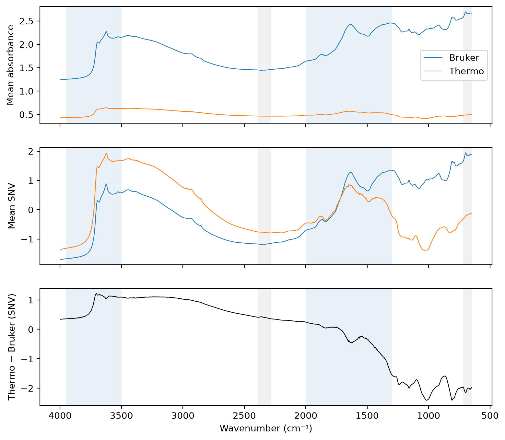
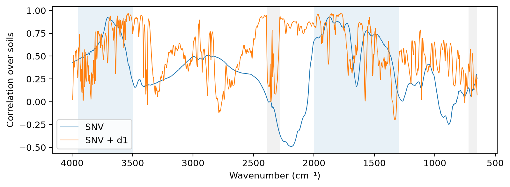

# Paired spectra


<!-- WARNING: THIS FILE WAS AUTOGENERATED! DO NOT EDIT! -->

``` python
import numpy as np, pandas as pd
import matplotlib.pyplot as plt
from scipy.ndimage import gaussian_filter1d
from sklearn.decomposition import PCA
from sklearn.pipeline import Pipeline
from fastcore.test import *
from soilspecdata.all import load_ossl
from soilspectfm.preprocessing import SNV
from soilspecdl.all import predict
from ossl_fuku_transfer.data import *
from ossl_fuku_transfer.transfer import *
```

    /Users/franckalbinet/pro/dev/soilspec/ossl-fuku-transfer/.venv/lib/python3.13/site-packages/torch/jit/_script.py:1491: FutureWarning: `torch.jit.script` is deprecated. Please switch to `torch.compile` or `torch.export`.
      warnings.warn(

Every code cell reads OSSL or the Fukushima data, and is marked
`#| fukudata`. The outputs come from a local run. Which Bruker
instrument and accessory measured these soils, and whether the Bruker
set is valid to use, are still open questions for the Fukushima data
team.

## Data

The soils with both Bruker and Thermo spectra, except those in
`excluded`. The Bruker files end at 3997.5 cm⁻¹, so the grid stops at
3996 cm⁻¹. Both spectra of a soil are averaged over their replicates and
interpolated onto the same grid:

``` python
pw = np.arange(650, 3997, 2)
ids = [i for i in sorted(set(bruker_files()) & set(spa_files()), key=int) if i not in excluded]
br, th = load_bruker(pw, ids), load_fuku(pw, ids)
test_eq(br.sample_ids, th.sample_ids)
len(ids), sum(int(i) >= 2600 for i in ids)
```

    (376, 316)

``` python
gas_bands = {'H₂O': [(1300, 2000), (3500, 3950)], 'CO₂': [(650, 720), (2280, 2390)]}
def shade(ax):
    for (gas, bands), color in zip(gas_bands.items(), ['tab:blue', 'tab:gray']):
        for lo, hi in bands: ax.axvspan(lo, hi, color=color, alpha=0.1, lw=0)
    ax.invert_xaxis(); ax.set_xlabel('Wavenumber (cm⁻¹)')
in_band = lambda lo, hi: (pw >= lo) & (pw <= hi)
regions = {'650–1300': in_band(650, 1300), 'H₂O 1300–2000': in_band(1300, 2000), 'CO₂ 2280–2390': in_band(2280, 2390), 'quiet 2400–2800': in_band(2400, 2800), '2800–3500': in_band(2800, 3500), 'H₂O 3500–3950': in_band(3500, 3950)}
```

## Mean spectra

The mean raw and SNV spectra of each instrument, and the difference of
the SNV means. The shaded regions are the water vapour (blue) and CO₂
(grey) bands:

``` python
snv = SNV()
S = {'Bruker': br.spectra, 'Thermo': th.spectra}
fig, axs = plt.subplots(3, 1, figsize=(9, 8), sharex=True)
for k, X in S.items():
    axs[0].plot(pw, X.mean(0), lw=0.8, label=k)
    axs[1].plot(pw, snv.transform(X).mean(0), lw=0.8, label=k)
axs[2].plot(pw, snv.transform(th.spectra).mean(0) - snv.transform(br.spectra).mean(0), lw=0.8, c='k')
for ax, t in zip(axs, ['Mean absorbance', 'Mean SNV', 'Thermo − Bruker (SNV)']): ax.set_ylabel(t); shade(ax)
axs[0].legend()
for ax in axs[:2]: ax.set_xlabel('')
{k: (round(float(X.mean()), 3), round(float(X.std(1).mean()), 3)) for k, X in S.items()}
```



    {'Bruker': (1.918, 0.398), 'Thermo': (0.514, 0.066)}

The pair of numbers per instrument is the mean absorbance and the mean
within-spectrum standard deviation.

## Agreement

For each soil, the correlation between its Bruker and Thermo spectra, as
median and 5th percentile over the soils, for raw spectra, SNV and SNV
with the first derivative:

``` python
pre = {'raw': None, 'SNV': Pipeline([('snv', SNV())]), 'SNV + d1': preprocessings()['snv_d1']}
tf = lambda p, X: X if p is None else p.fit_transform(X)
T = {k: (tf(p, br.spectra), tf(p, th.spectra)) for k, p in pre.items()}
pd.DataFrame({k: (lambda r: {'median': np.median(r), '5%': np.quantile(r, 0.05)})([np.corrcoef(a, b)[0, 1] for a, b in zip(*v)]) for k, v in T.items()}).T.round(3)
```

<div>
<style scoped>
    .dataframe tbody tr th:only-of-type {
        vertical-align: middle;
    }
&#10;    .dataframe tbody tr th {
        vertical-align: top;
    }
&#10;    .dataframe thead th {
        text-align: right;
    }
</style>

<table class="dataframe" data-quarto-postprocess="true" data-border="1">
<thead>
<tr style="text-align: right;">
<th data-quarto-table-cell-role="th"></th>
<th data-quarto-table-cell-role="th">median</th>
<th data-quarto-table-cell-role="th">5%</th>
</tr>
</thead>
<tbody>
<tr>
<td data-quarto-table-cell-role="th">raw</td>
<td>0.273</td>
<td>0.124</td>
</tr>
<tr>
<td data-quarto-table-cell-role="th">SNV</td>
<td>0.273</td>
<td>0.124</td>
</tr>
<tr>
<td data-quarto-table-cell-role="th">SNV + d1</td>
<td>0.776</td>
<td>0.681</td>
</tr>
</tbody>
</table>

</div>

Across soils, at each wavenumber: does the Thermo value rise where the
Bruker value rises? The correlation between instruments over the soils,
at each wavenumber, and its mean by region:

``` python
def colcorr(A, B):
    A, B = A - A.mean(0), B - B.mean(0)
    return (A * B).sum(0) / np.sqrt((A**2).sum(0) * (B**2).sum(0))
cc = {k: colcorr(*T[k]) for k in ['SNV', 'SNV + d1']}
fig, ax = plt.subplots(figsize=(9, 3))
for k, c in cc.items(): ax.plot(pw, c, lw=0.8, label=k)
ax.set_ylabel('Correlation over soils'); ax.legend(); shade(ax)
pd.DataFrame({k: {n: c[m].mean() for n, m in regions.items()} for k, c in cc.items()}).round(2)
```



<div>
<style scoped>
    .dataframe tbody tr th:only-of-type {
        vertical-align: middle;
    }
&#10;    .dataframe tbody tr th {
        vertical-align: top;
    }
&#10;    .dataframe thead th {
        text-align: right;
    }
</style>

<table class="dataframe" data-quarto-postprocess="true" data-border="1">
<thead>
<tr style="text-align: right;">
<th data-quarto-table-cell-role="th"></th>
<th data-quarto-table-cell-role="th">SNV</th>
<th data-quarto-table-cell-role="th">SNV + d1</th>
</tr>
</thead>
<tbody>
<tr>
<td data-quarto-table-cell-role="th">650–1300</td>
<td>0.10</td>
<td>0.43</td>
</tr>
<tr>
<td data-quarto-table-cell-role="th">H₂O 1300–2000</td>
<td>0.66</td>
<td>0.61</td>
</tr>
<tr>
<td data-quarto-table-cell-role="th">CO₂ 2280–2390</td>
<td>-0.11</td>
<td>0.32</td>
</tr>
<tr>
<td data-quarto-table-cell-role="th">quiet 2400–2800</td>
<td>0.32</td>
<td>0.45</td>
</tr>
<tr>
<td data-quarto-table-cell-role="th">2800–3500</td>
<td>0.34</td>
<td>0.52</td>
</tr>
<tr>
<td data-quarto-table-cell-role="th">H₂O 3500–3950</td>
<td>0.64</td>
<td>0.62</td>
</tr>
</tbody>
</table>

</div>

## Shift and broadening

A wavenumber calibration offset between the instruments shifts every
band. The cross-correlation of the mean SNV + d1 spectra, on a 0.1 cm⁻¹
grid, peaks at the shift that best aligns the Thermo spectrum with the
Bruker one:

``` python
fine = np.arange(pw[0] + 20, pw[-1] - 20, 0.1)
mb, mt = (np.interp(fine, pw, T['SNV + d1'][i].mean(0)) for i in (0, 1))
lags = np.arange(-50, 51)
n = len(fine)
xc = [np.corrcoef(mb[50:n-50], mt[50+l:n-50+l])[0, 1] for l in lags]
best_shift = lags[int(np.argmax(xc))] * 0.1
round(float(best_shift), 1), round(float(max(xc)), 4), round(float(xc[50]), 4)
```

    (1.6, 0.8093, 0.8045)

The output is the shift in cm⁻¹ (positive: the Thermo bands sit at
higher wavenumbers), the correlation at that shift and the correlation
without a shift.

Different resolution or apodisation gives bands of different widths.
Smoothing one instrument’s SNV spectra with a Gaussian of width σ, then
comparing the first derivatives, shows which instrument has the narrower
bands: smoothing the narrower one brings the two closer. The mean
squared difference of the SNV + d1 spectra, against σ in cm⁻¹:

``` python
sig = np.arange(0, 6.5, 0.5)
d1 = preprocessings()['snv_d1'].steps[-1][1]
Xb, Xt = T['SNV']
def msd(A, B): return float(((d1.transform(A) - d1.transform(B))**2).mean())
broad = pd.DataFrame({'smooth Bruker': [msd(gaussian_filter1d(Xb, s / 2, axis=1) if s else Xb, Xt) for s in sig],
                      'smooth Thermo': [msd(Xb, gaussian_filter1d(Xt, s / 2, axis=1) if s else Xt) for s in sig]}, index=sig)
broad.index.name = 'σ (cm⁻¹)'
broad.round(6).T
```

<div>
<style scoped>
    .dataframe tbody tr th:only-of-type {
        vertical-align: middle;
    }
&#10;    .dataframe tbody tr th {
        vertical-align: top;
    }
&#10;    .dataframe thead th {
        text-align: right;
    }
</style>

<table class="dataframe" data-quarto-postprocess="true" data-border="1">
<thead>
<tr style="text-align: right;">
<th data-quarto-table-cell-role="th">σ (cm⁻¹)</th>
<th data-quarto-table-cell-role="th">0.0</th>
<th data-quarto-table-cell-role="th">0.5</th>
<th data-quarto-table-cell-role="th">1.0</th>
<th data-quarto-table-cell-role="th">1.5</th>
<th data-quarto-table-cell-role="th">2.0</th>
<th data-quarto-table-cell-role="th">2.5</th>
<th data-quarto-table-cell-role="th">3.0</th>
<th data-quarto-table-cell-role="th">3.5</th>
<th data-quarto-table-cell-role="th">4.0</th>
<th data-quarto-table-cell-role="th">4.5</th>
<th data-quarto-table-cell-role="th">5.0</th>
<th data-quarto-table-cell-role="th">5.5</th>
<th data-quarto-table-cell-role="th">6.0</th>
</tr>
</thead>
<tbody>
<tr>
<td data-quarto-table-cell-role="th">smooth Bruker</td>
<td>0.000102</td>
<td>0.000102</td>
<td>0.000101</td>
<td>0.000100</td>
<td>0.000099</td>
<td>0.000098</td>
<td>0.000096</td>
<td>0.000095</td>
<td>0.000094</td>
<td>0.000093</td>
<td>0.000092</td>
<td>0.000092</td>
<td>0.000091</td>
</tr>
<tr>
<td data-quarto-table-cell-role="th">smooth Thermo</td>
<td>0.000102</td>
<td>0.000102</td>
<td>0.000102</td>
<td>0.000102</td>
<td>0.000101</td>
<td>0.000101</td>
<td>0.000100</td>
<td>0.000100</td>
<td>0.000100</td>
<td>0.000099</td>
<td>0.000099</td>
<td>0.000099</td>
<td>0.000099</td>
</tr>
</tbody>
</table>

</div>

## The OSSL view

Both instruments’ spectra projected onto a 10-component PCA fitted on
OSSL, after SNV and the first derivative. The share of soils beyond
OSSL’s 99th percentile of Hotelling’s T² and of the squared residual Q,
and the mean scores in standard deviations of the OSSL scores:

``` python
om = load_ossl().mir(wmin=pw[0], wmax=pw[-1])
pipe = preprocessings()['snv_d1']
Xo = pipe.fit_transform(om.spectra)
pca = PCA(n_components=10, svd_solver='randomized', random_state=0).fit(Xo)
sd = np.sqrt(pca.explained_variance_)
def t2q(X):
    Tx = pca.transform(X)
    return (Tx**2 / pca.explained_variance_).sum(1), ((X - pca.inverse_transform(Tx))**2).sum(1), Tx / sd
t2o, qo, _ = t2q(Xo)
lim_t2, lim_q = np.quantile(t2o, 0.99), np.quantile(qo, 0.99)
rows = {}
for k, X in {'Bruker': T['SNV + d1'][0], 'Thermo': T['SNV + d1'][1]}.items():
    t2, q, z = t2q(X)
    rows[k] = {'beyond T²': (t2 > lim_t2).mean(), 'beyond Q': (q > lim_q).mean(), **{f'PC{j+1}': z[:, j].mean() for j in range(3)}}
pd.DataFrame(rows).T.round(2)
```

<div>
<style scoped>
    .dataframe tbody tr th:only-of-type {
        vertical-align: middle;
    }
&#10;    .dataframe tbody tr th {
        vertical-align: top;
    }
&#10;    .dataframe thead th {
        text-align: right;
    }
</style>

<table class="dataframe" data-quarto-postprocess="true" data-border="1">
<thead>
<tr style="text-align: right;">
<th data-quarto-table-cell-role="th"></th>
<th data-quarto-table-cell-role="th">beyond T²</th>
<th data-quarto-table-cell-role="th">beyond Q</th>
<th data-quarto-table-cell-role="th">PC1</th>
<th data-quarto-table-cell-role="th">PC2</th>
<th data-quarto-table-cell-role="th">PC3</th>
</tr>
</thead>
<tbody>
<tr>
<td data-quarto-table-cell-role="th">Bruker</td>
<td>0.0</td>
<td>0.0</td>
<td>-0.68</td>
<td>-1.01</td>
<td>-0.51</td>
</tr>
<tr>
<td data-quarto-table-cell-role="th">Thermo</td>
<td>0.0</td>
<td>0.0</td>
<td>-0.89</td>
<td>-1.40</td>
<td>-0.64</td>
</tr>
</tbody>
</table>

</div>

## Zero-shot on both instruments

The pretrained OSSL models of `03_kex` and `04_cec` (SNV + d1), applied
without training to the Bruker and Thermo spectra of the same soils.
Scores as in `scores`: R² and correlation of `log1p`, RMSE and bias in
cmolc/kg:

``` python
props = br.source.reindex(ids)
targets = {'Kex': (props['soil_ex_K2O'] / mg_k2o_per_cmolc, 'ossl_kex_snv_d1'), 'CEC': (props['soil_CEC'], 'ossl_cec_snv_d1')}
rows = []
for t, (vals, fname) in targets.items():
    model, y = load_pretrained(fname), np.log1p(vals.to_numpy())
    ok = ~np.isnan(y)
    for k, X in {'Bruker': T['SNV + d1'][0], 'Thermo': T['SNV + d1'][1]}.items():
        rows.append({'target': t, 'instrument': k, 'n': int(ok.sum()), **scores(y[ok], predict(model, X, shared_wns)[ok])})
zs = pd.DataFrame(rows).set_index(['target', 'instrument'])
zs.round(3)
```

<div>
<style scoped>
    .dataframe tbody tr th:only-of-type {
        vertical-align: middle;
    }
&#10;    .dataframe tbody tr th {
        vertical-align: top;
    }
&#10;    .dataframe thead th {
        text-align: right;
    }
</style>

<table class="dataframe" data-quarto-postprocess="true" data-border="1">
<thead>
<tr style="text-align: right;">
<th data-quarto-table-cell-role="th"></th>
<th data-quarto-table-cell-role="th"></th>
<th data-quarto-table-cell-role="th">n</th>
<th data-quarto-table-cell-role="th">R²</th>
<th data-quarto-table-cell-role="th">r</th>
<th data-quarto-table-cell-role="th">RMSE</th>
<th data-quarto-table-cell-role="th">bias</th>
</tr>
<tr>
<th data-quarto-table-cell-role="th">target</th>
<th data-quarto-table-cell-role="th">instrument</th>
<th data-quarto-table-cell-role="th"></th>
<th data-quarto-table-cell-role="th"></th>
<th data-quarto-table-cell-role="th"></th>
<th data-quarto-table-cell-role="th"></th>
<th data-quarto-table-cell-role="th"></th>
</tr>
</thead>
<tbody>
<tr>
<td rowspan="2" data-quarto-table-cell-role="th"
data-valign="top">Kex</td>
<td data-quarto-table-cell-role="th">Bruker</td>
<td>375</td>
<td>-0.729</td>
<td>0.193</td>
<td>0.650</td>
<td>0.216</td>
</tr>
<tr>
<td data-quarto-table-cell-role="th">Thermo</td>
<td>375</td>
<td>-0.920</td>
<td>0.152</td>
<td>0.631</td>
<td>0.377</td>
</tr>
<tr>
<td rowspan="2" data-quarto-table-cell-role="th"
data-valign="top">CEC</td>
<td data-quarto-table-cell-role="th">Bruker</td>
<td>376</td>
<td>0.242</td>
<td>0.656</td>
<td>5.906</td>
<td>1.961</td>
</tr>
<tr>
<td data-quarto-table-cell-role="th">Thermo</td>
<td>376</td>
<td>-0.507</td>
<td>0.527</td>
<td>8.613</td>
<td>5.056</td>
</tr>
</tbody>
</table>

</div>

## Findings

376 soils have both Bruker and Thermo spectra after the exclusions. 316
of them are Kazu samples, which are outside the sample selection of
`03_kex` and `04_cec`. Which Bruker instrument and accessory measured
them is not known yet.

The two instruments record the same soils at very different contrast.
The Bruker spectra have a mean absorbance of 1.92 and a mean
within-spectrum standard deviation of 0.40. The Thermo spectra have 0.51
and 0.066: about six times less contrast. SNV removes a difference of
scale and offset, but not a non-linear one. Such a large difference in
contrast suggests a difference in measurement mode or sample
preparation, such as dilution, particle size or the accessory, more than
a difference between spectrometers.

The spectral shapes of the same soil differ. The median correlation
between a soil’s Bruker and Thermo spectra is 0.27 for raw and SNV
spectra. After the first derivative it is 0.78, because the derivative
removes the broad baseline differences.

Across soils, the instruments disagree most between 650 and 1300 cm⁻¹,
the region of the Si–O bands of quartz and clay minerals. There, the
correlation between instruments over the soils is 0.10 with SNV and 0.43
with the derivative. In the water bands, 1300–2000 and 3500–3950 cm⁻¹,
it is about 0.6. In diffuse reflectance, the bands in this mineral
region are the most sensitive to particle size and dilution.

Wavenumber calibration and resolution are minor. The best alignment
shifts the Thermo bands by 1.6 cm⁻¹ and raises the correlation of the
mean derivative spectra from 0.805 to 0.809. Smoothing the Bruker
spectra by a Gaussian of up to 6 cm⁻¹ lowers the derivative mismatch by
about 10%. Smoothing the Thermo spectra lowers it by about 3%. The
Bruker bands are slightly narrower.

In a PCA fitted on OSSL, both instruments’ spectra of these soils sit
within OSSL’s 99th percentiles of T² and Q. The Thermo spectra sit
further from the OSSL mean on PC2: -1.40 standard deviations, against
-1.01 for the Bruker spectra.

The OSSL models transfer better from the Bruker spectra, but not well.
For CEC, zero-shot prediction from the Bruker spectra gives a
correlation of 0.66 and an R² of 0.24. From the Thermo spectra of the
same soils it gives 0.53 and -0.51. The bias is +2.0 cmolc/kg from
Bruker and +5.1 from Thermo. For Kex, both instruments fail (correlation
0.19 and 0.15). The instrument explains part of the CEC gap. The rest,
and most of the Kex gap, comes from these soils or their preparation,
which OSSL does not cover, or from the Bruker instrument differing from
the instruments behind OSSL.

Questions for the Fukushima data team follow from this: the accessory of
each instrument, whether the samples were diluted (for example with KBr)
or measured neat, and how finely they were ground.
