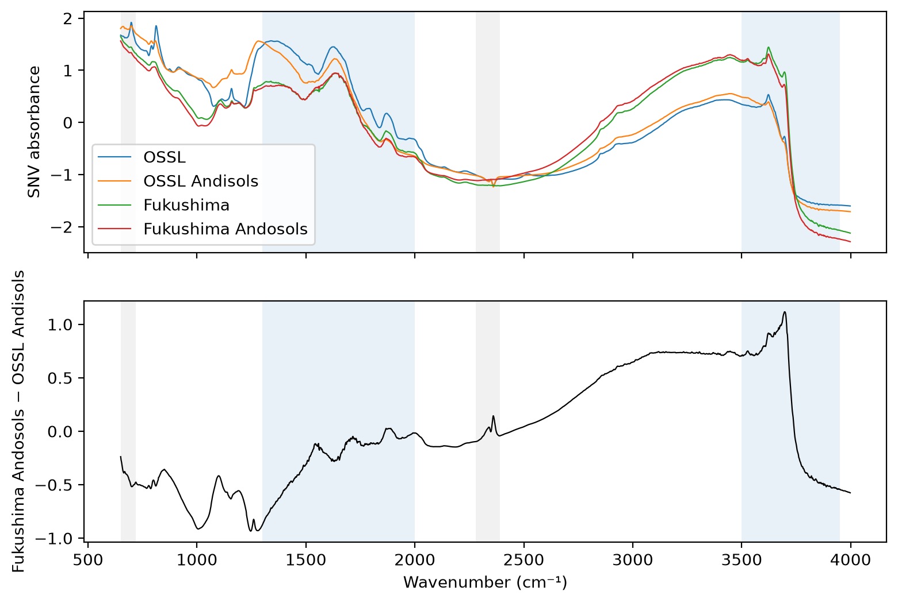
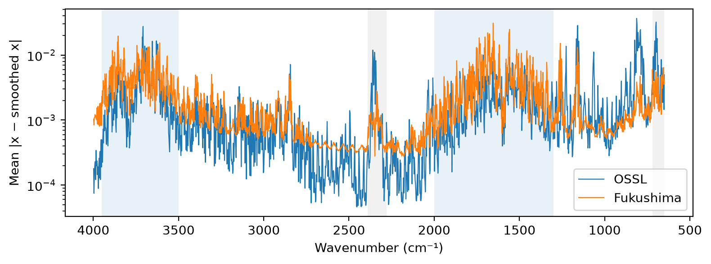
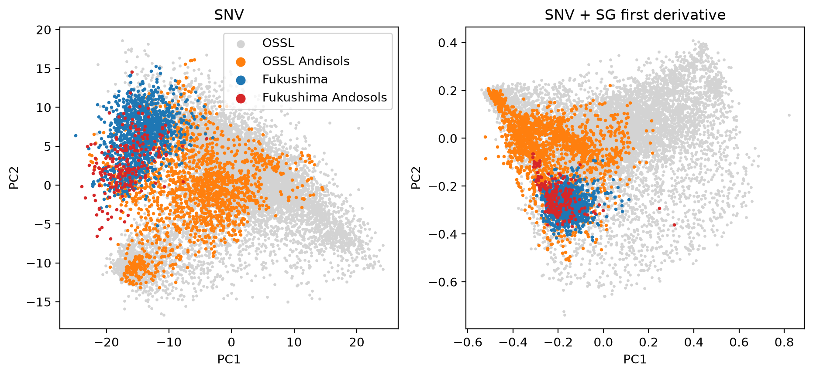
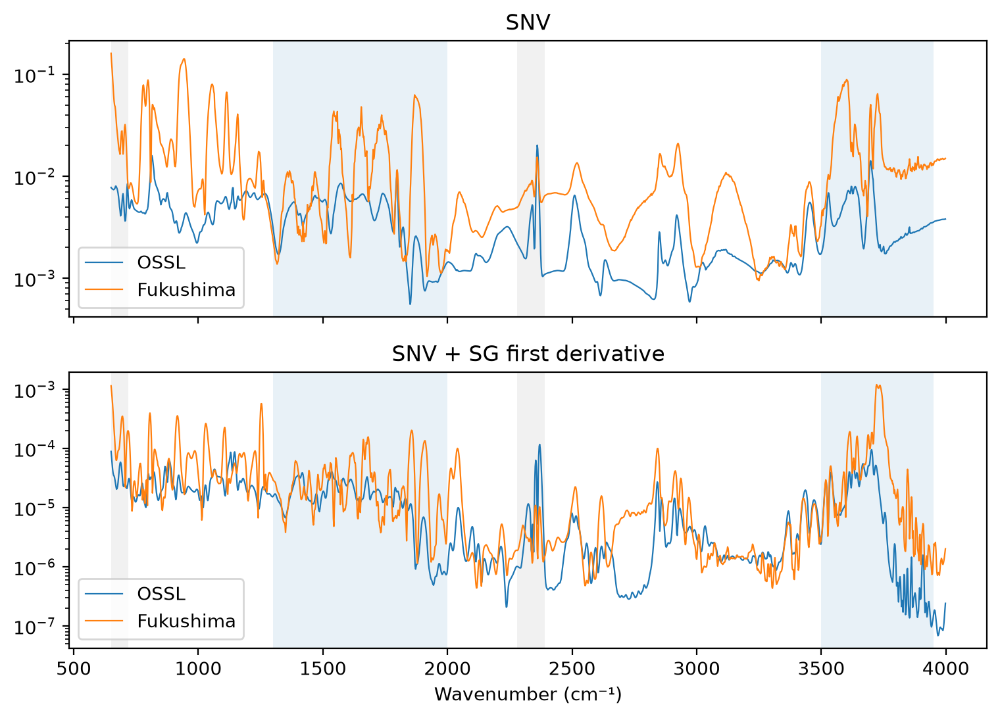
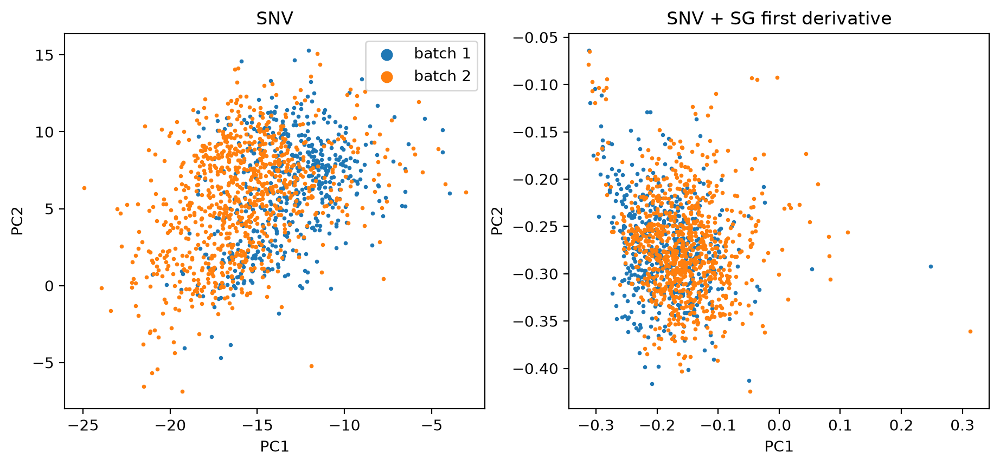

# OSSL and Fukushima spectra


<!-- WARNING: THIS FILE WAS AUTOGENERATED! DO NOT EDIT! -->

``` python
import numpy as np, pandas as pd
import matplotlib.pyplot as plt
from sklearn.decomposition import PCA
from sklearn.pipeline import make_pipeline
from fastcore.test import *
from soilspecdata.all import load_ossl
from soilspectfm.preprocessing import SNV, SavitzkyGolay
from ossl_fuku_transfer.data import load_fuku, sample_batches, shared_wns
```

Every code cell reads OSSL or the Fukushima data, so every cell is
marked `#| fukudata`. The outputs come from a local run.

## Data

OSSL MIR spectra, on the grid that OSSL and Fukushima share: 2 cm⁻¹ from
650 to 3998 cm⁻¹:

``` python
ossl = load_ossl()
om = ossl.mir(wmin=shared_wns[0], wmax=shared_wns[-1])
test_eq(om.wavenumbers, shared_wns)
om.spectra.shape
```

    (85684, 1675)

OSSL gives the USDA soil taxonomy name of a pedon in
`pedon.taxa_usda_txt`. Andisol great groups end in “-and”, such as
Hapludand. Older names end in “-andept”. The Andisols are the closest
OSSL counterpart of the Fukushima Andosols:

``` python
taxa = ossl['pedon.taxa_usda_txt'].reindex(om.sample_ids).astype('string')
is_andisol = taxa.str.contains(r'[a-z]ands?\b|andepts?\b', na=False).to_numpy()
int(taxa.notna().sum()), int(is_andisol.sum()), taxa[is_andisol].sample(4, random_state=0).tolist()
```

    (40075,
     1735,
     ['Ashy over loamy, amorphic over mixed, mesic Aquic Vitrixerand',
      'Medial, amorphic, mesic Vitric Hapludand',
      'Ashy over loamy, amorphic over  isotic, frigid Typic Udivitrand',
      'Typic Haplustand'])

The Fukushima spectra, with each sample’s soil type and measurement
batch. The batches are the folders of `.spa` files:

``` python
fuku = load_fuku()
soil = fuku.source.loc[fuku.sample_ids, 'Soil_type_describe'].to_numpy()
batch = sample_batches(fuku.sample_ids)
pd.Series(soil).value_counts().to_dict(), pd.Series(batch).value_counts().to_dict()
```

    ({'Lowland soil': 907,
      'Andosols': 213,
      'Forest soil': 138,
      'Peat soil': 66,
      'Red yellow soil': 46,
      'Glay soil': 16},
     {'batch 2': 854, 'batch 1': 535})

## Mean spectra

Atmospheric gases in the beam path add narrow lines to MIR spectra.
Water vapour absorbs between about 1300 and 2000 cm⁻¹ and between about
3500 and 3950 cm⁻¹. CO₂ absorbs between about 2280 and 2390 cm⁻¹, and
below 720 cm⁻¹. The plots shade these regions:

``` python
gas_bands = {'H₂O': [(1300, 2000), (3500, 3950)], 'CO₂': [(650, 720), (2280, 2390)]}

def shade(ax):
    for (gas, bands), color in zip(gas_bands.items(), ['tab:blue', 'tab:gray']):
        for lo, hi in bands: ax.axvspan(lo, hi, color=color, alpha=0.1, lw=0)
    ax.invert_xaxis()
    ax.set_xlabel('Wavenumber (cm⁻¹)')
```

After SNV, the mean Fukushima Andosol spectrum differs from the mean
OSSL Andisol spectrum:

``` python
snv = SNV()
Xo, Xf = snv.fit_transform(om.spectra), snv.transform(fuku.spectra)
means = {'OSSL': Xo.mean(0), 'OSSL Andisols': Xo[is_andisol].mean(0),
         'Fukushima': Xf.mean(0), 'Fukushima Andosols': Xf[soil == 'Andosols'].mean(0)}
fig, axs = plt.subplots(2, 1, figsize=(9, 6), sharex=True)
for k, m in means.items(): axs[0].plot(shared_wns, m, lw=0.8, label=k)
axs[0].legend(); axs[0].set_ylabel('SNV absorbance')
axs[1].plot(shared_wns, means['Fukushima Andosols'] - means['OSSL Andisols'], lw=0.8, color='k')
axs[1].set_ylabel('Fukushima Andosols − OSSL Andisols')
for ax in axs: shade(ax)
axs[0].set_xlabel('');
```



Gas lines are narrower than soil absorption bands. Subtracting a
smoothed copy of each spectrum keeps the narrow structure. Its mean size
at each wavenumber compares the two instruments:

``` python
smooth = SavitzkyGolay(window_length=11, polyorder=2)
rough = {'OSSL': np.abs(Xo - smooth.transform(Xo)).mean(0), 'Fukushima': np.abs(Xf - smooth.transform(Xf)).mean(0)}
fig, ax = plt.subplots(figsize=(9, 3))
for k, r in rough.items(): ax.plot(shared_wns, r, lw=0.8, label=k)
ax.set_yscale('log'); ax.set_ylabel('Mean |x − smoothed x|'); ax.legend(); shade(ax)
in_band = lambda lo, hi: (shared_wns >= lo) & (shared_wns <= hi)
regions = {'H₂O 1300–2000': in_band(1300, 2000), 'H₂O 3500–3950': in_band(3500, 3950), 'CO₂ 2280–2390': in_band(2280, 2390), 'quiet 2400–2800': in_band(2400, 2800)}
pd.DataFrame({k: {n: r[m].mean() for n, m in regions.items()} for k, r in rough.items()}).assign(ratio=lambda d: d.Fukushima / d.OSSL).round(5)
```



<div>
<style scoped>
    .dataframe tbody tr th:only-of-type {
        vertical-align: middle;
    }
&#10;    .dataframe tbody tr th {
        vertical-align: top;
    }
&#10;    .dataframe thead th {
        text-align: right;
    }
</style>

<table class="dataframe" data-quarto-postprocess="true" data-border="1">
<thead>
<tr style="text-align: right;">
<th data-quarto-table-cell-role="th"></th>
<th data-quarto-table-cell-role="th">OSSL</th>
<th data-quarto-table-cell-role="th">Fukushima</th>
<th data-quarto-table-cell-role="th">ratio</th>
</tr>
</thead>
<tbody>
<tr>
<td data-quarto-table-cell-role="th">H₂O 1300–2000</td>
<td>0.00203</td>
<td>0.00436</td>
<td>2.14486</td>
</tr>
<tr>
<td data-quarto-table-cell-role="th">H₂O 3500–3950</td>
<td>0.00321</td>
<td>0.00499</td>
<td>1.55446</td>
</tr>
<tr>
<td data-quarto-table-cell-role="th">CO₂ 2280–2390</td>
<td>0.00209</td>
<td>0.00088</td>
<td>0.42332</td>
</tr>
<tr>
<td data-quarto-table-cell-role="th">quiet 2400–2800</td>
<td>0.00026</td>
<td>0.00042</td>
<td>1.62329</td>
</tr>
</tbody>
</table>

</div>

## PCA

Each preprocessing is fitted on OSSL, then applied to the Fukushima
spectra. The PCA, with 10 components, is fitted on OSSL only. `T2` is
Hotelling’s T², the distance within the PCA model. `Q` is the squared
residual, the part of a spectrum the model does not explain:

``` python
pipes = {'SNV': make_pipeline(SNV()),
         'SNV + SG first derivative': make_pipeline(SNV(), SavitzkyGolay(window_length=11, polyorder=2, deriv=1))}

def fit_pca(pipe, n=10):
    Xo = pipe.fit_transform(om.spectra); Xf = pipe.transform(fuku.spectra)
    pca = PCA(n_components=n, svd_solver='randomized', random_state=0).fit(Xo)
    To, Tf = pca.transform(Xo), pca.transform(Xf)
    Eo, Ef = Xo - pca.inverse_transform(To), Xf - pca.inverse_transform(Tf)
    t2 = lambda T: (T**2 / pca.explained_variance_).sum(1)
    return dict(pca=pca, To=To, Tf=Tf, T2o=t2(To), T2f=t2(Tf), Qo=(Eo**2).sum(1), Qf=(Ef**2).sum(1), ro=(Eo**2).mean(0), rf=(Ef**2).mean(0))

res = {k: fit_pca(p) for k, p in pipes.items()}
{k: r['pca'].explained_variance_ratio_[:5].round(3).tolist() for k, r in res.items()}
```

    {'SNV': [0.441, 0.215, 0.12, 0.077, 0.039],
     'SNV + SG first derivative': [0.408, 0.178, 0.113, 0.055, 0.03]}

Scores on the first two components. Grey points are a random 10,000 OSSL
spectra:

``` python
rng = np.random.default_rng(0)
sub = rng.choice(len(om.spectra), 10_000, replace=False)
fig, axs = plt.subplots(1, 2, figsize=(11, 4.5))
for ax, (k, r) in zip(axs, res.items()):
    ax.scatter(*r['To'][sub, :2].T, s=2, c='lightgray', label='OSSL')
    ax.scatter(*r['To'][is_andisol, :2].T, s=3, c='tab:orange', label='OSSL Andisols')
    ax.scatter(*r['Tf'][soil != 'Andosols', :2].T, s=3, c='tab:blue', label='Fukushima')
    ax.scatter(*r['Tf'][soil == 'Andosols', :2].T, s=3, c='tab:red', label='Fukushima Andosols')
    ax.set_title(k); ax.set_xlabel('PC1'); ax.set_ylabel('PC2')
axs[0].legend(markerscale=4);
```



Group means of the scores, in standard deviations of the OSSL scores:

``` python
groups = {'OSSL Andisols': ('o', is_andisol), 'Fukushima Andosols': ('f', soil == 'Andosols'), 'Fukushima other soils': ('f', soil != 'Andosols')}
def std_means(r, n=3):
    sd = np.sqrt(r['pca'].explained_variance_[:n])
    return pd.DataFrame({g: r['T' + s][m, :n].mean(0) / sd for g, (s, m) in groups.items()}, index=[f'PC{j+1}' for j in range(n)]).T
pd.concat({k: std_means(r) for k, r in res.items()}, axis=1).round(2)
```

<div>
<style scoped>
    .dataframe tbody tr th:only-of-type {
        vertical-align: middle;
    }
&#10;    .dataframe tbody tr th {
        vertical-align: top;
    }
&#10;    .dataframe thead tr th {
        text-align: left;
    }
</style>

<table class="dataframe" data-quarto-postprocess="true" data-border="1">
<thead>
<tr>
<th data-quarto-table-cell-role="th"></th>
<th colspan="3" data-quarto-table-cell-role="th"
data-halign="left">SNV</th>
<th colspan="3" data-quarto-table-cell-role="th" data-halign="left">SNV
+ SG first derivative</th>
</tr>
<tr>
<th data-quarto-table-cell-role="th"></th>
<th data-quarto-table-cell-role="th">PC1</th>
<th data-quarto-table-cell-role="th">PC2</th>
<th data-quarto-table-cell-role="th">PC3</th>
<th data-quarto-table-cell-role="th">PC1</th>
<th data-quarto-table-cell-role="th">PC2</th>
<th data-quarto-table-cell-role="th">PC3</th>
</tr>
</thead>
<tbody>
<tr>
<td data-quarto-table-cell-role="th">OSSL Andisols</td>
<td>-0.75</td>
<td>-0.06</td>
<td>0.72</td>
<td>-0.93</td>
<td>-0.23</td>
<td>-0.59</td>
</tr>
<tr>
<td data-quarto-table-cell-role="th">Fukushima Andosols</td>
<td>-1.99</td>
<td>0.48</td>
<td>-2.76</td>
<td>-0.80</td>
<td>-1.46</td>
<td>-0.68</td>
</tr>
<tr>
<td data-quarto-table-cell-role="th">Fukushima other soils</td>
<td>-1.72</td>
<td>1.08</td>
<td>-2.45</td>
<td>-0.63</td>
<td>-1.65</td>
<td>-0.59</td>
</tr>
</tbody>
</table>

</div>

The share of each group beyond the 99th percentile of OSSL for `T2` and
for `Q`:

``` python
def beyond(r, key):
    lim = np.quantile(r[key + 'o'], 0.99)
    return {'OSSL Andisols': (r[key + 'o'][is_andisol] > lim).mean(), 'Fukushima Andosols': (r[key + 'f'][soil == 'Andosols'] > lim).mean(),
            'Fukushima': (r[key + 'f'] > lim).mean()}
pd.DataFrame({(k, key): beyond(r, key) for k, r in res.items() for key in ('T2', 'Q')}).round(3)
```

<div>
<style scoped>
    .dataframe tbody tr th:only-of-type {
        vertical-align: middle;
    }
&#10;    .dataframe tbody tr th {
        vertical-align: top;
    }
&#10;    .dataframe thead tr th {
        text-align: left;
    }
</style>

<table class="dataframe" data-quarto-postprocess="true" data-border="1">
<thead>
<tr>
<th data-quarto-table-cell-role="th"></th>
<th colspan="2" data-quarto-table-cell-role="th"
data-halign="left">SNV</th>
<th colspan="2" data-quarto-table-cell-role="th" data-halign="left">SNV
+ SG first derivative</th>
</tr>
<tr>
<th data-quarto-table-cell-role="th"></th>
<th data-quarto-table-cell-role="th">T2</th>
<th data-quarto-table-cell-role="th">Q</th>
<th data-quarto-table-cell-role="th">T2</th>
<th data-quarto-table-cell-role="th">Q</th>
</tr>
</thead>
<tbody>
<tr>
<td data-quarto-table-cell-role="th">OSSL Andisols</td>
<td>0.002</td>
<td>0.013</td>
<td>0.0</td>
<td>0.014</td>
</tr>
<tr>
<td data-quarto-table-cell-role="th">Fukushima Andosols</td>
<td>0.408</td>
<td>0.216</td>
<td>0.0</td>
<td>0.005</td>
</tr>
<tr>
<td data-quarto-table-cell-role="th">Fukushima</td>
<td>0.224</td>
<td>0.073</td>
<td>0.0</td>
<td>0.012</td>
</tr>
</tbody>
</table>

</div>

The mean squared residual at each wavenumber shows where the OSSL model
fails to explain the Fukushima spectra. The table gives the ratio of the
Fukushima mean to the OSSL mean in each region:

``` python
fig, axs = plt.subplots(2, 1, figsize=(9, 6), sharex=True)
for ax, (k, r) in zip(axs, res.items()):
    ax.plot(shared_wns, r['ro'], lw=0.8, label='OSSL')
    ax.plot(shared_wns, r['rf'], lw=0.8, label='Fukushima')
    ax.set_yscale('log'); ax.set_title(k); ax.legend(); shade(ax)
axs[0].set_xlabel('')
pd.DataFrame({k: {n: r['rf'][m].mean() / r['ro'][m].mean() for n, m in regions.items()} for k, r in res.items()}).round(2)
```



<div>
<style scoped>
    .dataframe tbody tr th:only-of-type {
        vertical-align: middle;
    }
&#10;    .dataframe tbody tr th {
        vertical-align: top;
    }
&#10;    .dataframe thead th {
        text-align: right;
    }
</style>

<table class="dataframe" data-quarto-postprocess="true" data-border="1">
<thead>
<tr style="text-align: right;">
<th data-quarto-table-cell-role="th"></th>
<th data-quarto-table-cell-role="th">SNV</th>
<th data-quarto-table-cell-role="th">SNV + SG first derivative</th>
</tr>
</thead>
<tbody>
<tr>
<td data-quarto-table-cell-role="th">H₂O 1300–2000</td>
<td>3.08</td>
<td>2.12</td>
</tr>
<tr>
<td data-quarto-table-cell-role="th">H₂O 3500–3950</td>
<td>5.69</td>
<td>6.91</td>
</tr>
<tr>
<td data-quarto-table-cell-role="th">CO₂ 2280–2390</td>
<td>1.96</td>
<td>0.21</td>
</tr>
<tr>
<td data-quarto-table-cell-role="th">quiet 2400–2800</td>
<td>3.56</td>
<td>3.46</td>
</tr>
</tbody>
</table>

</div>

## Within Fukushima

The two measurement batches, in the same scores. The table gives the
batch means in standard deviations of the OSSL scores:

``` python
fig, axs = plt.subplots(1, 2, figsize=(11, 4.5))
for ax, (k, r) in zip(axs, res.items()):
    for b in np.unique(batch): ax.scatter(*r['Tf'][batch == b, :2].T, s=3, label=b)
    ax.set_title(k); ax.set_xlabel('PC1'); ax.set_ylabel('PC2')
axs[0].legend(markerscale=4)
pd.concat({k: pd.DataFrame(r['Tf'][:, :3] / np.sqrt(r['pca'].explained_variance_[:3]), columns=['PC1', 'PC2', 'PC3']).groupby(batch).mean() for k, r in res.items()}, axis=1).round(2)
```



<div>
<style scoped>
    .dataframe tbody tr th:only-of-type {
        vertical-align: middle;
    }
&#10;    .dataframe tbody tr th {
        vertical-align: top;
    }
&#10;    .dataframe thead tr th {
        text-align: left;
    }
</style>

<table class="dataframe" data-quarto-postprocess="true" data-border="1">
<thead>
<tr>
<th data-quarto-table-cell-role="th"></th>
<th colspan="3" data-quarto-table-cell-role="th"
data-halign="left">SNV</th>
<th colspan="3" data-quarto-table-cell-role="th" data-halign="left">SNV
+ SG first derivative</th>
</tr>
<tr>
<th data-quarto-table-cell-role="th"></th>
<th data-quarto-table-cell-role="th">PC1</th>
<th data-quarto-table-cell-role="th">PC2</th>
<th data-quarto-table-cell-role="th">PC3</th>
<th data-quarto-table-cell-role="th">PC1</th>
<th data-quarto-table-cell-role="th">PC2</th>
<th data-quarto-table-cell-role="th">PC3</th>
</tr>
</thead>
<tbody>
<tr>
<td data-quarto-table-cell-role="th">batch 1</td>
<td>-1.57</td>
<td>1.05</td>
<td>-2.02</td>
<td>-0.73</td>
<td>-1.62</td>
<td>-0.65</td>
</tr>
<tr>
<td data-quarto-table-cell-role="th">batch 2</td>
<td>-1.88</td>
<td>0.95</td>
<td>-2.79</td>
<td>-0.61</td>
<td>-1.62</td>
<td>-0.57</td>
</tr>
</tbody>
</table>

</div>

## Findings

The figures in this section come from the tables above. They describe
the current sample selection.

With SNV only, the Fukushima spectra sit away from OSSL. 22% of the
Fukushima samples, and 41% of the Fukushima Andosols, are beyond the
99th percentile of OSSL’s T². The Fukushima Andosols are no closer to
the OSSL Andisols than the other Fukushima soils are. Both Fukushima
groups sit between 1.7 and 2.0 standard deviations below the OSSL mean
on PC1, and between 2.5 and 2.8 below it on PC3. The OSSL Andisols sit
at -0.75 on PC1 and +0.72 on PC3. The Andosols and the other Fukushima
soils share the offset. This points to the instrument or to sample
handling common to all Fukushima samples, more than to the soils.

The Savitzky-Golay first derivative removes most of the offset. No
Fukushima sample is beyond OSSL’s 99th percentile of T², and 1.2% are
beyond its 99th percentile of Q. An offset of about 1.5 standard
deviations remains on PC2, against 0.2 for the OSSL Andisols. Most of
the difference under SNV is therefore broad, such as baseline or slope.

The OSSL model leaves its largest Fukushima residuals between 3500 and
3950 cm⁻¹: 5.7 times the OSSL residual with SNV and 6.9 times with the
derivative. In the quiet region from 2400 to 2800 cm⁻¹ the ratio is
about 3.5. The narrow structure in 3500–3950 cm⁻¹ is not above that of
the quiet region. The excess is a broad absorption, such as O–H from
water held in the samples, more than water vapour lines.

Between 1300 and 2000 cm⁻¹, the Fukushima spectra have 2.1 times the
narrow structure of OSSL, against 1.6 times in the quiet region. This
excess is consistent with water vapour lines from the Nicolet’s beam
path. The Fukushima spectra were interpolated linearly from a step of
about 1.93 cm⁻¹ to 2 cm⁻¹, which smooths narrow lines a little. The
narrow-structure ratios may therefore understate the Nicolet’s lines.

The CO₂ band is not a problem for Fukushima. Its spectra have less
narrow structure there than OSSL (0.42 times), and the derivative model
explains the band better for Fukushima than for OSSL.

The two Fukushima batches differ by about 0.8 standard deviations on PC3
with SNV. After the derivative their means differ by at most 0.12
standard deviations on each component. This notebook does not check
whether the batches also differ in their soils.

Open questions for the Fukushima data team: how the samples were dried
and stored before scanning, and whether the Nicolet was purged with dry
air.
