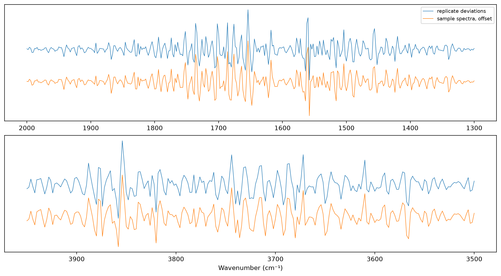
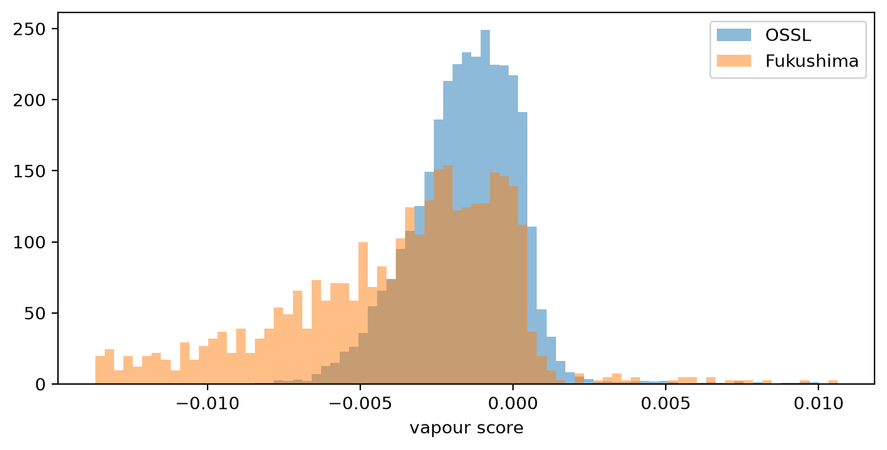

# Water vapour


<!-- WARNING: THIS FILE WAS AUTOGENERATED! DO NOT EDIT! -->

``` python
import pandas as pd
import matplotlib.pyplot as plt
from scipy.stats import spearmanr
from fastcore.test import *
from soilspecdata.all import load_ossl
from soilspecdata.readers import read_spa
from soilspecdl.all import predict
from ossl_fuku_transfer.data import *
from ossl_fuku_transfer.transfer import *
from ossl_fuku_transfer.inside import tracked_model
```

Water vapour in the beam of an FTIR spectrometer adds many narrow lines,
in the H–O–H bending region (about 1300–2000 cm⁻¹) and the O–H
stretching region (about 3500–3950 cm⁻¹). No soil component gives lines
that narrow. A spectrum is the sample scan against a background scan, so
the lines can point up, if the sample scan had more vapour, or down, if
the background had more. `01_pca` found more narrow structure in the
Fukushima spectra than in OSSL between 1300 and 2000 cm⁻¹.

The replicate scans of a sample measure the same soil. Their differences
hold the measurement differences, such as vapour and noise, and no soil
differences. They show the vapour pattern most clearly.

The module part uses small random arrays, so it runs without the data.
The sections from *Native grid* onwards read OSSL and the Fukushima
data, and are marked `#| fukudata`.

## Functions

`highpass` keeps the narrow structure of each spectrum: the spectrum
minus a Savitzky-Golay smooth with a window of `window` points. On the 2
cm⁻¹ grid, 11 points is 22 cm⁻¹, narrower than most soil bands and wider
than vapour lines. `band_mask` marks the wavenumbers in `bands`:

------------------------------------------------------------------------

### band_mask

``` python
def band_mask(
    wns, # Wavenumbers
    bands:list=[(1300, 2000), (3500, 3950)], # (low, high) ranges, in cm⁻¹
)->numpy.ndarray: # True for the wavenumbers in any of `bands`
```

*Mask of the wavenumbers within `bands`*

------------------------------------------------------------------------

### highpass

``` python
def highpass(
    X, # Spectra, one per row
    window:int=11, # Window of the Savitzky-Golay smooth, in points, odd
    polyorder:int=2, # Degree of the smoothing polynomial
)->numpy.ndarray:
```

*`X` minus its Savitzky-Golay smooth*

`replicate_deviations` subtracts from each replicate the mean of its
sample’s replicates, for samples with at least two. `vapour_pattern`
returns the first principal component of high-passed spectra within
`mask`, as a unit vector that is zero outside `mask`, with its sign set
so that its largest entry is positive. It also returns that component’s
share of the variance within `mask`. `vapour_score` projects the
high-passed spectra on a pattern:

------------------------------------------------------------------------

### vapour_score

``` python
def vapour_score(
    X, # Spectra, one per row, on the wavenumbers of `v`
    v, # Pattern from `vapour_pattern`
    window:int=11, # Passed to `highpass`
)->numpy.ndarray: # One score per spectrum
```

*Projection of the high-passed spectra on the pattern `v`*

------------------------------------------------------------------------

### vapour_pattern

``` python
def vapour_pattern(
    H, # High-passed spectra or deviations, one per row
    mask, # True for the wavenumbers to use, such as from `band_mask`
)->tuple: # (Unit pattern over all wavenumbers, share of variance within `mask`)
```

*First principal component of `H` within `mask`*

------------------------------------------------------------------------

### replicate_deviations

``` python
def replicate_deviations(
    X, # Replicate spectra, one per row
    sample_ids, # Sample ID of each row
)->tuple: # (Deviations from the sample mean, their sample IDs), for samples with two replicates or more
```

*Each replicate minus the mean of its sample’s replicates*

A test with synthetic spectra: smooth curves for the soils, plus a
random amount of a pattern of narrow lines, which differs between the
replicates of a sample. The functions recover the pattern and the
amounts:

``` python
rng = np.random.default_rng(0)
wns_syn = np.arange(650, 3999, 2.)
mask = band_mask(wns_syn)
lines = np.zeros(len(wns_syn))
lines[mask] = np.sin(wns_syn[mask] * 1.7) * (rng.random(mask.sum()) > 0.6)
soil = np.array([np.polyval(rng.normal(size=4), (wns_syn - 2300) / 1700) for _ in range(30)])
amt = rng.normal(size=(30, 4))
X_rep = np.repeat(soil, 4, axis=0) + 0.02 * amt.reshape(-1, 1) * lines + 0.001 * rng.normal(size=(120, len(wns_syn)))
ids_rep = np.repeat(np.arange(30), 4)
D, _ = replicate_deviations(X_rep, ids_rep)
v, share = vapour_pattern(highpass(D), mask)
test_eq(abs(np.corrcoef(v[mask], highpass(lines[None])[0][mask])[0, 1]) > 0.95, True)
test_eq(abs(np.corrcoef(vapour_score(X_rep, v), amt.ravel())[0, 1]) > 0.95, True)
round(share, 3)
```

    0.99

## Native grid

The Fukushima spectra are interpolated onto the shared 2 cm⁻¹ grid. The
point spacing of the `.spa` files shows whether that grid keeps their
narrow structure:

``` python
files = spa_files()
ids = sample_ids()
grids = {}
for i in ids[::50]:
    x, _, _ = read_spa(files[i][0])
    grids[i] = (len(x), round(x[0], 2), round(x[-1], 2), round(float(np.diff(x).mean()), 3))
pd.DataFrame(grids, index=['points', 'from', 'to', 'spacing']).T.drop_duplicates()
```

<div>
<style scoped>
    .dataframe tbody tr th:only-of-type {
        vertical-align: middle;
    }
&#10;    .dataframe tbody tr th {
        vertical-align: top;
    }
&#10;    .dataframe thead th {
        text-align: right;
    }
</style>

<table class="dataframe" data-quarto-postprocess="true" data-border="1">
<thead>
<tr style="text-align: right;">
<th data-quarto-table-cell-role="th"></th>
<th data-quarto-table-cell-role="th">points</th>
<th data-quarto-table-cell-role="th">from</th>
<th data-quarto-table-cell-role="th">to</th>
<th data-quarto-table-cell-role="th">spacing</th>
</tr>
</thead>
<tbody>
<tr>
<td data-quarto-table-cell-role="th">20</td>
<td>1764.0</td>
<td>599.75</td>
<td>3999.64</td>
<td>1.928</td>
</tr>
<tr>
<td data-quarto-table-cell-role="th">1246</td>
<td>1738.0</td>
<td>649.89</td>
<td>3999.64</td>
<td>1.928</td>
</tr>
</tbody>
</table>

</div>

## Vapour pattern

Every replicate of the current selection on the shared grid. The pattern
from the replicate deviations (approach 3), and the pattern from the
averaged sample spectra (approach 2), with the share of variance each
first component holds within the vapour bands:

``` python
reps = load_replicates()
fuku = load_fuku()
mask = band_mask(shared_wns)
D, d_ids = replicate_deviations(reps.spectra, reps.sample_ids)
v_rep, share_rep = vapour_pattern(highpass(D), mask)
v_avg, share_avg = vapour_pattern(highpass(fuku.spectra), mask)
{'replicates': len(reps.sample_ids), 'samples with 2 or more': len(np.unique(d_ids)), 'share, replicate deviations': round(share_rep, 3),
 'share, sample spectra': round(share_avg, 3), 'r between the two patterns': round(float(np.corrcoef(v_rep[mask], v_avg[mask])[0, 1]), 3)}
```

    {'replicates': 5546,
     'samples with 2 or more': 1388,
     'share, replicate deviations': 0.261,
     'share, sample spectra': 0.604,
     'r between the two patterns': 0.988}

Both patterns, in each vapour band:

``` python
fig, axs = plt.subplots(2, 1, figsize=(11, 6), layout='constrained')
for ax, (lo, hi) in zip(axs, vapour_bands):
    m = (shared_wns >= lo) & (shared_wns <= hi)
    ax.plot(shared_wns[m], v_rep[m], lw=0.7, label='replicate deviations')
    ax.plot(shared_wns[m], v_avg[m] - 0.15, lw=0.7, label='sample spectra, offset')
    ax.invert_xaxis(); ax.set_yticks([])
axs[0].legend(fontsize=8); axs[1].set_xlabel('Wavenumber (cm⁻¹)');
```



## Scores

Each Fukushima sample’s score is the projection of its averaged spectrum
on the replicate pattern. Positive scores mean the vapour lines point
up, so the sample scans held more vapour than the background, and
negative scores the reverse. The spread of the scores of a sample’s
replicates shows how much vapour varied between scans. OSSL spectra,
10,000 drawn at random, get the same score. The quantiles of the scores:

``` python
s_f = pd.Series(vapour_score(fuku.spectra, v_rep), index=fuku.sample_ids)
s_rep = pd.Series(vapour_score(reps.spectra, v_rep)).groupby(reps.sample_ids).std()
om = load_ossl().mir(wmin=shared_wns[0], wmax=shared_wns[-1])
sub = np.random.default_rng(0).choice(len(om.spectra), 10000, replace=False)
s_o = vapour_score(om.spectra[sub], v_rep)
qs = [0.01, 0.05, 0.25, 0.5, 0.75, 0.95, 0.99]
pd.DataFrame({'Fukushima': s_f.quantile(qs).to_numpy(), 'OSSL': np.quantile(s_o, qs), 'Fukushima, |score|': s_f.abs().quantile(qs).to_numpy(),
              'OSSL, |score|': np.quantile(np.abs(s_o), qs), 'Fukushima, spread of replicates': s_rep.quantile(qs).to_numpy()}, index=qs).round(4)
```

<div>
<style scoped>
    .dataframe tbody tr th:only-of-type {
        vertical-align: middle;
    }
&#10;    .dataframe tbody tr th {
        vertical-align: top;
    }
&#10;    .dataframe thead th {
        text-align: right;
    }
</style>

<table class="dataframe" data-quarto-postprocess="true" data-border="1">
<thead>
<tr style="text-align: right;">
<th data-quarto-table-cell-role="th"></th>
<th data-quarto-table-cell-role="th">Fukushima</th>
<th data-quarto-table-cell-role="th">OSSL</th>
<th data-quarto-table-cell-role="th">Fukushima, |score|</th>
<th data-quarto-table-cell-role="th">OSSL, |score|</th>
<th data-quarto-table-cell-role="th">Fukushima, spread of
replicates</th>
</tr>
</thead>
<tbody>
<tr>
<td data-quarto-table-cell-role="th">0.01</td>
<td>-0.0163</td>
<td>-0.0060</td>
<td>0.0000</td>
<td>0.0000</td>
<td>0.0000</td>
</tr>
<tr>
<td data-quarto-table-cell-role="th">0.05</td>
<td>-0.0131</td>
<td>-0.0046</td>
<td>0.0002</td>
<td>0.0001</td>
<td>0.0001</td>
</tr>
<tr>
<td data-quarto-table-cell-role="th">0.25</td>
<td>-0.0063</td>
<td>-0.0026</td>
<td>0.0013</td>
<td>0.0006</td>
<td>0.0001</td>
</tr>
<tr>
<td data-quarto-table-cell-role="th">0.50</td>
<td>-0.0032</td>
<td>-0.0014</td>
<td>0.0033</td>
<td>0.0015</td>
<td>0.0002</td>
</tr>
<tr>
<td data-quarto-table-cell-role="th">0.75</td>
<td>-0.0012</td>
<td>-0.0003</td>
<td>0.0064</td>
<td>0.0027</td>
<td>0.0004</td>
</tr>
<tr>
<td data-quarto-table-cell-role="th">0.95</td>
<td>0.0003</td>
<td>0.0008</td>
<td>0.0131</td>
<td>0.0048</td>
<td>0.0010</td>
</tr>
<tr>
<td data-quarto-table-cell-role="th">0.99</td>
<td>0.0042</td>
<td>0.0047</td>
<td>0.0163</td>
<td>0.0074</td>
<td>0.0023</td>
</tr>
</tbody>
</table>

</div>

``` python
fig, ax = plt.subplots(figsize=(7, 3.5), layout='constrained')
bins = np.linspace(np.quantile(np.r_[s_f, s_o], 0.005), np.quantile(np.r_[s_f, s_o], 0.995), 80)
ax.hist(s_o, bins, density=True, alpha=0.5, label='OSSL')
ax.hist(s_f, bins, density=True, alpha=0.5, label='Fukushima')
ax.set_xlabel('vapour score'); ax.legend();
```



The scores by measurement batch and by year:

``` python
meta = pd.DataFrame({'score': s_f, 'batch': sample_batches(fuku.sample_ids), 'year': fuku.source['year'].reindex(fuku.sample_ids).to_numpy()})
meta.groupby('batch')['score'].describe()[['count', 'mean', 'std', 'min', 'max']].round(4), meta.groupby('year')['score'].describe()[['count', 'mean', 'std']].round(4)
```

    (         count    mean     std     min     max
     batch                                         
     batch 1  535.0 -0.0056  0.0057 -0.0178  0.0116
     batch 2  854.0 -0.0032  0.0026 -0.0114  0.0011,
             count    mean     std
     year                         
     2013.0   86.0 -0.0037  0.0036
     2014.0  238.0 -0.0064  0.0057
     2015.0  140.0 -0.0045  0.0045
     2016.0  194.0 -0.0032  0.0031
     2017.0  184.0 -0.0049  0.0041
     2018.0  213.0 -0.0036  0.0046
     2019.0  185.0 -0.0032  0.0025
     2020.0  149.0 -0.0030  0.0022)

## Vapour and the transfer failure

Kex errors against the vapour score: the zero-shot error of the
pretrained OSSL model on all samples, and the residuals of the fully
fine-tuned and Fukushima-only models of `06_dynamics` on the test
samples. The Spearman correlation of each error, and of its absolute
value, with the score and with its absolute value:

``` python
fuku.source = fuku.source.assign(target=fuku.source['soil_ex_K2O'] / mg_k2o_per_cmolc)
Xf, yf, idf = fuku.xy('target')
yf = np.log1p(yf.ravel())
Xf_d = preprocessings()['snv_d1'].fit_transform(Xf)
is_test = np.isin(idf, cs137_split()[1])
sc = s_f.reindex(idf).to_numpy()
errs = {'zero-shot, all': (predict(load_pretrained('ossl_kex_snv_d1'), Xf_d, shared_wns) - yf, np.ones(len(yf), bool)),
        'fully fine-tuned, test': (predict(tracked_model('dyn_fuku_kex_ft'), Xf_d, shared_wns) - yf, is_test),
        'Fukushima only, test': (predict(tracked_model('dyn_fuku_kex_scratch'), Xf_d, shared_wns) - yf, is_test)}
pd.DataFrame({k: {'error vs score': spearmanr(e[m], sc[m])[0], '|error| vs |score|': spearmanr(np.abs(e[m]), np.abs(sc[m]))[0],
                  'error vs |score|': spearmanr(e[m], np.abs(sc[m]))[0]} for k, (e, m) in errs.items()}).T.round(3)
```

<div>
<style scoped>
    .dataframe tbody tr th:only-of-type {
        vertical-align: middle;
    }
&#10;    .dataframe tbody tr th {
        vertical-align: top;
    }
&#10;    .dataframe thead th {
        text-align: right;
    }
</style>

<table class="dataframe" data-quarto-postprocess="true" data-border="1">
<thead>
<tr style="text-align: right;">
<th data-quarto-table-cell-role="th"></th>
<th data-quarto-table-cell-role="th">error vs score</th>
<th data-quarto-table-cell-role="th">|error| vs |score|</th>
<th data-quarto-table-cell-role="th">error vs |score|</th>
</tr>
</thead>
<tbody>
<tr>
<td data-quarto-table-cell-role="th">zero-shot, all</td>
<td>-0.078</td>
<td>0.085</td>
<td>0.068</td>
</tr>
<tr>
<td data-quarto-table-cell-role="th">fully fine-tuned, test</td>
<td>-0.045</td>
<td>0.064</td>
<td>0.012</td>
</tr>
<tr>
<td data-quarto-table-cell-role="th">Fukushima only, test</td>
<td>-0.034</td>
<td>0.025</td>
<td>-0.007</td>
</tr>
</tbody>
</table>

</div>

Zero-shot scores of the pretrained OSSL model on the quarters of the
samples with the smallest to the largest absolute vapour score:

``` python
pz = errs['zero-shot, all'][0] + yf
qt = pd.qcut(np.abs(sc), 4, labels=['least vapour', '2nd', '3rd', 'most vapour'])
pd.DataFrame({q: {'n': int((qt == q).sum()), 'median |score|': float(np.median(np.abs(sc[qt == q]))), **scores(yf[qt == q], pz[qt == q])} for q in qt.categories}).T.round(3)
```

<div>
<style scoped>
    .dataframe tbody tr th:only-of-type {
        vertical-align: middle;
    }
&#10;    .dataframe tbody tr th {
        vertical-align: top;
    }
&#10;    .dataframe thead th {
        text-align: right;
    }
</style>

<table class="dataframe" data-quarto-postprocess="true" data-border="1">
<thead>
<tr style="text-align: right;">
<th data-quarto-table-cell-role="th"></th>
<th data-quarto-table-cell-role="th">n</th>
<th data-quarto-table-cell-role="th">median |score|</th>
<th data-quarto-table-cell-role="th">R²</th>
<th data-quarto-table-cell-role="th">r</th>
<th data-quarto-table-cell-role="th">RMSE</th>
<th data-quarto-table-cell-role="th">bias</th>
</tr>
</thead>
<tbody>
<tr>
<td data-quarto-table-cell-role="th">least vapour</td>
<td>347.0</td>
<td>0.001</td>
<td>-0.596</td>
<td>0.190</td>
<td>0.539</td>
<td>0.254</td>
</tr>
<tr>
<td data-quarto-table-cell-role="th">2nd</td>
<td>347.0</td>
<td>0.002</td>
<td>-0.947</td>
<td>0.128</td>
<td>0.607</td>
<td>0.321</td>
</tr>
<tr>
<td data-quarto-table-cell-role="th">3rd</td>
<td>347.0</td>
<td>0.005</td>
<td>-0.602</td>
<td>0.224</td>
<td>0.547</td>
<td>0.285</td>
</tr>
<tr>
<td data-quarto-table-cell-role="th">most vapour</td>
<td>347.0</td>
<td>0.009</td>
<td>-0.921</td>
<td>0.082</td>
<td>0.634</td>
<td>0.340</td>
</tr>
</tbody>
</table>

</div>

## Findings

The Fukushima spectra contain a clear water-vapour pattern. The `.spa`
files have a point spacing of 1.93 cm⁻¹, so the 2 cm⁻¹ grid keeps their
narrow structure. The pattern estimated from replicate deviations and
the one estimated from the averaged sample spectra correlate at r 0.99.
In the vapour bands, the first component holds 26% of the
narrow-structure variance of the replicate deviations, where noise holds
much of the rest, and 60% of that of the sample spectra.

The Fukushima vapour lines are about twice as strong as OSSL’s, and
mostly point down. The median absolute score is 0.0033 for Fukushima and
0.0015 for OSSL, and the 95th percentiles are 0.013 and 0.005. 95% of
the Fukushima scores are below 0.0003, so their background scans almost
always held more vapour than their sample scans. The scores of a
sample’s replicates spread much less than the scores vary between
samples (median spread 0.0002), so the vapour level was set per session
rather than per scan. Batch 1 has more vapour than batch 2 (mean score
−0.0056 against −0.0032). The year makes less difference.

Vapour doesn’t explain the transfer failure. Its Spearman correlation
with the Kex errors is at most 0.09 in absolute value: for the zero-shot
error of the OSSL model, and for the residuals of the fully fine-tuned
and Fukushima-only models. The OSSL model fails zero-shot on the quarter
of the samples with the least vapour too (correlation 0.19, R² −0.60).
On the quarter with the most vapour, the correlation is 0.08. The four
quarters show no steady trend.

The score measures the narrow vapour lines only. Water held by the soil
gives broad bands, near 3400 and 1630 cm⁻¹, which `highpass` removes.
This notebook doesn’t test that.
