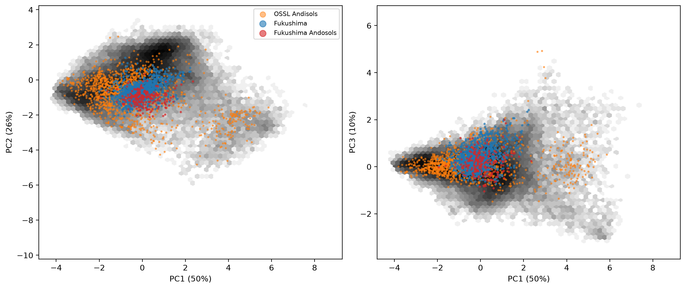
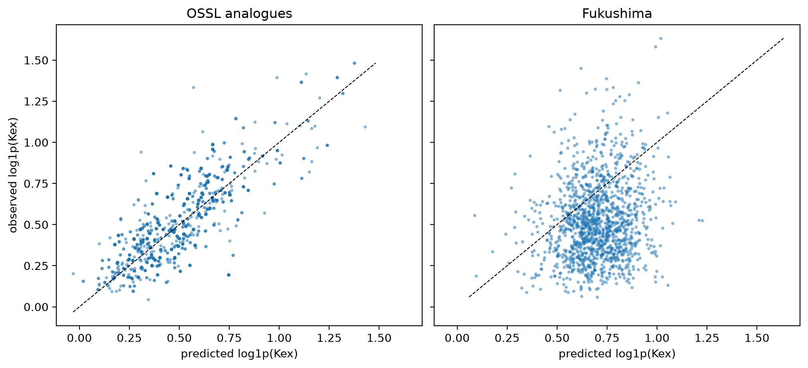

# Wet chemistry


<!-- WARNING: THIS FILE WAS AUTOGENERATED! DO NOT EDIT! -->

``` python
import numpy as np, pandas as pd
import matplotlib.pyplot as plt
from sklearn.decomposition import PCA
from sklearn.pipeline import make_pipeline
from sklearn.preprocessing import StandardScaler
from soilspecdata.all import load_ossl
from ossl_fuku_transfer.data import *
from ossl_fuku_transfer.inside import nn_ratio
from sklearn.neighbors import NearestNeighbors
from soilspecdl.all import get_splitter, predict
from ossl_fuku_transfer.transfer import preprocessings, load_pretrained, scores
```

    /Users/franckalbinet/pro/dev/soilspec/ossl-fuku-transfer/.venv/lib/python3.13/site-packages/torch/jit/_script.py:1491: FutureWarning: `torch.jit.script` is deprecated. Please switch to `torch.compile` or `torch.export`.
      warnings.warn(

`07_inside_transfer` found that Fukushima spectra sit outside OSSL in
every layer of every model. This notebook asks the same question of the
soils themselves, through the properties both datasets measured. If the
Fukushima soils fall within OSSL in property space, the transfer gap
more likely lies in the spectra, through the instrument or sample
preparation, than in the soils.

Every code cell reads OSSL or the Fukushima data, and is marked
`#| fukudata`.

## Shared properties

Seven properties are measured in both datasets: exchangeable K, Mg and
Ca, CEC, total C, total N and pH in water. `fuku_shared_props` and
`ossl_shared_props` from `00_data` give them in the same units, with
clay, and say how the units were converted.

The soil properties come from the current selection of Fukushima
samples, and from the OSSL samples with a MIR spectrum on the shared
grid, as in the other notebooks:

``` python
om = load_ossl().mir(wmin=shared_wns[0], wmax=shared_wns[-1])
ossl, fuku = ossl_shared_props(om), fuku_shared_props()
props = shared_props
pd.DataFrame({'OSSL': ossl[props].notna().all(axis=1).sum(), 'OSSL Andisols': (ossl[props].notna().all(axis=1) & ossl.andisol).sum(),
              'Fukushima': fuku[props].notna().all(axis=1).sum(), 'Fukushima Andosols': (fuku[props].notna().all(axis=1) & (fuku.soil == 'Andosols')).sum()}, index=['complete samples'])
```

<div>
<style scoped>
    .dataframe tbody tr th:only-of-type {
        vertical-align: middle;
    }
&#10;    .dataframe tbody tr th {
        vertical-align: top;
    }
&#10;    .dataframe thead th {
        text-align: right;
    }
</style>

<table class="dataframe" data-quarto-postprocess="true" data-border="1">
<thead>
<tr style="text-align: right;">
<th data-quarto-table-cell-role="th"></th>
<th data-quarto-table-cell-role="th">OSSL</th>
<th data-quarto-table-cell-role="th">OSSL Andisols</th>
<th data-quarto-table-cell-role="th">Fukushima</th>
<th data-quarto-table-cell-role="th">Fukushima Andosols</th>
</tr>
</thead>
<tbody>
<tr>
<td data-quarto-table-cell-role="th">complete samples</td>
<td>49626</td>
<td>1405</td>
<td>1385</td>
<td>213</td>
</tr>
</tbody>
</table>

</div>

The 5th, 50th and 95th percentiles of each property, with K as a share
of CEC in %. Fukushima’s are the first row of each group:

``` python
for d in (ossl, fuku): d['K/CEC %'] = 100 * d.K / d.CEC
groups = {'Fukushima': fuku, 'Fukushima Andosols': fuku[fuku.soil == 'Andosols'], 'OSSL': ossl, 'OSSL Andisols': ossl[ossl.andisol]}
q = pd.concat({g: d[props + ['clay', 'K/CEC %']].quantile([0.05, 0.5, 0.95]) for g, d in groups.items()})
q.round(2)
```

<div>
<style scoped>
    .dataframe tbody tr th:only-of-type {
        vertical-align: middle;
    }
&#10;    .dataframe tbody tr th {
        vertical-align: top;
    }
&#10;    .dataframe thead th {
        text-align: right;
    }
</style>

<table class="dataframe" data-quarto-postprocess="true" data-border="1">
<thead>
<tr style="text-align: right;">
<th data-quarto-table-cell-role="th"></th>
<th data-quarto-table-cell-role="th"></th>
<th data-quarto-table-cell-role="th">K</th>
<th data-quarto-table-cell-role="th">Mg</th>
<th data-quarto-table-cell-role="th">Ca</th>
<th data-quarto-table-cell-role="th">CEC</th>
<th data-quarto-table-cell-role="th">C</th>
<th data-quarto-table-cell-role="th">N</th>
<th data-quarto-table-cell-role="th">pH</th>
<th data-quarto-table-cell-role="th">clay</th>
<th data-quarto-table-cell-role="th">K/CEC %</th>
</tr>
</thead>
<tbody>
<tr>
<td rowspan="3" data-quarto-table-cell-role="th"
data-valign="top">Fukushima</td>
<td data-quarto-table-cell-role="th">0.05</td>
<td>0.22</td>
<td>0.38</td>
<td>2.35</td>
<td>11.20</td>
<td>1.13</td>
<td>0.10</td>
<td>5.00</td>
<td>7.22</td>
<td>1.19</td>
</tr>
<tr>
<td data-quarto-table-cell-role="th">0.50</td>
<td>0.64</td>
<td>1.63</td>
<td>6.95</td>
<td>18.10</td>
<td>2.28</td>
<td>0.20</td>
<td>5.60</td>
<td>19.40</td>
<td>3.59</td>
</tr>
<tr>
<td data-quarto-table-cell-role="th">0.95</td>
<td>1.63</td>
<td>5.36</td>
<td>15.86</td>
<td>30.78</td>
<td>5.05</td>
<td>0.40</td>
<td>6.50</td>
<td>35.80</td>
<td>8.10</td>
</tr>
<tr>
<td rowspan="3" data-quarto-table-cell-role="th"
data-valign="top">Fukushima Andosols</td>
<td data-quarto-table-cell-role="th">0.05</td>
<td>0.22</td>
<td>0.38</td>
<td>2.22</td>
<td>12.96</td>
<td>1.62</td>
<td>0.15</td>
<td>5.10</td>
<td>6.50</td>
<td>0.95</td>
</tr>
<tr>
<td data-quarto-table-cell-role="th">0.50</td>
<td>0.60</td>
<td>1.12</td>
<td>6.88</td>
<td>20.90</td>
<td>3.31</td>
<td>0.29</td>
<td>5.70</td>
<td>20.15</td>
<td>3.06</td>
</tr>
<tr>
<td data-quarto-table-cell-role="th">0.95</td>
<td>1.40</td>
<td>3.22</td>
<td>13.44</td>
<td>32.52</td>
<td>6.89</td>
<td>0.51</td>
<td>6.20</td>
<td>38.30</td>
<td>7.33</td>
</tr>
<tr>
<td rowspan="3" data-quarto-table-cell-role="th"
data-valign="top">OSSL</td>
<td data-quarto-table-cell-role="th">0.05</td>
<td>0.02</td>
<td>0.02</td>
<td>0.05</td>
<td>2.01</td>
<td>0.12</td>
<td>0.01</td>
<td>4.40</td>
<td>2.13</td>
<td>0.05</td>
</tr>
<tr>
<td data-quarto-table-cell-role="th">0.50</td>
<td>0.35</td>
<td>2.72</td>
<td>11.35</td>
<td>15.33</td>
<td>1.58</td>
<td>0.12</td>
<td>6.23</td>
<td>21.85</td>
<td>2.47</td>
</tr>
<tr>
<td data-quarto-table-cell-role="th">0.95</td>
<td>2.24</td>
<td>18.63</td>
<td>69.25</td>
<td>62.95</td>
<td>44.82</td>
<td>1.79</td>
<td>8.44</td>
<td>59.05</td>
<td>11.92</td>
</tr>
<tr>
<td rowspan="3" data-quarto-table-cell-role="th" data-valign="top">OSSL
Andisols</td>
<td data-quarto-table-cell-role="th">0.05</td>
<td>0.05</td>
<td>0.00</td>
<td>0.02</td>
<td>3.79</td>
<td>0.11</td>
<td>0.01</td>
<td>4.69</td>
<td>1.48</td>
<td>0.28</td>
</tr>
<tr>
<td data-quarto-table-cell-role="th">0.50</td>
<td>0.37</td>
<td>0.80</td>
<td>3.59</td>
<td>18.69</td>
<td>1.78</td>
<td>0.11</td>
<td>5.90</td>
<td>7.30</td>
<td>2.44</td>
</tr>
<tr>
<td data-quarto-table-cell-role="th">0.95</td>
<td>2.27</td>
<td>6.96</td>
<td>43.37</td>
<td>78.27</td>
<td>45.02</td>
<td>1.27</td>
<td>6.95</td>
<td>36.02</td>
<td>8.74</td>
</tr>
</tbody>
</table>

</div>

## PCA

The PCA is fitted on the OSSL samples with all seven properties, after
`log1p` of all but pH and standardisation on OSSL. The Fukushima samples
are projected onto it:

``` python
Fo, Ff = prop_features(ossl), prop_features(fuku)
pca = make_pipeline(StandardScaler(), PCA(random_state=0)).fit(Fo)
To, Tf = pca.transform(Fo), pca.transform(Ff)
ev = pca[-1].explained_variance_ratio_
pd.DataFrame(pca[-1].components_[:3].T, index=props, columns=[f'PC{i + 1} ({ev[i]:.0%})' for i in range(3)]).round(2)
```

<div>
<style scoped>
    .dataframe tbody tr th:only-of-type {
        vertical-align: middle;
    }
&#10;    .dataframe tbody tr th {
        vertical-align: top;
    }
&#10;    .dataframe thead th {
        text-align: right;
    }
</style>

<table class="dataframe" data-quarto-postprocess="true" data-border="1">
<thead>
<tr style="text-align: right;">
<th data-quarto-table-cell-role="th"></th>
<th data-quarto-table-cell-role="th">PC1 (50%)</th>
<th data-quarto-table-cell-role="th">PC2 (26%)</th>
<th data-quarto-table-cell-role="th">PC3 (10%)</th>
</tr>
</thead>
<tbody>
<tr>
<td data-quarto-table-cell-role="th">K</td>
<td>0.36</td>
<td>0.08</td>
<td>0.81</td>
</tr>
<tr>
<td data-quarto-table-cell-role="th">Mg</td>
<td>0.42</td>
<td>0.26</td>
<td>0.13</td>
</tr>
<tr>
<td data-quarto-table-cell-role="th">Ca</td>
<td>0.41</td>
<td>0.38</td>
<td>-0.31</td>
</tr>
<tr>
<td data-quarto-table-cell-role="th">CEC</td>
<td>0.45</td>
<td>-0.14</td>
<td>0.07</td>
</tr>
<tr>
<td data-quarto-table-cell-role="th">C</td>
<td>0.40</td>
<td>-0.38</td>
<td>-0.30</td>
</tr>
<tr>
<td data-quarto-table-cell-role="th">N</td>
<td>0.37</td>
<td>-0.46</td>
<td>-0.23</td>
</tr>
<tr>
<td data-quarto-table-cell-role="th">pH</td>
<td>0.15</td>
<td>0.64</td>
<td>-0.30</td>
</tr>
</tbody>
</table>

</div>

The OSSL samples as a density in grey, OSSL Andisols in orange, and the
Fukushima samples in blue, with Fukushima Andosols in red:

``` python
and_o = ossl.loc[Fo.index, 'andisol'].to_numpy()
and_f = (fuku.loc[Ff.index, 'soil'] == 'Andosols').to_numpy()
fig, axs = plt.subplots(1, 2, figsize=(12, 5), layout='constrained')
for ax, (i, j) in zip(axs, [(0, 1), (0, 2)]):
    ax.hexbin(To[:, i], To[:, j], gridsize=60, bins='log', cmap='Greys', mincnt=1)
    ax.scatter(To[and_o, i], To[and_o, j], s=3, c='tab:orange', alpha=0.5, label='OSSL Andisols')
    ax.scatter(Tf[~and_f, i], Tf[~and_f, j], s=4, c='tab:blue', alpha=0.6, label='Fukushima')
    ax.scatter(Tf[and_f, i], Tf[and_f, j], s=4, c='tab:red', alpha=0.6, label='Fukushima Andosols')
    ax.set_xlabel(f'PC{i + 1} ({ev[i]:.0%})'); ax.set_ylabel(f'PC{j + 1} ({ev[j]:.0%})')
axs[0].legend(markerscale=4, fontsize=8);
```



## Coverage

Two measures of how well OSSL covers the Fukushima soils in property
space:

- the share of samples beyond OSSL’s 99th percentile of Hotelling’s T²
  over all seven components, which with seven properties is the squared
  Mahalanobis distance from the OSSL mean;
- `nn_ratio` from `07_inside_transfer`: the median distance to the
  nearest of 5,000 OSSL reference samples, relative to OSSL’s own
  nearest-neighbour distance. As in `07`, OSSL samples outside the
  reference set, as many as there are Fukushima samples, are the
  control. The spectra gave a ratio of 2.5 at the input.

Both on all samples, and on OSSL Andisols and Fukushima Andosols alone:

``` python
t2 = lambda T: (T**2 / pca[-1].explained_variance_).sum(1)
lim = np.quantile(t2(To), 0.99)
r = np.random.default_rng(0)
perm = r.permutation(len(Fo))
ref, held = perm[:5000], perm[5000:5000 + len(Ff)]
Zo, Zf = pca[0].transform(Fo), pca[0].transform(Ff)
cov = {'OSSL held out': {'n': len(held), 'beyond T² 99%': (t2(To[held]) > lim).mean(), 'nn_ratio': nn_ratio(Zo[ref], Zo[held], n_pca=7)},
       'Fukushima': {'n': len(Ff), 'beyond T² 99%': (t2(Tf) > lim).mean(), 'nn_ratio': nn_ratio(Zo[ref], Zf, n_pca=7)},
       'Fukushima Andosols': {'n': int(and_f.sum()), 'beyond T² 99%': (t2(Tf[and_f]) > lim).mean(), 'nn_ratio': nn_ratio(Zo[ref], Zf[and_f], n_pca=7)},
       'OSSL Andisols': {'n': int(and_o.sum()), 'beyond T² 99%': (t2(To[and_o]) > lim).mean(), 'nn_ratio': nn_ratio(Zo[ref], Zo[and_o], n_pca=7)}}
pd.DataFrame(cov).T.round(3)
```

<div>
<style scoped>
    .dataframe tbody tr th:only-of-type {
        vertical-align: middle;
    }
&#10;    .dataframe tbody tr th {
        vertical-align: top;
    }
&#10;    .dataframe thead th {
        text-align: right;
    }
</style>

<table class="dataframe" data-quarto-postprocess="true" data-border="1">
<thead>
<tr style="text-align: right;">
<th data-quarto-table-cell-role="th"></th>
<th data-quarto-table-cell-role="th">n</th>
<th data-quarto-table-cell-role="th">beyond T² 99%</th>
<th data-quarto-table-cell-role="th">nn_ratio</th>
</tr>
</thead>
<tbody>
<tr>
<td data-quarto-table-cell-role="th">OSSL held out</td>
<td>1385.0</td>
<td>0.014</td>
<td>0.987</td>
</tr>
<tr>
<td data-quarto-table-cell-role="th">Fukushima</td>
<td>1385.0</td>
<td>0.000</td>
<td>1.127</td>
</tr>
<tr>
<td data-quarto-table-cell-role="th">Fukushima Andosols</td>
<td>213.0</td>
<td>0.000</td>
<td>1.331</td>
</tr>
<tr>
<td data-quarto-table-cell-role="th">OSSL Andisols</td>
<td>1405.0</td>
<td>0.004</td>
<td>1.093</td>
</tr>
</tbody>
</table>

</div>

The same PCA and coverage with clay added as an eighth property, on the
samples that have it. Clay is below 2 µm in both datasets. Fukushima’s
silt and sand follow other size limits than OSSL’s, so they are left
out:

``` python
cols8 = props + ['clay']
Fo8, Ff8 = prop_features(ossl, cols8), prop_features(fuku, cols8)
pca8 = make_pipeline(StandardScaler(), PCA(random_state=0)).fit(Fo8)
To8, Tf8 = pca8.transform(Fo8), pca8.transform(Ff8)
t2_8 = lambda T: (T**2 / pca8[-1].explained_variance_).sum(1)
lim8 = np.quantile(t2_8(To8), 0.99)
perm8 = r.permutation(len(Fo8))
ref8, held8 = perm8[:5000], perm8[5000:5000 + len(Ff8)]
Zo8, Zf8 = pca8[0].transform(Fo8), pca8[0].transform(Ff8)
pd.DataFrame({'OSSL held out': {'n': len(held8), 'beyond T² 99%': (t2_8(To8[held8]) > lim8).mean(), 'nn_ratio': nn_ratio(Zo8[ref8], Zo8[held8], n_pca=8)},
              'Fukushima': {'n': len(Ff8), 'beyond T² 99%': (t2_8(Tf8) > lim8).mean(), 'nn_ratio': nn_ratio(Zo8[ref8], Zf8, n_pca=8)}}).T.round(3)
```

<div>
<style scoped>
    .dataframe tbody tr th:only-of-type {
        vertical-align: middle;
    }
&#10;    .dataframe tbody tr th {
        vertical-align: top;
    }
&#10;    .dataframe thead th {
        text-align: right;
    }
</style>

<table class="dataframe" data-quarto-postprocess="true" data-border="1">
<thead>
<tr style="text-align: right;">
<th data-quarto-table-cell-role="th"></th>
<th data-quarto-table-cell-role="th">n</th>
<th data-quarto-table-cell-role="th">beyond T² 99%</th>
<th data-quarto-table-cell-role="th">nn_ratio</th>
</tr>
</thead>
<tbody>
<tr>
<td data-quarto-table-cell-role="th">OSSL held out</td>
<td>972.0</td>
<td>0.013</td>
<td>0.971</td>
</tr>
<tr>
<td data-quarto-table-cell-role="th">Fukushima</td>
<td>972.0</td>
<td>0.000</td>
<td>1.115</td>
</tr>
</tbody>
</table>

</div>

## Soil analogues

This section separates the soils from the spectra. Each Fukushima soil
is matched to its nearest OSSL sample in the standardised space of the
seven properties, its analogue. The analogues come only from the
validation samples of each pretrained model, which the model never
trained on. Kex is one of the matching properties, so the analogues span
about the same Kex range as the Fukushima soils.

The pretrained OSSL model then predicts each target, without
fine-tuning, from two sets of spectra: the analogues’ OSSL spectra and
the Fukushima spectra. Good predictions on the analogues and poor ones
on Fukushima would place the problem in the Fukushima spectra. Poor
predictions on both would place it in these soil conditions.

The match quality first: the distance from each Fukushima soil to its
analogue, relative to the median nearest-neighbour distance among the
OSSL validation samples, the number of distinct analogues, and the
correlation between each Fukushima soil’s property and its analogue’s:

``` python
pipe = preprocessings()['snv_d1']
fk = load_fuku()
fpos = pd.Series(np.arange(len(fk.sample_ids)), index=fk.sample_ids)
Zo_df = pd.DataFrame(pca[0].transform(Fo), index=Fo.index)
Zf_df = pd.DataFrame(pca[0].transform(Ff), index=Ff.index)
Xf_d = pipe.fit_transform(fk.spectra[fpos[Zf_df.index].to_numpy()])
targets = {'Kex': ('k.ext_usda.a725_cmolc.kg', 'K', 'ossl_kex_snv_d1'), 'CEC': ('cec_usda.a723_cmolc.kg', 'CEC', 'ossl_cec_snv_d1')}
match, preds = {}, {}
for t, (col, prop, fname) in targets.items():
    Xo_t, yo_t, ido_t = om.xy(col)
    yo_t = yo_t.ravel()
    va = get_splitter(0.9, 0.1, seed=42)(Xo_t, yo_t)[1]
    vid = np.intersect1d(ido_t[va], Zo_df.index)
    nn = NearestNeighbors(n_neighbors=2).fit(Zo_df.loc[vid])
    d, j = nn.kneighbors(Zf_df, 1)
    an = vid[j[:, 0]]
    base = np.median(nn.kneighbors(Zo_df.loc[vid])[0][:, 1])
    pos = pd.Series(np.arange(len(ido_t)), index=ido_t)
    model = load_pretrained(fname)
    yv = np.log1p(yo_t[pos[vid].to_numpy()])
    yf_t = np.log1p(fuku.loc[Zf_df.index, prop].to_numpy())
    lo, hi = yf_t.min(), yf_t.max()
    pv = predict(model, pipe.transform(Xo_t[pos[vid].to_numpy()]), shared_wns)
    preds[t] = {'OSSL validation': (yv, pv), "OSSL validation in Fukushima's range": (yv[(yv >= lo) & (yv <= hi)], pv[(yv >= lo) & (yv <= hi)]),
                'OSSL analogues': (np.log1p(yo_t[pos[an].to_numpy()]), predict(model, pipe.transform(Xo_t[pos[an].to_numpy()]), shared_wns)),
                'Fukushima': (yf_t, predict(model, Xf_d, shared_wns))}
    match[t] = {'validation samples': len(vid), 'distinct analogues': len(np.unique(an)), 'median distance ratio': np.median(d[:, 0]) / base,
                'r, Fukushima and analogue property': np.corrcoef(yf_t, np.log1p(yo_t[pos[an].to_numpy()]))[0, 1]}
pd.DataFrame(match).round(3)
```

<div>
<style scoped>
    .dataframe tbody tr th:only-of-type {
        vertical-align: middle;
    }
&#10;    .dataframe tbody tr th {
        vertical-align: top;
    }
&#10;    .dataframe thead th {
        text-align: right;
    }
</style>

<table class="dataframe" data-quarto-postprocess="true" data-border="1">
<thead>
<tr style="text-align: right;">
<th data-quarto-table-cell-role="th"></th>
<th data-quarto-table-cell-role="th">Kex</th>
<th data-quarto-table-cell-role="th">CEC</th>
</tr>
</thead>
<tbody>
<tr>
<td data-quarto-table-cell-role="th">validation samples</td>
<td>4963.000</td>
<td>4965.000</td>
</tr>
<tr>
<td data-quarto-table-cell-role="th">distinct analogues</td>
<td>424.000</td>
<td>453.000</td>
</tr>
<tr>
<td data-quarto-table-cell-role="th">median distance ratio</td>
<td>1.100</td>
<td>1.108</td>
</tr>
<tr>
<td data-quarto-table-cell-role="th">r, Fukushima and analogue
property</td>
<td>0.962</td>
<td>0.869</td>
</tr>
</tbody>
</table>

</div>

The scores of each pretrained model, without fine-tuning, on each set of
spectra: R² and correlation `r` of `log1p` of the property, and the RMSE
and bias of the property in cmolc/kg:

``` python
pd.DataFrame({(t, k): {'n': len(y), **scores(y, p)} for t, d in preds.items() for k, (y, p) in d.items()}).T.round(3)
```

<div>
<style scoped>
    .dataframe tbody tr th:only-of-type {
        vertical-align: middle;
    }
&#10;    .dataframe tbody tr th {
        vertical-align: top;
    }
&#10;    .dataframe thead th {
        text-align: right;
    }
</style>

<table class="dataframe" data-quarto-postprocess="true" data-border="1">
<thead>
<tr style="text-align: right;">
<th data-quarto-table-cell-role="th"></th>
<th data-quarto-table-cell-role="th"></th>
<th data-quarto-table-cell-role="th">n</th>
<th data-quarto-table-cell-role="th">R²</th>
<th data-quarto-table-cell-role="th">r</th>
<th data-quarto-table-cell-role="th">RMSE</th>
<th data-quarto-table-cell-role="th">bias</th>
</tr>
</thead>
<tbody>
<tr>
<td rowspan="4" data-quarto-table-cell-role="th"
data-valign="top">Kex</td>
<td data-quarto-table-cell-role="th">OSSL validation</td>
<td>4963.0</td>
<td>0.807</td>
<td>0.899</td>
<td>0.523</td>
<td>-0.020</td>
</tr>
<tr>
<td data-quarto-table-cell-role="th">OSSL validation in Fukushima's
range</td>
<td>4457.0</td>
<td>0.753</td>
<td>0.871</td>
<td>0.359</td>
<td>-0.009</td>
</tr>
<tr>
<td data-quarto-table-cell-role="th">OSSL analogues</td>
<td>1385.0</td>
<td>0.596</td>
<td>0.786</td>
<td>0.276</td>
<td>-0.046</td>
</tr>
<tr>
<td data-quarto-table-cell-role="th">Fukushima</td>
<td>1385.0</td>
<td>-0.764</td>
<td>0.152</td>
<td>0.584</td>
<td>0.300</td>
</tr>
<tr>
<td rowspan="4" data-quarto-table-cell-role="th"
data-valign="top">CEC</td>
<td data-quarto-table-cell-role="th">OSSL validation</td>
<td>4965.0</td>
<td>0.968</td>
<td>0.984</td>
<td>5.691</td>
<td>-0.620</td>
</tr>
<tr>
<td data-quarto-table-cell-role="th">OSSL validation in Fukushima's
range</td>
<td>3577.0</td>
<td>0.894</td>
<td>0.949</td>
<td>3.294</td>
<td>-0.371</td>
</tr>
<tr>
<td data-quarto-table-cell-role="th">OSSL analogues</td>
<td>1385.0</td>
<td>0.881</td>
<td>0.942</td>
<td>1.783</td>
<td>-0.141</td>
</tr>
<tr>
<td data-quarto-table-cell-role="th">Fukushima</td>
<td>1385.0</td>
<td>-0.671</td>
<td>0.625</td>
<td>6.625</td>
<td>-3.213</td>
</tr>
</tbody>
</table>

</div>

Observed against predicted Kex on the analogues and on Fukushima:

``` python
fig, axs = plt.subplots(1, 2, figsize=(10, 4.5), sharex=True, sharey=True, layout='constrained')
for ax, k in zip(axs, ('OSSL analogues', 'Fukushima')):
    y, p = preds['Kex'][k]
    ax.scatter(p, y, s=4, alpha=0.4)
    lims = [min(y.min(), p.min()), max(y.max(), p.max())]
    ax.plot(lims, lims, 'k--', lw=0.8)
    ax.set_title(k); ax.set_xlabel('predicted log1p(Kex)')
axs[0].set_ylabel('observed log1p(Kex)');
```



## Findings

In property space, OSSL covers the Fukushima soils. No Fukushima sample
is beyond OSSL’s 99th percentile of Hotelling’s T², against 1.4% of
held-out OSSL samples. The median distance from a Fukushima sample to
its nearest OSSL sample is 1.13 times OSSL’s own nearest-neighbour
distance, against 0.99 for held-out OSSL samples. With clay as an eighth
property, on 972 Fukushima samples, the ratio is the same, 1.13. On the
spectra, the same ratio was 2.5 (`07_inside_transfer`). Each ratio
compares with its own control, since the two spaces have different
numbers of dimensions. Relative to those controls, the Fukushima soils
are close to OSSL soils in their properties and far from them in their
spectra.

The Fukushima Andosols sit a little further out (ratio 1.33), but within
the T² limit, as do the OSSL Andisols (1.09). They differ from the OSSL
Andisols in these properties: at the median, more exchangeable Ca (6.9
against 3.6 cmolc/kg), C (3.3 against 1.8%) and clay (20 against 7%).

The Fukushima soils span a narrower range than OSSL for every property.
Their pH runs from 5.0 to 6.5 between the 5th and 95th percentiles,
against 4.4 to 8.4 in OSSL.

Exchangeable K is higher in Fukushima than in OSSL, both on its own and
as a share of CEC. At the median, Kex is 0.64 against 0.35 cmolc/kg, and
K is 3.6% of CEC against 2.5%. For the Andosols and Andisols, K is 3.1%
of CEC against 2.4%. This is consistent with potassium fertilisation
after 2011, but these data don’t show the cause.

The OSSL Kex model predicts the Fukushima soils’ OSSL analogues well and
the Fukushima spectra poorly. On the analogues it gives R² 0.60 (r
0.79). On the Fukushima spectra of the soils they match, it gives R²
−0.76 (r 0.15). The analogues are close matches: each lies at 1.10 times
the median nearest-neighbour distance among OSSL validation samples, and
their Kex correlates with the Fukushima soils’ Kex at r 0.96. The CEC
model shows the same pattern: R² 0.88 (r 0.94) on the analogues, against
−0.67 (r 0.63) on Fukushima.

The 1,385 matches use 424 distinct Kex analogues and 453 distinct CEC
analogues, since one OSSL sample can be the nearest to several Fukushima
soils. The analogue scores count each OSSL sample as often as it is
matched.

OSSL holds soils with properties like the Fukushima soils. From their
OSSL spectra, the model predicts Kex less well than for OSSL validation
samples overall (R² 0.81) or within Fukushima’s Kex range, from its
minimum to its maximum (0.75), but far better than from the Fukushima
spectra. These seven properties don’t describe mineralogy, such as the
micas and short-range-order minerals that matter for K and Cs. Within
what they measure, the zero-shot failure comes from the Fukushima
spectra, through the instrument or sample preparation, and not from the
soils.
